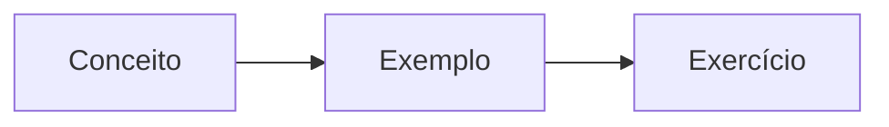

<!-- nav:topo -->
[Início](../../README.md) › [00 - Planejamento e Organização](../README.md) › [Modelos](README.md) · [Mapa](../../MAPA.md)
<!-- /nav:topo -->

# Modelo de nota

Copie o bloco abaixo para um arquivo `.md` novo e troque o que está entre `< >`. Apague as seções que não usar. O modelo mostra cada tipo de recurso que a base suporta; veja o [guia](../guia-da-base-de-conhecimento.md) para os detalhes.

````markdown
# <Título da nota>

> **Assunto:** <tema> · **Aulas:** [Aula NN](<caminho relativo até>/01%20-%20Aulas/Aula%20NN%20-%20Tema/README.md) · **Data:** <aaaa-mm-dd>

## Ideia principal

<Uma ou duas frases com o ponto da nota.>

## Explicação

<Texto. Cite o slide com a página, por exemplo "Aula08 p.13": o link para a página é criado automaticamente.>

> [!TIP]
> <Dica, macete ou ligação com outra matéria.>

## Imagem ou foto


<!-- tamanho controlado: -->
.jpg" width="600" alt="<descrição>">

## Exemplo de código

```java
public class Exemplo {
    public static void main(String[] args) {
        System.out.println("Olá");
    }
}
```

## Diagrama



## Documento anexado

[<Nome do PDF>](<arquivo>.pdf) — a galeria com as páginas em imagem é gerada ao lado do PDF.

## Referências

- [<Título>](https://<endereço>) — <por que vale ler>
- Ver também: [<outra nota>](<caminho/relativo>.md)
````


<!-- nav:rodape -->

---

**Links para esta página (3):** [Guia da base de conhecimento](../guia-da-base-de-conhecimento.md) · [10 - Caderno de Anotações](../../10%20-%20Caderno%20de%20Anotações/README.md) · [Paradigmas de Linguagens de Programação — UNICSUL](../../README.md)

<!-- /nav:rodape -->
