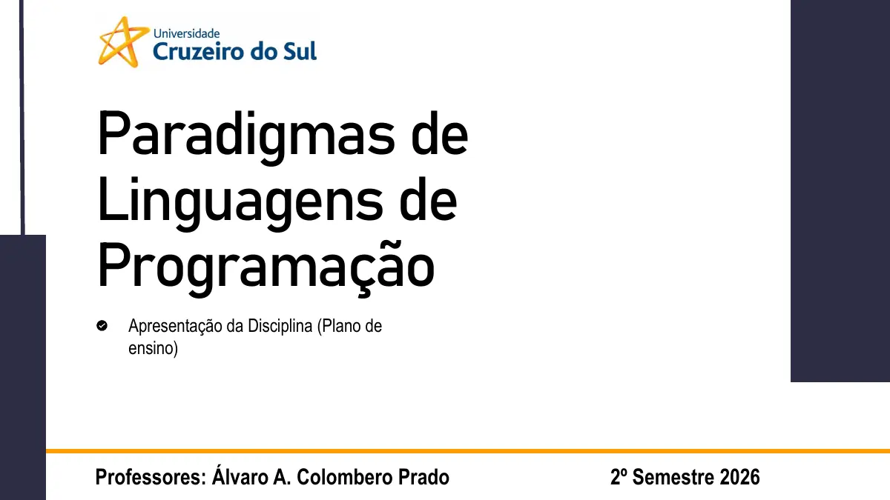
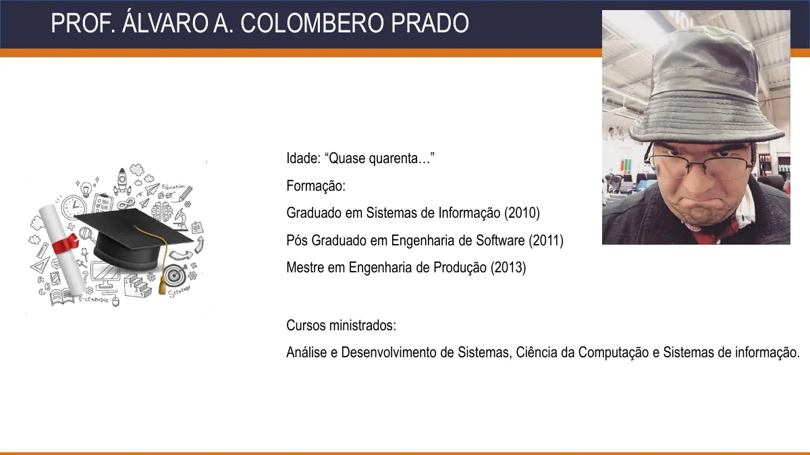
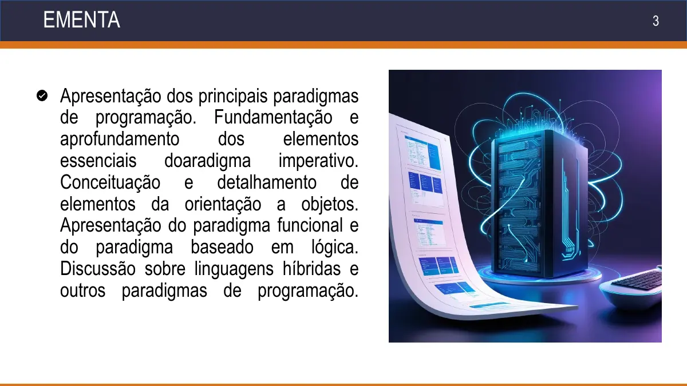
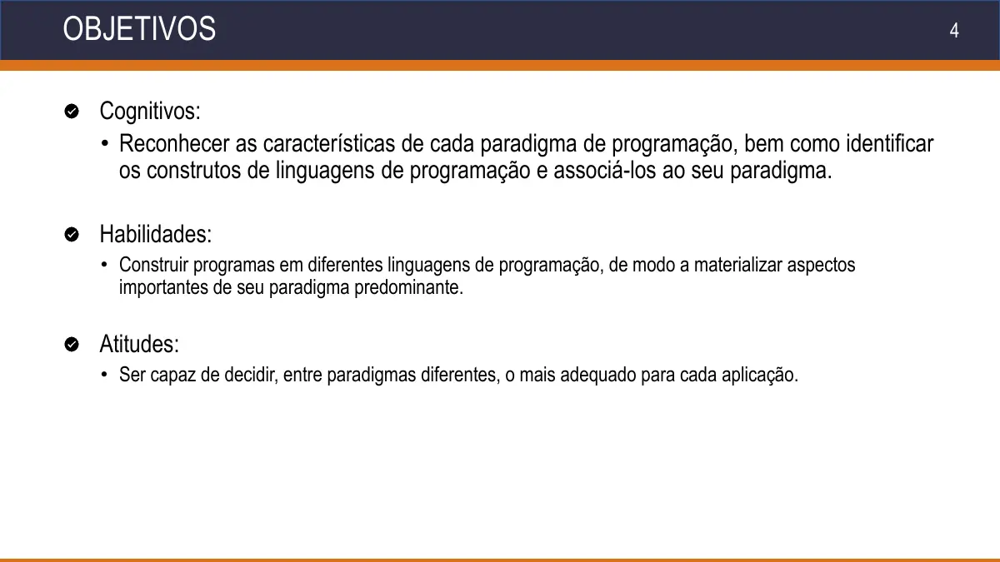
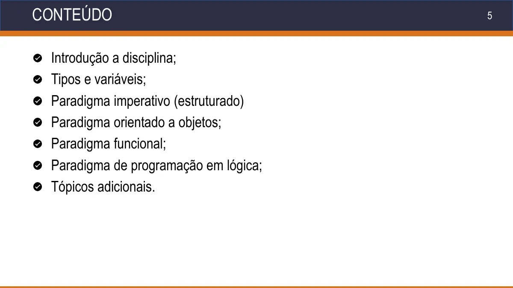
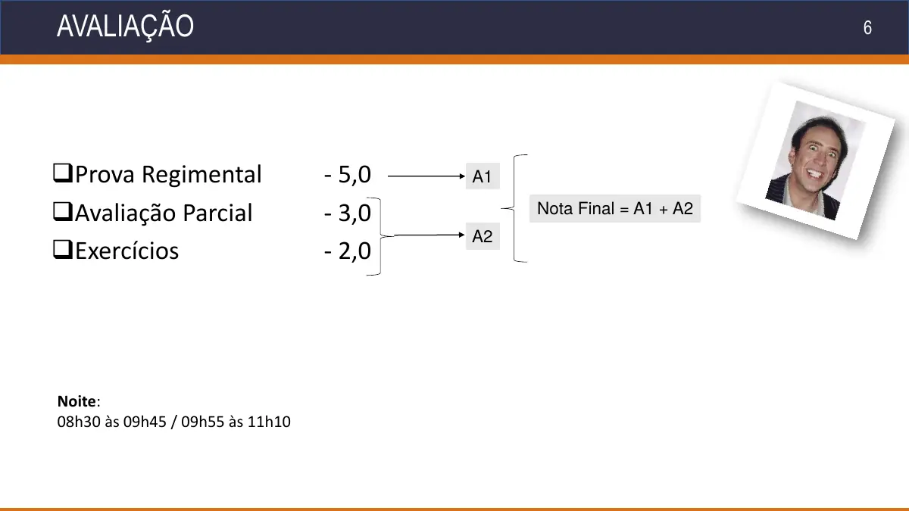
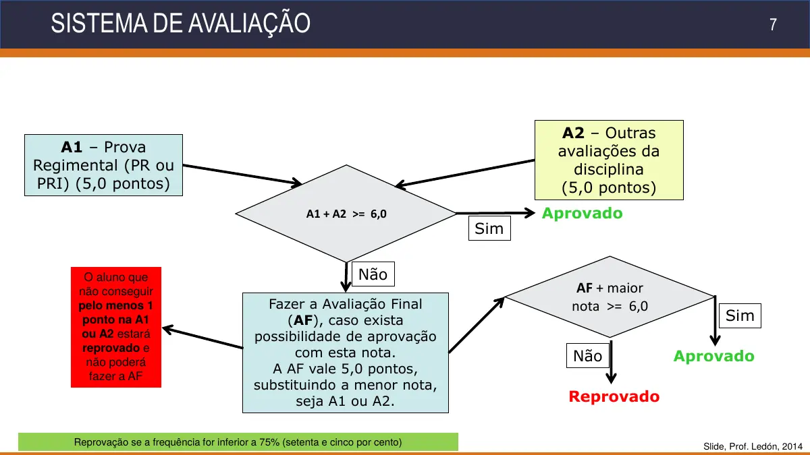
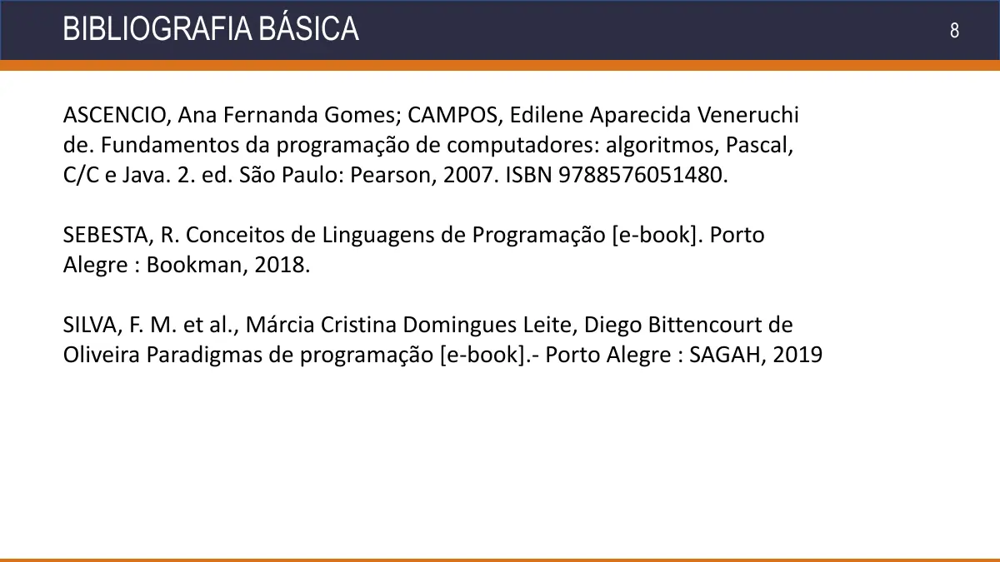
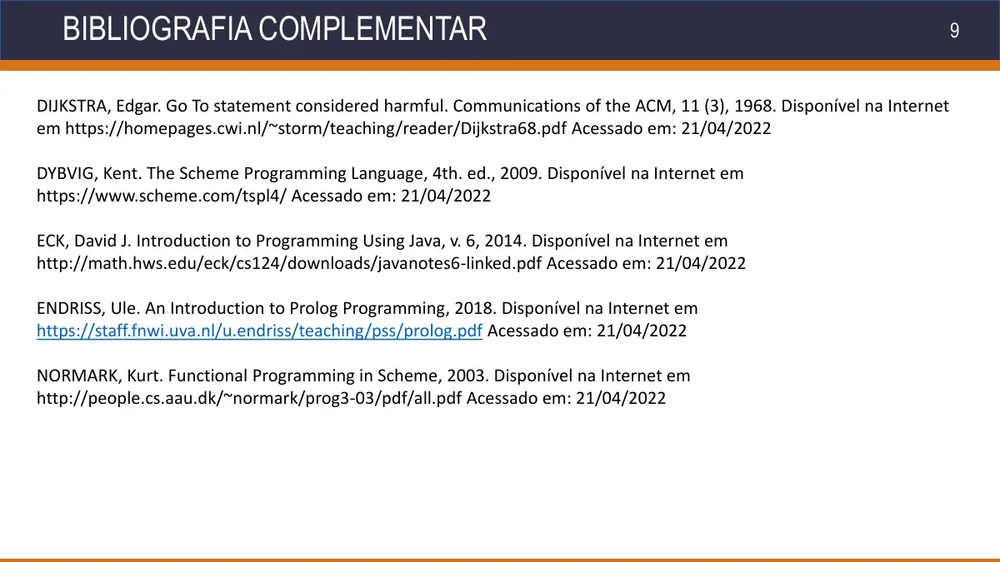

<!-- nav:topo -->
[Início](../../../README.md) › [01 - Aulas](../../README.md) › [Aula 01](../README.md) › **01 - Slides Originais** · [Mapa](../../../MAPA.md)
<!-- /nav:topo -->

<!-- gerado por ferramentas/geradores/gerar_galerias.py: não edite à mão -->

# Aula 01 - Apresentação da Disciplina · Slides originais

> **[Material original]** Slides originais do professor, página por página, para ler aqui mesmo no GitHub. O arquivo original é o PDF [`Aula01_Intro.pdf`](Aula01_Intro.pdf) (9 páginas): use-o para baixar ou imprimir. As imagens e o texto de cada página foram extraídos do PDF, sem alteração do conteúdo.

**Ir para a página:** [1](#página-1) · [2](#página-2) · [3](#página-3) · [4](#página-4) · [5](#página-5) · [6](#página-6) · [7](#página-7) · [8](#página-8) · [9](#página-9)

O texto de cada página fica em **Texto da página**, logo abaixo da imagem: é por ele que a busca encontra o conteúdo dos slides.

---

### Página 1



<details>
<summary>Texto da página</summary>

```text
Paradigmas de
Linguagens de
Programação
   Apresentação da Disciplina (Plano de
   ensino)

Professores: Álvaro A. Colombero Prado    2º Semestre 2026
```

</details>

<sub>[↑ voltar ao índice](#aula-01---apresentação-da-disciplina--slides-originais)</sub>

---

### Página 2



<details>
<summary>Texto da página</summary>

```text
PROF. ÁLVARO A. COLOMBERO PRADO                                                                  2

                 Idade: “Quase quarenta…”
                 Formação:
                 Graduado em Sistemas de Informação (2010)
                 Pós Graduado em Engenharia de Software (2011)
                 Mestre em Engenharia de Produção (2013)

                 Cursos ministrados:
                 Análise e Desenvolvimento de Sistemas, Ciência da Computação e Sistemas de informação.
```

</details>

<sub>[↑ voltar ao índice](#aula-01---apresentação-da-disciplina--slides-originais)</sub>

---

### Página 3



<details>
<summary>Texto da página</summary>

```text
EMENTA                                    3

 Apresentação dos principais paradigmas
 de programação. Fundamentação e
 aprofundamento      dos      elementos
 essenciais doaradigma imperativo.
 Conceituação e detalhamento de
 elementos da orientação a objetos.
 Apresentação do paradigma funcional e
 do paradigma baseado em lógica.
 Discussão sobre linguagens híbridas e
 outros paradigmas de programação.
```

</details>

<sub>[↑ voltar ao índice](#aula-01---apresentação-da-disciplina--slides-originais)</sub>

---

### Página 4



<details>
<summary>Texto da página</summary>

```text
OBJETIVOS                                                                                          4

  Cognitivos:
  • Reconhecer as características de cada paradigma de programação, bem como identificar
    os construtos de linguagens de programação e associá-los ao seu paradigma.

  Habilidades:
  • Construir programas em diferentes linguagens de programação, de modo a materializar aspectos
    importantes de seu paradigma predominante.

  Atitudes:
  • Ser capaz de decidir, entre paradigmas diferentes, o mais adequado para cada aplicação.
```

</details>

<sub>[↑ voltar ao índice](#aula-01---apresentação-da-disciplina--slides-originais)</sub>

---

### Página 5



<details>
<summary>Texto da página</summary>

```text
CONTEÚDO                               5

 Introdução a disciplina;
 Tipos e variáveis;
 Paradigma imperativo (estruturado)
 Paradigma orientado a objetos;
 Paradigma funcional;
 Paradigma de programação em lógica;
 Tópicos adicionais.
```

</details>

<sub>[↑ voltar ao índice](#aula-01---apresentação-da-disciplina--slides-originais)</sub>

---

### Página 6



<details>
<summary>Texto da página</summary>

```text
AVALIAÇÃO                                                             6

Prova Regimental                 - 5,0   A1

Avaliação Parcial                - 3,0        Nota Final = A1 + A2
                                          A2
Exercícios                       - 2,0

Noite:
08h30 às 09h45 / 09h55 às 11h10
```

</details>

<sub>[↑ voltar ao índice](#aula-01---apresentação-da-disciplina--slides-originais)</sub>

---

### Página 7



<details>
<summary>Texto da página</summary>

```text
  SISTEMA DE AVALIAÇÃO                                                                                                  7

                                                                                       A2 – Outras
   A1 – Prova                                                                          avaliações da
Regimental (PR ou                                                                        disciplina
PRI) (5,0 pontos)                                                                      (5,0 pontos)
                                                       A1 + A2 >= 6,0                 Aprovado
                                                                                Sim

      O aluno que                                                  Não
     não conseguir                                                                       AF + maior
     pelo menos 1                            Fazer a Avaliação Final                    nota >= 6,0
      ponto na A1                               (AF), caso exista                                             Sim
     ou A2 estará                          possibilidade de aprovação
      reprovado e                                com esta nota.
       não poderá                                                                        Não           Aprovado
                                              A AF vale 5,0 pontos,
       fazer a AF
                                           substituindo a menor nota,
                                                 seja A1 ou A2.                         Reprovado

    Reprovação se a frequência for inferior a 75% (setenta e cinco por cento)                            Slide, Prof. Ledón, 2014
```

</details>

<sub>[↑ voltar ao índice](#aula-01---apresentação-da-disciplina--slides-originais)</sub>

---

### Página 8



<details>
<summary>Texto da página</summary>

```text
BIBLIOGRAFIA BÁSICA                                                          8

ASCENCIO, Ana Fernanda Gomes; CAMPOS, Edilene Aparecida Veneruchi
de. Fundamentos da programação de computadores: algoritmos, Pascal,
C/C e Java. 2. ed. São Paulo: Pearson, 2007. ISBN 9788576051480.

SEBESTA, R. Conceitos de Linguagens de Programação [e-book]. Porto
Alegre : Bookman, 2018.

SILVA, F. M. et al., Márcia Cristina Domingues Leite, Diego Bittencourt de
Oliveira Paradigmas de programação [e-book].- Porto Alegre : SAGAH, 2019
```

</details>

<sub>[↑ voltar ao índice](#aula-01---apresentação-da-disciplina--slides-originais)</sub>

---

### Página 9



<details>
<summary>Texto da página</summary>

```text
   BIBLIOGRAFIA COMPLEMENTAR                                                                                           9

DIJKSTRA, Edgar. Go To statement considered harmful. Communications of the ACM, 11 (3), 1968. Disponível na Internet
em https://homepages.cwi.nl/~storm/teaching/reader/Dijkstra68.pdf Acessado em: 21/04/2022

DYBVIG, Kent. The Scheme Programming Language, 4th. ed., 2009. Disponível na Internet em
https://www.scheme.com/tspl4/ Acessado em: 21/04/2022

ECK, David J. Introduction to Programming Using Java, v. 6, 2014. Disponível na Internet em
http://math.hws.edu/eck/cs124/downloads/javanotes6-linked.pdf Acessado em: 21/04/2022

ENDRISS, Ule. An Introduction to Prolog Programming, 2018. Disponível na Internet em
https://staff.fnwi.uva.nl/u.endriss/teaching/pss/prolog.pdf Acessado em: 21/04/2022

NORMARK, Kurt. Functional Programming in Scheme, 2003. Disponível na Internet em
http://people.cs.aau.dk/~normark/prog3-03/pdf/all.pdf Acessado em: 21/04/2022
```

</details>

<sub>[↑ voltar ao índice](#aula-01---apresentação-da-disciplina--slides-originais)</sub>


<!-- nav:rodape -->

---

**Aula 01:** [Visão geral](../README.md) · **Slides** · [Resumo](../02%20-%20Resumo%20Teórico/resumo-aula-01.md) · [Exercícios](../03%20-%20Exercícios/exercicios-aula-01.md) · [Resoluções](../04%20-%20Resoluções/resolucoes-aula-01.md) · [Complementos](../05%20-%20Materiais%20Complementares/materiais-complementares.md)

[Aula 02 · Slides](../../Aula%2002%20-%20Evolução%20das%20Linguagens%20e%20Paradigmas/01%20-%20Slides%20Originais/README.md) →

**Links para esta página (13):** [Aula 01 · Resumo](../02%20-%20Resumo%20Teórico/resumo-aula-01.md) · [Aula 01 · Resoluções](../04%20-%20Resoluções/resolucoes-aula-01.md) · [Aula 01 · Complementos](../05%20-%20Materiais%20Complementares/materiais-complementares.md) · [Aula 09 · Artigo de Dijkstra (resumo)](../../Aula%2009%20-%20Paradigma%20Imperativo%20I/02%20-%20Resumo%20Teórico/resumo-artigo-dijkstra-1968.md) · [Aula 09 · Complementos](../../Aula%2009%20-%20Paradigma%20Imperativo%20I/05%20-%20Materiais%20Complementares/materiais-complementares.md) · [Aula 12 · Complementos](../../Aula%2012%20-%20Paradigma%20Orientado%20a%20Objetos%20I/05%20-%20Materiais%20Complementares/materiais-complementares.md) · [Aula 14 · Complementos](../../Aula%2014%20-%20Paradigma%20Funcional/05%20-%20Materiais%20Complementares/materiais-complementares.md) · [Aula 15 · Complementos](../../Aula%2015%20-%20Paradigma%20Lógico/05%20-%20Materiais%20Complementares/materiais-complementares.md) · [Erratas e inconsistências do material](../../../06%20-%20Revisões%20e%20Sínteses/erratas-e-inconsistencias.md) · [Questões integradoras · Resolução comentada](../../../06%20-%20Revisões%20e%20Sínteses/resolucao-questoes-integradoras.md) · [Artigos clássicos](../../../08%20-%20Referências%20e%20Fontes/artigos.md) · [Livros e notas de aula](../../../08%20-%20Referências%20e%20Fontes/livros.md) · [Paradigmas de Linguagens de Programação — UNICSUL](../../../README.md)

<!-- /nav:rodape -->
