<!-- nav:topo -->
[Início](../../../README.md) › [01 - Aulas](../../README.md) › [Aula 02](../README.md) › **01 - Slides Originais** · [Mapa](../../../MAPA.md)
<!-- /nav:topo -->

<!-- gerado por ferramentas/geradores/gerar_galerias.py: não edite à mão -->

# Aula 02 - Evolução das Linguagens e Paradigmas · Slides originais

> **[Material original]** Slides originais do professor, página por página, para ler aqui mesmo no GitHub. O arquivo original é o PDF [`Aula02_Evolução_LinguagensDeProgramacao.pdf`](Aula02_Evolu%C3%A7%C3%A3o_LinguagensDeProgramacao.pdf) (23 páginas): use-o para baixar ou imprimir. As imagens e o texto de cada página foram extraídos do PDF, sem alteração do conteúdo.

**Ir para a página:** [1](#página-1) · [2](#página-2) · [3](#página-3) · [4](#página-4) · [5](#página-5) · [6](#página-6) · [7](#página-7) · [8](#página-8) · [9](#página-9) · [10](#página-10) · [11](#página-11) · [12](#página-12) · [13](#página-13) · [14](#página-14) · [15](#página-15) · [16](#página-16) · [17](#página-17) · [18](#página-18) · [19](#página-19) · [20](#página-20) · [21](#página-21) · [22](#página-22) · [23](#página-23)

O texto de cada página fica em **Texto da página**, logo abaixo da imagem: é por ele que a busca encontra o conteúdo dos slides.

---

### Página 1

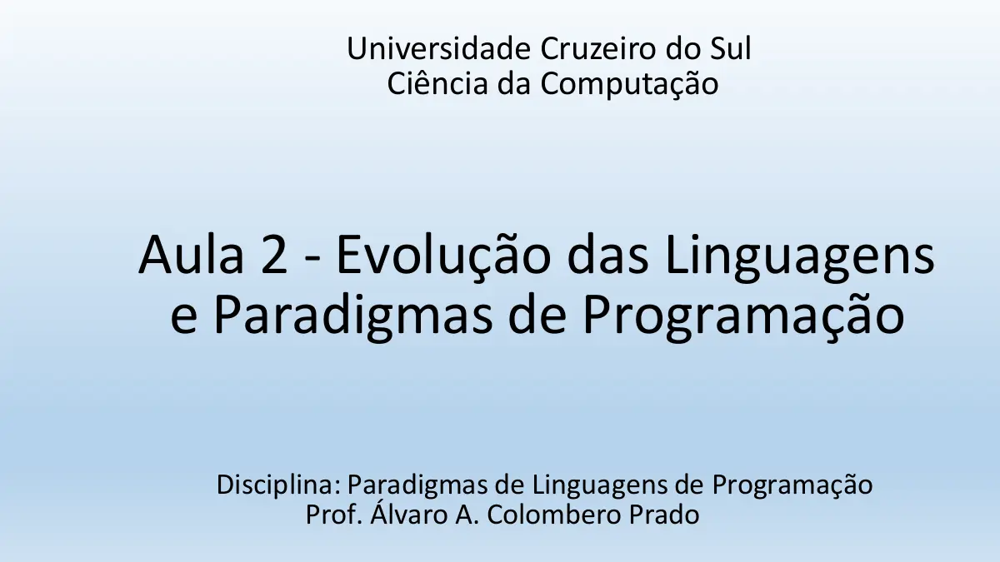

<details>
<summary>Texto da página</summary>

```text
             Universidade Cruzeiro do Sul
               Ciência da Computação

Aula 2 - Evolução das Linguagens
 e Paradigmas de Programação

   Disciplina: Paradigmas de Linguagens de Programação
           Prof. Álvaro A. Colombero Prado
```

</details>

<sub>[↑ voltar ao índice](#aula-02---evolução-das-linguagens-e-paradigmas--slides-originais)</sub>

---

### Página 2

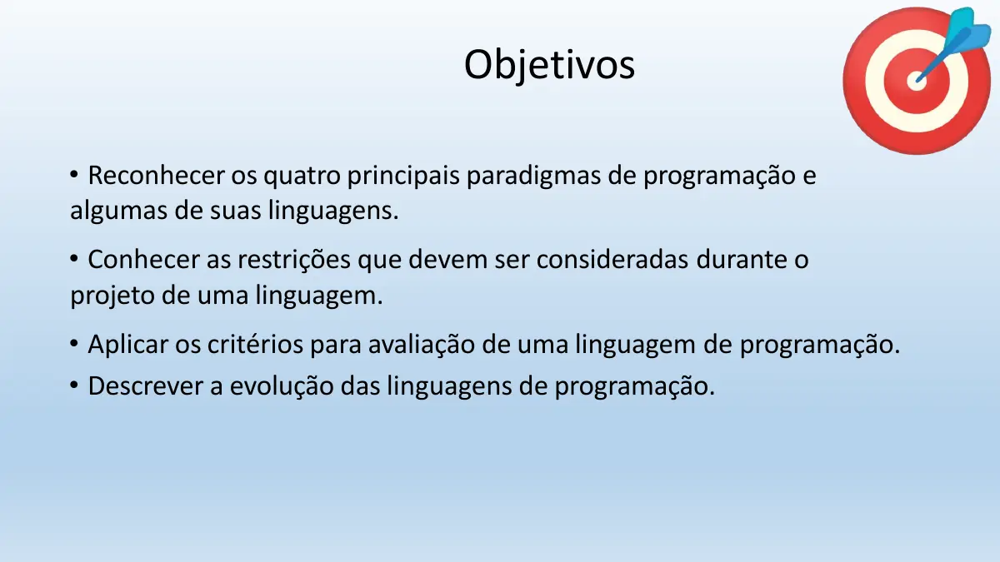

<details>
<summary>Texto da página</summary>

```text
                                 Objetivos

• Reconhecer os quatro principais paradigmas de programação e
algumas de suas linguagens.
• Conhecer as restrições que devem ser consideradas durante o
projeto de uma linguagem.
• Aplicar os critérios para avaliação de uma linguagem de programação.
• Descrever a evolução das linguagens de programação.
```

</details>

<sub>[↑ voltar ao índice](#aula-02---evolução-das-linguagens-e-paradigmas--slides-originais)</sub>

---

### Página 3

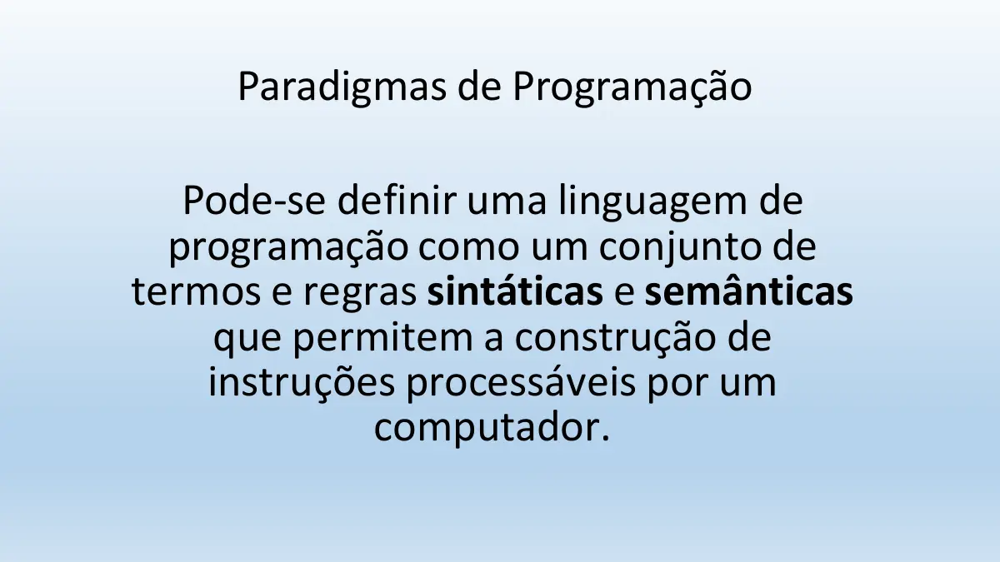

<details>
<summary>Texto da página</summary>

```text
     Paradigmas de Programação

   Pode-se definir uma linguagem de
  programação como um conjunto de
termos e regras sintáticas e semânticas
     que permitem a construção de
    instruções processáveis por um
             computador.
```

</details>

<sub>[↑ voltar ao índice](#aula-02---evolução-das-linguagens-e-paradigmas--slides-originais)</sub>

---

### Página 4

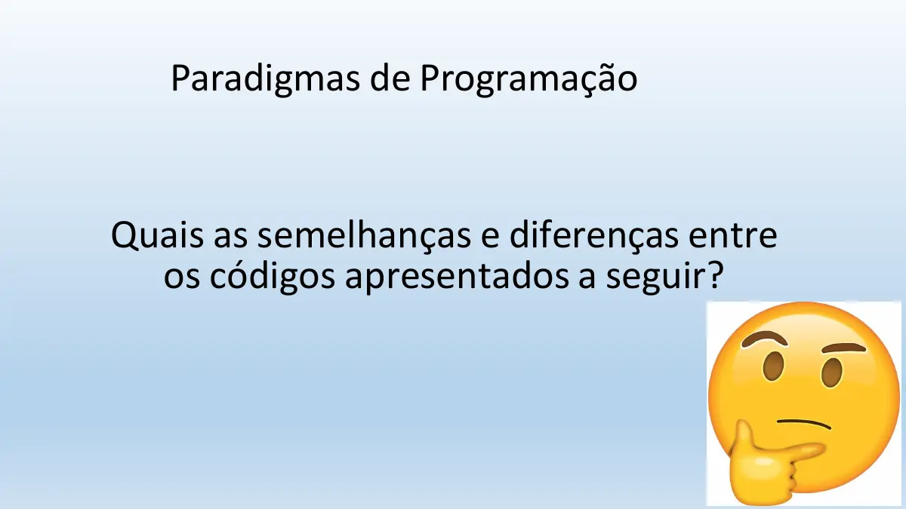

<details>
<summary>Texto da página</summary>

```text
   Paradigmas de Programação

Quais as semelhanças e diferenças entre
  os códigos apresentados a seguir?
```

</details>

<sub>[↑ voltar ao índice](#aula-02---evolução-das-linguagens-e-paradigmas--slides-originais)</sub>

---

### Página 5

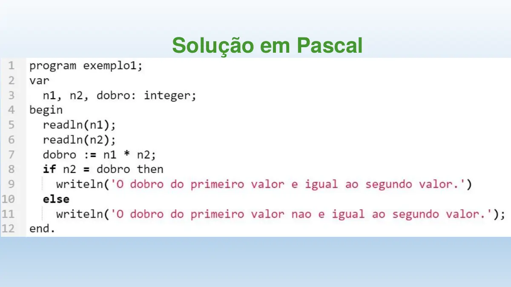

<details>
<summary>Texto da página</summary>

```text
Solução em Pascal
```

</details>

<sub>[↑ voltar ao índice](#aula-02---evolução-das-linguagens-e-paradigmas--slides-originais)</sub>

---

### Página 6

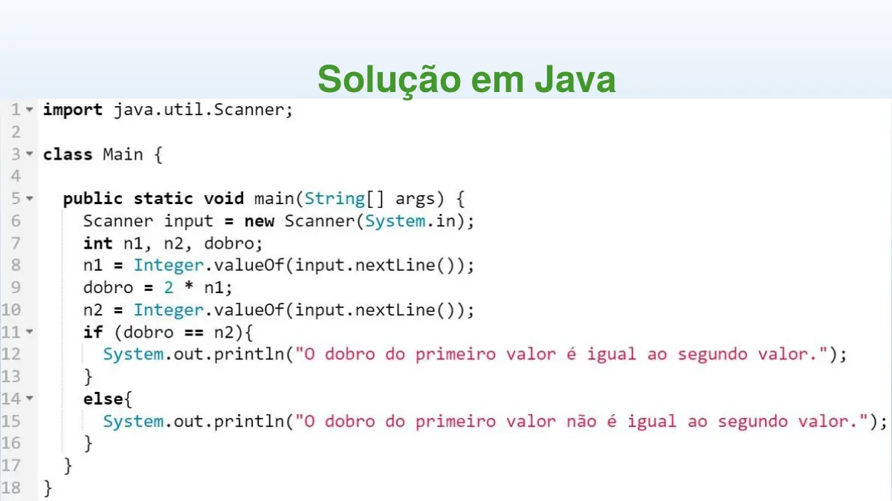

<details>
<summary>Texto da página</summary>

```text
Solução em Java
```

</details>

<sub>[↑ voltar ao índice](#aula-02---evolução-das-linguagens-e-paradigmas--slides-originais)</sub>

---

### Página 7

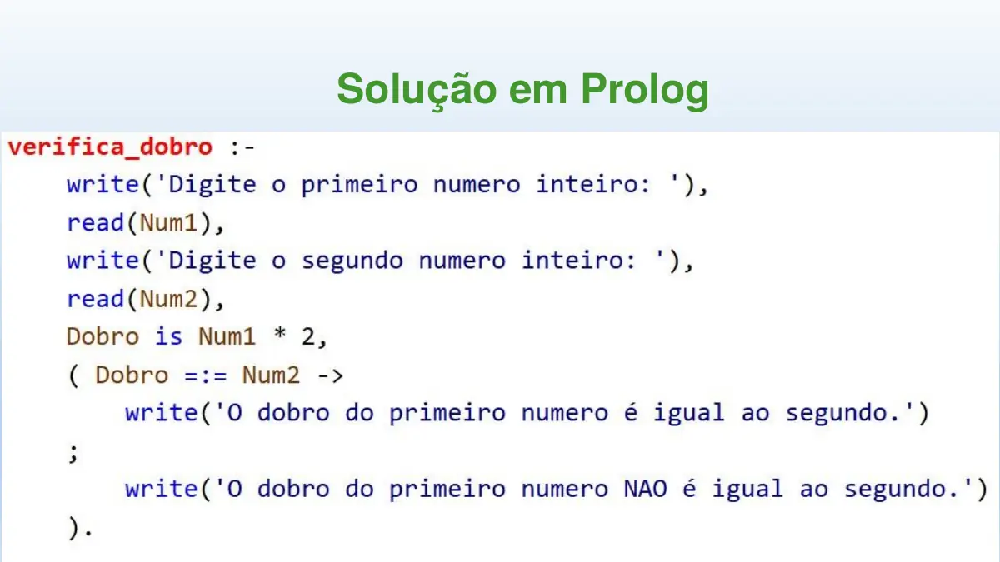

<details>
<summary>Texto da página</summary>

```text
Solução em Prolog
```

</details>

<sub>[↑ voltar ao índice](#aula-02---evolução-das-linguagens-e-paradigmas--slides-originais)</sub>

---

### Página 8

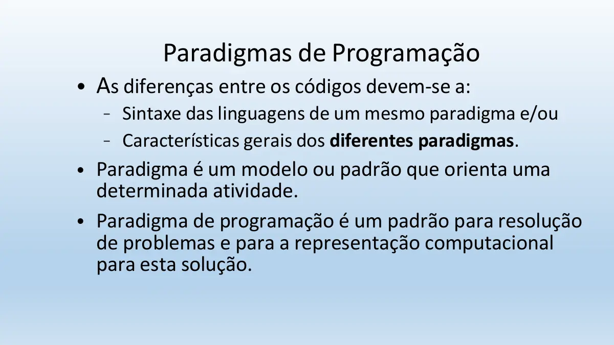

<details>
<summary>Texto da página</summary>

```text
           Paradigmas de Programação
●   As diferenças entre os códigos devem-se a:
    – Sintaxe das linguagens de um mesmo paradigma e/ou
    – Características gerais dos diferentes paradigmas.
● Paradigma é um modelo ou padrão que orienta uma
  determinada atividade.
● Paradigma de programação é um padrão para resolução

  de problemas e para a representação computacional
  para esta solução.
```

</details>

<sub>[↑ voltar ao índice](#aula-02---evolução-das-linguagens-e-paradigmas--slides-originais)</sub>

---

### Página 9

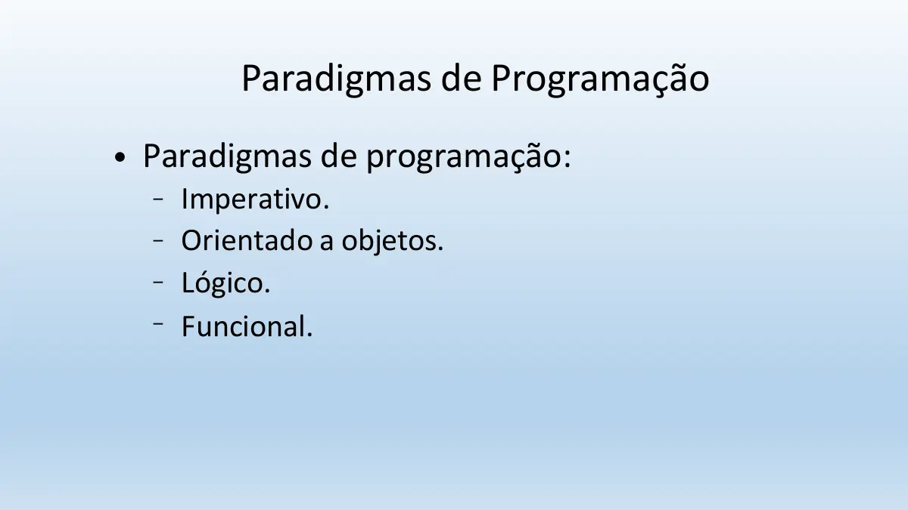

<details>
<summary>Texto da página</summary>

```text
          Paradigmas de Programação
●   Paradigmas de programação:
    – Imperativo.
    – Orientado a objetos.
    – Lógico.
    – Funcional.
```

</details>

<sub>[↑ voltar ao índice](#aula-02---evolução-das-linguagens-e-paradigmas--slides-originais)</sub>

---

### Página 10

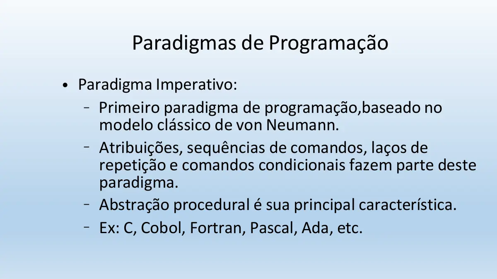

<details>
<summary>Texto da página</summary>

```text
           Paradigmas de Programação
●   Paradigma Imperativo:
     – Primeiro paradigma de programação,baseado no
       modelo clássico de von Neumann.
     – Atribuições, sequências de comandos, laços de
       repetição e comandos condicionais fazem parte deste
       paradigma.
     – Abstração procedural é sua principal característica.
     – Ex: C, Cobol, Fortran, Pascal, Ada, etc.
```

</details>

<sub>[↑ voltar ao índice](#aula-02---evolução-das-linguagens-e-paradigmas--slides-originais)</sub>

---

### Página 11

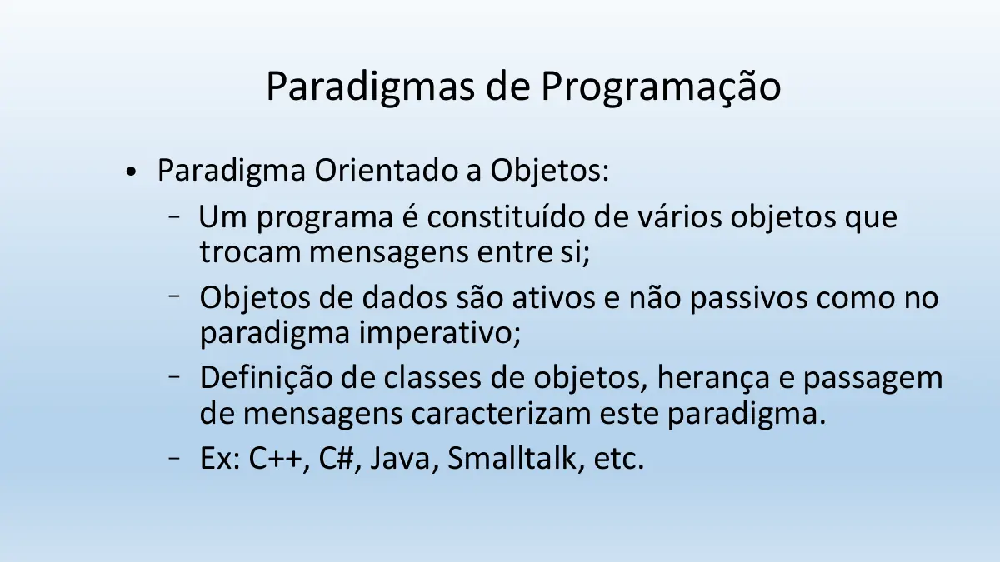

<details>
<summary>Texto da página</summary>

```text
           Paradigmas de Programação
●   Paradigma Orientado a Objetos:
     – Um programa é constituído de vários objetos que
       trocam mensagens entre si;
     – Objetos de dados são ativos e não passivos como no
       paradigma imperativo;
     – Definição de classes de objetos, herança e passagem
       de mensagens caracterizam este paradigma.
     – Ex: C++, C#, Java, Smalltalk, etc.
```

</details>

<sub>[↑ voltar ao índice](#aula-02---evolução-das-linguagens-e-paradigmas--slides-originais)</sub>

---

### Página 12

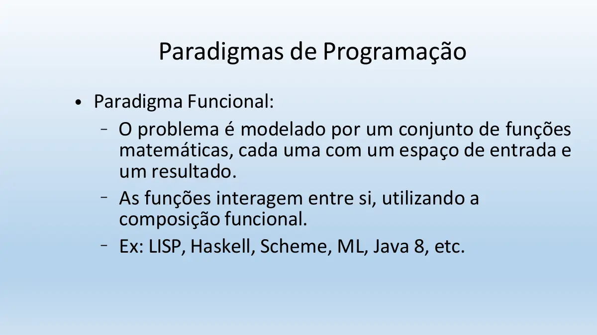

<details>
<summary>Texto da página</summary>

```text
          Paradigmas de Programação
●   Paradigma Funcional:
     – O problema é modelado por um conjunto de funções
       matemáticas, cada uma com um espaço de entrada e
       um resultado.
     – As funções interagem entre si, utilizando a
       composição funcional.
     – Ex: LISP, Haskell, Scheme, ML, Java 8, etc.
```

</details>

<sub>[↑ voltar ao índice](#aula-02---evolução-das-linguagens-e-paradigmas--slides-originais)</sub>

---

### Página 13

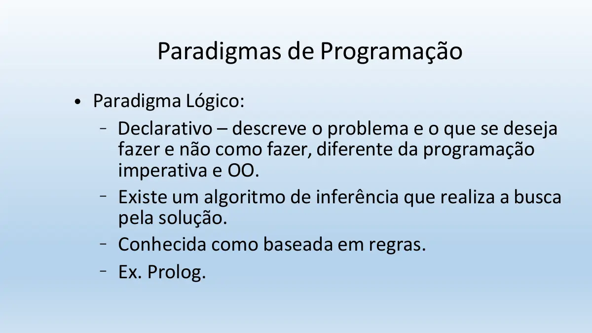

<details>
<summary>Texto da página</summary>

```text
           Paradigmas de Programação
●   Paradigma Lógico:
     – Declarativo – descreve o problema e o que se deseja
       fazer e não como fazer, diferente da programação
       imperativa e OO.
     – Existe um algoritmo de inferência que realiza a busca
       pela solução.
     – Conhecida como baseada em regras.
     – Ex. Prolog.
```

</details>

<sub>[↑ voltar ao índice](#aula-02---evolução-das-linguagens-e-paradigmas--slides-originais)</sub>

---

### Página 14

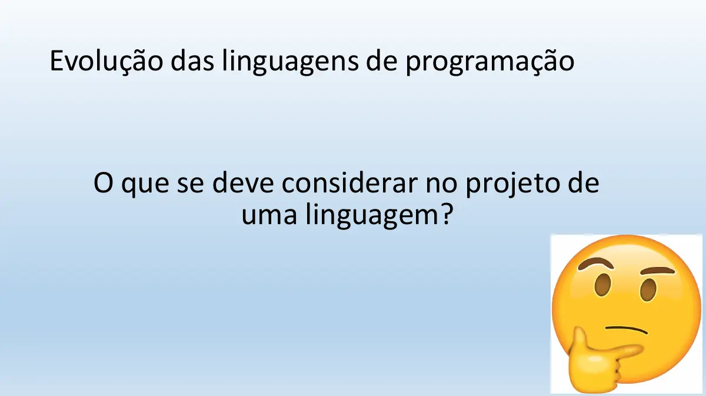

<details>
<summary>Texto da página</summary>

```text
Evolução das linguagens de programação

   O que se deve considerar no projeto de
              uma linguagem?
```

</details>

<sub>[↑ voltar ao índice](#aula-02---evolução-das-linguagens-e-paradigmas--slides-originais)</sub>

---

### Página 15

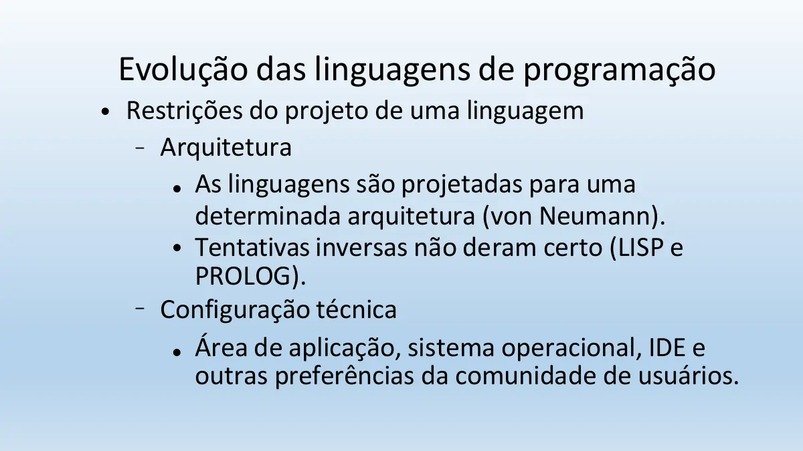

<details>
<summary>Texto da página</summary>

```text
    Evolução das linguagens de programação
●   Restrições do projeto de uma linguagem
     – Arquitetura
        ● As linguagens são projetadas para uma

          determinada arquitetura (von Neumann).
        ● Tentativas inversas não deram certo (LISP e

          PROLOG).
     – Configuração técnica
        ● Área de aplicação, sistema operacional, IDE e

          outras preferências da comunidade de usuários.
```

</details>

<sub>[↑ voltar ao índice](#aula-02---evolução-das-linguagens-e-paradigmas--slides-originais)</sub>

---

### Página 16

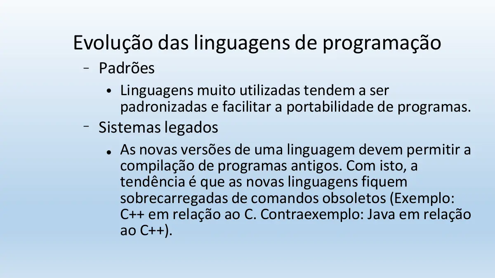

<details>
<summary>Texto da página</summary>

```text
Evolução das linguagens de programação
 –   Padrões
     ●   Linguagens muito utilizadas tendem a ser
         padronizadas e facilitar a portabilidade de programas.
 –   Sistemas legados
     ●   As novas versões de uma linguagem devem permitir a
         compilação de programas antigos. Com isto, a
         tendência é que as novas linguagens fiquem
         sobrecarregadas de comandos obsoletos (Exemplo:
         C++ em relação ao C. Contraexemplo: Java em relação
         ao C++).
```

</details>

<sub>[↑ voltar ao índice](#aula-02---evolução-das-linguagens-e-paradigmas--slides-originais)</sub>

---

### Página 17

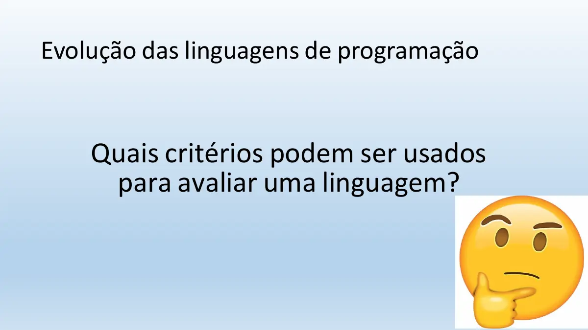

<details>
<summary>Texto da página</summary>

```text
Evolução das linguagens de programação

    Quais critérios podem ser usados
     para avaliar uma linguagem?
```

</details>

<sub>[↑ voltar ao índice](#aula-02---evolução-das-linguagens-e-paradigmas--slides-originais)</sub>

---

### Página 18

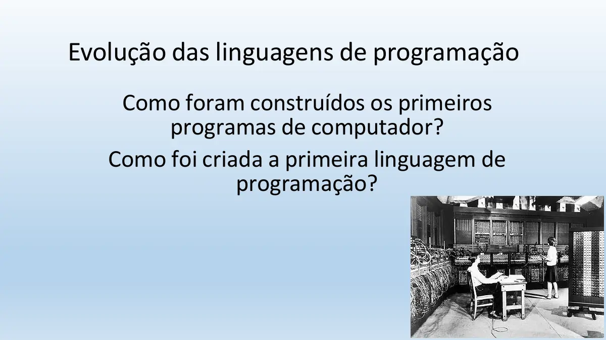

<details>
<summary>Texto da página</summary>

```text
Evolução das linguagens de programação
    Como foram construídos os primeiros
        programas de computador?
   Como foi criada a primeira linguagem de
                programação?
```

</details>

<sub>[↑ voltar ao índice](#aula-02---evolução-das-linguagens-e-paradigmas--slides-originais)</sub>

---

### Página 19

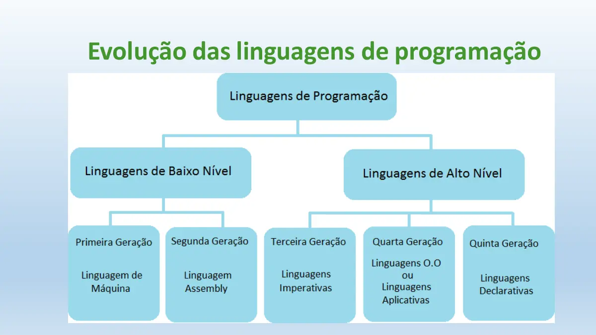

<details>
<summary>Texto da página</summary>

```text
Evolução das linguagens de programação
```

</details>

<sub>[↑ voltar ao índice](#aula-02---evolução-das-linguagens-e-paradigmas--slides-originais)</sub>

---

### Página 20

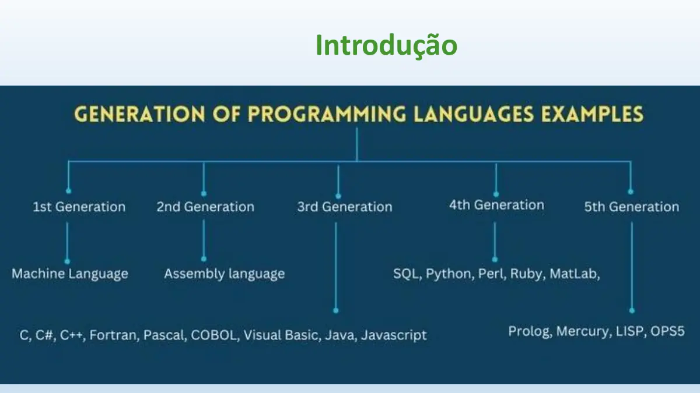

<details>
<summary>Texto da página</summary>

```text
Introdução
```

</details>

<sub>[↑ voltar ao índice](#aula-02---evolução-das-linguagens-e-paradigmas--slides-originais)</sub>

---

### Página 21

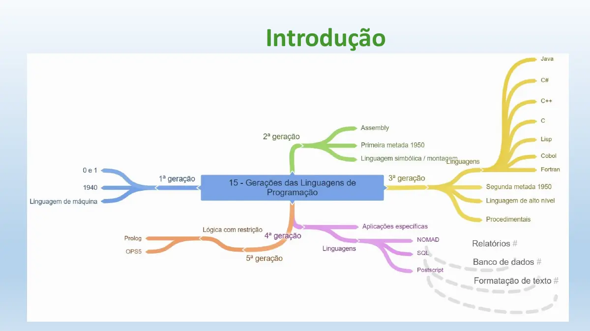

<details>
<summary>Texto da página</summary>

```text
Introdução
```

</details>

<sub>[↑ voltar ao índice](#aula-02---evolução-das-linguagens-e-paradigmas--slides-originais)</sub>

---

### Página 22

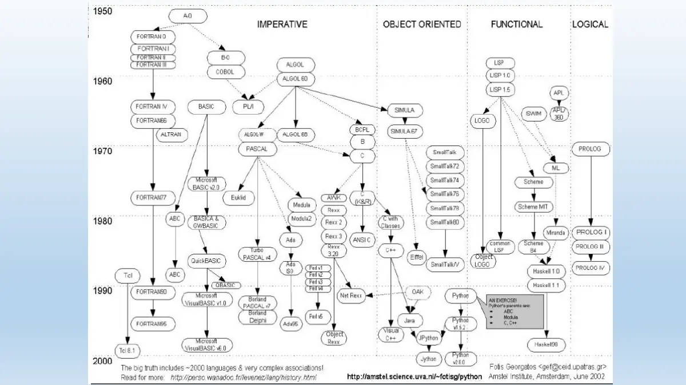

*Página sem texto extraível (só imagem).*

<sub>[↑ voltar ao índice](#aula-02---evolução-das-linguagens-e-paradigmas--slides-originais)</sub>

---

### Página 23

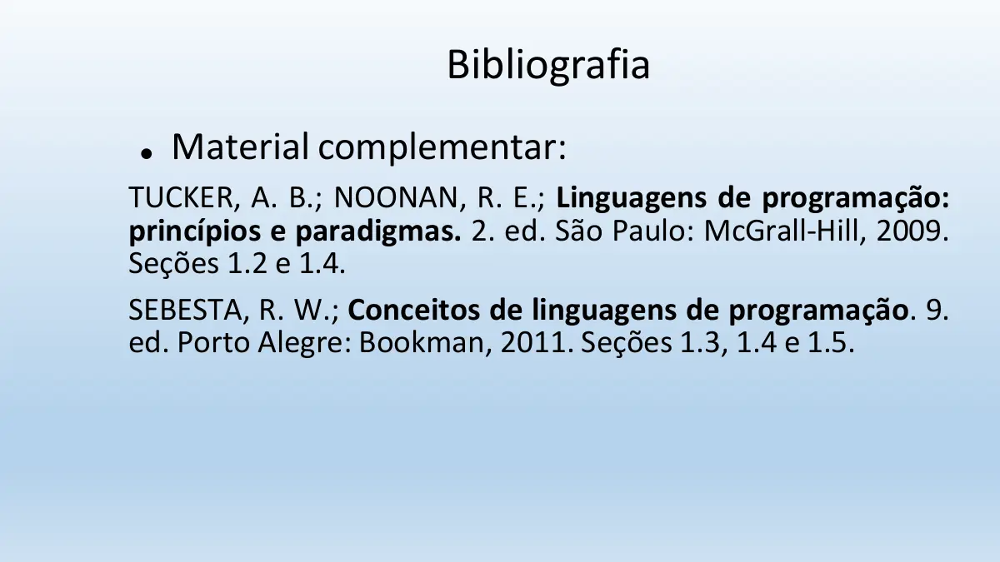

<details>
<summary>Texto da página</summary>

```text
                       Bibliografia
●   Material complementar:
TUCKER, A. B.; NOONAN, R. E.; Linguagens de programação:
princípios e paradigmas. 2. ed. São Paulo: McGrall-Hill, 2009.
Seções 1.2 e 1.4.
SEBESTA, R. W.; Conceitos de linguagens de programação. 9.
ed. Porto Alegre: Bookman, 2011. Seções 1.3, 1.4 e 1.5.
```

</details>

<sub>[↑ voltar ao índice](#aula-02---evolução-das-linguagens-e-paradigmas--slides-originais)</sub>


<!-- nav:rodape -->

---

**Aula 02:** [Visão geral](../README.md) · **Slides** · [Resumo](../02%20-%20Resumo%20Teórico/resumo-aula-02.md) · [Exercícios](../03%20-%20Exercícios/exercicios-aula-02.md) · [Resoluções](../04%20-%20Resoluções/resolucoes-aula-02.md) · [Complementos](../05%20-%20Materiais%20Complementares/materiais-complementares.md)

← [Aula 01 · Slides](../../Aula%2001%20-%20Apresentação%20da%20Disciplina/01%20-%20Slides%20Originais/README.md) · [Aula 03 · Slides](../../Aula%2003%20-%20Implementação%20das%20Linguagens/01%20-%20Slides%20Originais/README.md) →

**Links para esta página (12):** [Ementa, conteúdo e avaliação](../../../00%20-%20Planejamento%20e%20Organização/ementa.md) · [Aula 01 · Resumo](../../Aula%2001%20-%20Apresentação%20da%20Disciplina/02%20-%20Resumo%20Teórico/resumo-aula-01.md) · [Aula 02 · Resumo](../02%20-%20Resumo%20Teórico/resumo-aula-02.md) · [Aula 02 · Exercícios](../03%20-%20Exercícios/exercicios-aula-02.md) · [Aula 02 · Resoluções](../04%20-%20Resoluções/resolucoes-aula-02.md) · [Aula 02 · Complementos](../05%20-%20Materiais%20Complementares/materiais-complementares.md) · [Aula 03 · Resumo](../../Aula%2003%20-%20Implementação%20das%20Linguagens/02%20-%20Resumo%20Teórico/resumo-aula-03.md) · [Lista 01 · Resolução](../../../02%20-%20Listas%20de%20Exercícios/Lista%2001%20-%20Revisão%20I/02%20-%20Resolução/resolucao-lista-01.md) · [Lista 02 · Resolução](../../../02%20-%20Listas%20de%20Exercícios/Lista%2002%20-%20Revisão%20II/02%20-%20Resolução/resolucao-lista-02.md) · [Erratas e inconsistências do material](../../../06%20-%20Revisões%20e%20Sínteses/erratas-e-inconsistencias.md) · [Quadros comparativos](../../../06%20-%20Revisões%20e%20Sínteses/quadros-comparativos.md) · [Questões integradoras · Resolução comentada](../../../06%20-%20Revisões%20e%20Sínteses/resolucao-questoes-integradoras.md)

<!-- /nav:rodape -->
