<!-- nav:topo -->
[Início](../../../README.md) › [01 - Aulas](../../README.md) › [Aula 03](../README.md) › **01 - Slides Originais** · [Mapa](../../../MAPA.md)
<!-- /nav:topo -->

<!-- gerado por ferramentas/geradores/gerar_galerias.py: não edite à mão -->

# Aula 03 - Implementação das Linguagens · Slides originais

> **[Material original]** Slides originais do professor, página por página, para ler aqui mesmo no GitHub. O arquivo original é o PDF [`Aula03_Implementacao_LinguagensDeProgramacao.pdf`](Aula03_Implementacao_LinguagensDeProgramacao.pdf) (17 páginas): use-o para baixar ou imprimir. As imagens e o texto de cada página foram extraídos do PDF, sem alteração do conteúdo.

**Ir para a página:** [1](#página-1) · [2](#página-2) · [3](#página-3) · [4](#página-4) · [5](#página-5) · [6](#página-6) · [7](#página-7) · [8](#página-8) · [9](#página-9) · [10](#página-10) · [11](#página-11) · [12](#página-12) · [13](#página-13) · [14](#página-14) · [15](#página-15) · [16](#página-16) · [17](#página-17)

O texto de cada página fica em **Texto da página**, logo abaixo da imagem: é por ele que a busca encontra o conteúdo dos slides.

---

### Página 1

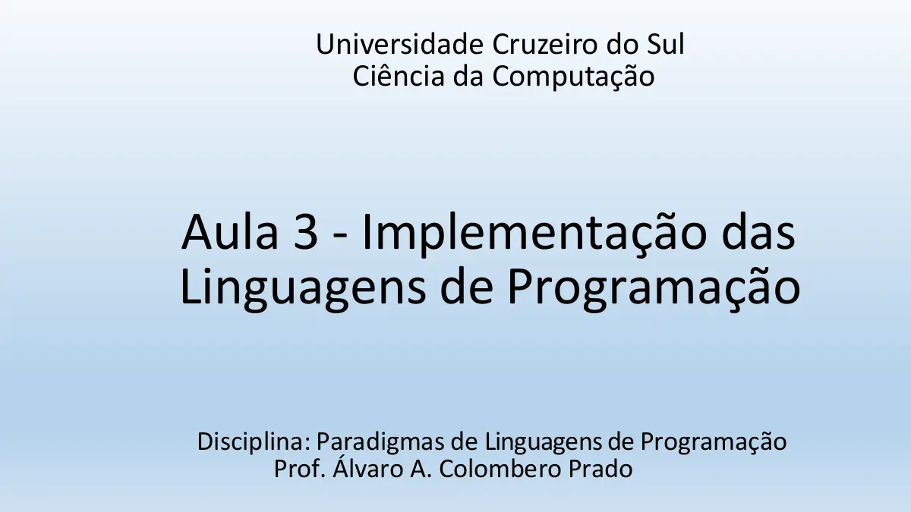

<details>
<summary>Texto da página</summary>

```text
          Universidade Cruzeiro do Sul
            Ciência da Computação

Aula 3 - Implementação das
Linguagens de Programação

Disciplina: Paradigmas de Linguagens de Programação
        Prof. Álvaro A. Colombero Prado
```

</details>

<sub>[↑ voltar ao índice](#aula-03---implementação-das-linguagens--slides-originais)</sub>

---

### Página 2


<details>
<summary>Texto da página</summary>

```text
Na aula passada…
```

</details>

<sub>[↑ voltar ao índice](#aula-03---implementação-das-linguagens--slides-originais)</sub>

---

### Página 3

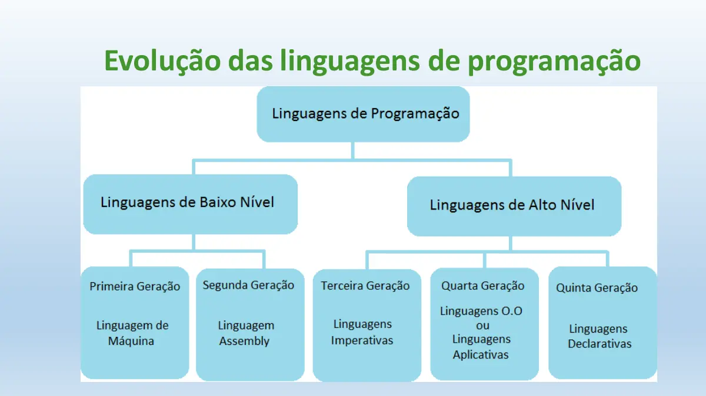

<details>
<summary>Texto da página</summary>

```text
Evolução das linguagens de programação
```

</details>

<sub>[↑ voltar ao índice](#aula-03---implementação-das-linguagens--slides-originais)</sub>

---

### Página 4

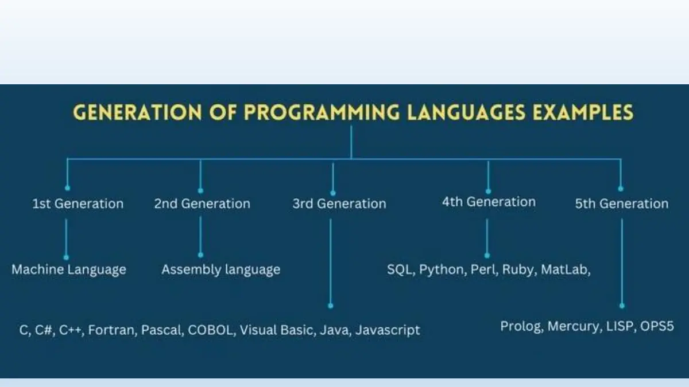

*Página sem texto extraível (só imagem).*

<sub>[↑ voltar ao índice](#aula-03---implementação-das-linguagens--slides-originais)</sub>

---

### Página 5

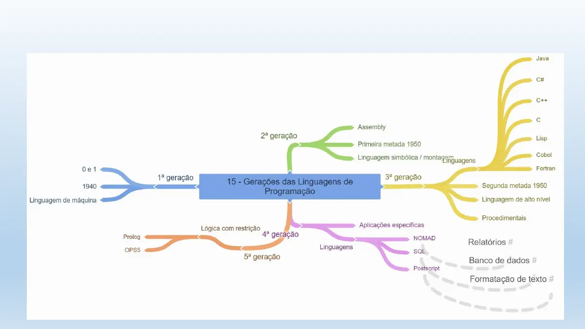

*Página sem texto extraível (só imagem).*

<sub>[↑ voltar ao índice](#aula-03---implementação-das-linguagens--slides-originais)</sub>

---

### Página 6

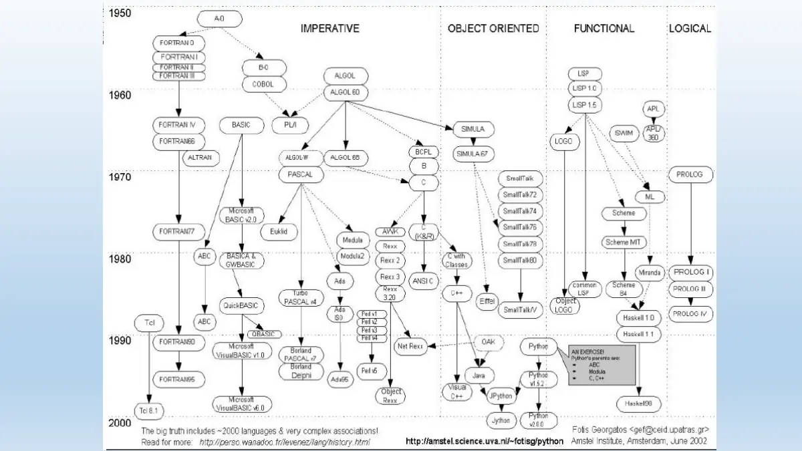

*Página sem texto extraível (só imagem).*

<sub>[↑ voltar ao índice](#aula-03---implementação-das-linguagens--slides-originais)</sub>

---

### Página 7

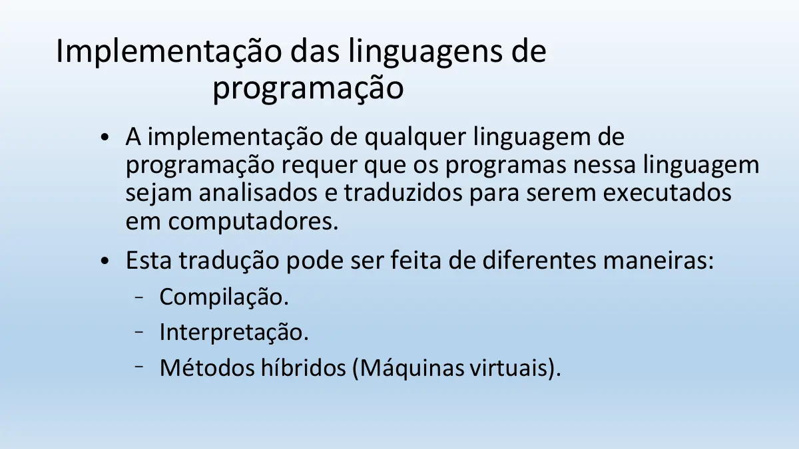

<details>
<summary>Texto da página</summary>

```text
Implementação das linguagens de
         programação
  ● A implementação de qualquer linguagem de
    programação requer que os programas nessa linguagem
    sejam analisados e traduzidos para serem executados
    em computadores.
  ● Esta tradução pode ser feita de diferentes maneiras:

      – Compilação.
      – Interpretação.
      – Métodos híbridos (Máquinas virtuais).
```

</details>

<sub>[↑ voltar ao índice](#aula-03---implementação-das-linguagens--slides-originais)</sub>

---

### Página 8

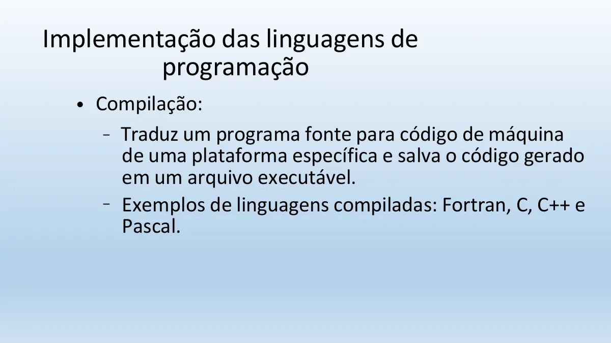

<details>
<summary>Texto da página</summary>

```text
Implementação das linguagens de
         programação
  ●   Compilação:
       – Traduz um programa fonte para código de máquina
         de uma plataforma específica e salva o código gerado
         em um arquivo executável.
       – Exemplos de linguagens compiladas: Fortran, C, C++ e
         Pascal.
```

</details>

<sub>[↑ voltar ao índice](#aula-03---implementação-das-linguagens--slides-originais)</sub>

---

### Página 9

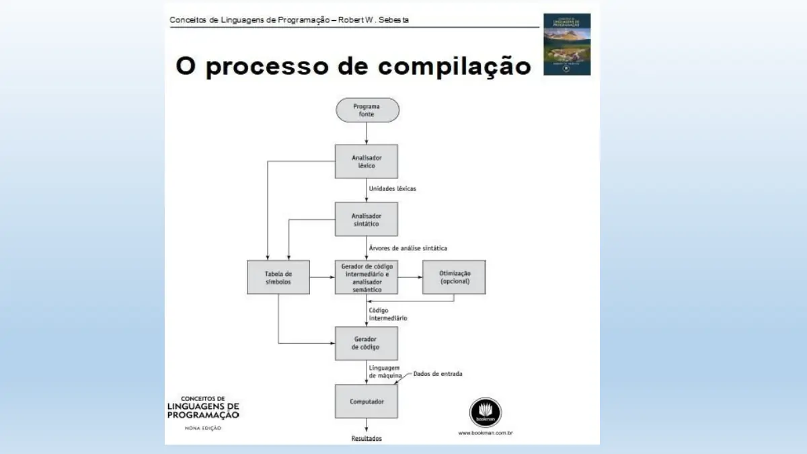

*Página sem texto extraível (só imagem).*

<sub>[↑ voltar ao índice](#aula-03---implementação-das-linguagens--slides-originais)</sub>

---

### Página 10

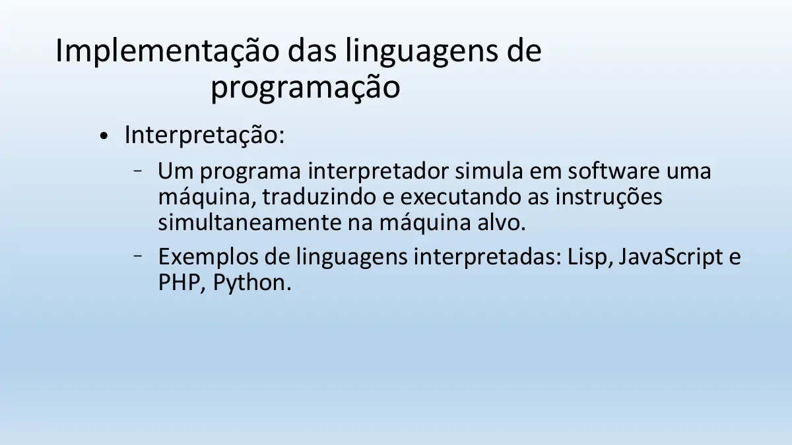

<details>
<summary>Texto da página</summary>

```text
Implementação das linguagens de
         programação
  ●   Interpretação:
      – Um programa interpretador simula em software uma
        máquina, traduzindo e executando as instruções
        simultaneamente na máquina alvo.
      – Exemplos de linguagens interpretadas: Lisp, JavaScript e
        PHP, Python.
```

</details>

<sub>[↑ voltar ao índice](#aula-03---implementação-das-linguagens--slides-originais)</sub>

---

### Página 11

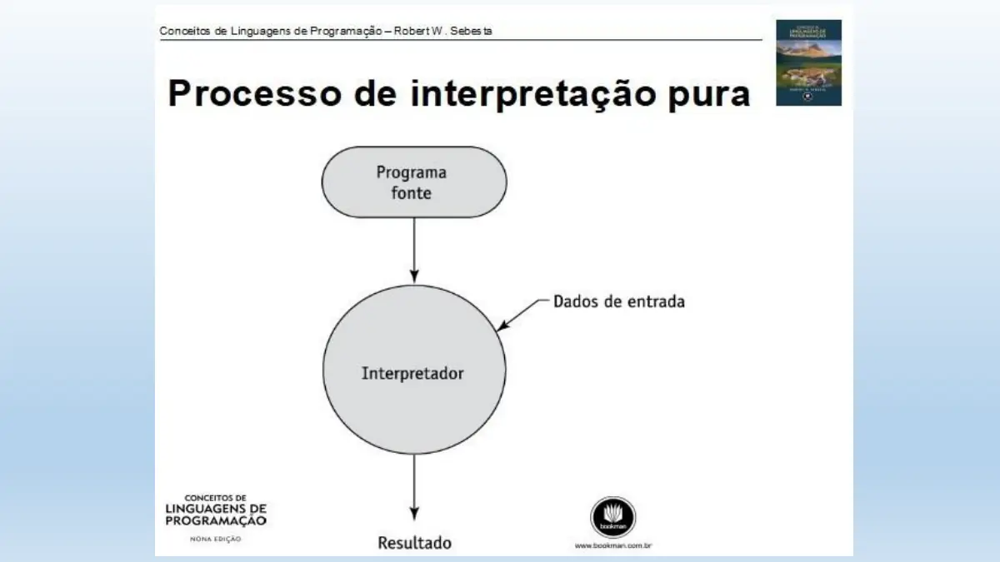

*Página sem texto extraível (só imagem).*

<sub>[↑ voltar ao índice](#aula-03---implementação-das-linguagens--slides-originais)</sub>

---

### Página 12

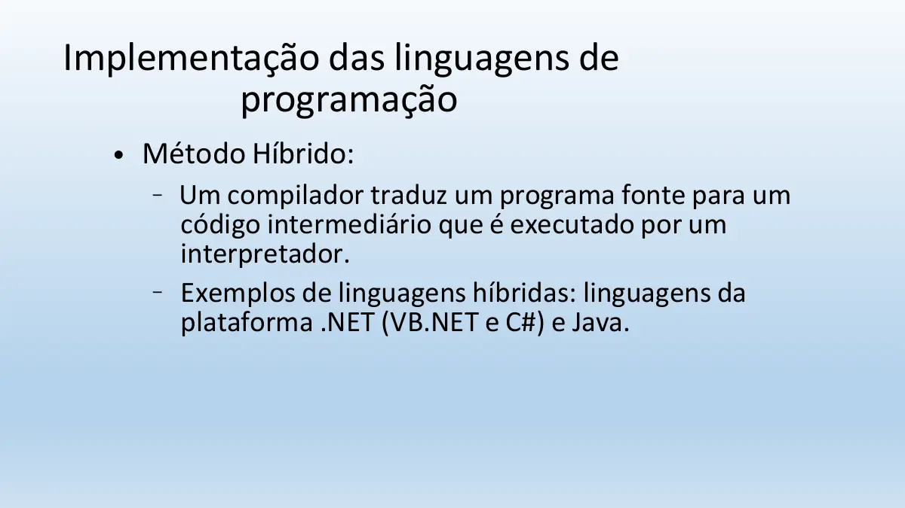

<details>
<summary>Texto da página</summary>

```text
Implementação das linguagens de
         programação
  ●   Método Híbrido:
      – Um compilador traduz um programa fonte para um
        código intermediário que é executado por um
        interpretador.
      – Exemplos de linguagens híbridas: linguagens da
        plataforma .NET (VB.NET e C#) e Java.
```

</details>

<sub>[↑ voltar ao índice](#aula-03---implementação-das-linguagens--slides-originais)</sub>

---

### Página 13

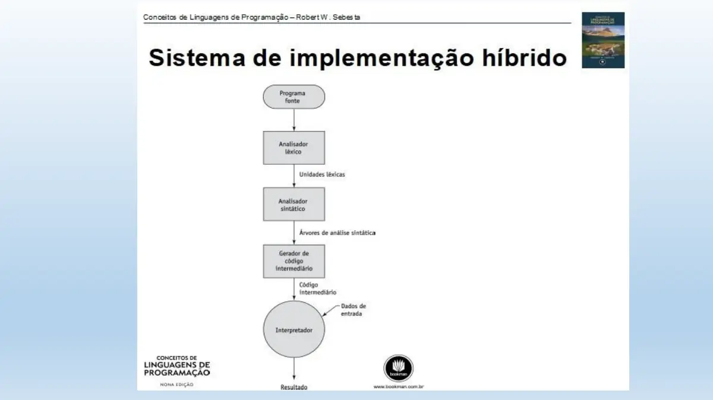

*Página sem texto extraível (só imagem).*

<sub>[↑ voltar ao índice](#aula-03---implementação-das-linguagens--slides-originais)</sub>

---

### Página 14

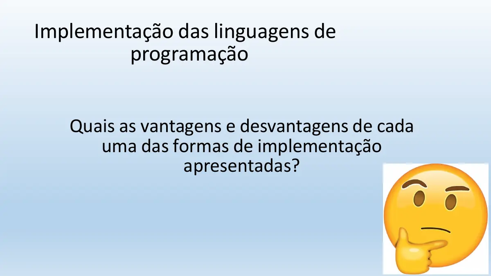

<details>
<summary>Texto da página</summary>

```text
Implementação das linguagens de
         programação

   Quais as vantagens e desvantagens de cada
      uma das formas de implementação
                 apresentadas?
```

</details>

<sub>[↑ voltar ao índice](#aula-03---implementação-das-linguagens--slides-originais)</sub>

---

### Página 15

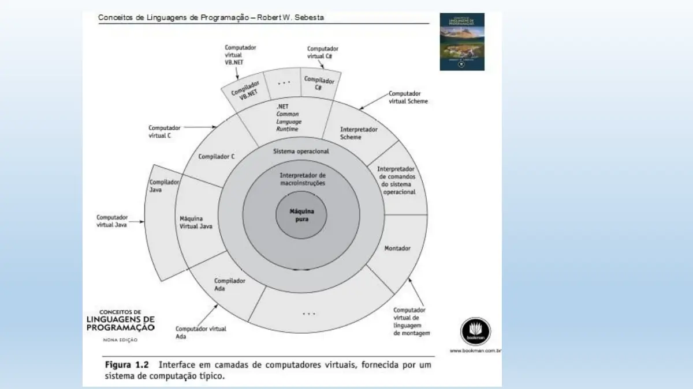

*Página sem texto extraível (só imagem).*

<sub>[↑ voltar ao índice](#aula-03---implementação-das-linguagens--slides-originais)</sub>

---

### Página 16

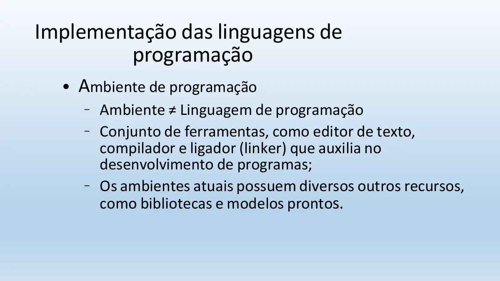

<details>
<summary>Texto da página</summary>

```text
Implementação das linguagens de
         programação
  ●   Ambiente de programação
      – Ambiente ≠ Linguagem de programação
      – Conjunto de ferramentas, como editor de texto,
        compilador e ligador (linker) que auxilia no
        desenvolvimento de programas;
      – Os ambientes atuais possuem diversos outros recursos,
        como bibliotecas e modelos prontos.
```

</details>

<sub>[↑ voltar ao índice](#aula-03---implementação-das-linguagens--slides-originais)</sub>

---

### Página 17

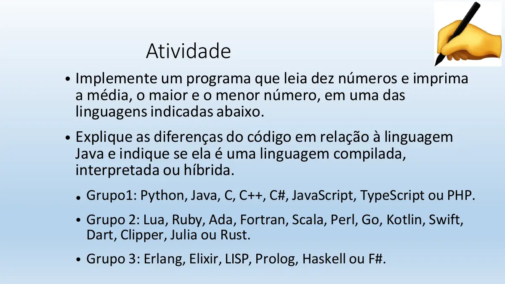

<details>
<summary>Texto da página</summary>

```text
                  Atividade
●   Implemente um programa que leia dez números e imprima
    a média, o maior e o menor número, em uma das
    linguagens indicadas abaixo.
●   Explique as diferenças do código em relação à linguagem
    Java e indique se ela é uma linguagem compilada,
    interpretada ou híbrida.
    ●   Grupo1: Python, Java, C, C++, C#, JavaScript, TypeScript ou PHP.
    ●   Grupo 2: Lua, Ruby, Ada, Fortran, Scala, Perl, Go, Kotlin, Swift,
        Dart, Clipper, Julia ou Rust.
    ●   Grupo 3: Erlang, Elixir, LISP, Prolog, Haskell ou F#.
```

</details>

<sub>[↑ voltar ao índice](#aula-03---implementação-das-linguagens--slides-originais)</sub>


<!-- nav:rodape -->

---

**Aula 03:** [Visão geral](../README.md) · **Slides** · [Resumo](../02%20-%20Resumo%20Teórico/resumo-aula-03.md) · [Exercícios](../03%20-%20Exercícios/exercicios-aula-03.md) · [Resoluções](../04%20-%20Resoluções/resolucoes-aula-03.md) · [Complementos](../05%20-%20Materiais%20Complementares/materiais-complementares.md)

← [Aula 02 · Slides](../../Aula%2002%20-%20Evolução%20das%20Linguagens%20e%20Paradigmas/01%20-%20Slides%20Originais/README.md) · [Aula 04 · Slides](../../Aula%2004%20-%20Sintaxe/01%20-%20Slides%20Originais/README.md) →

**Links para esta página (12):** [Acompanhamento de estudo](../../../00%20-%20Planejamento%20e%20Organização/acompanhamento.md) · [Ementa, conteúdo e avaliação](../../../00%20-%20Planejamento%20e%20Organização/ementa.md) · [Aula 01 · Resumo](../../Aula%2001%20-%20Apresentação%20da%20Disciplina/02%20-%20Resumo%20Teórico/resumo-aula-01.md) · [Aula 03 · Resumo](../02%20-%20Resumo%20Teórico/resumo-aula-03.md) · [Aula 03 · Exercícios](../03%20-%20Exercícios/exercicios-aula-03.md) · [Aula 03 · Resoluções](../04%20-%20Resoluções/resolucoes-aula-03.md) · [Aula 03 · Complementos](../05%20-%20Materiais%20Complementares/materiais-complementares.md) · [Lista 02 · Resolução](../../../02%20-%20Listas%20de%20Exercícios/Lista%2002%20-%20Revisão%20II/02%20-%20Resolução/resolucao-lista-02.md) · [Simulado 02 · Resolução comentada](../../../04%20-%20Provas%20e%20Avaliações/Simulados/resolucao-simulado-02.md) · [Erratas e inconsistências do material](../../../06%20-%20Revisões%20e%20Sínteses/erratas-e-inconsistencias.md) · [Quadros comparativos](../../../06%20-%20Revisões%20e%20Sínteses/quadros-comparativos.md) · [Questões integradoras · Resolução comentada](../../../06%20-%20Revisões%20e%20Sínteses/resolucao-questoes-integradoras.md)

<!-- /nav:rodape -->
