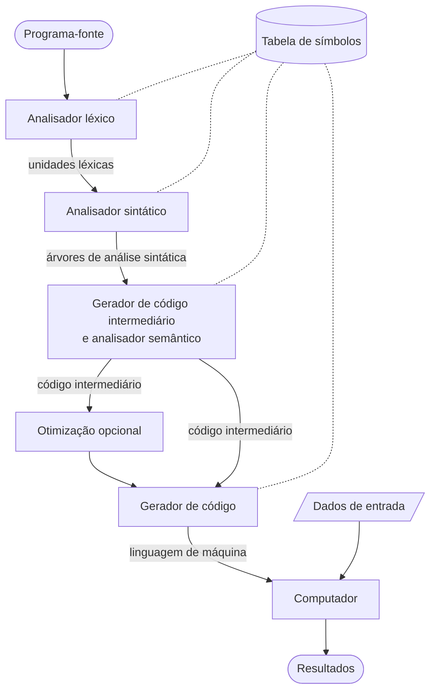

# Aula 03 — Implementação das Linguagens · Resumo teórico

> **Fonte:** [`Aula03_Implementacao_LinguagensDeProgramacao.pdf`](../01%20-%20Slides%20Originais/Aula03_Implementacao_LinguagensDeProgramacao.pdf) (17 páginas). As figuras das p.9, 11, 13 e 15 são de Sebesta (9ª ed.), cap. 1.
> **Legenda:** ver [Convenções](../../../README.md#convenções-de-marcação). `p.N` = página do PDF.

---

## 1. Revisão (p.2–6)

**[Material original]** A aula abre com "Na aula passada…" e repete as três figuras de gerações e a linha do tempo (as quatro figuras das p.19–22 da Aula 02) da [Aula 02](../../Aula%2002%20-%20Evolução%20das%20Linguagens%20e%20Paradigmas/02%20-%20Resumo%20Teórico/resumo-aula-02.md#8-evolução-das-linguagens-p1822).

## 2. A tese da aula (p.7)

**[Material original]** "A implementação de qualquer linguagem de programação requer que os programas nessa linguagem sejam **analisados e traduzidos** para serem executados em computadores." A tradução pode ser feita por:

1. Compilação.
2. Interpretação.
3. Métodos híbridos (máquinas virtuais).

**[Explicação elaborada]** O processador só entende a própria linguagem de máquina. Qualquer outra linguagem precisa ser convertida, e a diferença entre as três formas está em **quando** e **para quê** se traduz.

## 3. Compilação (p.8–9)

**[Material original]** Traduz o programa-fonte para **código de máquina de uma plataforma específica** e salva o resultado em um **arquivo executável**. Exemplos: Fortran, C, C++, Pascal.

**Fases do compilador (figura da p.9, Sebesta):**

**[Explicação elaborada] — o que cada fase faz:**

| Fase | Entrada → saída | Exemplo com `soma = x + 10;` | Aula |
| --- | --- | --- | --- |
| Léxica | Caracteres → tokens | `soma` (identificador), `=` (símbolo especial na classificação da Aula 04, p.9; em C é o operador de atribuição), `x`, `+` (operador), `10` (constante), `;` | 04 |
| Sintática | Tokens → árvore sintática | Atribuição cujo lado direito é a soma de `x` e `10` | 04 |
| Semântica / código intermediário | Árvore → código intermediário verificado | Verifica se `soma` e `x` foram declaradas e se os tipos são compatíveis; gera `t1 = x + 10; soma = t1` | 05, 06 |
| Otimização (opcional) | Intermediário → intermediário melhor | Remove temporários desnecessários | — |
| Geração de código | Intermediário → máquina | Instruções `load`, `add`, `store` | 06 (p.24) |

A **tabela de símbolos** guarda nomes, tipos e endereços e é consultada por todas as fases.

## 4. Interpretação pura (p.10–11)

**[Material original]** Um programa **interpretador** simula em software uma máquina, **traduzindo e executando as instruções simultaneamente** na máquina-alvo. Exemplos: Lisp, JavaScript, PHP, Python.

Figura (p.11): o programa-fonte e os dados de entrada vão direto ao interpretador, que produz o resultado — sem arquivo executável intermediário.

## 5. Sistema híbrido (p.12–13)

**[Material original]** Um compilador traduz o programa-fonte para um **código intermediário**, que é executado por um **interpretador**. Exemplos: linguagens da plataforma .NET (VB.NET, C#) e Java.

Figura (p.13): analisador léxico → analisador sintático → gerador de código intermediário → código intermediário → interpretador (com os dados de entrada) → resultado.

**[Complemento]** Em Java, `javac` gera **bytecode** (`.class`), executado pela **JVM**. Em .NET, o compilador gera **CIL**, executado pelo **CLR**. JVM e CLR modernas também usam **compilação JIT** (*just-in-time*), que converte trechos frequentes do código intermediário em código de máquina durante a execução.

## 6. Vantagens e desvantagens (p.14)

**[Material original]** O slide apenas pergunta: "Quais as vantagens e desvantagens de cada uma das formas de implementação apresentadas?"

**[Complemento]** Resposta baseada em Sebesta, seções 1.7.1–1.7.3:

| Critério | Compilação | Interpretação pura | Híbrido |
| --- | --- | --- | --- |
| Velocidade de execução | **Alta**: código nativo, traduzido uma vez | **Baixa**: decodifica cada instrução a cada execução (Sebesta cita lentidão de 10 a 100 vezes) | Intermediária: o código intermediário é mais simples de interpretar que o fonte |
| Portabilidade | Baixa: um executável por plataforma | Alta: basta haver interpretador | Alta: "escreva uma vez, rode em qualquer VM" |
| Erros detectados antes de executar | Muitos (sintaxe e semântica estática) | Poucos: "por definição, não há verificação estática" (Aula 05, p.17) | Os da etapa de compilação |
| Depuração | Mais difícil de relacionar com o fonte | Fácil: erro aponta a linha do fonte | Intermediária |
| Espaço | Executável independente | Precisa do fonte e do interpretador | Precisa da VM |

## 7. Atividade (p.17)

**[Material original]** Implementar um programa que leia dez números e imprima a média, o maior e o menor, em uma linguagem de um dos grupos abaixo. Depois, explicar as diferenças em relação ao Java e indicar se a linguagem é compilada, interpretada ou híbrida.

- **Grupo 1:** Python, Java, C, C++, C#, JavaScript, TypeScript ou PHP.
- **Grupo 2:** Lua, Ruby, Ada, Fortran, Scala, Perl, Go, Kotlin, Swift, Dart, Clipper, Julia ou Rust.
- **Grupo 3:** Erlang, Elixir, LISP, Prolog, Haskell ou F#.

Soluções comentadas em C, Python e Java estão em [resolucoes-aula-03.md](../04%20-%20Resoluções/resolucoes-aula-03.md#e9--atividade-da-p17).

## 8. Computadores virtuais em camadas (p.15)

**[Material original]** Figura 1.2 de Sebesta: no núcleo, a **máquina pura**; em volta, o **interpretador de macroinstruções** e o **sistema operacional**. Na camada externa ficam compiladores e interpretadores — C, Ada, Java (máquina virtual Java), .NET Common Language Runtime (VB.NET, C#), Scheme, montador e interpretador de comandos do sistema operacional. Cada um cria um **computador virtual** da sua linguagem.

**[Explicação elaborada]** Para quem programa em C, o computador "parece" executar C; para quem programa em Scheme, parece executar Scheme. Cada camada esconde a de baixo — mais um exemplo de **abstração** (tema da [Aula 10](../../Aula%2010%20-%20Paradigma%20Imperativo%20II/02%20-%20Resumo%20Teórico/resumo-aula-10.md)).

## 9. Ambiente de programação (p.16)

**[Material original]** **Ambiente ≠ linguagem.** O ambiente é o conjunto de ferramentas — editor de texto, compilador, ligador (*linker*) — que auxilia o desenvolvimento. Os ambientes atuais têm também bibliotecas e modelos prontos.

**[Explicação elaborada]** Visual Studio, IntelliJ, VS Code e Eclipse são ambientes; C#, Java e Python são linguagens. A mesma linguagem pode ser usada em ambientes diferentes, e o mesmo ambiente pode suportar várias linguagens.

## 10. Classificando linguagens conhecidas

**[Complemento]** Classificação usual (a mesma linguagem pode ter implementações de mais de um tipo):

| Linguagem | Forma usual | Observação |
| --- | --- | --- |
| C, C++, Fortran, Pascal, Go, Rust | Compilada | Gera executável nativo |
| Java, Kotlin, Scala, C#, F#, VB.NET | Híbrida | Bytecode/CIL + VM com JIT |
| Python | Interpretada (slide) | O CPython compila internamente para bytecode `.pyc`, o que é tecnicamente híbrido |
| PHP, JavaScript, Ruby, Perl, Lua | Interpretadas (classificação usual) | Como o CPython, as implementações de referência compilam internamente para bytecode/opcodes; motores modernos (V8) usam JIT |
| Erlang, Elixir | Híbridas | Bytecode para a máquina virtual BEAM |
| LISP, Prolog, Haskell | Interpretadas ou compiladas | Haskell (GHC) é normalmente compilado |

> **[Atenção]** O slide classifica Python como interpretado; essa é a classificação esperada na disciplina. A nota sobre `.pyc` é complementar.

## 11. Conexões e pontos para a prova

- As fases do compilador organizam as Aulas 04 (léxica e sintática), 05 (semântica estática × dinâmica) e 06 (verificação de tipos e geração de código).
- Saber **definir** as três formas, dar **exemplos** de cada uma e explicar o **papel do código intermediário e da VM** na portabilidade — tema da [Lista 02, questão 2](../../../02%20-%20Listas%20de%20Exercícios/Lista%2002%20-%20Revisão%20II/02%20-%20Resolução/resolucao-lista-02.md#q2).

---

**Anterior:** [Aula 02](../../Aula%2002%20-%20Evolução%20das%20Linguagens%20e%20Paradigmas/02%20-%20Resumo%20Teórico/resumo-aula-02.md) · **Próxima:** [Aula 04 — Sintaxe](../../Aula%2004%20-%20Sintaxe/02%20-%20Resumo%20Teórico/resumo-aula-04.md)
