<!-- nav:topo -->
[Início](../../../README.md) › [01 - Aulas](../../README.md) › [Aula 04](../README.md) › **01 - Slides Originais** · [Mapa](../../../MAPA.md)
<!-- /nav:topo -->

<!-- gerado por ferramentas/geradores/gerar_galerias.py: não edite à mão -->

# Aula 04 - Sintaxe · Slides originais

> **[Material original]** Slides originais do professor, página por página, para ler aqui mesmo no GitHub. O arquivo original é o PDF [`Aula04_Sintaxe.pdf`](Aula04_Sintaxe.pdf) (21 páginas): use-o para baixar ou imprimir. As imagens e o texto de cada página foram extraídos do PDF, sem alteração do conteúdo.

**Ir para a página:** [1](#página-1) · [2](#página-2) · [3](#página-3) · [4](#página-4) · [5](#página-5) · [6](#página-6) · [7](#página-7) · [8](#página-8) · [9](#página-9) · [10](#página-10) · [11](#página-11) · [12](#página-12) · [13](#página-13) · [14](#página-14) · [15](#página-15) · [16](#página-16) · [17](#página-17) · [18](#página-18) · [19](#página-19) · [20](#página-20) · [21](#página-21)

O texto de cada página fica em **Texto da página**, logo abaixo da imagem: é por ele que a busca encontra o conteúdo dos slides.

---

### Página 1

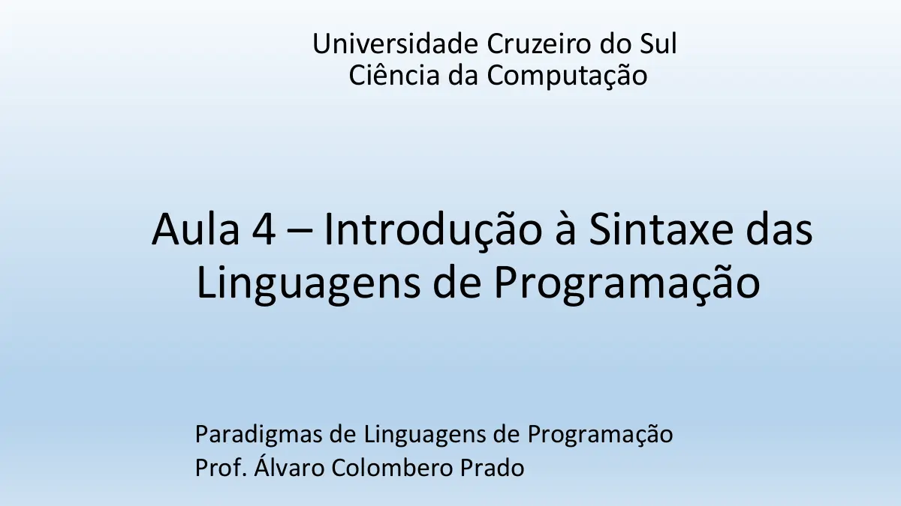

<details>
<summary>Texto da página</summary>

```text
           Universidade Cruzeiro do Sul
             Ciência da Computação

Aula 4 – Introdução à Sintaxe das
  Linguagens de Programação

  Paradigmas de Linguagens de Programação
  Prof. Álvaro Colombero Prado
```

</details>

<sub>[↑ voltar ao índice](#aula-04---sintaxe--slides-originais)</sub>

---

### Página 2

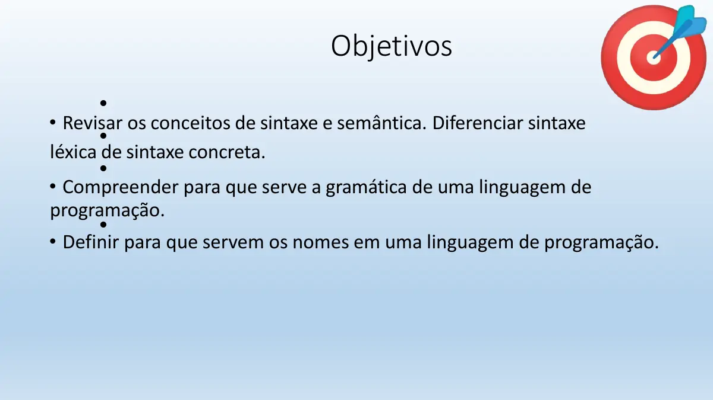

<details>
<summary>Texto da página</summary>

```text
                                  Objetivos
      ●

• Revisar
       ●
          os conceitos de sintaxe e semântica. Diferenciar sintaxe
léxica de sintaxe concreta.
      ●

• Compreender para que serve a gramática de uma linguagem de
programação.
      ●

• Definir para que servem os nomes em uma linguagem de programação.
```

</details>

<sub>[↑ voltar ao índice](#aula-04---sintaxe--slides-originais)</sub>

---

### Página 3

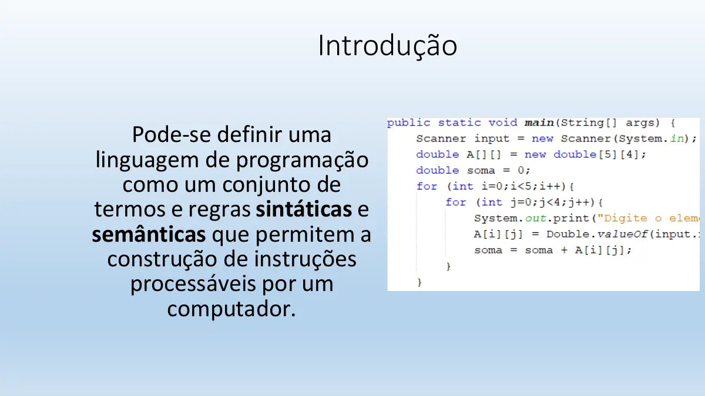

<details>
<summary>Texto da página</summary>

```text
                      Introdução

    Pode-se definir uma
linguagem de programação
   como um conjunto de
termos e regras sintáticas e
semânticas que permitem a
  construção de instruções
    processáveis por um
        computador.
```

</details>

<sub>[↑ voltar ao índice](#aula-04---sintaxe--slides-originais)</sub>

---

### Página 4

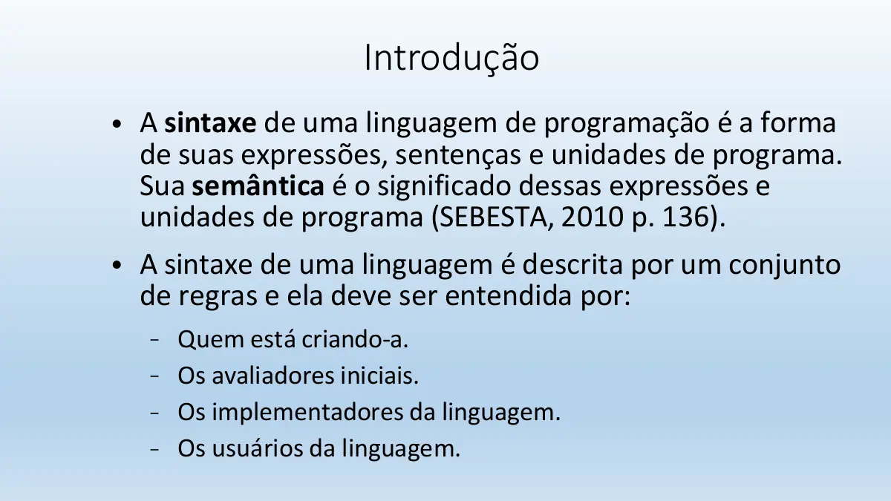

<details>
<summary>Texto da página</summary>

```text
                     Introdução
●   A sintaxe de uma linguagem de programação é a forma
    de suas expressões, sentenças e unidades de programa.
    Sua semântica é o significado dessas expressões e
    unidades de programa (SEBESTA, 2010 p. 136).
●   A sintaxe de uma linguagem é descrita por um conjunto
    de regras e ela deve ser entendida por:
    – Quem está criando-a.
    – Os avaliadores iniciais.
    – Os implementadores da linguagem.
    – Os usuários da linguagem.
```

</details>

<sub>[↑ voltar ao índice](#aula-04---sintaxe--slides-originais)</sub>

---

### Página 5

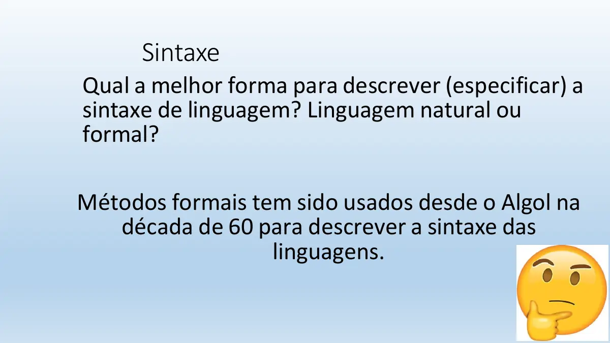

<details>
<summary>Texto da página</summary>

```text
      Sintaxe
Qual a melhor forma para descrever (especificar) a
sintaxe de linguagem? Linguagem natural ou
formal?

Métodos formais tem sido usados desde o Algol na
   década de 60 para descrever a sintaxe das
                  linguagens.
```

</details>

<sub>[↑ voltar ao índice](#aula-04---sintaxe--slides-originais)</sub>

---

### Página 6

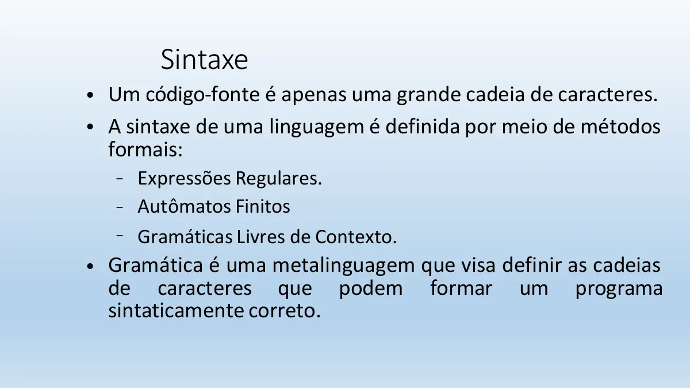

<details>
<summary>Texto da página</summary>

```text
         Sintaxe
● Um código-fonte é apenas uma grande cadeia de caracteres.
● A sintaxe de uma linguagem é definida por meio de métodos

  formais:
    – Expressões Regulares.
    – Autômatos Finitos
    – Gramáticas Livres de Contexto.
●   Gramática é uma metalinguagem que visa definir as cadeias
    de caracteres que podem formar um programa
    sintaticamente correto.
```

</details>

<sub>[↑ voltar ao índice](#aula-04---sintaxe--slides-originais)</sub>

---

### Página 7

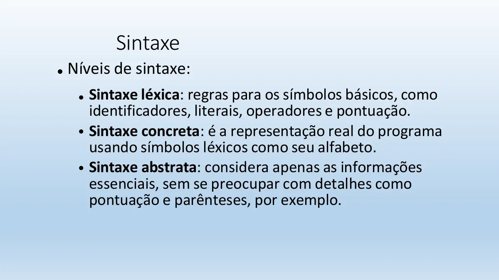

<details>
<summary>Texto da página</summary>

```text
           Sintaxe
●   Níveis de sintaxe:
     ● Sintaxe léxica: regras para os símbolos básicos, como
       identificadores, literais, operadores e pontuação.
     ● Sintaxe concreta: é a representação real do programa

       usando símbolos léxicos como seu alfabeto.
     ● Sintaxe abstrata: considera apenas as informações

       essenciais, sem se preocupar com detalhes como
       pontuação e parênteses, por exemplo.
```

</details>

<sub>[↑ voltar ao índice](#aula-04---sintaxe--slides-originais)</sub>

---

### Página 8

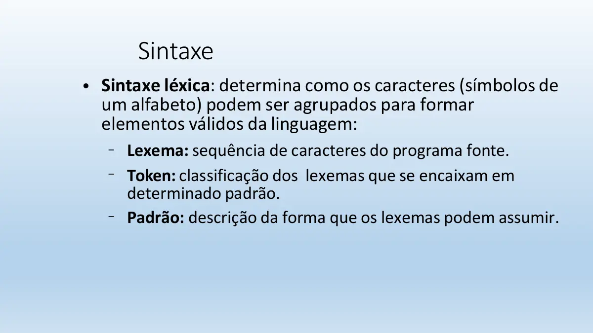

<details>
<summary>Texto da página</summary>

```text
        Sintaxe
●   Sintaxe léxica: determina como os caracteres (símbolos de
    um alfabeto) podem ser agrupados para formar
    elementos válidos da linguagem:
    – Lexema: sequência de caracteres do programa fonte.
    – Token: classificação dos lexemas que se encaixam em
      determinado padrão.
    – Padrão: descrição da forma que os lexemas podem assumir.
```

</details>

<sub>[↑ voltar ao índice](#aula-04---sintaxe--slides-originais)</sub>

---

### Página 9

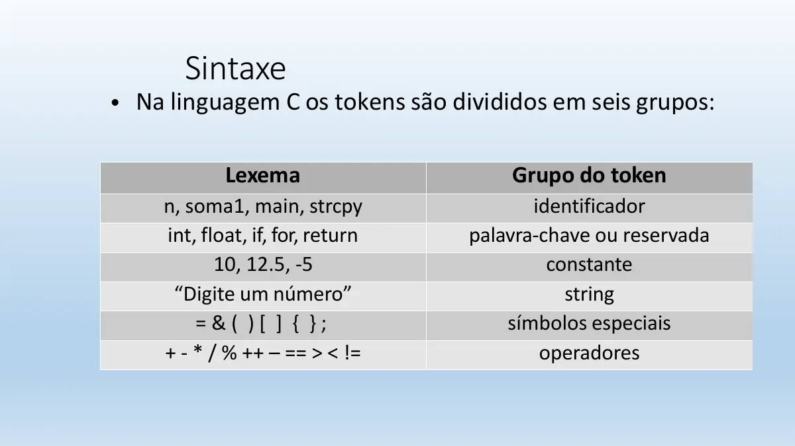

<details>
<summary>Texto da página</summary>

```text
        Sintaxe
●   Na linguagem C os tokens são divididos em seis grupos:

              Lexema                    Grupo do token
      n, soma1, main, strcpy               identificador
      int, float, if, for, return   palavra-chave ou reservada
             10, 12.5, -5                    constante
       “Digite um número”                      string
          =&( )[ ] { };                 símbolos especiais
      + - * / % ++ – == > < !=              operadores
```

</details>

<sub>[↑ voltar ao índice](#aula-04---sintaxe--slides-originais)</sub>

---

### Página 10

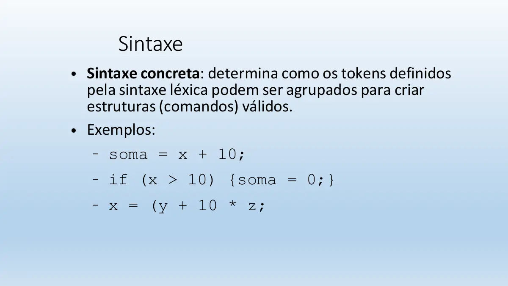

<details>
<summary>Texto da página</summary>

```text
        Sintaxe
● Sintaxe concreta: determina como os tokens definidos
  pela sintaxe léxica podem ser agrupados para criar
  estruturas (comandos) válidos.
● Exemplos:

   – soma = x + 10;

    –   if (x > 10) {soma = 0;}
    –   x = (y + 10 * z;
```

</details>

<sub>[↑ voltar ao índice](#aula-04---sintaxe--slides-originais)</sub>

---

### Página 11

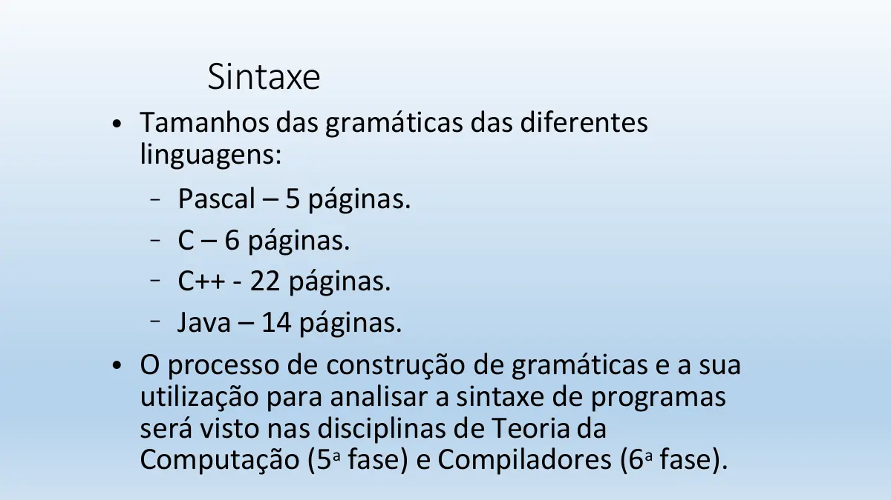

<details>
<summary>Texto da página</summary>

```text
       Sintaxe
● Tamanhos das gramáticas das diferentes
  linguagens:
   – Pascal – 5 páginas.
   – C – 6 páginas.
   – C++ - 22 páginas.
   – Java – 14 páginas.
● O processo de construção de gramáticas e a sua

  utilização para analisar a sintaxe de programas
  será visto nas disciplinas de Teoria da
  Computação (5a fase) e Compiladores (6a fase).
```

</details>

<sub>[↑ voltar ao índice](#aula-04---sintaxe--slides-originais)</sub>

---

### Página 12

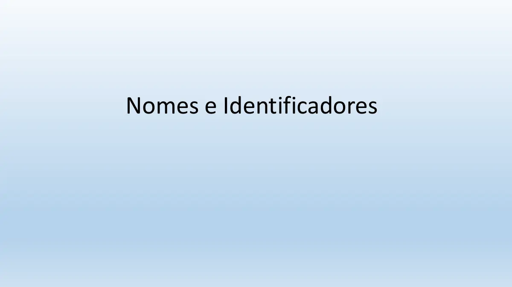

<details>
<summary>Texto da página</summary>

```text
Nomes e Identificadores
```

</details>

<sub>[↑ voltar ao índice](#aula-04---sintaxe--slides-originais)</sub>

---

### Página 13

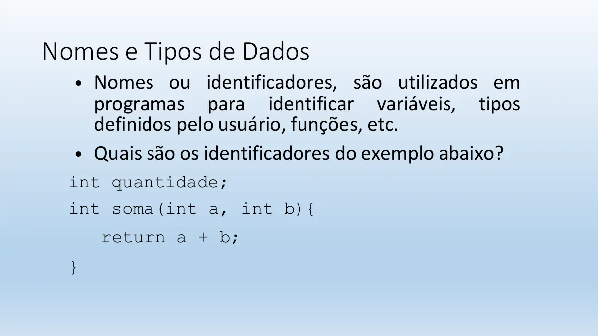

<details>
<summary>Texto da página</summary>

```text
Nomes e Tipos de Dados
  ● Nomes ou identificadores, são utilizados em
    programas para identificar variáveis, tipos
    definidos pelo usuário, funções, etc.
  ● Quais são os identificadores do exemplo abaixo?

  int quantidade;
  int soma(int a, int b){
      return a + b;
  }
```

</details>

<sub>[↑ voltar ao índice](#aula-04---sintaxe--slides-originais)</sub>

---

### Página 14

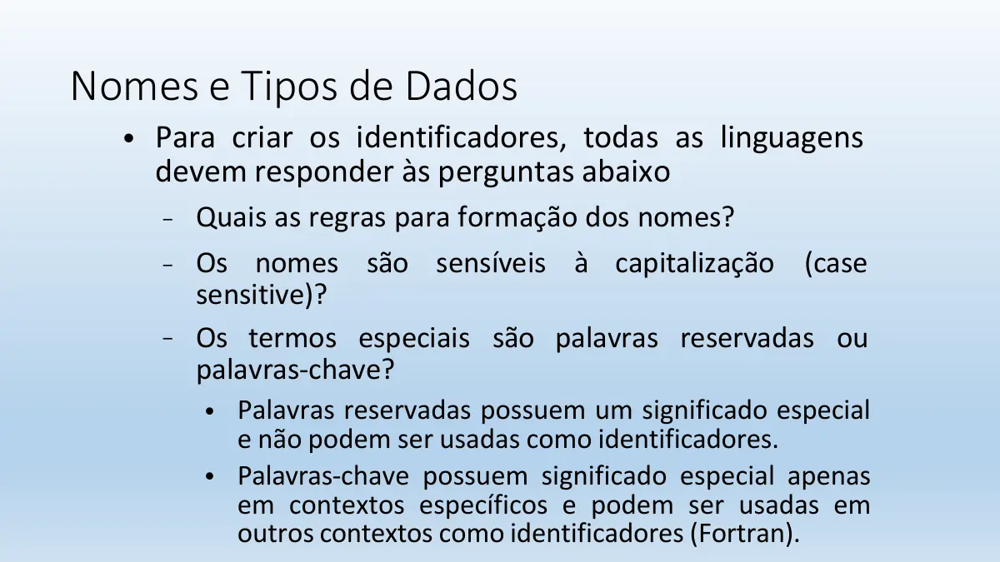

<details>
<summary>Texto da página</summary>

```text
Nomes e Tipos de Dados
  ●   Para criar os identificadores, todas as linguagens
      devem responder às perguntas abaixo
      –   Quais as regras para formação dos nomes?
      –   Os nomes são sensíveis à capitalização (case
          sensitive)?
      –   Os termos especiais são palavras reservadas ou
          palavras-chave?
          ●   Palavras reservadas possuem um significado especial
              e não podem ser usadas como identificadores.
          ●   Palavras-chave possuem significado especial apenas
              em contextos específicos e podem ser usadas em
              outros contextos como identificadores (Fortran).
```

</details>

<sub>[↑ voltar ao índice](#aula-04---sintaxe--slides-originais)</sub>

---

### Página 15

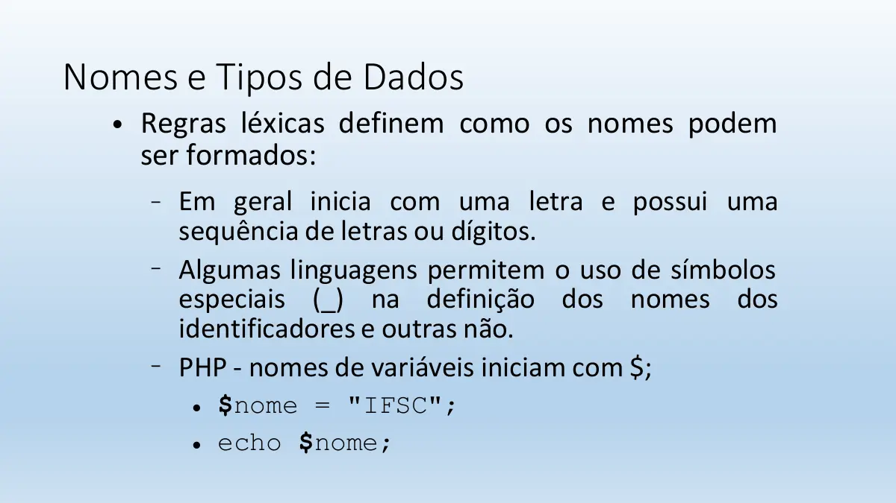

<details>
<summary>Texto da página</summary>

```text
Nomes e Tipos de Dados
  ●   Regras léxicas definem como os nomes podem
      ser formados:
      – Em geral inicia com uma letra e possui uma
        sequência de letras ou dígitos.
      – Algumas linguagens permitem o uso de símbolos
        especiais (_) na definição dos nomes dos
        identificadores e outras não.
      – PHP - nomes de variáveis iniciam com $;
          ● $nome = "IFSC";
          ● echo $nome;
```

</details>

<sub>[↑ voltar ao índice](#aula-04---sintaxe--slides-originais)</sub>

---

### Página 16

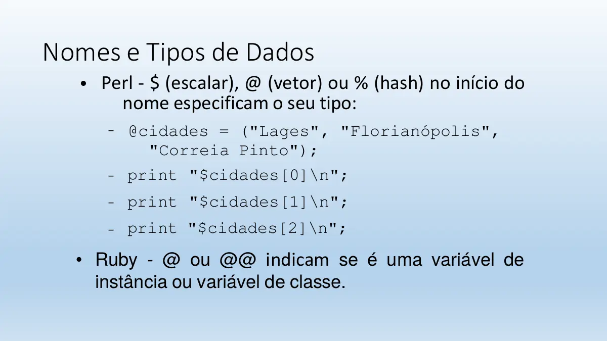

<details>
<summary>Texto da página</summary>

```text
Nomes e Tipos de Dados
   ●   Perl - $ (escalar), @ (vetor) ou % (hash) no início do
         nome especificam o seu tipo:
        –   @cidades = ("Lages", "Florianópolis",
              "Correia Pinto");
        –   print "$cidades[0]\n";
        –   print "$cidades[1]\n";
        –   print "$cidades[2]\n";
  ●    Ruby - @ ou @@ indicam se é uma variável de
       instância ou variável de classe.
```

</details>

<sub>[↑ voltar ao índice](#aula-04---sintaxe--slides-originais)</sub>

---

### Página 17

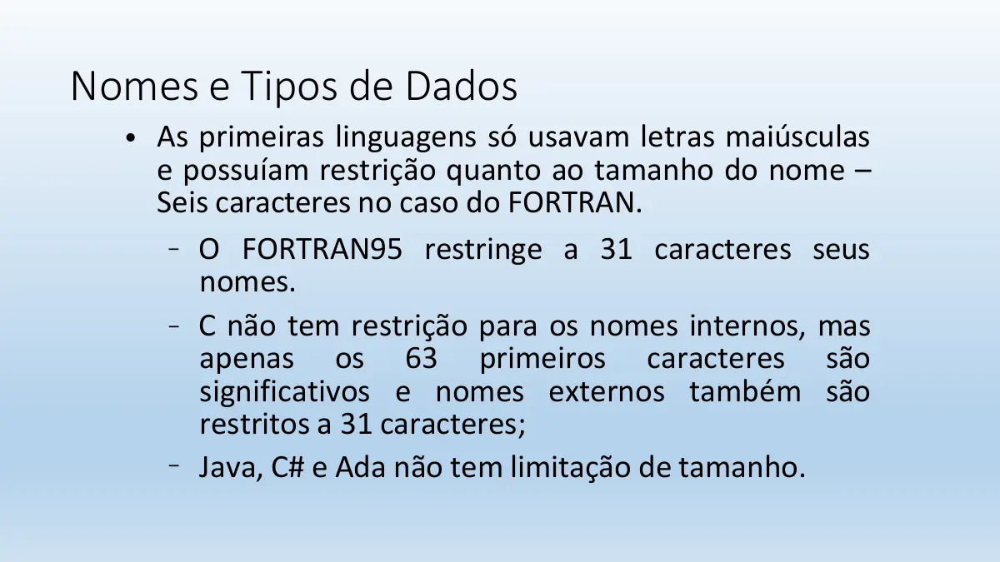

<details>
<summary>Texto da página</summary>

```text
Nomes e Tipos de Dados
  ●   As primeiras linguagens só usavam letras maiúsculas
      e possuíam restrição quanto ao tamanho do nome –
      Seis caracteres no caso do FORTRAN.
       – O FORTRAN95 restringe a 31 caracteres seus
         nomes.
       – C não tem restrição para os nomes internos, mas
         apenas os 63 primeiros caracteres são
         significativos e nomes externos também são
         restritos a 31 caracteres;
       – Java, C# e Ada não tem limitação de tamanho.
```

</details>

<sub>[↑ voltar ao índice](#aula-04---sintaxe--slides-originais)</sub>

---

### Página 18

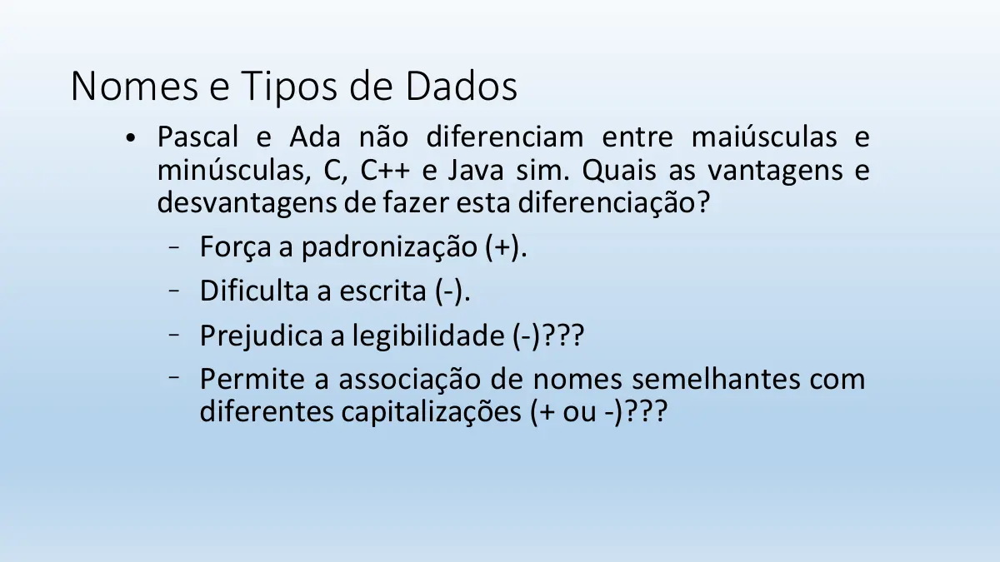

<details>
<summary>Texto da página</summary>

```text
Nomes e Tipos de Dados
  ●   Pascal e Ada não diferenciam entre maiúsculas e
      minúsculas, C, C++ e Java sim. Quais as vantagens e
      desvantagens de fazer esta diferenciação?
       – Força a padronização (+).
       – Dificulta a escrita (-).
       – Prejudica a legibilidade (-)???
       – Permite a associação de nomes semelhantes com
         diferentes capitalizações (+ ou -)???
```

</details>

<sub>[↑ voltar ao índice](#aula-04---sintaxe--slides-originais)</sub>

---

### Página 19

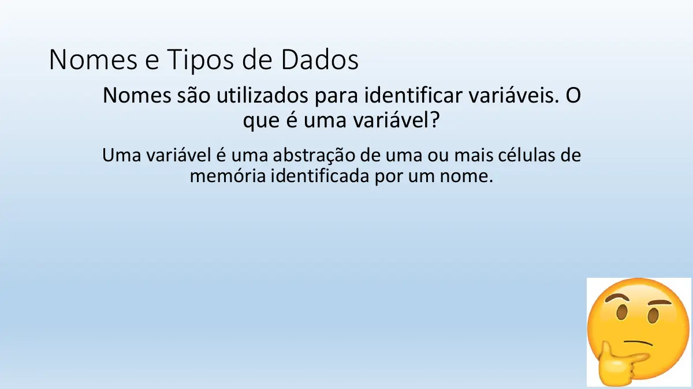

<details>
<summary>Texto da página</summary>

```text
Nomes e Tipos de Dados
   Nomes são utilizados para identificar variáveis. O
                que é uma variável?
   Uma variável é uma abstração de uma ou mais células de
            memória identificada por um nome.
```

</details>

<sub>[↑ voltar ao índice](#aula-04---sintaxe--slides-originais)</sub>

---

### Página 20

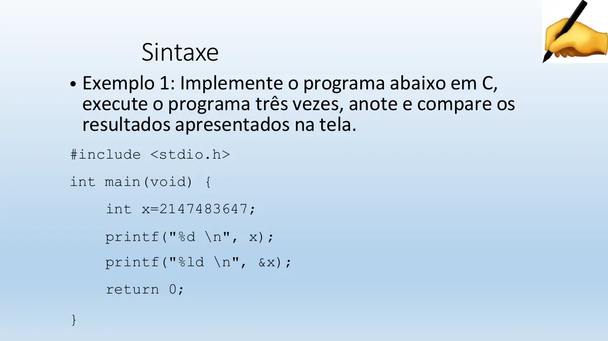

<details>
<summary>Texto da página</summary>

```text
          Sintaxe
●   Exemplo 1: Implemente o programa abaixo em C,
    execute o programa três vezes, anote e compare os
    resultados apresentados na tela.
#include <stdio.h>
int main(void) {
      int x=2147483647;
      printf("%d \n", x);
      printf("%ld \n", &x);
      return 0;

}
```

</details>

<sub>[↑ voltar ao índice](#aula-04---sintaxe--slides-originais)</sub>

---

### Página 21

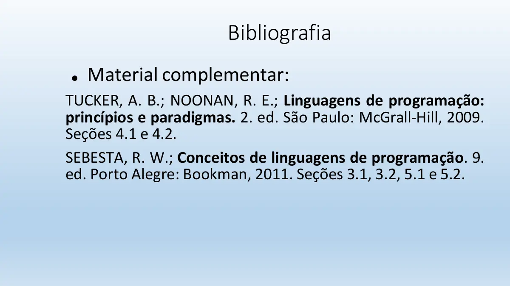

<details>
<summary>Texto da página</summary>

```text
                       Bibliografia
●   Material complementar:
TUCKER, A. B.; NOONAN, R. E.; Linguagens de programação:
princípios e paradigmas. 2. ed. São Paulo: McGrall-Hill, 2009.
Seções 4.1 e 4.2.
SEBESTA, R. W.; Conceitos de linguagens de programação. 9.
ed. Porto Alegre: Bookman, 2011. Seções 3.1, 3.2, 5.1 e 5.2.
```

</details>

<sub>[↑ voltar ao índice](#aula-04---sintaxe--slides-originais)</sub>


<!-- nav:rodape -->

---

**Aula 04:** [Visão geral](../README.md) · **Slides** · [Resumo](../02%20-%20Resumo%20Teórico/resumo-aula-04.md) · [Exercícios](../03%20-%20Exercícios/exercicios-aula-04.md) · [Resoluções](../04%20-%20Resoluções/resolucoes-aula-04.md) · [Complementos](../05%20-%20Materiais%20Complementares/materiais-complementares.md)

← [Aula 03 · Slides](../../Aula%2003%20-%20Implementação%20das%20Linguagens/01%20-%20Slides%20Originais/README.md) · [Aula 05 · Slides](../../Aula%2005%20-%20Semântica/01%20-%20Slides%20Originais/README.md) →

**Links para esta página (9):** [Aula 03 · Resumo](../../Aula%2003%20-%20Implementação%20das%20Linguagens/02%20-%20Resumo%20Teórico/resumo-aula-03.md) · [Aula 03 · Complementos](../../Aula%2003%20-%20Implementação%20das%20Linguagens/05%20-%20Materiais%20Complementares/materiais-complementares.md) · [Aula 04 · Resumo](../02%20-%20Resumo%20Teórico/resumo-aula-04.md) · [Aula 04 · Exercícios](../03%20-%20Exercícios/exercicios-aula-04.md) · [Aula 04 · Resoluções](../04%20-%20Resoluções/resolucoes-aula-04.md) · [Aula 04 · Complementos](../05%20-%20Materiais%20Complementares/materiais-complementares.md) · [Lista 02 · Resolução](../../../02%20-%20Listas%20de%20Exercícios/Lista%2002%20-%20Revisão%20II/02%20-%20Resolução/resolucao-lista-02.md) · [Erratas e inconsistências do material](../../../06%20-%20Revisões%20e%20Sínteses/erratas-e-inconsistencias.md) · [Quadros comparativos](../../../06%20-%20Revisões%20e%20Sínteses/quadros-comparativos.md)

<!-- /nav:rodape -->
