<!-- nav:topo -->
[Início](../../../README.md) › [01 - Aulas](../../README.md) › [Aula 05](../README.md) › **01 - Slides Originais** · [Mapa](../../../MAPA.md)
<!-- /nav:topo -->

<!-- gerado por ferramentas/geradores/gerar_galerias.py: não edite à mão -->

# Aula 05 - Semântica · Slides originais

> **[Material original]** Slides originais do professor, página por página, para ler aqui mesmo no GitHub. O arquivo original é o PDF [`Aula05_Semantica.pdf`](Aula05_Semantica.pdf) (18 páginas): use-o para baixar ou imprimir. As imagens e o texto de cada página foram extraídos do PDF, sem alteração do conteúdo.

**Ir para a página:** [1](#página-1) · [2](#página-2) · [3](#página-3) · [4](#página-4) · [5](#página-5) · [6](#página-6) · [7](#página-7) · [8](#página-8) · [9](#página-9) · [10](#página-10) · [11](#página-11) · [12](#página-12) · [13](#página-13) · [14](#página-14) · [15](#página-15) · [16](#página-16) · [17](#página-17) · [18](#página-18)

O texto de cada página fica em **Texto da página**, logo abaixo da imagem: é por ele que a busca encontra o conteúdo dos slides.

---

### Página 1

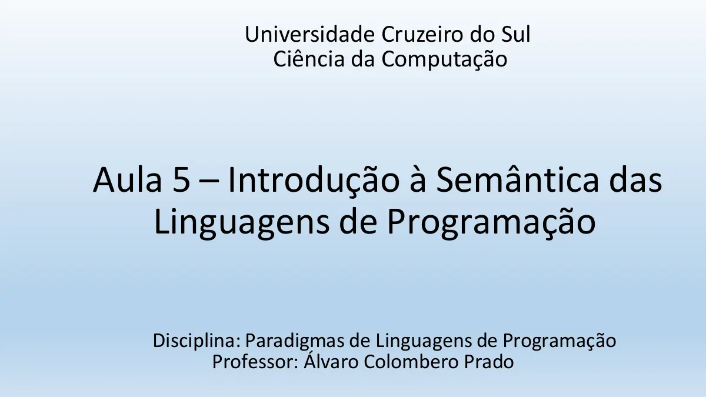

<details>
<summary>Texto da página</summary>

```text
             Universidade Cruzeiro do Sul
               Ciência da Computação

Aula 5 – Introdução à Semântica das
   Linguagens de Programação

   Disciplina: Paradigmas de Linguagens de Programação
           Professor: Álvaro Colombero Prado
```

</details>

<sub>[↑ voltar ao índice](#aula-05---semântica--slides-originais)</sub>

---

### Página 2

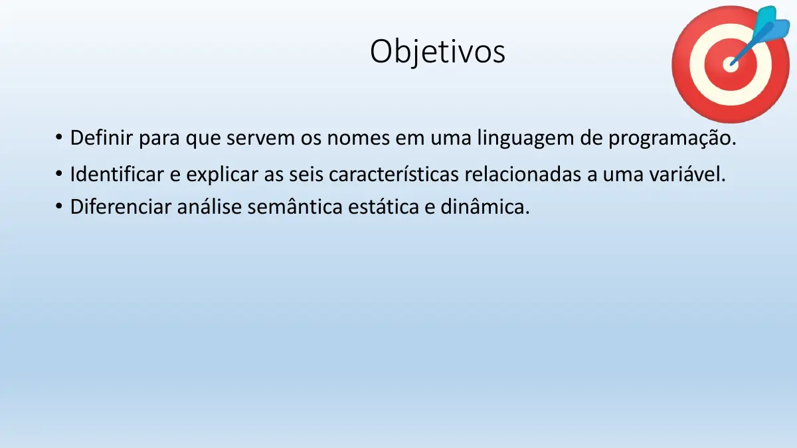

<details>
<summary>Texto da página</summary>

```text
                                    Objetivos

• Definir para que servem os nomes em uma linguagem de programação.
• Identificar e explicar as seis características relacionadas a uma variável.
• Diferenciar análise semântica estática e dinâmica.
```

</details>

<sub>[↑ voltar ao índice](#aula-05---semântica--slides-originais)</sub>

---

### Página 3

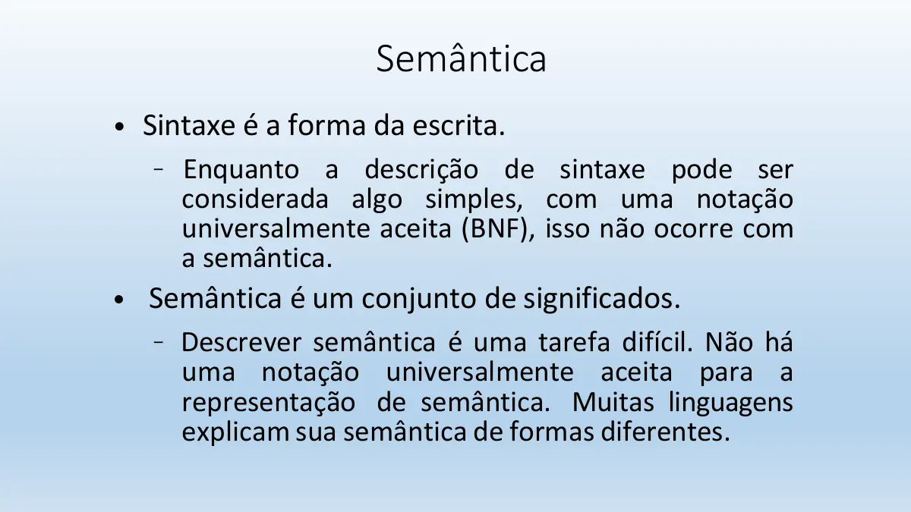

<details>
<summary>Texto da página</summary>

```text
                       Semântica
●   Sintaxe é a forma da escrita.
    –   Enquanto a descrição de sintaxe pode ser
        considerada algo simples, com uma notação
        universalmente aceita (BNF), isso não ocorre com
        a semântica.
●   Semântica é um conjunto de significados.
    –   Descrever semântica é uma tarefa difícil. Não há
        uma notação universalmente aceita para a
        representação de semântica. Muitas linguagens
        explicam sua semântica de formas diferentes.
```

</details>

<sub>[↑ voltar ao índice](#aula-05---semântica--slides-originais)</sub>

---

### Página 4

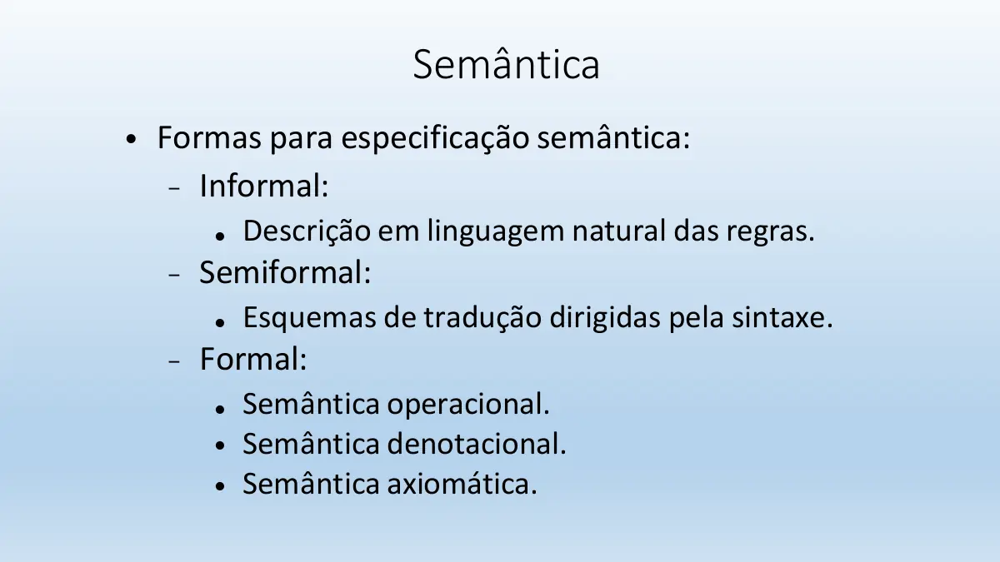

<details>
<summary>Texto da página</summary>

```text
                        Semântica
●   Formas para especificação semântica:
     – Informal:
        ●   Descrição em linguagem natural das regras.
    –   Semiformal:
        ●   Esquemas de tradução dirigidas pela sintaxe.
    –   Formal:
        ● Semântica operacional.
        ● Semântica denotacional.

        ● Semântica axiomática.
```

</details>

<sub>[↑ voltar ao índice](#aula-05---semântica--slides-originais)</sub>

---

### Página 5

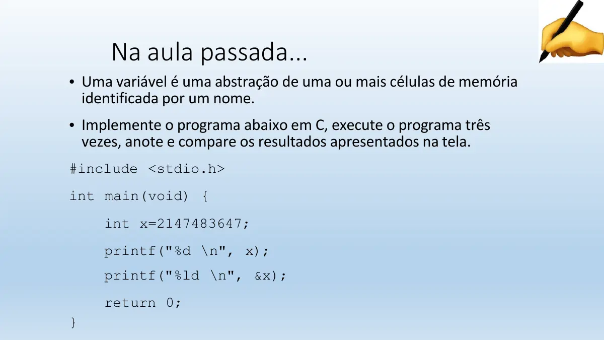

<details>
<summary>Texto da página</summary>

```text
        Na aula passada...
●   Uma variável é uma abstração de uma ou mais células de memória
    identificada por um nome.
●   Implemente o programa abaixo em C, execute o programa três
    vezes, anote e compare os resultados apresentados na tela.
#include <stdio.h>
int main(void) {
       int x=2147483647;
       printf("%d \n", x);
       printf("%ld \n", &x);
       return 0;
}
```

</details>

<sub>[↑ voltar ao índice](#aula-05---semântica--slides-originais)</sub>

---

### Página 6

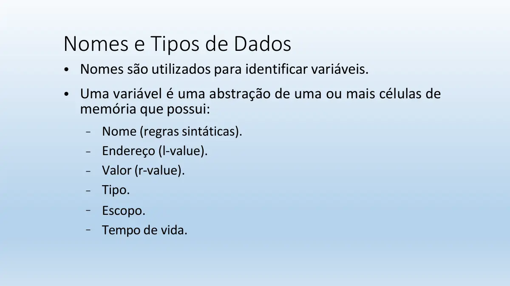

<details>
<summary>Texto da página</summary>

```text
Nomes e Tipos de Dados
●   Nomes são utilizados para identificar variáveis.
●   Uma variável é uma abstração de uma ou mais células de
    memória que possui:
    –   Nome (regras sintáticas).
    –   Endereço (l-value).
    –   Valor (r-value).
    –   Tipo.
    –   Escopo.
    –   Tempo de vida.
```

</details>

<sub>[↑ voltar ao índice](#aula-05---semântica--slides-originais)</sub>

---

### Página 7

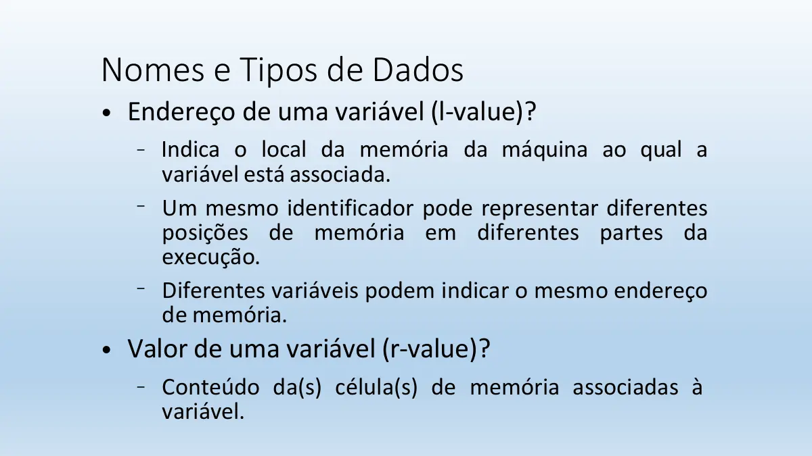

<details>
<summary>Texto da página</summary>

```text
Nomes e Tipos de Dados
●   Endereço de uma variável (l-value)?
    – Indica o local da memória da máquina ao qual a
      variável está associada.
    – Um mesmo identificador pode representar diferentes
      posições de memória em diferentes partes da
      execução.
    – Diferentes variáveis podem indicar o mesmo endereço
      de memória.
●   Valor de uma variável (r-value)?
    –   Conteúdo da(s) célula(s) de memória associadas à
        variável.
```

</details>

<sub>[↑ voltar ao índice](#aula-05---semântica--slides-originais)</sub>

---

### Página 8

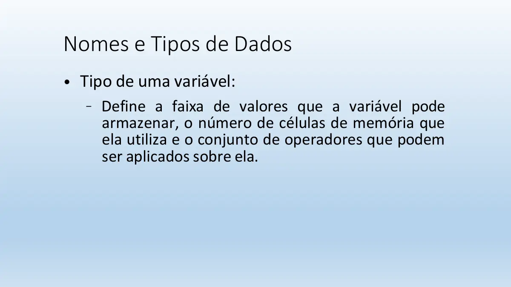

<details>
<summary>Texto da página</summary>

```text
Nomes e Tipos de Dados
●   Tipo de uma variável:
    –   Define a faixa de valores que a variável pode
        armazenar, o número de células de memória que
        ela utiliza e o conjunto de operadores que podem
        ser aplicados sobre ela.
```

</details>

<sub>[↑ voltar ao índice](#aula-05---semântica--slides-originais)</sub>

---

### Página 9

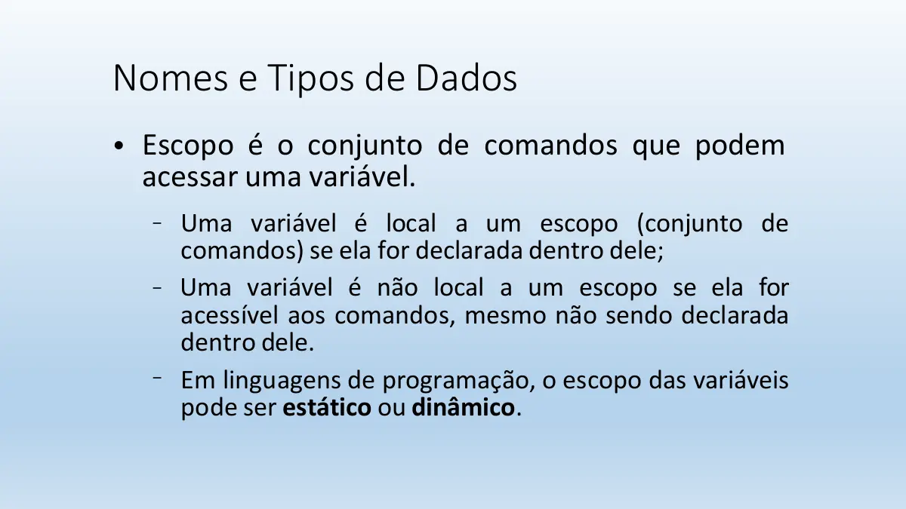

<details>
<summary>Texto da página</summary>

```text
Nomes e Tipos de Dados
●   Escopo é o conjunto de comandos que podem
    acessar uma variável.
    – Uma variável é local a um escopo (conjunto de
      comandos) se ela for declarada dentro dele;
    – Uma variável é não local a um escopo se ela for
      acessível aos comandos, mesmo não sendo declarada
      dentro dele.
    – Em linguagens de programação, o escopo das variáveis
      pode ser estático ou dinâmico.
```

</details>

<sub>[↑ voltar ao índice](#aula-05---semântica--slides-originais)</sub>

---

### Página 10

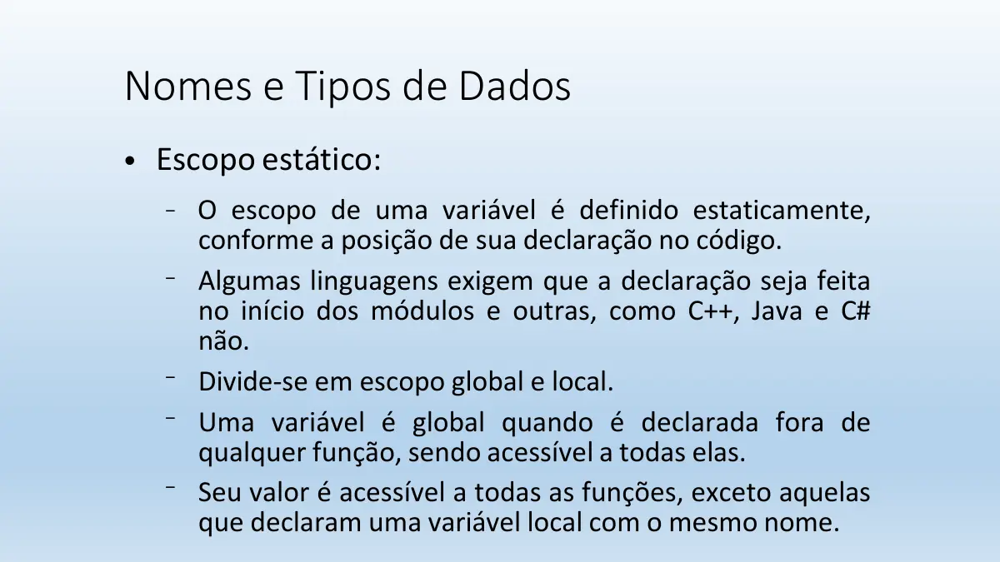

<details>
<summary>Texto da página</summary>

```text
Nomes e Tipos de Dados
●   Escopo estático:
    –   O escopo de uma variável é definido estaticamente,
        conforme a posição de sua declaração no código.
    –   Algumas linguagens exigem que a declaração seja feita
        no início dos módulos e outras, como C++, Java e C#
        não.
    –   Divide-se em escopo global e local.
    –   Uma variável é global quando é declarada fora de
        qualquer função, sendo acessível a todas elas.
    –   Seu valor é acessível a todas as funções, exceto aquelas
        que declaram uma variável local com o mesmo nome.
```

</details>

<sub>[↑ voltar ao índice](#aula-05---semântica--slides-originais)</sub>

---

### Página 11

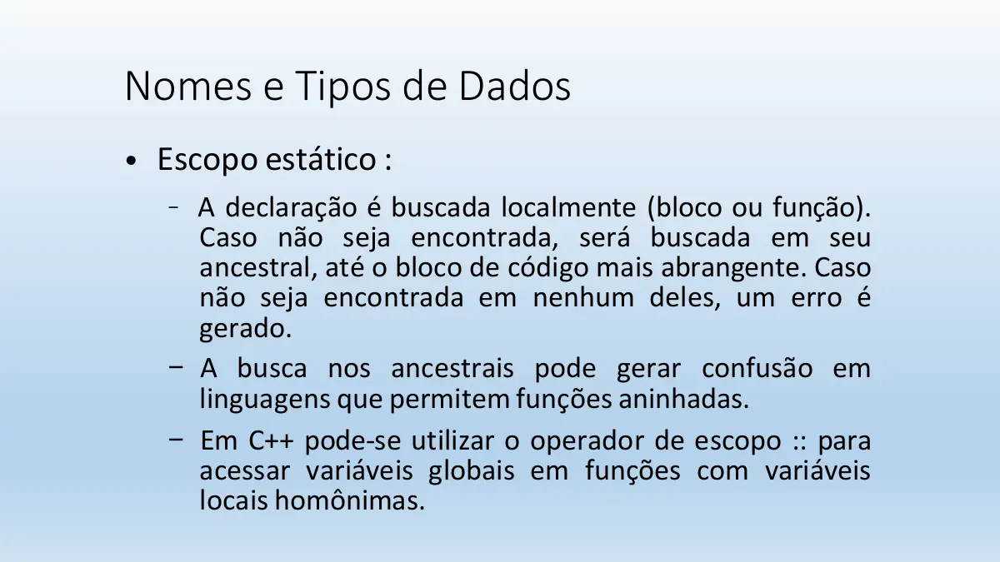

<details>
<summary>Texto da página</summary>

```text
Nomes e Tipos de Dados
●   Escopo estático :
    – A declaração é buscada localmente (bloco ou função).
      Caso não seja encontrada, será buscada em seu
      ancestral, até o bloco de código mais abrangente. Caso
      não seja encontrada em nenhum deles, um erro é
      gerado.
    – A busca nos ancestrais pode gerar confusão em
      linguagens que permitem funções aninhadas.
    – Em C++ pode-se utilizar o operador de escopo :: para
      acessar variáveis globais em funções com variáveis
      locais homônimas.
```

</details>

<sub>[↑ voltar ao índice](#aula-05---semântica--slides-originais)</sub>

---

### Página 12

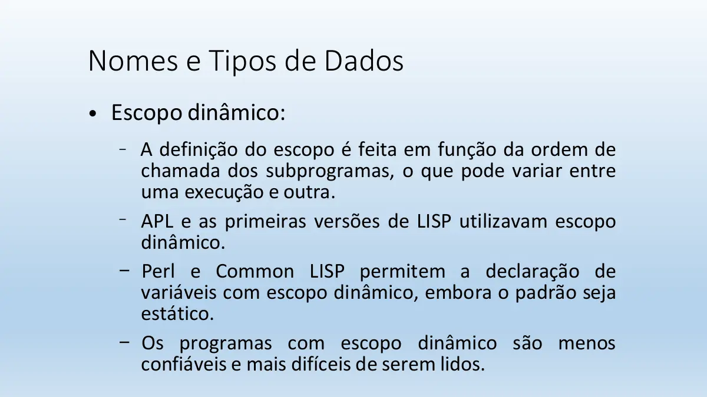

<details>
<summary>Texto da página</summary>

```text
Nomes e Tipos de Dados
●   Escopo dinâmico:
    – A definição do escopo é feita em função da ordem de
      chamada dos subprogramas, o que pode variar entre
      uma execução e outra.
    – APL e as primeiras versões de LISP utilizavam escopo
      dinâmico.
    – Perl e Common LISP permitem a declaração de
      variáveis com escopo dinâmico, embora o padrão seja
      estático.
    – Os programas com escopo dinâmico são menos
      confiáveis e mais difíceis de serem lidos.
```

</details>

<sub>[↑ voltar ao índice](#aula-05---semântica--slides-originais)</sub>

---

### Página 13

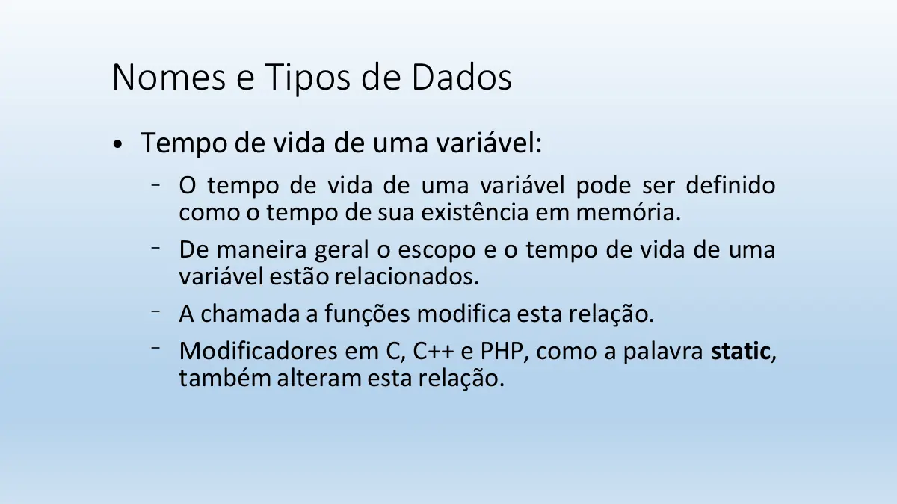

<details>
<summary>Texto da página</summary>

```text
Nomes e Tipos de Dados
●   Tempo de vida de uma variável:
    – O tempo de vida de uma variável pode ser definido
      como o tempo de sua existência em memória.
    – De maneira geral o escopo e o tempo de vida de uma
      variável estão relacionados.
    – A chamada a funções modifica esta relação.
    – Modificadores em C, C++ e PHP, como a palavra static,
      também alteram esta relação.
```

</details>

<sub>[↑ voltar ao índice](#aula-05---semântica--slides-originais)</sub>

---

### Página 14

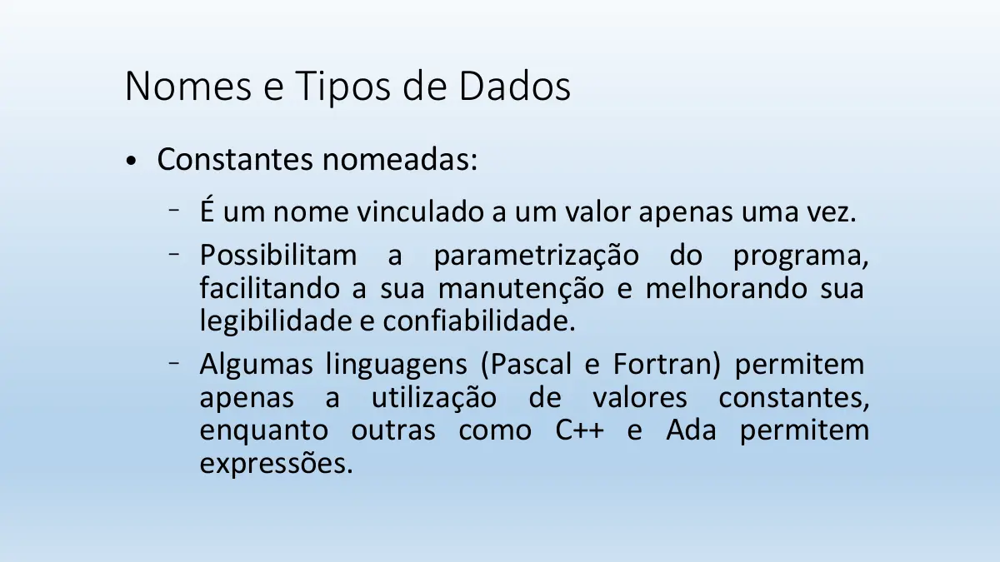

<details>
<summary>Texto da página</summary>

```text
Nomes e Tipos de Dados
●   Constantes nomeadas:
    – É um nome vinculado a um valor apenas uma vez.
    – Possibilitam a parametrização do programa,
      facilitando a sua manutenção e melhorando sua
      legibilidade e confiabilidade.
    – Algumas linguagens (Pascal e Fortran) permitem
      apenas a utilização de valores constantes,
      enquanto outras como C++ e Ada permitem
      expressões.
```

</details>

<sub>[↑ voltar ao índice](#aula-05---semântica--slides-originais)</sub>

---

### Página 15

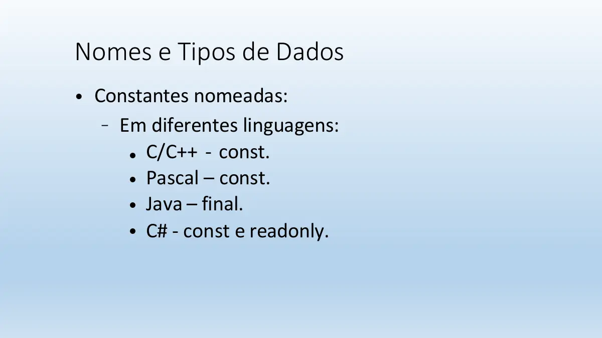

<details>
<summary>Texto da página</summary>

```text
Nomes e Tipos de Dados
●   Constantes nomeadas:
     – Em diferentes linguagens:
        ● C/C++ - const.

        ● Pascal – const.

        ● Java – final.

        ● C# - const e readonly.
```

</details>

<sub>[↑ voltar ao índice](#aula-05---semântica--slides-originais)</sub>

---

### Página 16

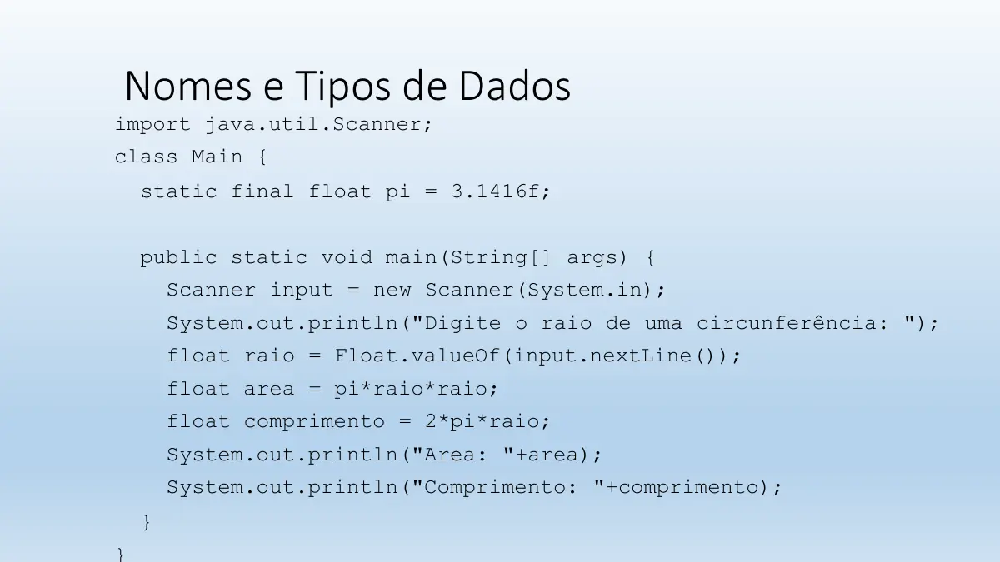

<details>
<summary>Texto da página</summary>

```text
Nomes e Tipos de Dados
import java.util.Scanner;
class Main {
    static final float pi = 3.1416f;

    public static void main(String[] args) {
        Scanner input = new Scanner(System.in);
        System.out.println("Digite o raio de uma circunferência: ");
        float raio = Float.valueOf(input.nextLine());
        float area = pi*raio*raio;
        float comprimento = 2*pi*raio;
        System.out.println("Area: "+area);
        System.out.println("Comprimento: "+comprimento);
    }
}
```

</details>

<sub>[↑ voltar ao índice](#aula-05---semântica--slides-originais)</sub>

---

### Página 17

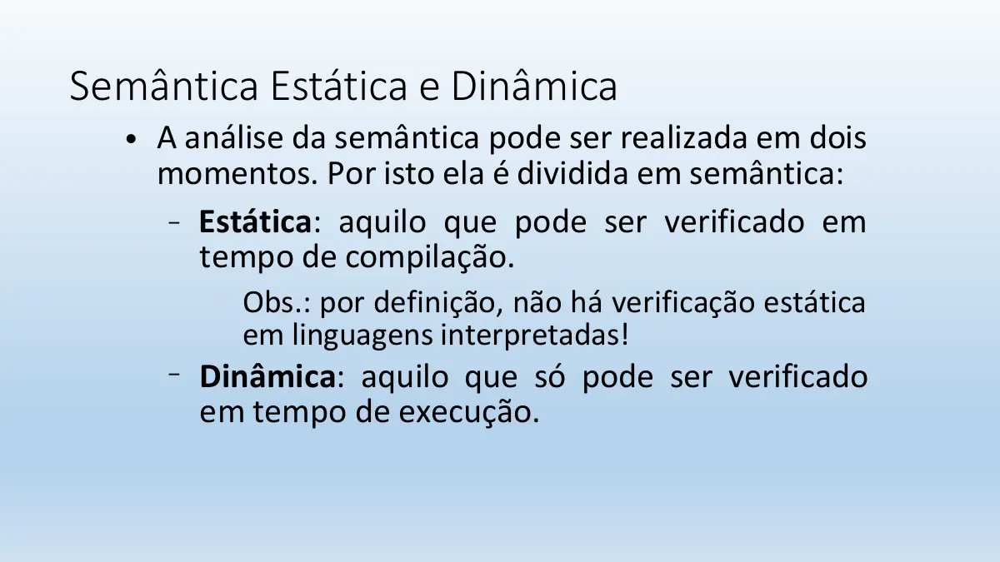

<details>
<summary>Texto da página</summary>

```text
Semântica Estática e Dinâmica
  ●   A análise da semântica pode ser realizada em dois
      momentos. Por isto ela é dividida em semântica:
       – Estática: aquilo que pode ser verificado em
         tempo de compilação.
            Obs.: por definição, não há verificação estática
            em linguagens interpretadas!
      –   Dinâmica: aquilo que só pode ser verificado
          em tempo de execução.
```

</details>

<sub>[↑ voltar ao índice](#aula-05---semântica--slides-originais)</sub>

---

### Página 18

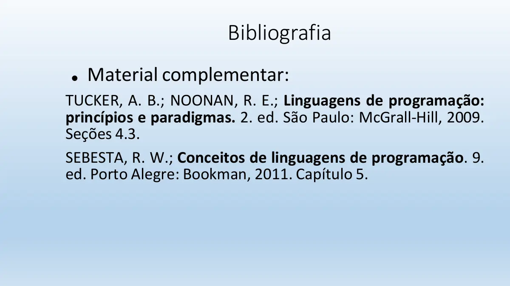

<details>
<summary>Texto da página</summary>

```text
                       Bibliografia
●   Material complementar:
TUCKER, A. B.; NOONAN, R. E.; Linguagens de programação:
princípios e paradigmas. 2. ed. São Paulo: McGrall-Hill, 2009.
Seções 4.3.
SEBESTA, R. W.; Conceitos de linguagens de programação. 9.
ed. Porto Alegre: Bookman, 2011. Capítulo 5.
```

</details>

<sub>[↑ voltar ao índice](#aula-05---semântica--slides-originais)</sub>


<!-- nav:rodape -->

---

**Aula 05:** [Visão geral](../README.md) · **Slides** · [Resumo](../02%20-%20Resumo%20Teórico/resumo-aula-05.md) · [Exercícios](../03%20-%20Exercícios/exercicios-aula-05.md) · [Resoluções](../04%20-%20Resoluções/resolucoes-aula-05.md) · [Complementos](../05%20-%20Materiais%20Complementares/materiais-complementares.md)

← [Aula 04 · Slides](../../Aula%2004%20-%20Sintaxe/01%20-%20Slides%20Originais/README.md) · [Aula 06 · Slides](../../Aula%2006%20-%20Sistema%20de%20Tipos/01%20-%20Slides%20Originais/README.md) →

**Links para esta página (12):** [Aula 02 · Resoluções](../../Aula%2002%20-%20Evolução%20das%20Linguagens%20e%20Paradigmas/04%20-%20Resoluções/resolucoes-aula-02.md) · [Aula 03 · Resumo](../../Aula%2003%20-%20Implementação%20das%20Linguagens/02%20-%20Resumo%20Teórico/resumo-aula-03.md) · [Aula 03 · Resoluções](../../Aula%2003%20-%20Implementação%20das%20Linguagens/04%20-%20Resoluções/resolucoes-aula-03.md) · [Aula 04 · Resumo](../../Aula%2004%20-%20Sintaxe/02%20-%20Resumo%20Teórico/resumo-aula-04.md) · [Aula 05 · Resumo](../02%20-%20Resumo%20Teórico/resumo-aula-05.md) · [Aula 05 · Resoluções](../04%20-%20Resoluções/resolucoes-aula-05.md) · [Aula 05 · Complementos](../05%20-%20Materiais%20Complementares/materiais-complementares.md) · [Lista 02 · Resolução](../../../02%20-%20Listas%20de%20Exercícios/Lista%2002%20-%20Revisão%20II/02%20-%20Resolução/resolucao-lista-02.md) · [Simulado 02 · Resolução comentada](../../../04%20-%20Provas%20e%20Avaliações/Simulados/resolucao-simulado-02.md) · [Erratas e inconsistências do material](../../../06%20-%20Revisões%20e%20Sínteses/erratas-e-inconsistencias.md) · [Quadros comparativos](../../../06%20-%20Revisões%20e%20Sínteses/quadros-comparativos.md) · [P1 — Interpretador de expressões](../../../09%20-%20Projetos%20Práticos/P1%20-%20Interpretador%20de%20Expressões/README.md)

<!-- /nav:rodape -->
