<!-- nav:topo -->
[Início](../../../README.md) › [01 - Aulas](../../README.md) › [Aula 06](../README.md) › **01 - Slides Originais** · [Mapa](../../../MAPA.md)
<!-- /nav:topo -->

<!-- gerado por ferramentas/geradores/gerar_galerias.py: não edite à mão -->

# Aula 06 - Sistema de Tipos · Slides originais

> **[Material original]** Slides originais do professor, página por página, para ler aqui mesmo no GitHub. O arquivo original é o PDF [`Aula06_Tipos.pdf`](Aula06_Tipos.pdf) (26 páginas): use-o para baixar ou imprimir. As imagens e o texto de cada página foram extraídos do PDF, sem alteração do conteúdo.

**Ir para a página:** [1](#página-1) · [2](#página-2) · [3](#página-3) · [4](#página-4) · [5](#página-5) · [6](#página-6) · [7](#página-7) · [8](#página-8) · [9](#página-9) · [10](#página-10) · [11](#página-11) · [12](#página-12) · [13](#página-13) · [14](#página-14) · [15](#página-15) · [16](#página-16) · [17](#página-17) · [18](#página-18) · [19](#página-19) · [20](#página-20) · [21](#página-21) · [22](#página-22) · [23](#página-23) · [24](#página-24) · [25](#página-25) · [26](#página-26)

O texto de cada página fica em **Texto da página**, logo abaixo da imagem: é por ele que a busca encontra o conteúdo dos slides.

---

### Página 1

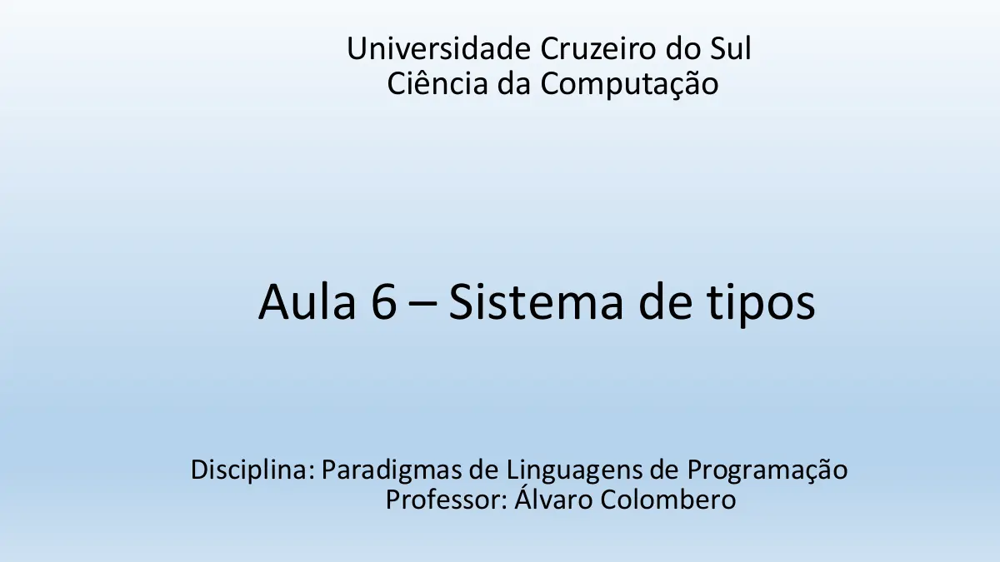

<details>
<summary>Texto da página</summary>

```text
            Universidade Cruzeiro do Sul
              Ciência da Computação

     Aula 6 – Sistema de tipos

Disciplina: Paradigmas de Linguagens de Programação
                 Professor: Álvaro Colombero
```

</details>

<sub>[↑ voltar ao índice](#aula-06---sistema-de-tipos--slides-originais)</sub>

---

### Página 2

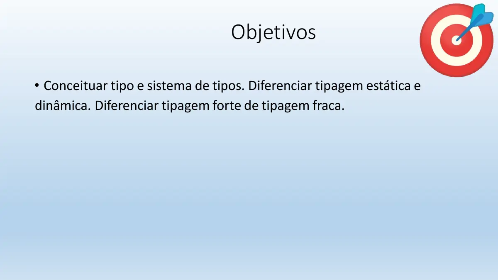

<details>
<summary>Texto da página</summary>

```text
                                  Objetivos

• Conceituar tipo e sistema de tipos. Diferenciar tipagem estática e
dinâmica. Diferenciar tipagem forte de tipagem fraca.
```

</details>

<sub>[↑ voltar ao índice](#aula-06---sistema-de-tipos--slides-originais)</sub>

---

### Página 3

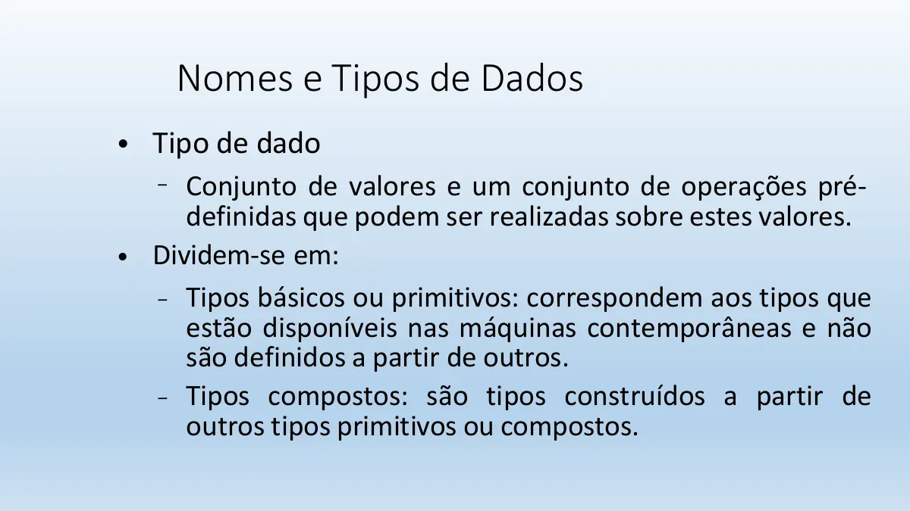

<details>
<summary>Texto da página</summary>

```text
        Nomes e Tipos de Dados
●   Tipo de dado
    –  Conjunto de valores e um conjunto de operações pré-
       definidas que podem ser realizadas sobre estes valores.
●   Dividem-se em:
    – Tipos básicos ou primitivos: correspondem aos tipos que
       estão disponíveis nas máquinas contemporâneas e não
       são definidos a partir de outros.
    – Tipos compostos: são tipos construídos a partir de
       outros tipos primitivos ou compostos.
```

</details>

<sub>[↑ voltar ao índice](#aula-06---sistema-de-tipos--slides-originais)</sub>

---

### Página 4

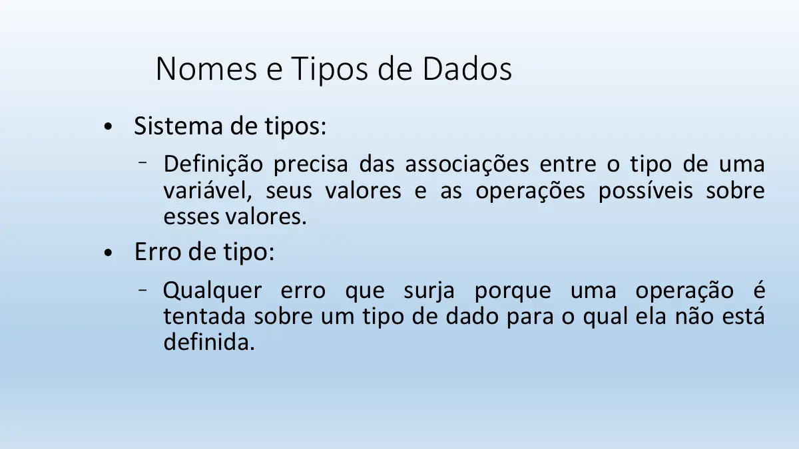

<details>
<summary>Texto da página</summary>

```text
        Nomes e Tipos de Dados
●   Sistema de tipos:
    –   Definição precisa das associações entre o tipo de uma
        variável, seus valores e as operações possíveis sobre
        esses valores.
●   Erro de tipo:
    –   Qualquer erro que surja porque uma operação é
        tentada sobre um tipo de dado para o qual ela não está
        definida.
```

</details>

<sub>[↑ voltar ao índice](#aula-06---sistema-de-tipos--slides-originais)</sub>

---

### Página 5

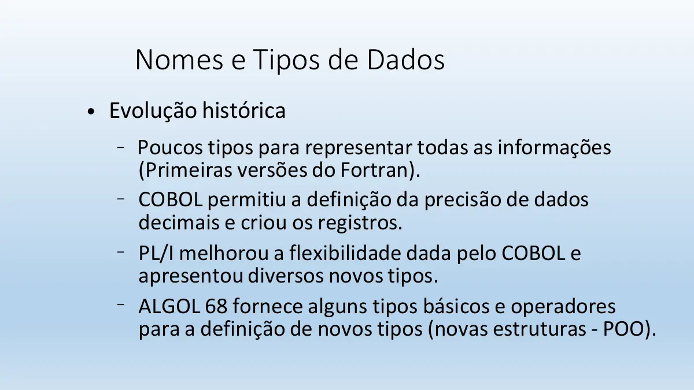

<details>
<summary>Texto da página</summary>

```text
        Nomes e Tipos de Dados
●   Evolução histórica
    – Poucos tipos para representar todas as informações
      (Primeiras versões do Fortran).
    – COBOL permitiu a definição da precisão de dados
      decimais e criou os registros.
    – PL/I melhorou a flexibilidade dada pelo COBOL e
      apresentou diversos novos tipos.
    – ALGOL 68 fornece alguns tipos básicos e operadores
      para a definição de novos tipos (novas estruturas - POO).
```

</details>

<sub>[↑ voltar ao índice](#aula-06---sistema-de-tipos--slides-originais)</sub>

---

### Página 6

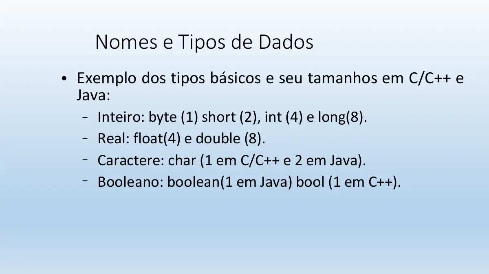

<details>
<summary>Texto da página</summary>

```text
        Nomes e Tipos de Dados
●   Exemplo dos tipos básicos e seu tamanhos em C/C++ e
    Java:
    – Inteiro: byte (1) short (2), int (4) e long(8).
    – Real: float(4) e double (8).
    – Caractere: char (1 em C/C++ e 2 em Java).
    – Booleano: boolean(1 em Java) bool (1 em C++).
```

</details>

<sub>[↑ voltar ao índice](#aula-06---sistema-de-tipos--slides-originais)</sub>

---

### Página 7

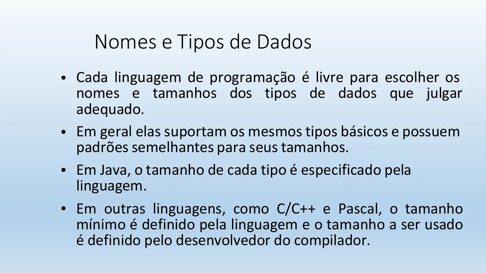

<details>
<summary>Texto da página</summary>

```text
    Nomes e Tipos de Dados
● Cada linguagem de programação é livre para escolher os
  nomes e tamanhos dos tipos de dados que julgar
  adequado.
● Em geral elas suportam os mesmos tipos básicos e possuem

  padrões semelhantes para seus tamanhos.
● Em Java, o tamanho de cada tipo é especificado pela

  linguagem.
● Em outras linguagens, como C/C++ e Pascal, o tamanho

  mínimo é definido pela linguagem e o tamanho a ser usado
  é definido pelo desenvolvedor do compilador.
```

</details>

<sub>[↑ voltar ao índice](#aula-06---sistema-de-tipos--slides-originais)</sub>

---

### Página 8

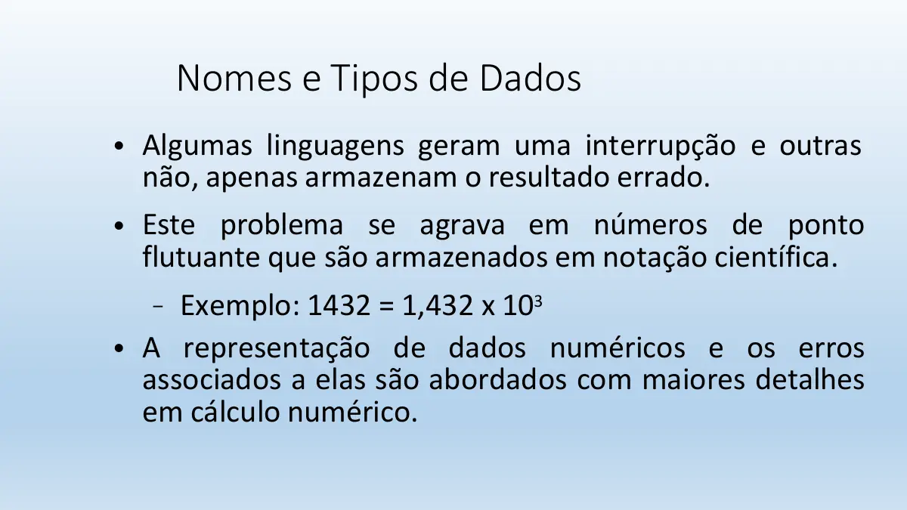

<details>
<summary>Texto da página</summary>

```text
      Nomes e Tipos de Dados
● Algumas linguagens geram uma interrupção e outras
  não, apenas armazenam o resultado errado.
● Este  problema se agrava em números de ponto
  flutuante que são armazenados em notação científica.
    – Exemplo: 1432 = 1,432 x 103
●   A representação de dados numéricos e os erros
    associados a elas são abordados com maiores detalhes
    em cálculo numérico.
```

</details>

<sub>[↑ voltar ao índice](#aula-06---sistema-de-tipos--slides-originais)</sub>

---

### Página 9

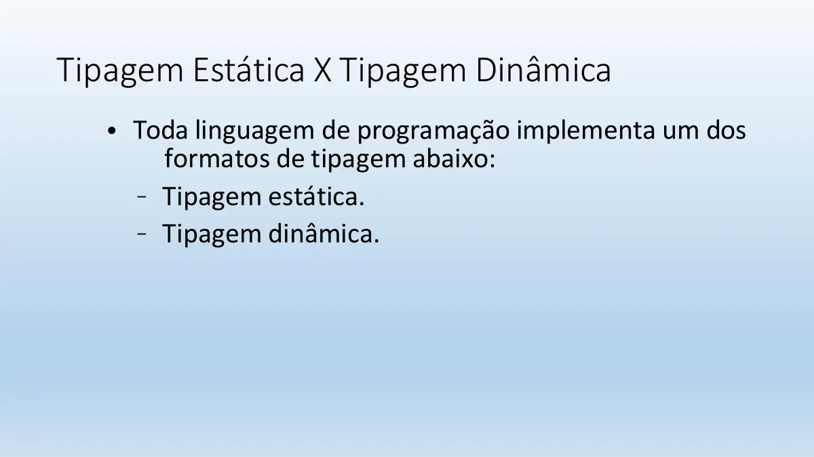

<details>
<summary>Texto da página</summary>

```text
Tipagem Estática X Tipagem Dinâmica
   ●   Toda linguagem de programação implementa um dos
         formatos de tipagem abaixo:
       – Tipagem estática.
       – Tipagem dinâmica.
```

</details>

<sub>[↑ voltar ao índice](#aula-06---sistema-de-tipos--slides-originais)</sub>

---

### Página 10

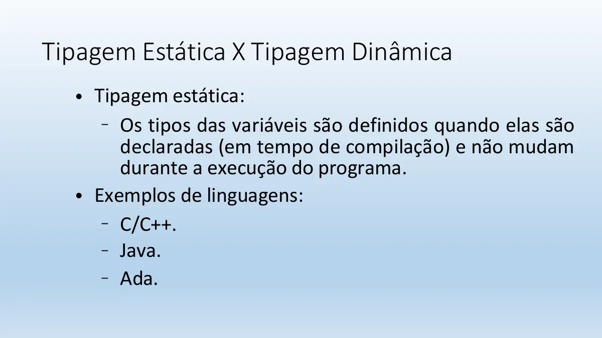

<details>
<summary>Texto da página</summary>

```text
Tipagem Estática X Tipagem Dinâmica
  ● Tipagem estática:
     – Os tipos das variáveis são definidos quando elas são
       declaradas (em tempo de compilação) e não mudam
       durante a execução do programa.
  ● Exemplos de linguagens:

     – C/C++.
     – Java.
     – Ada.
```

</details>

<sub>[↑ voltar ao índice](#aula-06---sistema-de-tipos--slides-originais)</sub>

---

### Página 11

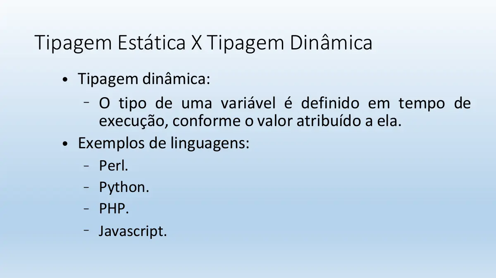

<details>
<summary>Texto da página</summary>

```text
Tipagem Estática X Tipagem Dinâmica
  ● Tipagem dinâmica:
     – O tipo de uma variável é definido em tempo de
       execução, conforme o valor atribuído a ela.
  ● Exemplos de linguagens:

      – Perl.
      – Python.
      – PHP.
      – Javascript.
```

</details>

<sub>[↑ voltar ao índice](#aula-06---sistema-de-tipos--slides-originais)</sub>

---

### Página 12

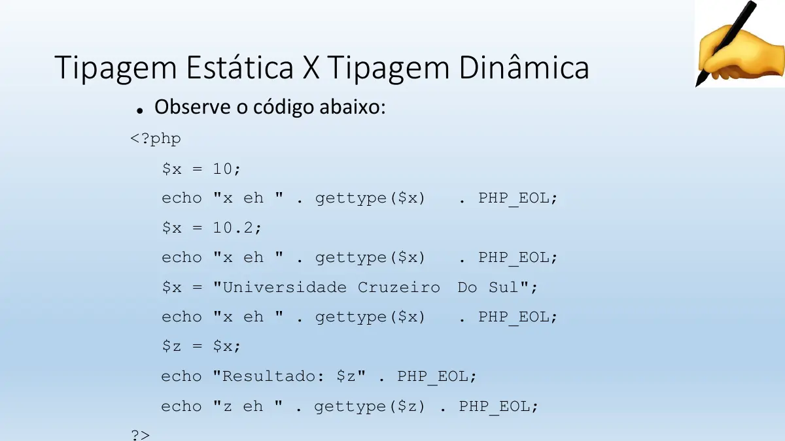

<details>
<summary>Texto da página</summary>

```text
Tipagem Estática X Tipagem Dinâmica
     ●   Observe o código abaixo:
    <?php
         $x = 10;
         echo "x eh " . gettype($x)   . PHP_EOL;
         $x = 10.2;
         echo "x eh " . gettype($x)   . PHP_EOL;
         $x = "Universidade Cruzeiro Do Sul";
         echo "x eh " . gettype($x)   . PHP_EOL;
         $z = $x;
         echo "Resultado: $z" . PHP_EOL;
         echo "z eh " . gettype($z) . PHP_EOL;
    ?>
```

</details>

<sub>[↑ voltar ao índice](#aula-06---sistema-de-tipos--slides-originais)</sub>

---

### Página 13

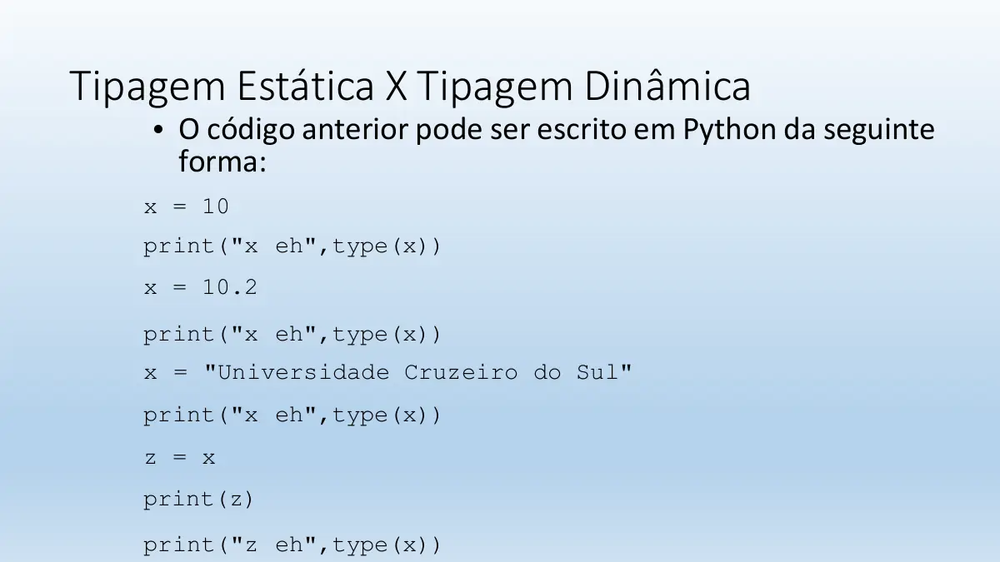

<details>
<summary>Texto da página</summary>

```text
Tipagem Estática X Tipagem Dinâmica
    ●   O código anterior pode ser escrito em Python da seguinte
        forma:
   x = 10
   print("x eh",type(x))
   x = 10.2
   print("x eh",type(x))
   x = "Universidade Cruzeiro do Sul"
   print("x eh",type(x))
   z = x
   print(z)
   print("z eh",type(x))
```

</details>

<sub>[↑ voltar ao índice](#aula-06---sistema-de-tipos--slides-originais)</sub>

---

### Página 14

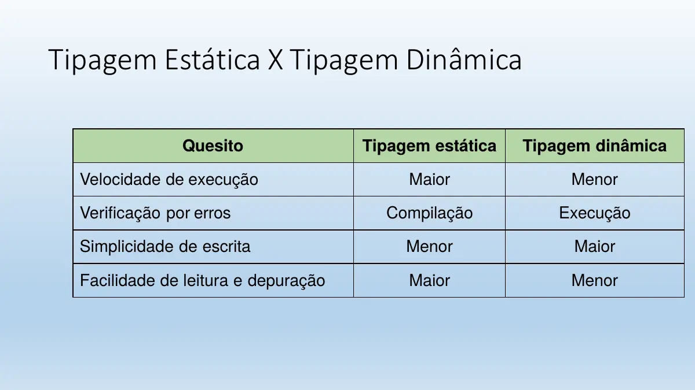

<details>
<summary>Texto da página</summary>

```text
Tipagem Estática X Tipagem Dinâmica

                Quesito               Tipagem estática   Tipagem dinâmica

  Velocidade de execução                   Maior              Menor

  Verificação por erros                 Compilação           Execução

  Simplicidade de escrita                  Menor              Maior

  Facilidade de leitura e depuração        Maior              Menor
```

</details>

<sub>[↑ voltar ao índice](#aula-06---sistema-de-tipos--slides-originais)</sub>

---

### Página 15

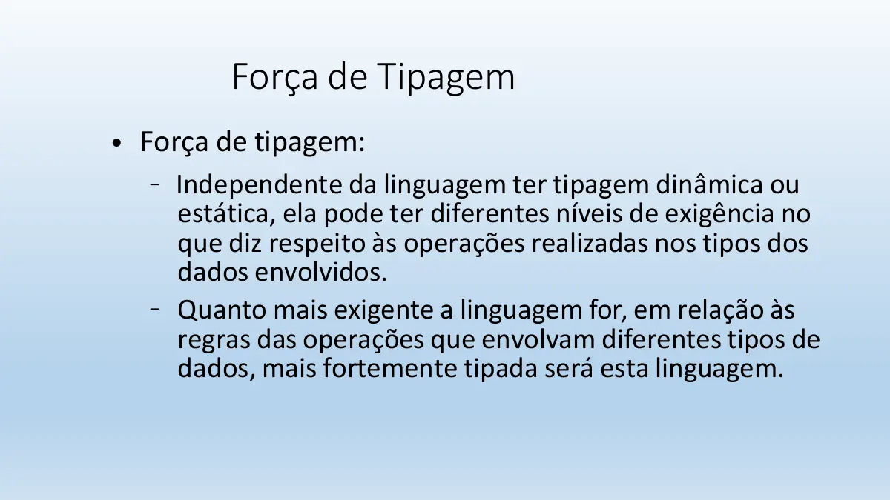

<details>
<summary>Texto da página</summary>

```text
           Força de Tipagem
●   Força de tipagem:
    – Independente da linguagem ter tipagem dinâmica ou
      estática, ela pode ter diferentes níveis de exigência no
      que diz respeito às operações realizadas nos tipos dos
      dados envolvidos.
    – Quanto mais exigente a linguagem for, em relação às
      regras das operações que envolvam diferentes tipos de
      dados, mais fortemente tipada será esta linguagem.
```

</details>

<sub>[↑ voltar ao índice](#aula-06---sistema-de-tipos--slides-originais)</sub>

---

### Página 16

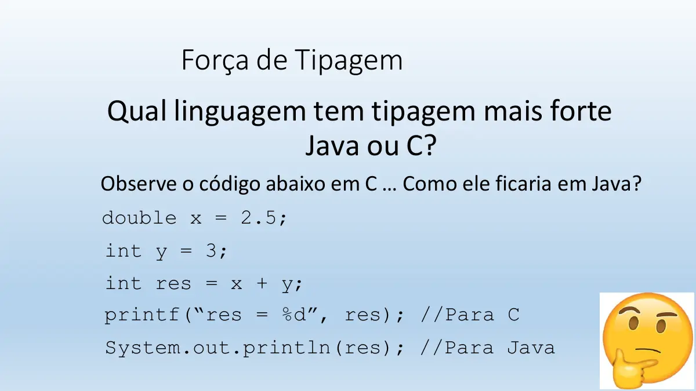

<details>
<summary>Texto da página</summary>

```text
        Força de Tipagem
Qual linguagem tem tipagem mais forte
              Java ou C?
Observe o código abaixo em C … Como ele ficaria em Java?
double x = 2.5;
int y = 3;
int res = x + y;
printf(“res = %d”, res); //Para C
System.out.println(res); //Para Java
```

</details>

<sub>[↑ voltar ao índice](#aula-06---sistema-de-tipos--slides-originais)</sub>

---

### Página 17

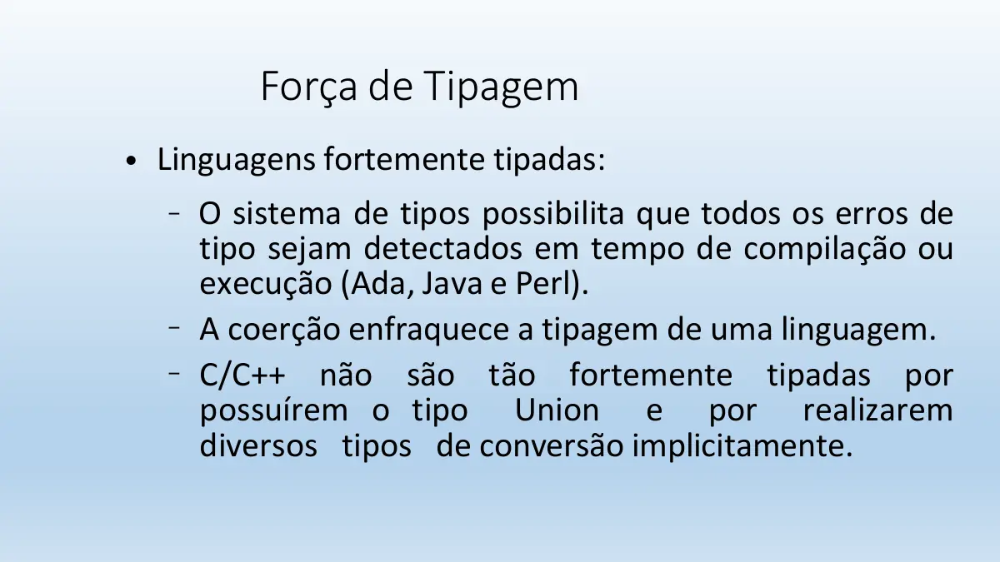

<details>
<summary>Texto da página</summary>

```text
          Força de Tipagem
●   Linguagens fortemente tipadas:
    – O sistema de tipos possibilita que todos os erros de
      tipo sejam detectados em tempo de compilação ou
      execução (Ada, Java e Perl).
    – A coerção enfraquece a tipagem de uma linguagem.
    – C/C++ não são tão fortemente tipadas por
      possuírem o tipo Union e por realizarem
      diversos tipos de conversão implicitamente.
```

</details>

<sub>[↑ voltar ao índice](#aula-06---sistema-de-tipos--slides-originais)</sub>

---

### Página 18

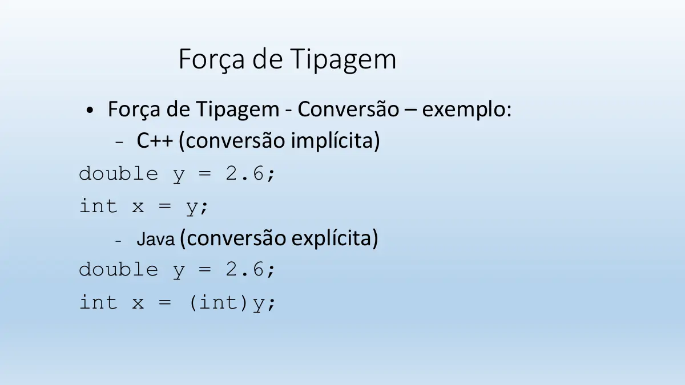

<details>
<summary>Texto da página</summary>

```text
            Força de Tipagem
●   Força de Tipagem - Conversão – exemplo:
     – C++ (conversão implícita)
double y = 2.6;
int x = y;
    –   Java (conversão explícita)
double y = 2.6;
int x = (int)y;
```

</details>

<sub>[↑ voltar ao índice](#aula-06---sistema-de-tipos--slides-originais)</sub>

---

### Página 19

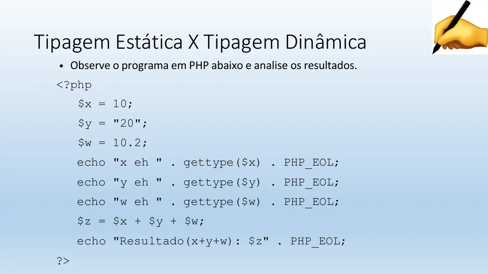

<details>
<summary>Texto da página</summary>

```text
Tipagem Estática X Tipagem Dinâmica
  ●    Observe o programa em PHP abaixo e analise os resultados.
  <?php
        $x = 10;
        $y = "20";
        $w = 10.2;
        echo "x eh " . gettype($x) . PHP_EOL;
        echo "y eh " . gettype($y) . PHP_EOL;
        echo "w eh " . gettype($w) . PHP_EOL;
        $z = $x + $y + $w;
        echo "Resultado(x+y+w): $z" . PHP_EOL;
  ?>
```

</details>

<sub>[↑ voltar ao índice](#aula-06---sistema-de-tipos--slides-originais)</sub>

---

### Página 20

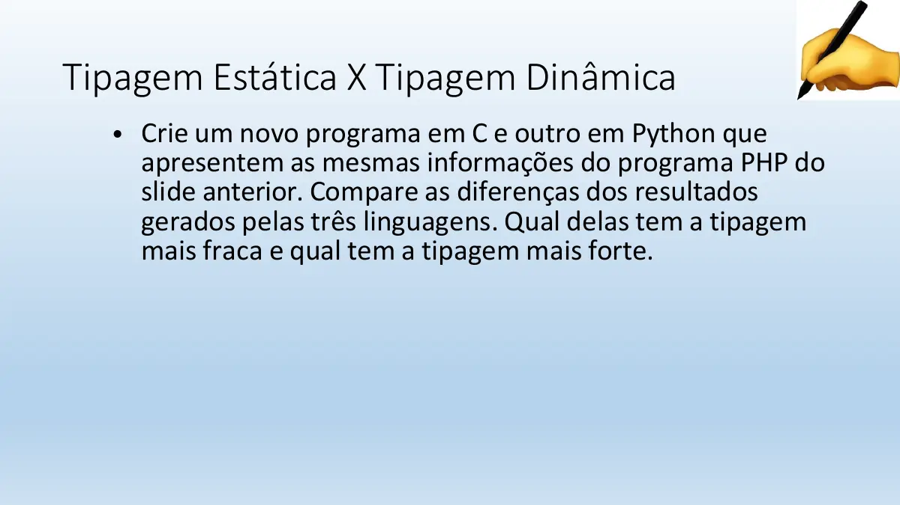

<details>
<summary>Texto da página</summary>

```text
Tipagem Estática X Tipagem Dinâmica
  ●   Crie um novo programa em C e outro em Python que
      apresentem as mesmas informações do programa PHP do
      slide anterior. Compare as diferenças dos resultados
      gerados pelas três linguagens. Qual delas tem a tipagem
      mais fraca e qual tem a tipagem mais forte.
```

</details>

<sub>[↑ voltar ao índice](#aula-06---sistema-de-tipos--slides-originais)</sub>

---

### Página 21

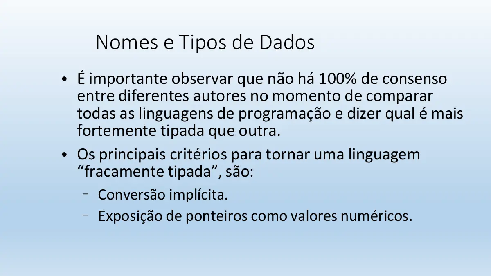

<details>
<summary>Texto da página</summary>

```text
        Nomes e Tipos de Dados
● É importante observar que não há 100% de consenso
  entre diferentes autores no momento de comparar
  todas as linguagens de programação e dizer qual é mais
  fortemente tipada que outra.
● Os principais critérios para tornar uma linguagem

  “fracamente tipada”, são:
    – Conversão implícita.
    – Exposição de ponteiros como valores numéricos.
```

</details>

<sub>[↑ voltar ao índice](#aula-06---sistema-de-tipos--slides-originais)</sub>

---

### Página 22

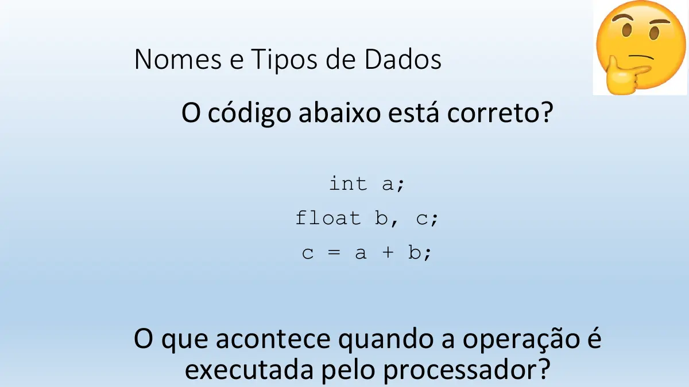

<details>
<summary>Texto da página</summary>

```text
Nomes e Tipos de Dados
   O código abaixo está correto?

              int a;
           float b, c;
            c = a + b;

O que acontece quando a operação é
   executada pelo processador?
```

</details>

<sub>[↑ voltar ao índice](#aula-06---sistema-de-tipos--slides-originais)</sub>

---

### Página 23

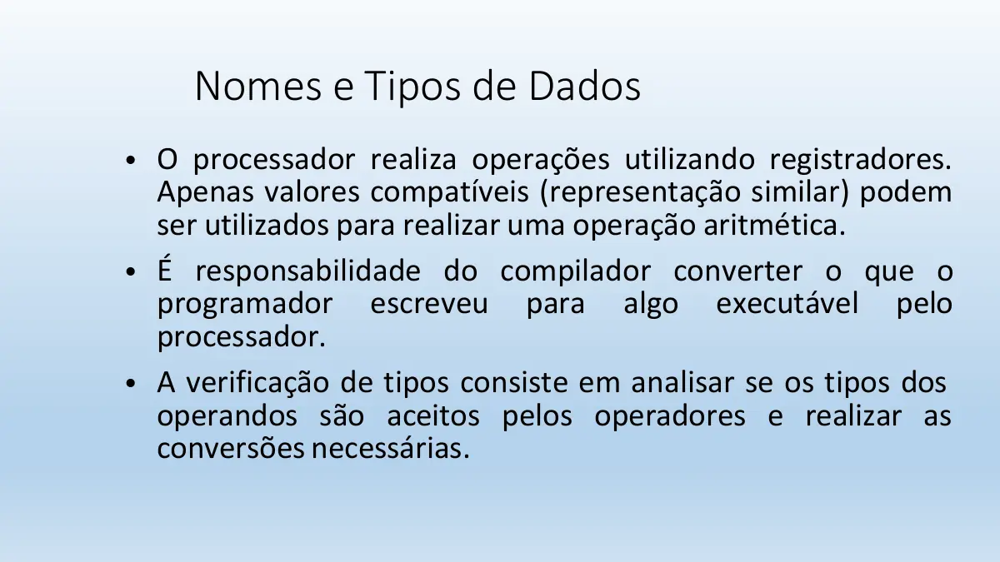

<details>
<summary>Texto da página</summary>

```text
     Nomes e Tipos de Dados
● O processador realiza operações utilizando registradores.
  Apenas valores compatíveis (representação similar) podem
  ser utilizados para realizar uma operação aritmética.
● É  responsabilidade do compilador converter o que o
  programador escreveu para algo executável pelo
  processador.
● A verificação de tipos consiste em analisar se os tipos dos

  operandos são aceitos pelos operadores e realizar as
  conversões necessárias.
```

</details>

<sub>[↑ voltar ao índice](#aula-06---sistema-de-tipos--slides-originais)</sub>

---

### Página 24

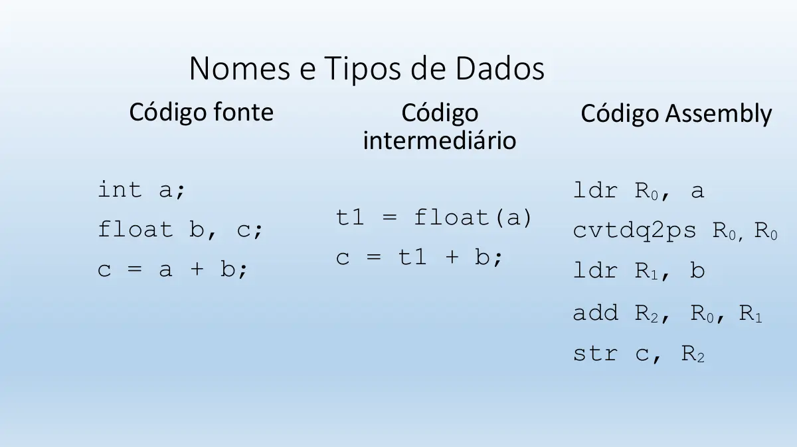

<details>
<summary>Texto da página</summary>

```text
      Nomes e Tipos de Dados
  Código fonte        Código      Código Assembly
                  intermediário
int a;                            ldr R0, a
float b, c;      t1 = float(a)    cvtdq2ps R0, R0
c = a + b;       c = t1 + b;      ldr R1, b
                                  add R2, R0, R1
                                  str c, R2
```

</details>

<sub>[↑ voltar ao índice](#aula-06---sistema-de-tipos--slides-originais)</sub>

---

### Página 25

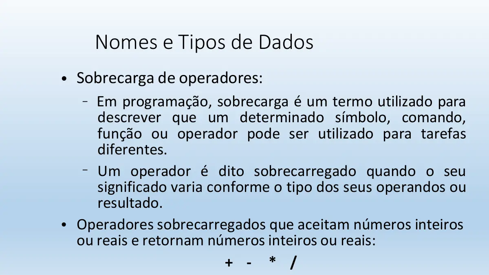

<details>
<summary>Texto da página</summary>

```text
        Nomes e Tipos de Dados
●   Sobrecarga de operadores:
    –Em programação, sobrecarga é um termo utilizado para
     descrever que um determinado símbolo, comando,
     função ou operador pode ser utilizado para tarefas
     diferentes.
   – Um operador é dito sobrecarregado quando o seu
     significado varia conforme o tipo dos seus operandos ou
     resultado.
● Operadores sobrecarregados que aceitam números inteiros

  ou reais e retornam números inteiros ou reais:
                         + - * /
```

</details>

<sub>[↑ voltar ao índice](#aula-06---sistema-de-tipos--slides-originais)</sub>

---

### Página 26

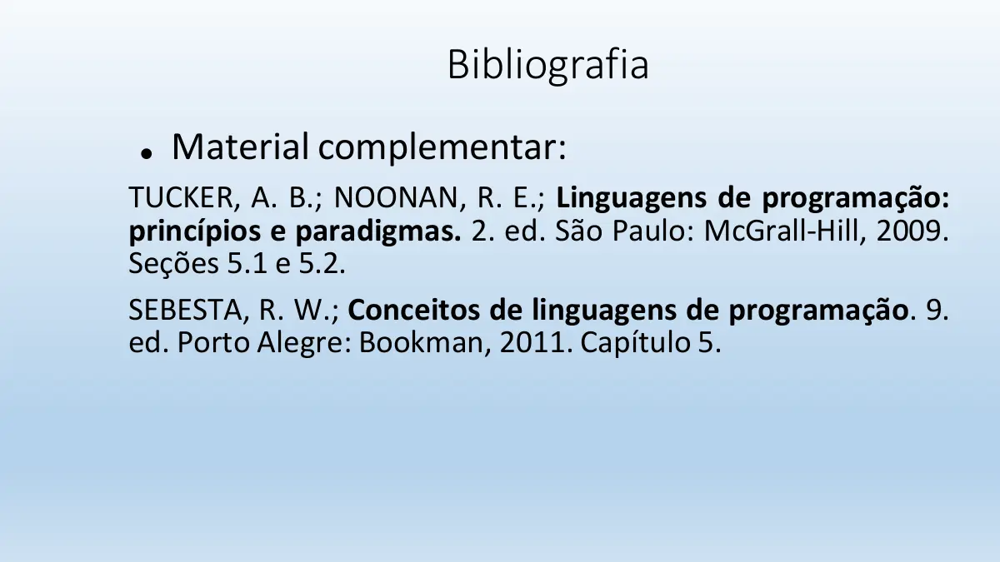

<details>
<summary>Texto da página</summary>

```text
                       Bibliografia
●   Material complementar:
TUCKER, A. B.; NOONAN, R. E.; Linguagens de programação:
princípios e paradigmas. 2. ed. São Paulo: McGrall-Hill, 2009.
Seções 5.1 e 5.2.
SEBESTA, R. W.; Conceitos de linguagens de programação. 9.
ed. Porto Alegre: Bookman, 2011. Capítulo 5.
```

</details>

<sub>[↑ voltar ao índice](#aula-06---sistema-de-tipos--slides-originais)</sub>


<!-- nav:rodape -->

---

**Aula 06:** [Visão geral](../README.md) · **Slides** · [Resumo](../02%20-%20Resumo%20Teórico/resumo-aula-06.md) · [Exercícios](../03%20-%20Exercícios/exercicios-aula-06.md) · [Resoluções](../04%20-%20Resoluções/resolucoes-aula-06.md) · [Complementos](../05%20-%20Materiais%20Complementares/materiais-complementares.md)

← [Aula 05 · Slides](../../Aula%2005%20-%20Semântica/01%20-%20Slides%20Originais/README.md) · [Aula 07 · Slides](../../Aula%2007%20-%20Tipos%20Compostos/01%20-%20Slides%20Originais/README.md) →

**Links para esta página (11):** [Acompanhamento de estudo](../../../00%20-%20Planejamento%20e%20Organização/acompanhamento.md) · [Aula 06 · Resumo](../02%20-%20Resumo%20Teórico/resumo-aula-06.md) · [Aula 06 · Exercícios](../03%20-%20Exercícios/exercicios-aula-06.md) · [Aula 06 · Resoluções](../04%20-%20Resoluções/resolucoes-aula-06.md) · [Aula 06 · Complementos](../05%20-%20Materiais%20Complementares/materiais-complementares.md) · [Aula 07 · Resoluções](../../Aula%2007%20-%20Tipos%20Compostos/04%20-%20Resoluções/resolucoes-aula-07.md) · [Lista 02 · Resolução](../../../02%20-%20Listas%20de%20Exercícios/Lista%2002%20-%20Revisão%20II/02%20-%20Resolução/resolucao-lista-02.md) · [Simulado 02 · Resolução comentada](../../../04%20-%20Provas%20e%20Avaliações/Simulados/resolucao-simulado-02.md) · [Erratas e inconsistências do material](../../../06%20-%20Revisões%20e%20Sínteses/erratas-e-inconsistencias.md) · [Quadros comparativos](../../../06%20-%20Revisões%20e%20Sínteses/quadros-comparativos.md) · [Questões integradoras · Resolução comentada](../../../06%20-%20Revisões%20e%20Sínteses/resolucao-questoes-integradoras.md)

<!-- /nav:rodape -->
