<!-- nav:topo -->
[Início](../../../README.md) › [01 - Aulas](../../README.md) › [Aula 07](../README.md) › **01 - Slides Originais** · [Mapa](../../../MAPA.md)
<!-- /nav:topo -->

<!-- gerado por ferramentas/geradores/gerar_galerias.py: não edite à mão -->

# Aula 07 - Tipos Compostos · Slides originais

> **[Material original]** Slides originais do professor, página por página, para ler aqui mesmo no GitHub. O arquivo original é o PDF [`Aula07_Tipos Compostos.pdf`](Aula07_Tipos%20Compostos.pdf) (16 páginas): use-o para baixar ou imprimir. As imagens e o texto de cada página foram extraídos do PDF, sem alteração do conteúdo.

**Ir para a página:** [1](#página-1) · [2](#página-2) · [3](#página-3) · [4](#página-4) · [5](#página-5) · [6](#página-6) · [7](#página-7) · [8](#página-8) · [9](#página-9) · [10](#página-10) · [11](#página-11) · [12](#página-12) · [13](#página-13) · [14](#página-14) · [15](#página-15) · [16](#página-16)

O texto de cada página fica em **Texto da página**, logo abaixo da imagem: é por ele que a busca encontra o conteúdo dos slides.

---

### Página 1

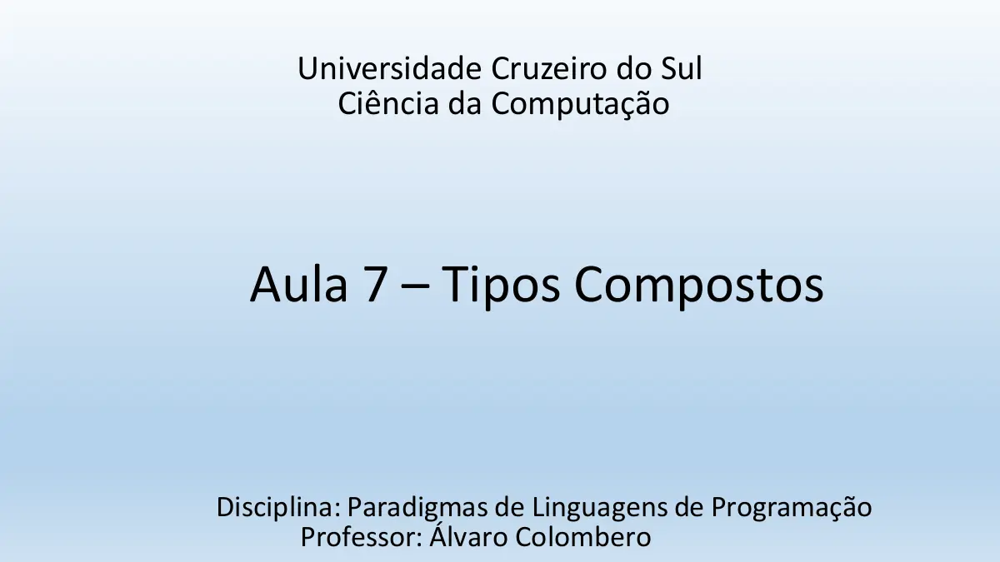

<details>
<summary>Texto da página</summary>

```text
      Universidade Cruzeiro do Sul
        Ciência da Computação

  Aula 7 – Tipos Compostos

Disciplina: Paradigmas de Linguagens de Programação
        Professor: Álvaro Colombero
```

</details>

<sub>[↑ voltar ao índice](#aula-07---tipos-compostos--slides-originais)</sub>

---

### Página 2

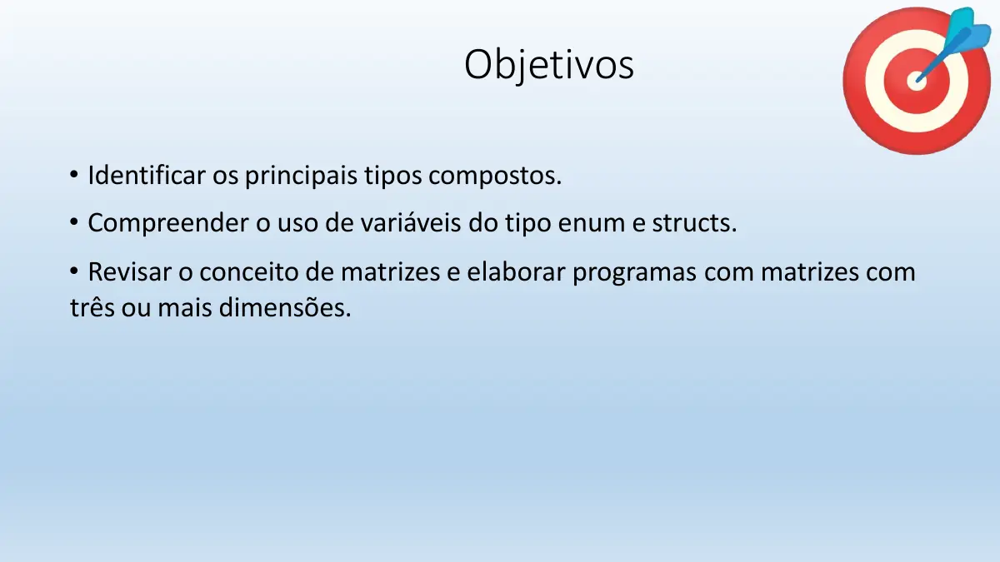

<details>
<summary>Texto da página</summary>

```text
                                   Objetivos

• Identificar os principais tipos compostos.
• Compreender o uso de variáveis do tipo enum e structs.
• Revisar o conceito de matrizes e elaborar programas com matrizes com
três ou mais dimensões.
```

</details>

<sub>[↑ voltar ao índice](#aula-07---tipos-compostos--slides-originais)</sub>

---

### Página 3

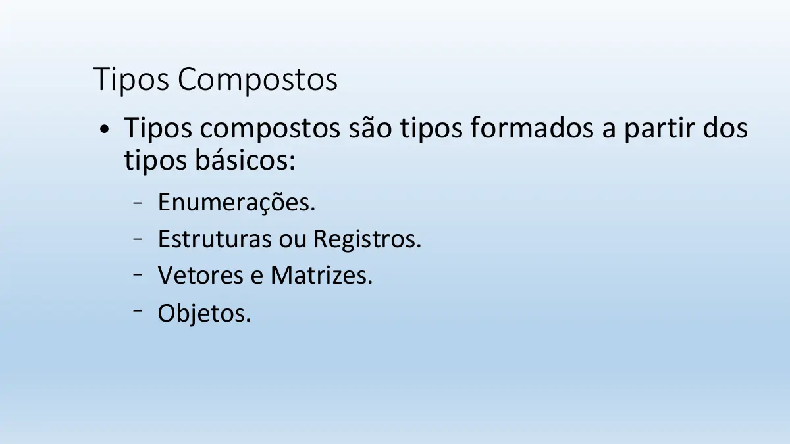

<details>
<summary>Texto da página</summary>

```text
Tipos Compostos
●   Tipos compostos são tipos formados a partir dos
    tipos básicos:
    – Enumerações.
    – Estruturas ou Registros.
    – Vetores e Matrizes.
    – Objetos.
```

</details>

<sub>[↑ voltar ao índice](#aula-07---tipos-compostos--slides-originais)</sub>

---

### Página 4

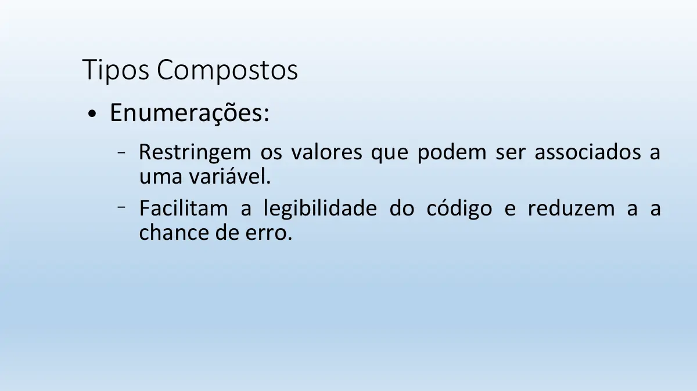

<details>
<summary>Texto da página</summary>

```text
Tipos Compostos
●   Enumerações:
    – Restringem os valores que podem ser associados a
      uma variável.
    – Facilitam a legibilidade do código e reduzem a a
      chance de erro.
```

</details>

<sub>[↑ voltar ao índice](#aula-07---tipos-compostos--slides-originais)</sub>

---

### Página 5

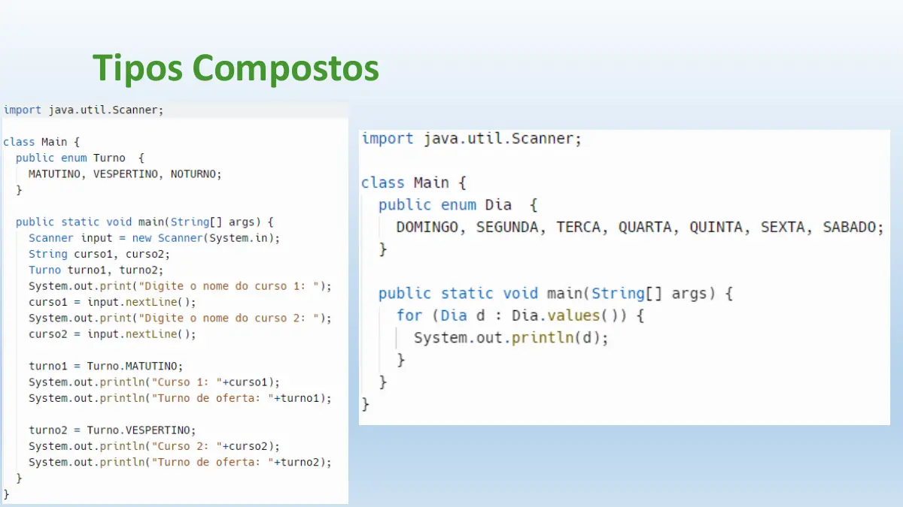

<details>
<summary>Texto da página</summary>

```text
Tipos Compostos
```

</details>

<sub>[↑ voltar ao índice](#aula-07---tipos-compostos--slides-originais)</sub>

---

### Página 6

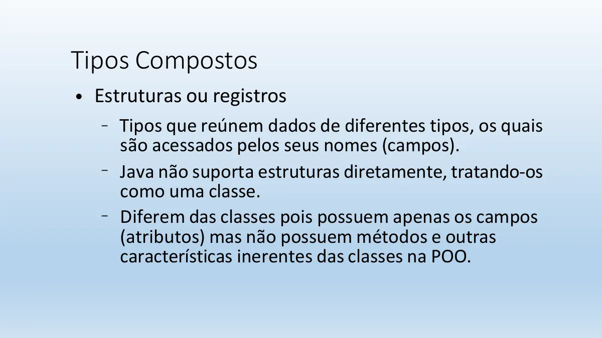

<details>
<summary>Texto da página</summary>

```text
Tipos Compostos
●   Estruturas ou registros
    – Tipos que reúnem dados de diferentes tipos, os quais
      são acessados pelos seus nomes (campos).
    – Java não suporta estruturas diretamente, tratando-os
      como uma classe.
    – Diferem das classes pois possuem apenas os campos
      (atributos) mas não possuem métodos e outras
      características inerentes das classes na POO.
```

</details>

<sub>[↑ voltar ao índice](#aula-07---tipos-compostos--slides-originais)</sub>

---

### Página 7

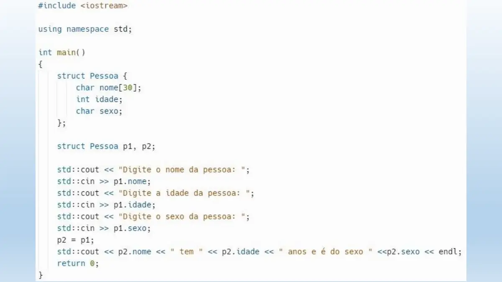

<details>
<summary>Texto da página</summary>

```text
Tipos Compostos
```

</details>

<sub>[↑ voltar ao índice](#aula-07---tipos-compostos--slides-originais)</sub>

---

### Página 8

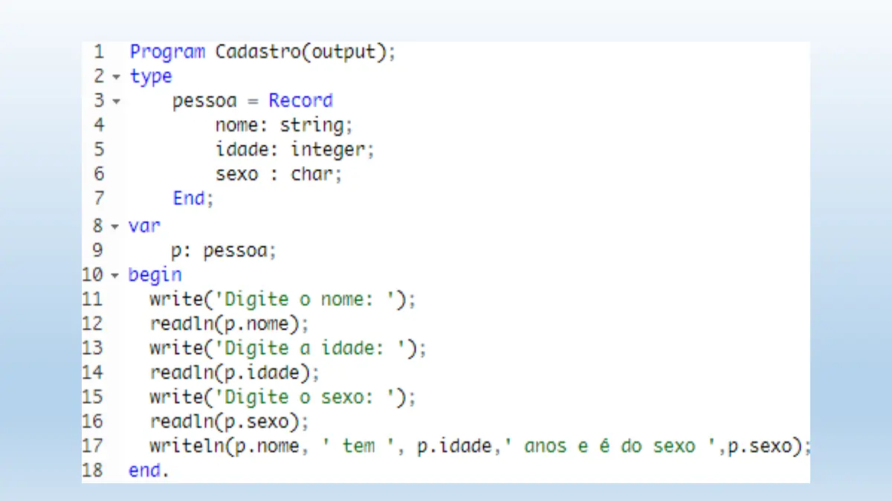

<details>
<summary>Texto da página</summary>

```text
Tipos Compostos
```

</details>

<sub>[↑ voltar ao índice](#aula-07---tipos-compostos--slides-originais)</sub>

---

### Página 9

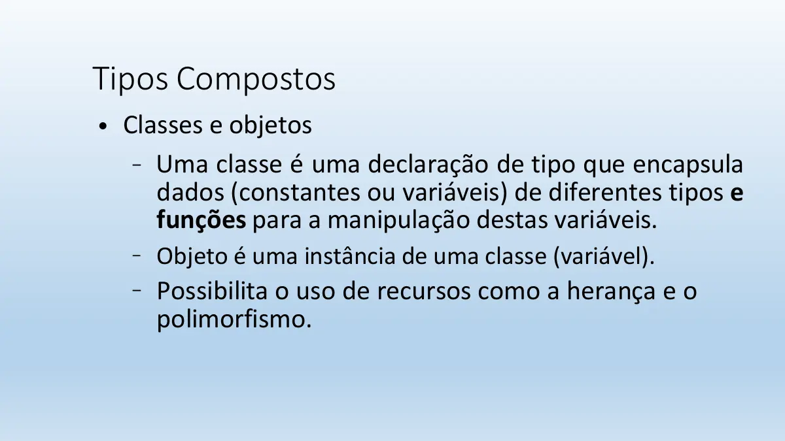

<details>
<summary>Texto da página</summary>

```text
Tipos Compostos
●   Classes e objetos
     – Uma classe é uma declaração de tipo que encapsula
       dados (constantes ou variáveis) de diferentes tipos e
       funções para a manipulação destas variáveis.
    –   Objeto é uma instância de uma classe (variável).
    –   Possibilita o uso de recursos como a herança e o
        polimorfismo.
```

</details>

<sub>[↑ voltar ao índice](#aula-07---tipos-compostos--slides-originais)</sub>

---

### Página 10

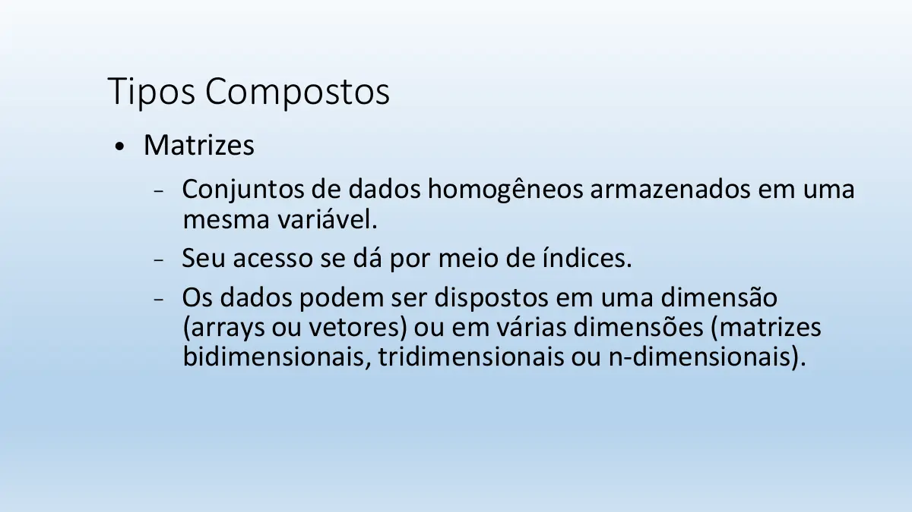

<details>
<summary>Texto da página</summary>

```text
Tipos Compostos
●   Matrizes
    – Conjuntos de dados homogêneos armazenados em uma
      mesma variável.
    – Seu acesso se dá por meio de índices.
    – Os dados podem ser dispostos em uma dimensão
      (arrays ou vetores) ou em várias dimensões (matrizes
      bidimensionais, tridimensionais ou n-dimensionais).
```

</details>

<sub>[↑ voltar ao índice](#aula-07---tipos-compostos--slides-originais)</sub>

---

### Página 11

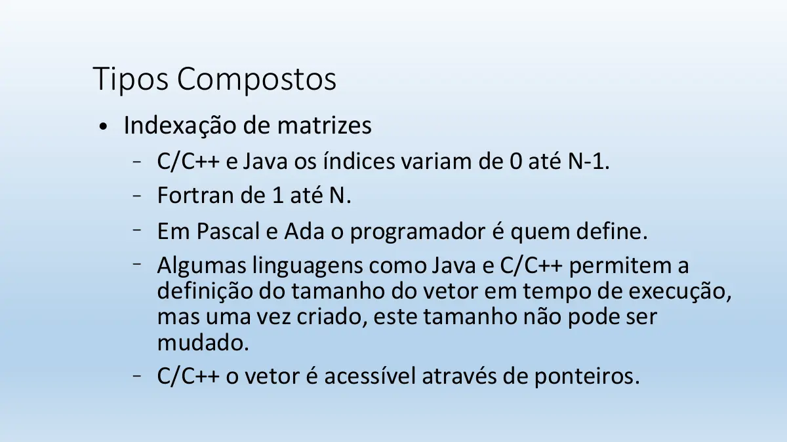

<details>
<summary>Texto da página</summary>

```text
Tipos Compostos
●   Indexação de matrizes
    – C/C++ e Java os índices variam de 0 até N-1.
    – Fortran de 1 até N.
    – Em Pascal e Ada o programador é quem define.
    – Algumas linguagens como Java e C/C++ permitem a
      definição do tamanho do vetor em tempo de execução,
      mas uma vez criado, este tamanho não pode ser
      mudado.
    – C/C++ o vetor é acessível através de ponteiros.
```

</details>

<sub>[↑ voltar ao índice](#aula-07---tipos-compostos--slides-originais)</sub>

---

### Página 12

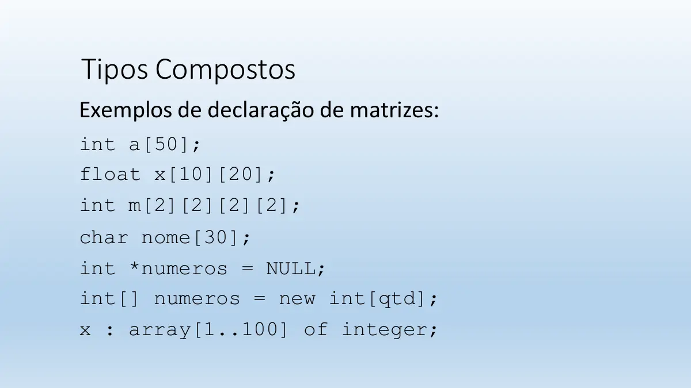

<details>
<summary>Texto da página</summary>

```text
Tipos Compostos
Exemplos de declaração de matrizes:
int a[50];
float x[10][20];
int m[2][2][2][2];
char nome[30];
int *numeros = NULL;
int[] numeros = new int[qtd];
x : array[1..100] of integer;
```

</details>

<sub>[↑ voltar ao índice](#aula-07---tipos-compostos--slides-originais)</sub>

---

### Página 13

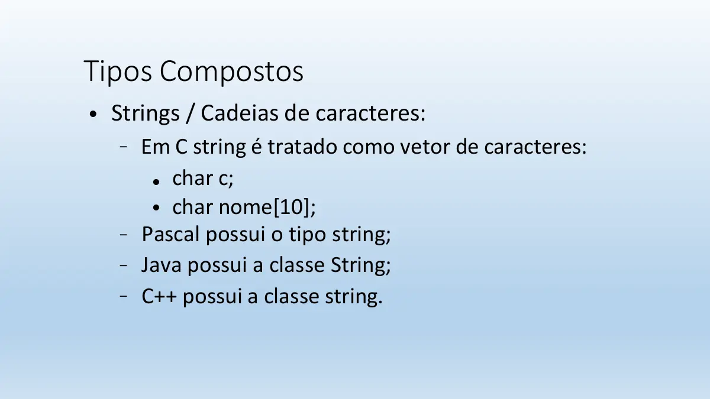

<details>
<summary>Texto da página</summary>

```text
Tipos Compostos
●   Strings / Cadeias de caracteres:
    – Em C string é tratado como vetor de caracteres:
       ● char c;

       ● char nome[10];

    – Pascal possui o tipo string;
    – Java possui a classe String;
    – C++ possui a classe string.
```

</details>

<sub>[↑ voltar ao índice](#aula-07---tipos-compostos--slides-originais)</sub>

---

### Página 14

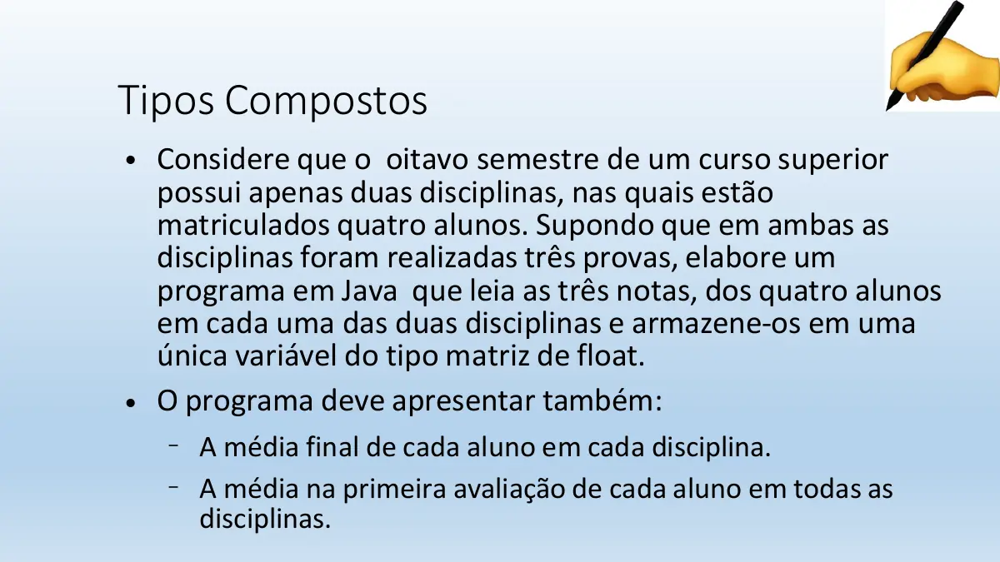

<details>
<summary>Texto da página</summary>

```text
Tipos Compostos
● Considere que o oitavo semestre de um curso superior
  possui apenas duas disciplinas, nas quais estão
  matriculados quatro alunos. Supondo que em ambas as
  disciplinas foram realizadas três provas, elabore um
  programa em Java que leia as três notas, dos quatro alunos
  em cada uma das duas disciplinas e armazene-os em uma
  única variável do tipo matriz de float.
● O programa deve apresentar também:

    – A média final de cada aluno em cada disciplina.
    – A média na primeira avaliação de cada aluno em todas as
      disciplinas.
```

</details>

<sub>[↑ voltar ao índice](#aula-07---tipos-compostos--slides-originais)</sub>

---

### Página 15

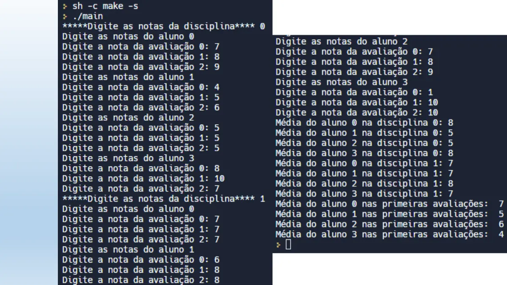

*Página sem texto extraível (só imagem).*

<sub>[↑ voltar ao índice](#aula-07---tipos-compostos--slides-originais)</sub>

---

### Página 16

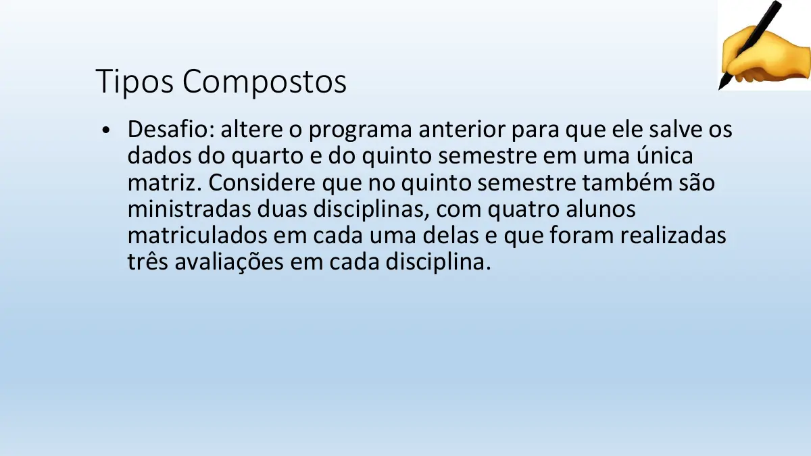

<details>
<summary>Texto da página</summary>

```text
Tipos Compostos
●   Desafio: altere o programa anterior para que ele salve os
    dados do quarto e do quinto semestre em uma única
    matriz. Considere que no quinto semestre também são
    ministradas duas disciplinas, com quatro alunos
    matriculados em cada uma delas e que foram realizadas
    três avaliações em cada disciplina.
```

</details>

<sub>[↑ voltar ao índice](#aula-07---tipos-compostos--slides-originais)</sub>


<!-- nav:rodape -->

---

**Aula 07:** [Visão geral](../README.md) · **Slides** · [Resumo](../02%20-%20Resumo%20Teórico/resumo-aula-07.md) · [Exercícios](../03%20-%20Exercícios/exercicios-aula-07.md) · [Resoluções](../04%20-%20Resoluções/resolucoes-aula-07.md) · [Complementos](../05%20-%20Materiais%20Complementares/materiais-complementares.md)

← [Aula 06 · Slides](../../Aula%2006%20-%20Sistema%20de%20Tipos/01%20-%20Slides%20Originais/README.md) · [Aula 08 · Slides](../../Aula%2008%20-%20Ponteiros/01%20-%20Slides%20Originais/README.md) →

**Links para esta página (6):** [Acompanhamento de estudo](../../../00%20-%20Planejamento%20e%20Organização/acompanhamento.md) · [Aula 07 · Resumo](../02%20-%20Resumo%20Teórico/resumo-aula-07.md) · [Aula 07 · Exercícios](../03%20-%20Exercícios/exercicios-aula-07.md) · [Aula 07 · Resoluções](../04%20-%20Resoluções/resolucoes-aula-07.md) · [Aula 08 · Resumo](../../Aula%2008%20-%20Ponteiros/02%20-%20Resumo%20Teórico/resumo-aula-08.md) · [Erratas e inconsistências do material](../../../06%20-%20Revisões%20e%20Sínteses/erratas-e-inconsistencias.md)

<!-- /nav:rodape -->
