<!-- nav:topo -->
[Início](../../../README.md) › [01 - Aulas](../../README.md) › [Aula 08](../README.md) › **01 - Slides Originais** · [Mapa](../../../MAPA.md)
<!-- /nav:topo -->

<!-- gerado por ferramentas/geradores/gerar_galerias.py: não edite à mão -->

# Aula 08 - Ponteiros · Slides originais

> **[Material original]** Slides originais do professor, página por página, para ler aqui mesmo no GitHub. O arquivo original é o PDF [`Aula08_Ponteiros.pdf`](Aula08_Ponteiros.pdf) (14 páginas): use-o para baixar ou imprimir. As imagens e o texto de cada página foram extraídos do PDF, sem alteração do conteúdo.

**Ir para a página:** [1](#página-1) · [2](#página-2) · [3](#página-3) · [4](#página-4) · [5](#página-5) · [6](#página-6) · [7](#página-7) · [8](#página-8) · [9](#página-9) · [10](#página-10) · [11](#página-11) · [12](#página-12) · [13](#página-13) · [14](#página-14)

O texto de cada página fica em **Texto da página**, logo abaixo da imagem: é por ele que a busca encontra o conteúdo dos slides.

---

### Página 1

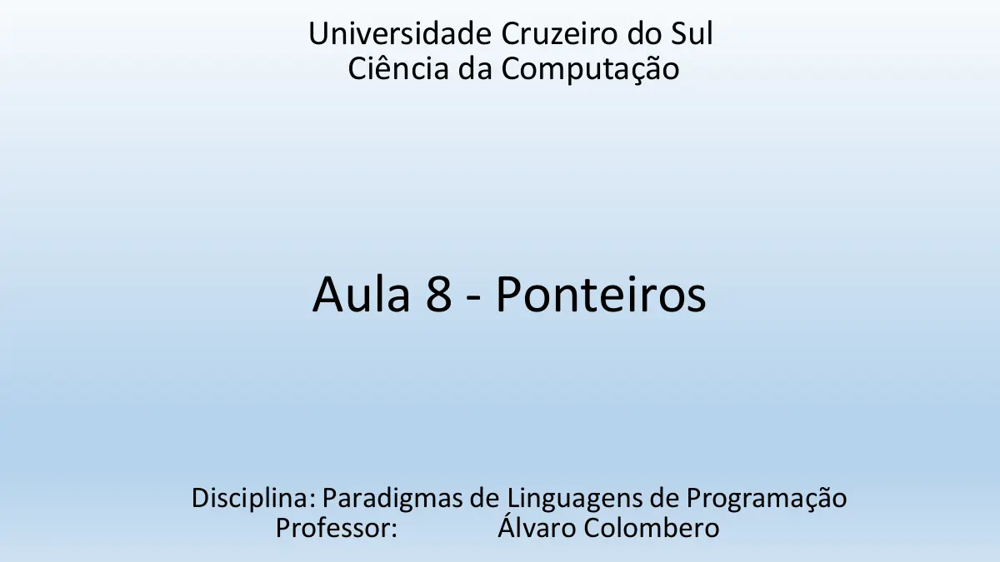

<details>
<summary>Texto da página</summary>

```text
         Universidade Cruzeiro do Sul
           Ciência da Computação

         Aula 8 - Ponteiros

Disciplina: Paradigmas de Linguagens de Programação
        Professor:       Álvaro Colombero
```

</details>

<sub>[↑ voltar ao índice](#aula-08---ponteiros--slides-originais)</sub>

---

### Página 2

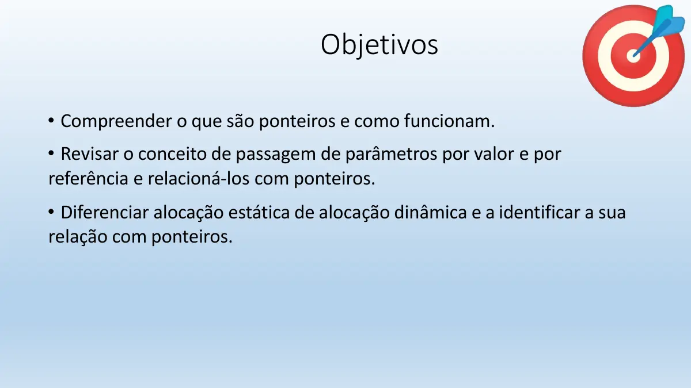

<details>
<summary>Texto da página</summary>

```text
                                  Objetivos

• Compreender o que são ponteiros e como funcionam.
• Revisar o conceito de passagem de parâmetros por valor e por
referência e relacioná-los com ponteiros.
• Diferenciar alocação estática de alocação dinâmica e a identificar a sua
relação com ponteiros.
```

</details>

<sub>[↑ voltar ao índice](#aula-08---ponteiros--slides-originais)</sub>

---

### Página 3

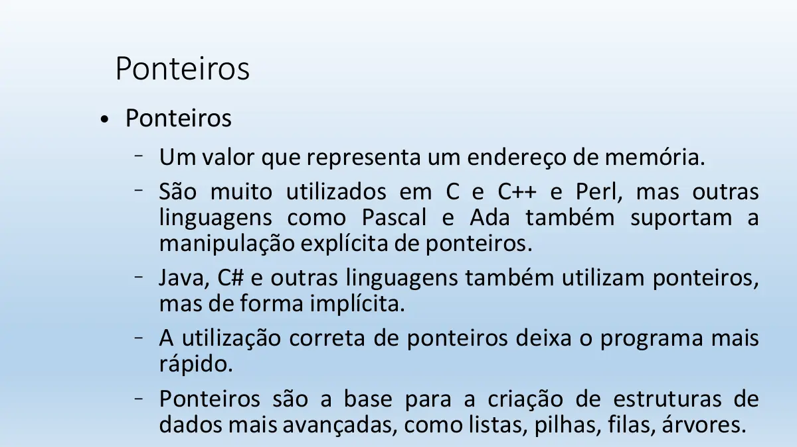

<details>
<summary>Texto da página</summary>

```text
    Ponteiros
●   Ponteiros
     – Um valor que representa um endereço de memória.
     – São muito utilizados em C e C++ e Perl, mas outras
       linguagens como Pascal e Ada também suportam a
       manipulação explícita de ponteiros.
     – Java, C# e outras linguagens também utilizam ponteiros,
       mas de forma implícita.
     – A utilização correta de ponteiros deixa o programa mais
       rápido.
     – Ponteiros são a base para a criação de estruturas de
       dados mais avançadas, como listas, pilhas, filas, árvores.
```

</details>

<sub>[↑ voltar ao índice](#aula-08---ponteiros--slides-originais)</sub>

---

### Página 4

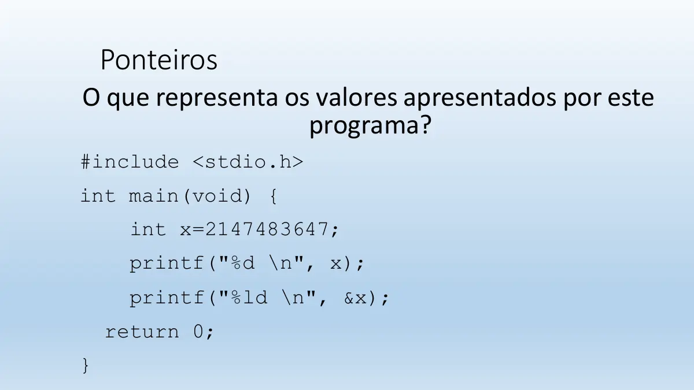

<details>
<summary>Texto da página</summary>

```text
    Ponteiros
O que representa os valores apresentados por este
                   programa?
#include <stdio.h>
int main(void) {
      int x=2147483647;
      printf("%d \n", x);
      printf("%ld \n", &x);
    return 0;
}
```

</details>

<sub>[↑ voltar ao índice](#aula-08---ponteiros--slides-originais)</sub>

---

### Página 5

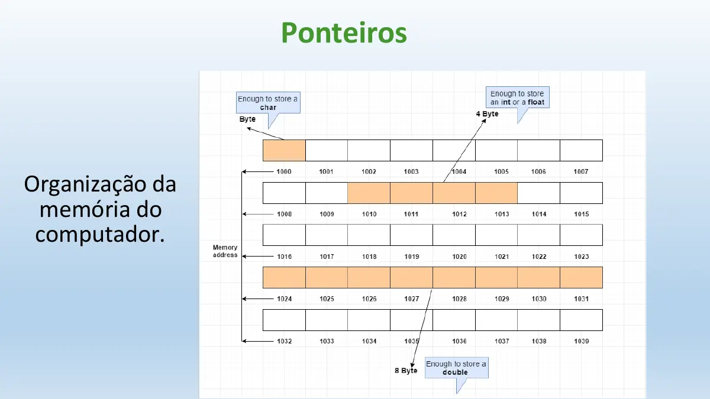

<details>
<summary>Texto da página</summary>

```text
                 Ponteiros

Organização da
 memória do
 computador.
```

</details>

<sub>[↑ voltar ao índice](#aula-08---ponteiros--slides-originais)</sub>

---

### Página 6

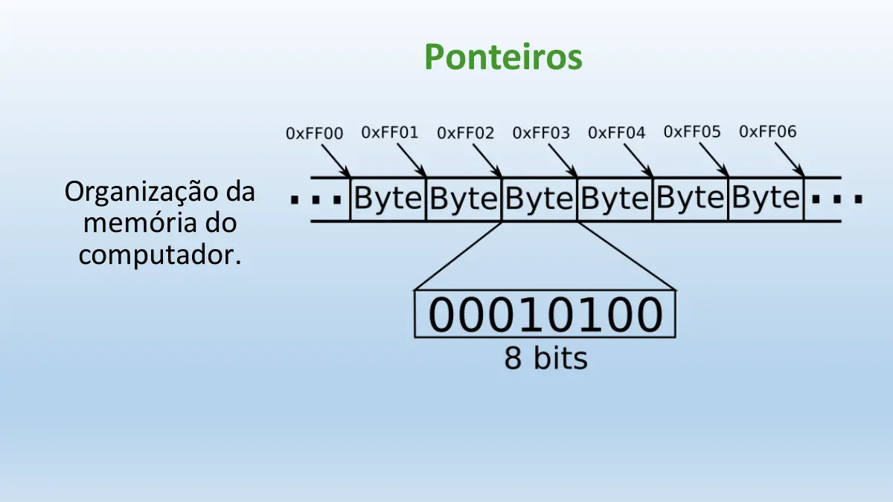

<details>
<summary>Texto da página</summary>

```text
                 Ponteiros

Organização da
 memória do
 computador.
```

</details>

<sub>[↑ voltar ao índice](#aula-08---ponteiros--slides-originais)</sub>

---

### Página 7

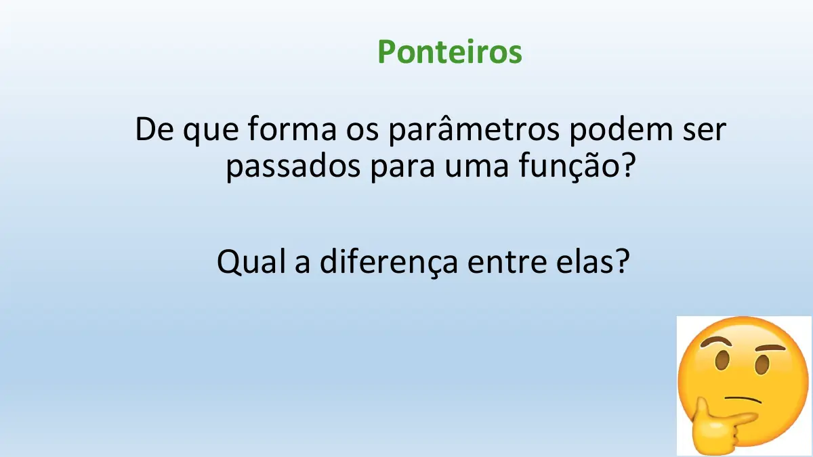

<details>
<summary>Texto da página</summary>

```text
               Ponteiros

De que forma os parâmetros podem ser
     passados para uma função?

     Qual a diferença entre elas?
```

</details>

<sub>[↑ voltar ao índice](#aula-08---ponteiros--slides-originais)</sub>

---

### Página 8

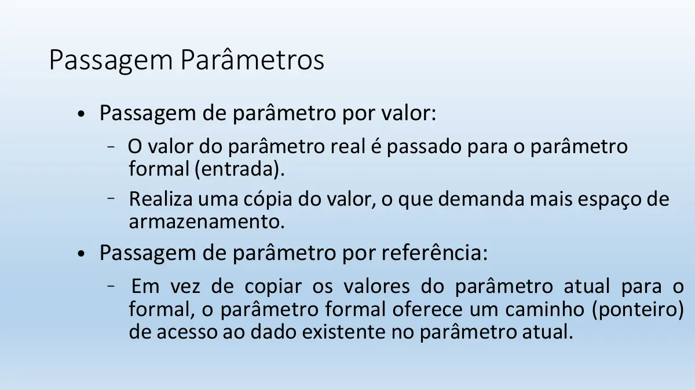

<details>
<summary>Texto da página</summary>

```text
Passagem Parâmetros
 ●   Passagem de parâmetro por valor:
     – O valor do parâmetro real é passado para o parâmetro
       formal (entrada).
     – Realiza uma cópia do valor, o que demanda mais espaço de
       armazenamento.
 ●   Passagem de parâmetro por referência:
     –   Em vez de copiar os valores do parâmetro atual para o
         formal, o parâmetro formal oferece um caminho (ponteiro)
         de acesso ao dado existente no parâmetro atual.
```

</details>

<sub>[↑ voltar ao índice](#aula-08---ponteiros--slides-originais)</sub>

---

### Página 9

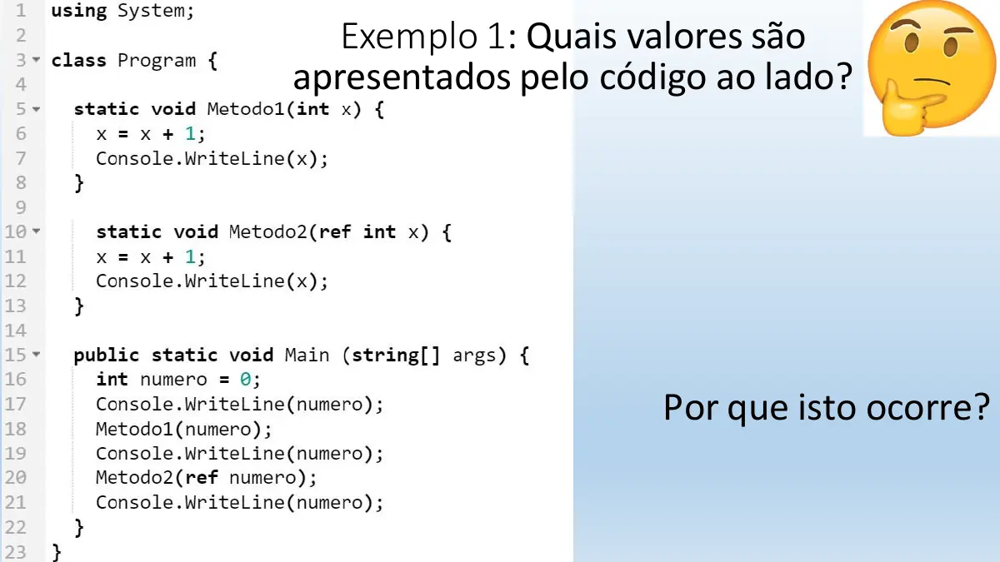

<details>
<summary>Texto da página</summary>

```text
   Exemplo 1: Quais valores são
apresentados pelo código ao lado?

                     Por que isto ocorre?
```

</details>

<sub>[↑ voltar ao índice](#aula-08---ponteiros--slides-originais)</sub>

---

### Página 10

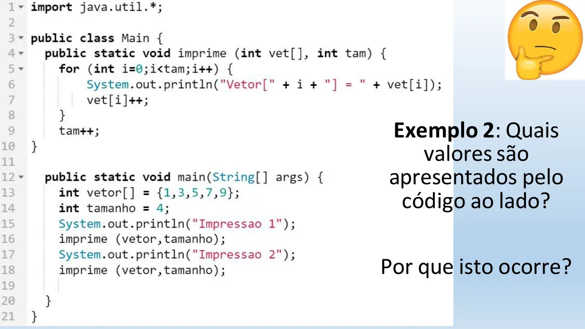

<details>
<summary>Texto da página</summary>

```text
Exemplo 2: Quais
   valores são
apresentados pelo
 código ao lado?

Por que isto ocorre?
```

</details>

<sub>[↑ voltar ao índice](#aula-08---ponteiros--slides-originais)</sub>

---

### Página 11

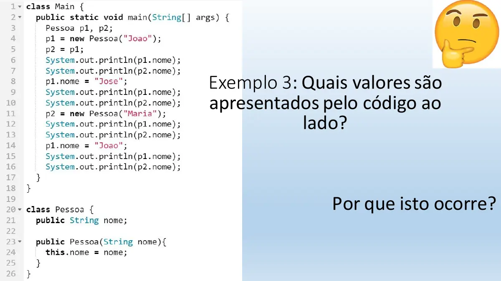

<details>
<summary>Texto da página</summary>

```text
Exemplo 3: Quais valores são
apresentados pelo código ao
           lado?

              Por que isto ocorre?
```

</details>

<sub>[↑ voltar ao índice](#aula-08---ponteiros--slides-originais)</sub>

---

### Página 12

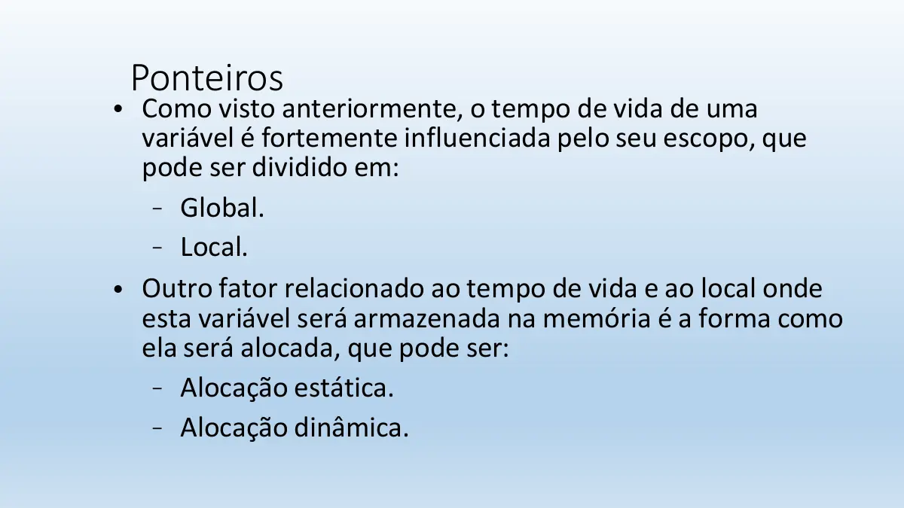

<details>
<summary>Texto da página</summary>

```text
    Ponteiros
● Como visto anteriormente, o tempo de vida de uma
  variável é fortemente influenciada pelo seu escopo, que
  pode ser dividido em:
   – Global.
   – Local.
● Outro fator relacionado ao tempo de vida e ao local onde

  esta variável será armazenada na memória é a forma como
  ela será alocada, que pode ser:
   – Alocação estática.
   – Alocação dinâmica.
```

</details>

<sub>[↑ voltar ao índice](#aula-08---ponteiros--slides-originais)</sub>

---

### Página 13

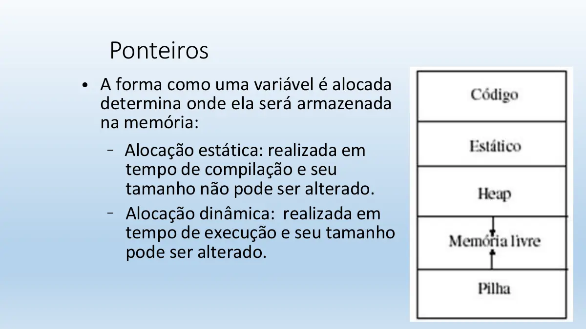

<details>
<summary>Texto da página</summary>

```text
     Ponteiros
●   A forma como uma variável é alocada
    determina onde ela será armazenada
    na memória:
     – Alocação estática: realizada em
       tempo de compilação e seu
       tamanho não pode ser alterado.
     – Alocação dinâmica: realizada em
       tempo de execução e seu tamanho
       pode ser alterado.
```

</details>

<sub>[↑ voltar ao índice](#aula-08---ponteiros--slides-originais)</sub>

---

### Página 14

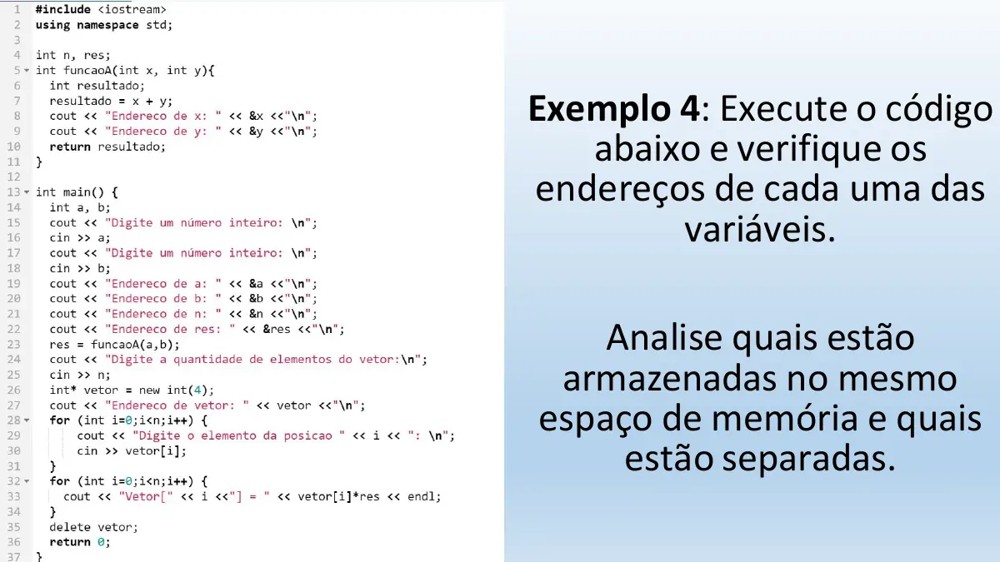

<details>
<summary>Texto da página</summary>

```text
Exemplo 4: Execute o código
   abaixo e verifique os
endereços de cada uma das
        variáveis.

    Analise quais estão
 armazenadas no mesmo
espaço de memória e quais
     estão separadas.
```

</details>

<sub>[↑ voltar ao índice](#aula-08---ponteiros--slides-originais)</sub>


<!-- nav:rodape -->

---

**Aula 08:** [Visão geral](../README.md) · **Slides** · [Resumo](../02%20-%20Resumo%20Teórico/resumo-aula-08.md) · [Exercícios](../03%20-%20Exercícios/exercicios-aula-08.md) · [Resoluções](../04%20-%20Resoluções/resolucoes-aula-08.md) · [Complementos](../05%20-%20Materiais%20Complementares/materiais-complementares.md)

← [Aula 07 · Slides](../../Aula%2007%20-%20Tipos%20Compostos/01%20-%20Slides%20Originais/README.md) · [Aula 09 · Slides](../../Aula%2009%20-%20Paradigma%20Imperativo%20I/01%20-%20Slides%20Originais/README.md) →

**Links para esta página (10):** [Aula 07 · Resumo](../../Aula%2007%20-%20Tipos%20Compostos/02%20-%20Resumo%20Teórico/resumo-aula-07.md) · [Aula 08 · Resumo](../02%20-%20Resumo%20Teórico/resumo-aula-08.md) · [Aula 08 · Exercícios](../03%20-%20Exercícios/exercicios-aula-08.md) · [Aula 08 · Resoluções](../04%20-%20Resoluções/resolucoes-aula-08.md) · [Aula 08 · Complementos](../05%20-%20Materiais%20Complementares/materiais-complementares.md) · [Lista 02 · Resolução](../../../02%20-%20Listas%20de%20Exercícios/Lista%2002%20-%20Revisão%20II/02%20-%20Resolução/resolucao-lista-02.md) · [Simulado 02 · Resolução comentada](../../../04%20-%20Provas%20e%20Avaliações/Simulados/resolucao-simulado-02.md) · [Erratas e inconsistências do material](../../../06%20-%20Revisões%20e%20Sínteses/erratas-e-inconsistencias.md) · [Quadros comparativos](../../../06%20-%20Revisões%20e%20Sínteses/quadros-comparativos.md) · [Questões integradoras · Resolução comentada](../../../06%20-%20Revisões%20e%20Sínteses/resolucao-questoes-integradoras.md)

<!-- /nav:rodape -->
