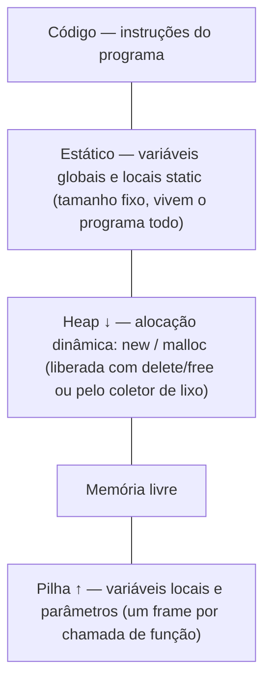

<!-- nav:topo -->
[Início](../../../README.md) › [01 - Aulas](../../README.md) › [Aula 08](../README.md) › [02 - Resumo Teórico](README.md) · [Mapa](../../../MAPA.md)
<!-- /nav:topo -->

# Aula 08 — Ponteiros · Resumo teórico

> **Fonte:** [`Aula08_Ponteiros.pdf`](../01%20-%20Slides%20Originais/Aula08_Ponteiros.pdf) (14 páginas). Os Exemplos 1–4 aparecem só como imagem no PDF; foram transcritos e conferidos com ampliação. A aula não tem slide de bibliografia.
> **Legenda:** ver [Convenções](../../../README.md#convenções-de-marcação). `p.N` = página do PDF. Os exemplos Java e C++ foram executados (javac, g++); o C# foi analisado sem execução.

---

## 1. Objetivos (p.2)

**[Material original]** Compreender o que são ponteiros e como funcionam; revisar passagem de parâmetros por valor e por referência e relacioná-las com ponteiros; diferenciar alocação estática de dinâmica e identificar sua relação com ponteiros.

## 2. O que é um ponteiro (p.3)

**[Material original]**

- Um **valor que representa um endereço de memória**.
- Muito usado em **C, C++ e Perl**; **Pascal e Ada** também permitem manipulação explícita.
- **Java, C#** e outras linguagens também usam ponteiros, mas **de forma implícita**.
- O uso correto de ponteiros deixa o programa **mais rápido**.
- Ponteiros são a **base de estruturas de dados avançadas**: listas, pilhas, filas, árvores.

**[Explicação elaborada] — sintaxe em C:**

| Expressão | Significado |
| --- | --- |
| `int *p;` | `p` é um ponteiro para `int`: guarda um endereço |
| `p = &x;` | `&` = "endereço de": `p` passa a apontar para `x` |
| `*p` | `*` = "conteúdo apontado por" (desreferência) |
| `*p = 5;` | Grava 5 **em `x`**, através de `p` |
| `p + 1` | Endereço do próximo `int` (avança `sizeof(int)` bytes) |

<!-- teste: saida-contem="x = 10|x = 5|v[1] = 20" -->
```c
#include <stdio.h>

int main(void) {
    int x = 10;
    int *p = &x;                       /* p guarda o endereço de x */
    printf("x = %d\n", *p);            /* lê x através de p: 10 */
    *p = 5;                            /* escreve em x através de p */
    printf("x = %d\n", x);             /* 5 */
    printf("endereco de x = %p\n", (void *)p);

    int v[3] = {10, 20, 30};
    int *q = v;                        /* o nome do vetor é o endereço do 1º elemento */
    printf("v[1] = %d\n", *(q + 1));   /* aritmética de ponteiros: 20 */
    return 0;
}
```

**[Explicação elaborada] — "Java usa ponteiros implicitamente":** toda variável de tipo objeto em Java (`Pessoa p1`) guarda uma **referência** — na prática, um ponteiro gerenciado pela JVM. O programador não pode fazer `&` nem aritmética de ponteiros, mas a semântica de compartilhamento é a mesma (Exemplos 2 e 3).

## 3. Organização da memória (p.4–6)

**[Material original]** A aula retoma o programa da Aula 04 (`printf("%d", x)` × `printf("%ld", &x)`) e pergunta o que representam os valores. Duas figuras explicam:

<!-- figura: aula08 página 5 -->
<p align="center"><a href="../01%20-%20Slides%20Originais/README.md#página-5"></a><br><sub>Slide original, página 5: organização da memória em bytes e endereços. Clique para abrir na galeria.</sub></p>

<!-- figura: aula08 página 6 -->
<p align="center"><a href="../01%20-%20Slides%20Originais/README.md#página-6"></a><br><sub>Slide original, página 6: um byte tem 8 bits. Clique para abrir na galeria.</sub></p>

- A memória é uma sequência de **bytes**, cada um com seu **endereço** (0xFF00, 0xFF01, …), e cada byte tem **8 bits** (ex.: `00010100`).
- Um `char` ocupa **1 byte**; um `int` ou `float`, **4 bytes** consecutivos; um `double`, **8 bytes** (figura com endereços de 1000 a 1039).

**[Explicação elaborada]** O "endereço de uma variável" é o endereço do **primeiro byte** que ela ocupa. Por isso `p + 1`, num `int *`, avança 4 bytes: o compilador conhece o tamanho do tipo apontado.

## 4. Passagem de parâmetros (p.7–11)

**[Material original]**

- **Por valor:** o valor do parâmetro real é passado ao formal (entrada). É feita uma **cópia**, o que exige mais espaço.
- **Por referência:** em vez de copiar, o parâmetro formal oferece um **caminho (ponteiro)** de acesso ao dado existente no parâmetro real.

Os modelos são aprofundados na [Aula 11](../../Aula%2011%20-%20Paradigma%20Imperativo%20III/02%20-%20Resumo%20Teórico/resumo-aula-11.md#5-modelos-de-passagem-de-parâmetros-semânticos-e-de-implementação-p1318).

### Exemplo 1 — C#, `ref` (p.9)

<!-- teste: saida-contem="0\n1\n0\n1\n1" -->
```csharp
using System;

class Program {
    static void Metodo1(int x) {        // por valor
        x = x + 1;
        Console.WriteLine(x);
    }

    static void Metodo2(ref int x) {    // por referência
        x = x + 1;
        Console.WriteLine(x);
    }

    public static void Main(string[] args) {
        int numero = 0;
        Console.WriteLine(numero);   // 0
        Metodo1(numero);             // 1 (a cópia foi incrementada)
        Console.WriteLine(numero);   // 0 (o original não mudou)
        Metodo2(ref numero);         // 1
        Console.WriteLine(numero);   // 1 (o original mudou)
    }
}
```

**Saída:** `0`, `1`, `0`, `1`, `1`.

**[Explicação elaborada]** `Metodo1` recebe uma **cópia** de `numero` e incrementa só a cópia. `Metodo2` recebe uma **referência**: `x` é outro nome para a mesma célula de `numero`. Em C#, `ref` é obrigatório **na declaração e na chamada**, o que deixa explícito, para quem lê, que o argumento pode ser alterado.

### Exemplo 2 — Java, vetor e inteiro como parâmetros (p.10)

<!-- teste: saida-contem="Impressao 1\nVetor[0] = 1\nVetor[1] = 3\nVetor[2] = 5\nVetor[3] = 7\nImpressao 2\nVetor[0] = 2\nVetor[1] = 4\nVetor[2] = 6\nVetor[3] = 8" -->
```java
import java.util.*;

public class Main {
    public static void imprime(int vet[], int tam) {
        for (int i = 0; i < tam; i++) {
            System.out.println("Vetor[" + i + "] = " + vet[i]);
            vet[i]++;              // altera o vetor ORIGINAL
        }
        tam++;                     // altera só a cópia local
    }

    public static void main(String[] args) {
        int vetor[] = {1, 3, 5, 7, 9};
        int tamanho = 4;
        System.out.println("Impressao 1");
        imprime(vetor, tamanho);
        System.out.println("Impressao 2");
        imprime(vetor, tamanho);
    }
}
```

**Saída:** Impressão 1 → 1, 3, 5, 7; Impressão 2 → 2, 4, 6, 8.

**[Explicação elaborada]**

- O vetor é um **objeto**: o parâmetro `vet` recebe uma cópia da **referência**, que aponta para o **mesmo** array de `main`. Os `vet[i]++` persistem, e por isso a segunda impressão mostra os valores incrementados.
- `tam` é um **primitivo**: recebe uma **cópia** do valor. `tam++` muda só a cópia, `tamanho` continua 4, e o quinto elemento (9) nunca é impresso nem alterado.
- **[Complemento]** Formalmente, **Java sempre passa por valor**. Para objetos, o valor copiado é a referência. O efeito prático sobre o conteúdo do objeto é parecido com a passagem por referência, mas reatribuir `vet = new int[5]` dentro do método **não** afetaria o vetor de `main`.

### Exemplo 3 — Referências a objetos em Java (p.11)

<!-- teste: saida-contem="Joao\nJoao\nJose\nJose\nJose\nMaria\nJoao\nMaria" -->
```java
class Main {
    public static void main(String[] args) {
        Pessoa p1, p2;
        p1 = new Pessoa("Joao");
        p2 = p1;                       // p2 aponta para o MESMO objeto
        System.out.println(p1.nome);   // Joao
        System.out.println(p2.nome);   // Joao
        p1.nome = "Jose";
        System.out.println(p1.nome);   // Jose
        System.out.println(p2.nome);   // Jose  (mesmo objeto!)
        p2 = new Pessoa("Maria");      // p2 passa a apontar para OUTRO objeto
        System.out.println(p1.nome);   // Jose
        System.out.println(p2.nome);   // Maria
        p1.nome = "Joao";
        System.out.println(p1.nome);   // Joao
        System.out.println(p2.nome);   // Maria
    }
}

class Pessoa {
    public String nome;
    public Pessoa(String nome) {
        this.nome = nome;
    }
}
```

| Momento | `p1` aponta para | `p2` aponta para | p1.nome | p2.nome |
| --- | --- | --- | --- | --- |
| após `p2 = p1` | objeto A | objeto A | Joao | Joao |
| `p1.nome = "Jose"` | A | A | Jose | Jose |
| `p2 = new Pessoa("Maria")` | A | objeto B | Jose | Maria |
| `p1.nome = "Joao"` | A | B | Joao | Maria |

**[Explicação elaborada]** É o *aliasing* da Aula 05: duas variáveis, um endereço. Compare com a `struct` em C++ da [Aula 07](../../Aula%2007%20-%20Tipos%20Compostos/02%20-%20Resumo%20Teórico/resumo-aula-07.md#4-estruturas-ou-registros-p68), em que `p2 = p1` **copia** os dados.

## 5. Alocação estática × dinâmica (p.12–13)

**[Material original]**

- O **tempo de vida** de uma variável é fortemente influenciado pelo **escopo** (global ou local).
- Outro fator, que também define **onde** a variável fica na memória, é a forma de **alocação**:
  - **Estática:** realizada em **tempo de compilação**; o tamanho **não pode ser alterado**.
  - **Dinâmica:** realizada em **tempo de execução**; o tamanho **pode ser alterado**.

> **[Atenção]** A Aula 07 ([p.11](../../Aula%2007%20-%20Tipos%20Compostos/01%20-%20Slides%20Originais/README.md#página-11)) diz que, depois de criado, o vetor "não pode" mudar de tamanho; aqui ([p.13](../01%20-%20Slides%20Originais/README.md#página-13)), a alocação dinâmica tem tamanho que "pode ser alterado". As duas frases se conciliam assim: a alocação dinâmica permite **escolher** o tamanho em execução; para "alterá-lo", reserva-se um novo bloco e copiam-se os dados (é o que `realloc` faz em C, podendo mover o bloco; ver E10). Um `new int[n]` em C++ ou um array Java não mudam de tamanho.

- **Regiões da memória (figura da [p.13](../01%20-%20Slides%20Originais/README.md#página-13), de cima para baixo):** **Código**, **Estático**, **Heap**, **Memória livre**, **Pilha**. Heap e pilha crescem em direção à memória livre.

<!-- figura: aula08 página 13 -->
<p align="center"><a href="../01%20-%20Slides%20Originais/README.md#página-13"></a><br><sub>Slide original, página 13: regiões da memória: código, estático, heap, pilha. Clique para abrir na galeria.</sub></p>

**[Explicação elaborada] — o que vai em cada região:**



| Região | O que guarda | Quando é alocada | Quando é liberada |
| --- | --- | --- | --- |
| Estático | Globais, `static` | Antes da execução (compilação/carga) | No fim do programa |
| Pilha | Locais, parâmetros, endereço de retorno | A cada chamada de função | No retorno da função |
| Heap | O que for criado com `new`/`malloc` | Em execução, quando o programa pede | Com `delete`/`free` ou pelo coletor de lixo |

O heap só é acessível **por ponteiros**: `new` devolve um endereço, guardado numa variável ponteiro, que pode estar na pilha.

> **[Complemento]** Em textos introdutórios, a "alocação estática" costuma abranger tudo o que não é criado com `new`/`malloc`: globais e `static` (segmento estático) e locais (pilha), porque o **tamanho** de ambas é conhecido em compilação. Rigorosamente, só as globais e `static` são alocadas antes da execução; as locais são alocadas **em execução**, a cada chamada, quando o frame é empilhado. Por isso Sebesta (seção 5.4.3) separa as variáveis em estáticas, dinâmicas da pilha e dinâmicas do heap (explícitas e implícitas).

### Exemplo 4 — C++, onde cada variável mora (p.14)

**[Material original]** "Execute o código e verifique os endereços de cada uma das variáveis. Analise quais estão armazenadas no mesmo espaço de memória e quais estão separadas." Código do slide (os comentários à direita foram acrescentados pelo repositório):

```cpp
#include <iostream>
using namespace std;

int n, res;                                   // globais -> segmento estático
int funcaoA(int x, int y){                     // parâmetros -> pilha (frame de funcaoA)
  int resultado;
  resultado = x + y;
  cout << "Endereco de x: " << &x <<"\n";
  cout << "Endereco de y: " << &y <<"\n";
  return resultado;
}

int main() {
  int a, b;                                    // locais -> pilha (frame de main)
  cout << "Digite um número inteiro: \n";
  cin >> a;
  cout << "Digite um número inteiro: \n";
  cin >> b;
  cout << "Endereco de a: " << &a <<"\n";
  cout << "Endereco de b: " << &b <<"\n";
  cout << "Endereco de n: " << &n <<"\n";
  cout << "Endereco de res: " << &res <<"\n";
  res = funcaoA(a,b);
  cout << "Digite a quantidade de elementos do vetor:\n";
  cin >> n;
  int* vetor = new int(4);                     // [Atenção] veja abaixo
  cout << "Endereco de vetor: " << vetor <<"\n";
  for (int i=0;i<n;i++) {
    cout << "Digite o elemento da posicao " << i << ": \n";
    cin >> vetor[i];
  }
  for (int i=0;i<n;i++) {
    cout << "Vetor[" << i <<"] = " << vetor[i]*res << endl;
  }
  delete vetor;
  return 0;
}
```

> **[Atenção] — erro no código do slide.** `new int(4)` aloca **um único** `int` com valor inicial 4, não um vetor de 4 posições. Para `n > 1`, o laço grava em `vetor[1]`, `vetor[2]`… — memória **não alocada** (comportamento indefinido; pode parecer funcionar ou corromper o heap). O correto é `int* vetor = new int[n];` e, para liberar um vetor, `delete[] vetor;`.

**Versão corrigida (testada):**

<!-- teste: entrada="2 3 3 1 2 3" saida-contem="Vetor[0] = 5|Vetor[1] = 10|Vetor[2] = 15" -->
```cpp
#include <iostream>
using namespace std;

int n, res;                                   // segmento estático

int funcaoA(int x, int y) {
    cout << "Endereco de x: " << &x << "\n";  // pilha (frame de funcaoA)
    cout << "Endereco de y: " << &y << "\n";
    return x + y;
}

int main() {
    int a, b;                                 // pilha (frame de main)
    cin >> a >> b;
    cout << "Endereco de a: " << &a << "\n";
    cout << "Endereco de b: " << &b << "\n";
    cout << "Endereco de n: " << &n << "\n";
    cout << "Endereco de res: " << &res << "\n";
    res = funcaoA(a, b);
    cin >> n;
    int* vetor = new int[n];                  // heap: vetor de n inteiros
    cout << "Endereco de vetor: " << vetor << "\n";
    for (int i = 0; i < n; i++) cin >> vetor[i];
    for (int i = 0; i < n; i++)
        cout << "Vetor[" << i << "] = " << vetor[i] * res << endl;
    delete[] vetor;                           // libera o vetor inteiro
    return 0;
}
```

**[Explicação elaborada] — o que observar nos endereços:**

| Variáveis | Região | O que se vê |
| --- | --- | --- |
| `n`, `res` | Estático | Endereços **vizinhos** entre si (diferem em 4 bytes), numa faixa "baixa" |
| `a`, `b` | Pilha (frame de `main`) | Vizinhas entre si, numa faixa "alta" (perto de 0x7ff… no Linux 64 bits) |
| `x`, `y` | Pilha (frame de `funcaoA`) | Próximas de `a`/`b`, mas em **outro frame** |
| conteúdo de `vetor` | Heap | Faixa distinta das duas anteriores |

## 6. Conexões e pontos para a prova

- Endereço e valor (l-value × r-value) vêm da [Aula 05](../../Aula%2005%20-%20Semântica/02%20-%20Resumo%20Teórico/resumo-aula-05.md); a exposição de ponteiros como números enfraquece a tipagem ([Aula 06](../../Aula%2006%20-%20Sistema%20de%20Tipos/02%20-%20Resumo%20Teórico/resumo-aula-06.md)).
- A passagem de parâmetros é formalizada na [Aula 11](../../Aula%2011%20-%20Paradigma%20Imperativo%20III/02%20-%20Resumo%20Teórico/resumo-aula-11.md); o heap e a liberação de memória voltam na [Aula 12](../../Aula%2012%20-%20Paradigma%20Orientado%20a%20Objetos%20I/02%20-%20Resumo%20Teórico/resumo-aula-12.md) (destrutores × coleta de lixo).
- Cobrado na [Lista 02, Q6](../../../02%20-%20Listas%20de%20Exercícios/Lista%2002%20-%20Revisão%20II/02%20-%20Resolução/resolucao-lista-02.md#q6) (alocação e regiões de memória).
- **Saber prever a saída dos Exemplos 1, 2 e 3** — é o tipo de questão mais provável sobre o tema.

---

**Anterior:** [Aula 07](../../Aula%2007%20-%20Tipos%20Compostos/02%20-%20Resumo%20Teórico/resumo-aula-07.md) · **Próxima:** [Aula 09 — Paradigma Imperativo I](../../Aula%2009%20-%20Paradigma%20Imperativo%20I/02%20-%20Resumo%20Teórico/resumo-aula-09.md)


<!-- nav:rodape -->

---

**Aula 08:** [Visão geral](../README.md) · [Slides](../01%20-%20Slides%20Originais/README.md) · **Resumo** · [Exercícios](../03%20-%20Exercícios/exercicios-aula-08.md) · [Resoluções](../04%20-%20Resoluções/resolucoes-aula-08.md) · [Complementos](../05%20-%20Materiais%20Complementares/materiais-complementares.md)

← [Aula 07 · Resumo](../../Aula%2007%20-%20Tipos%20Compostos/02%20-%20Resumo%20Teórico/resumo-aula-07.md) · [Aula 09 · Resumo](../../Aula%2009%20-%20Paradigma%20Imperativo%20I/02%20-%20Resumo%20Teórico/resumo-aula-09.md) →

**Links para esta página (20):** [Aula 04 · Resoluções](../../Aula%2004%20-%20Sintaxe/04%20-%20Resoluções/resolucoes-aula-04.md) · [Aula 05 · Resumo](../../Aula%2005%20-%20Semântica/02%20-%20Resumo%20Teórico/resumo-aula-05.md) · [Aula 06 · Resumo](../../Aula%2006%20-%20Sistema%20de%20Tipos/02%20-%20Resumo%20Teórico/resumo-aula-06.md) · [Aula 07 · Resumo](../../Aula%2007%20-%20Tipos%20Compostos/02%20-%20Resumo%20Teórico/resumo-aula-07.md) · [Aula 08 · Resoluções](../04%20-%20Resoluções/resolucoes-aula-08.md) · [Aula 08 · visão geral](../README.md) · [Aula 09 · Resumo](../../Aula%2009%20-%20Paradigma%20Imperativo%20I/02%20-%20Resumo%20Teórico/resumo-aula-09.md) · [Aula 10 · Resumo](../../Aula%2010%20-%20Paradigma%20Imperativo%20II/02%20-%20Resumo%20Teórico/resumo-aula-10.md) · [Aula 11 · Resumo](../../Aula%2011%20-%20Paradigma%20Imperativo%20III/02%20-%20Resumo%20Teórico/resumo-aula-11.md) · [Aula 12 · Resumo](../../Aula%2012%20-%20Paradigma%20Orientado%20a%20Objetos%20I/02%20-%20Resumo%20Teórico/resumo-aula-12.md) · [Lista 02](../../../02%20-%20Listas%20de%20Exercícios/Lista%2002%20-%20Revisão%20II/README.md) · [Simulado 01 · Resolução comentada](../../../04%20-%20Provas%20e%20Avaliações/Simulados/resolucao-simulado-01.md) · [Simulado 02 · Resolução comentada](../../../04%20-%20Provas%20e%20Avaliações/Simulados/resolucao-simulado-02.md) · [Revisão da Unidade 1 — Fundamentos das linguagens (Aulas 01…](../../../06%20-%20Revisões%20e%20Sínteses/Revisões%20por%20Unidade/unidade-1-fundamentos.md) · [Erratas e inconsistências do material](../../../06%20-%20Revisões%20e%20Sínteses/erratas-e-inconsistencias.md) · [Resumo geral da disciplina](../../../06%20-%20Revisões%20e%20Sínteses/resumo-geral-da-disciplina.md) · [Glossário](../../../07%20-%20Glossário/glossario.md) · [P2 — Estruturas encadeadas em C++: pilha e fila](../../../09%20-%20Projetos%20Práticos/P2%20-%20Estruturas%20Encadeadas%20em%20C++/README.md) · [Exemplo de anotação: pilha encadeada × pilha em vetor](../../../10%20-%20Caderno%20de%20Anotações/exemplo-de-anotacao.md) · [Paradigmas de Linguagens de Programação — UNICSUL](../../../README.md)

<!-- /nav:rodape -->
