<!-- nav:topo -->
[Início](../../../README.md) › [01 - Aulas](../../README.md) › [Aula 09](../README.md) › **01 - Slides Originais** · [Mapa](../../../MAPA.md)
<!-- /nav:topo -->

<!-- gerado por ferramentas/geradores/gerar_galerias.py: não edite à mão -->

# Aula 09 - Paradigma Imperativo I · Slides originais

> **[Material original]** Slides originais do professor, página por página, para ler aqui mesmo no GitHub. O arquivo original é o PDF [`Aula09_ParadigmaImperativo1.pdf`](Aula09_ParadigmaImperativo1.pdf) (24 páginas): use-o para baixar ou imprimir. As imagens e o texto de cada página foram extraídos do PDF, sem alteração do conteúdo.

Nesta pasta também: [Artigo de Dijkstra (1968)](artigo-dijkstra-1968.md).

**Ir para a página:** [1](#página-1) · [2](#página-2) · [3](#página-3) · [4](#página-4) · [5](#página-5) · [6](#página-6) · [7](#página-7) · [8](#página-8) · [9](#página-9) · [10](#página-10) · [11](#página-11) · [12](#página-12) · [13](#página-13) · [14](#página-14) · [15](#página-15) · [16](#página-16) · [17](#página-17) · [18](#página-18) · [19](#página-19) · [20](#página-20) · [21](#página-21) · [22](#página-22) · [23](#página-23) · [24](#página-24)

O texto de cada página fica em **Texto da página**, logo abaixo da imagem: é por ele que a busca encontra o conteúdo dos slides.

---

### Página 1

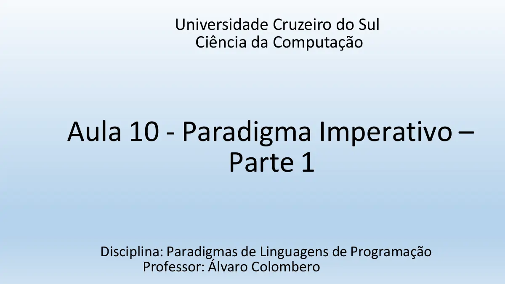

<details>
<summary>Texto da página</summary>

```text
             Universidade Cruzeiro do Sul
               Ciência da Computação

Aula 10 - Paradigma Imperativo –
             Parte 1

  Disciplina: Paradigmas de Linguagens de Programação
          Professor: Álvaro Colombero
```

</details>

<sub>[↑ voltar ao índice](#aula-09---paradigma-imperativo-i--slides-originais)</sub>

---

### Página 2

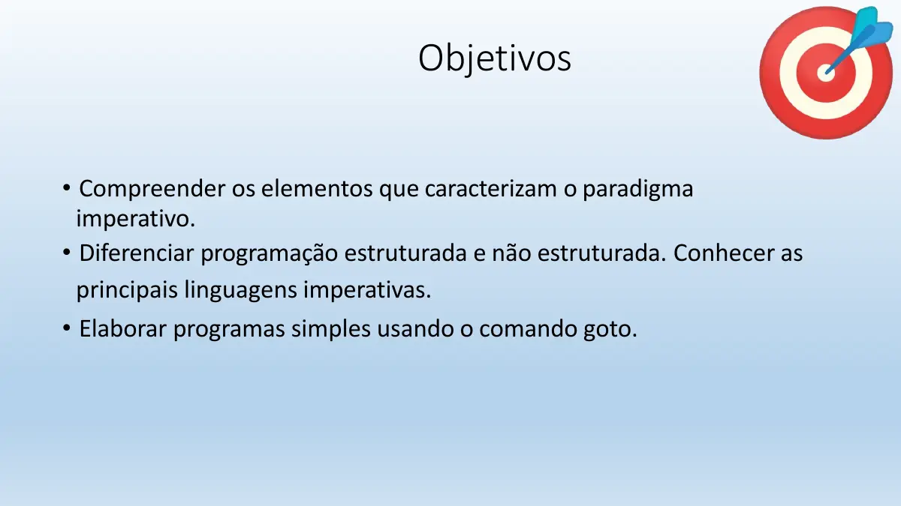

<details>
<summary>Texto da página</summary>

```text
                                Objetivos

• Compreender os elementos que caracterizam o paradigma
  imperativo.
• Diferenciar programação estruturada e não estruturada. Conhecer as
  principais linguagens imperativas.
• Elaborar programas simples usando o comando goto.
```

</details>

<sub>[↑ voltar ao índice](#aula-09---paradigma-imperativo-i--slides-originais)</sub>

---

### Página 3

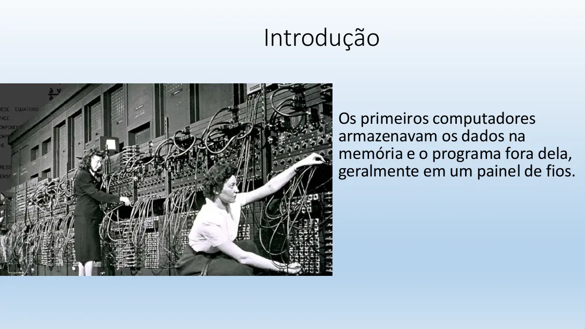

<details>
<summary>Texto da página</summary>

```text
Introdução

      Os primeiros computadores
      armazenavam os dados na
      memória e o programa fora dela,
      geralmente em um painel de fios.
```

</details>

<sub>[↑ voltar ao índice](#aula-09---paradigma-imperativo-i--slides-originais)</sub>

---

### Página 4

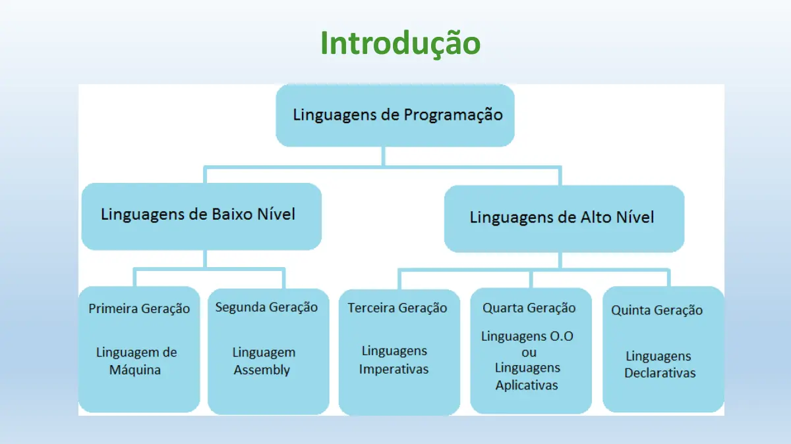

<details>
<summary>Texto da página</summary>

```text
Introdução
```

</details>

<sub>[↑ voltar ao índice](#aula-09---paradigma-imperativo-i--slides-originais)</sub>

---

### Página 5

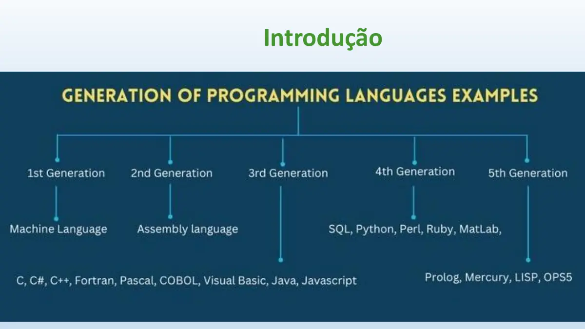

<details>
<summary>Texto da página</summary>

```text
Introdução
```

</details>

<sub>[↑ voltar ao índice](#aula-09---paradigma-imperativo-i--slides-originais)</sub>

---

### Página 6

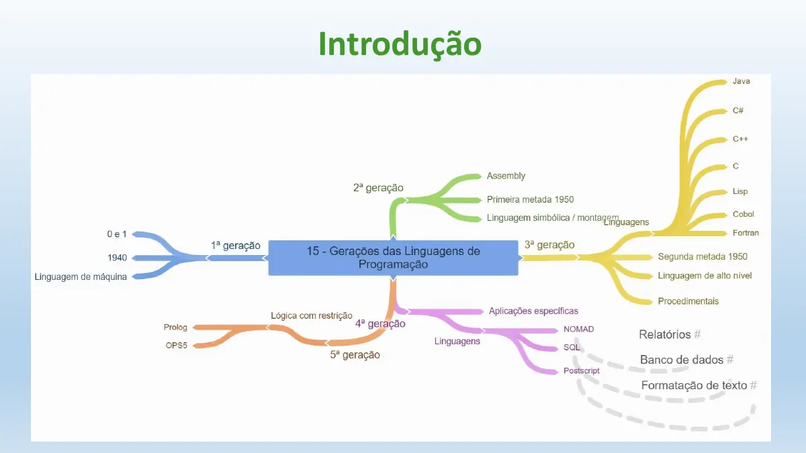

<details>
<summary>Texto da página</summary>

```text
Introdução
```

</details>

<sub>[↑ voltar ao índice](#aula-09---paradigma-imperativo-i--slides-originais)</sub>

---

### Página 7

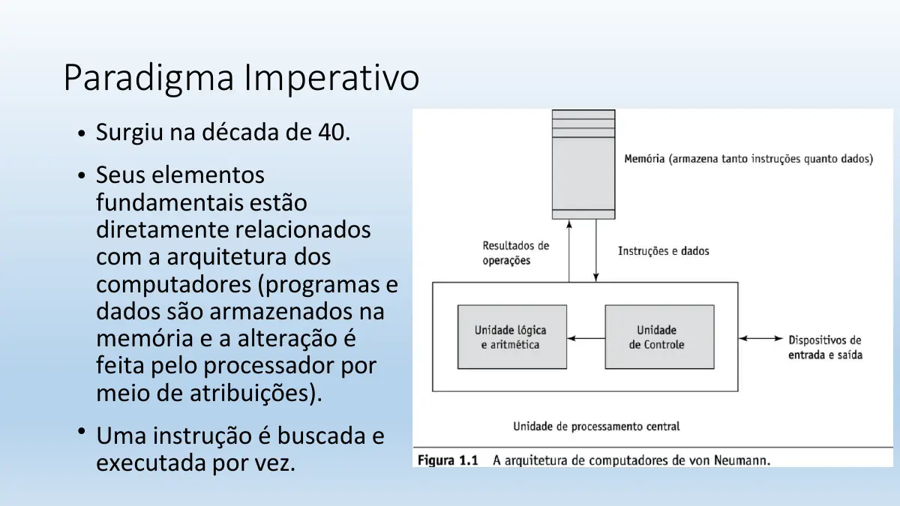

<details>
<summary>Texto da página</summary>

```text
Paradigma Imperativo
●   Surgiu na década de 40.
●   Seus elementos
    fundamentais estão
    diretamente relacionados
    com a arquitetura dos
    computadores (programas e
    dados são armazenados na
    memória e a alteração é
    feita pelo processador por
    meio de atribuições).
●
    Uma instrução é buscada e
    executada por vez.
```

</details>

<sub>[↑ voltar ao índice](#aula-09---paradigma-imperativo-i--slides-originais)</sub>

---

### Página 8

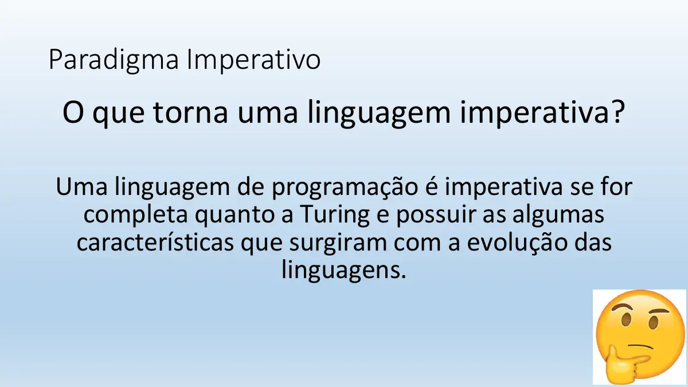

<details>
<summary>Texto da página</summary>

```text
Paradigma Imperativo
 O que torna uma linguagem imperativa?

Uma linguagem de programação é imperativa se for
  completa quanto a Turing e possuir as algumas
 características que surgiram com a evolução das
                    linguagens.
```

</details>

<sub>[↑ voltar ao índice](#aula-09---paradigma-imperativo-i--slides-originais)</sub>

---

### Página 9

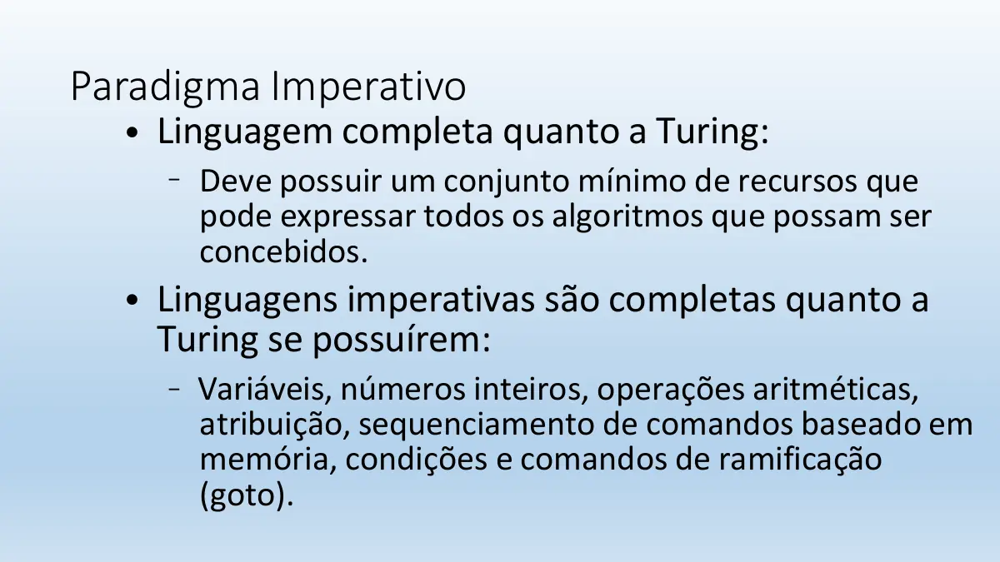

<details>
<summary>Texto da página</summary>

```text
Paradigma Imperativo
  ●   Linguagem completa quanto a Turing:
      –   Deve possuir um conjunto mínimo de recursos que
          pode expressar todos os algoritmos que possam ser
          concebidos.
  ●   Linguagens imperativas são completas quanto a
      Turing se possuírem:
      – Variáveis, números inteiros, operações aritméticas,
          atribuição, sequenciamento de comandos baseado em
          memória, condições e comandos de ramificação
          (goto).
```

</details>

<sub>[↑ voltar ao índice](#aula-09---paradigma-imperativo-i--slides-originais)</sub>

---

### Página 10

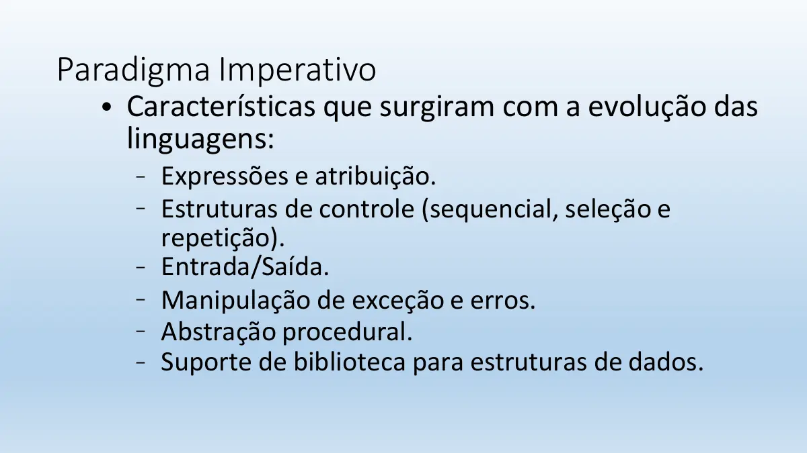

<details>
<summary>Texto da página</summary>

```text
Paradigma Imperativo
  ●   Características que surgiram com a evolução das
      linguagens:
      – Expressões e atribuição.
      – Estruturas de controle (sequencial, seleção e
        repetição).
      – Entrada/Saída.
      – Manipulação de exceção e erros.
      – Abstração procedural.
      – Suporte de biblioteca para estruturas de dados.
```

</details>

<sub>[↑ voltar ao índice](#aula-09---paradigma-imperativo-i--slides-originais)</sub>

---

### Página 11

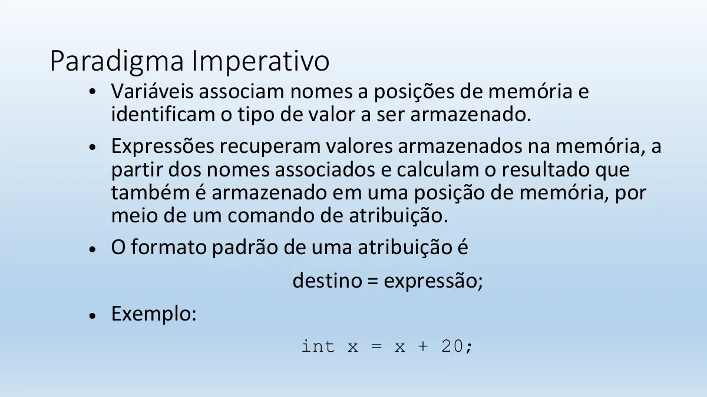

<details>
<summary>Texto da página</summary>

```text
Paradigma Imperativo
  ● Variáveis associam nomes a posições de memória e
    identificam o tipo de valor a ser armazenado.
  ● Expressões recuperam valores armazenados na memória, a

    partir dos nomes associados e calculam o resultado que
    também é armazenado em uma posição de memória, por
    meio de um comando de atribuição.
  ● O formato padrão de uma atribuição é

                        destino = expressão;
  ● Exemplo:

                      int x = x + 20;
```

</details>

<sub>[↑ voltar ao índice](#aula-09---paradigma-imperativo-i--slides-originais)</sub>

---

### Página 12

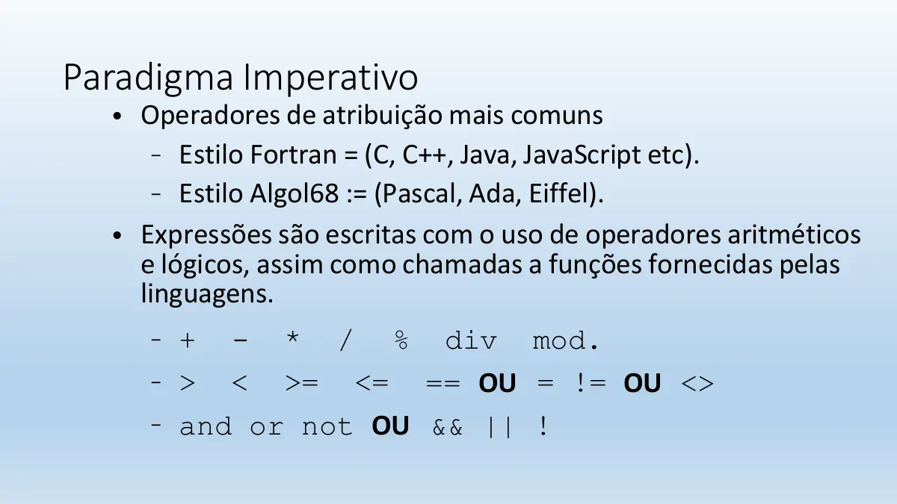

<details>
<summary>Texto da página</summary>

```text
Paradigma Imperativo
  ● Operadores de atribuição mais comuns
     – Estilo Fortran = (C, C++, Java, JavaScript etc).
     – Estilo Algol68 := (Pascal, Ada, Eiffel).
  ● Expressões são escritas com o uso de operadores aritméticos

    e lógicos, assim como chamadas a funções fornecidas pelas
    linguagens.
      – + - * / % div mod.
      – >  < >= <= == OU = != OU <>
      – and or not OU && || !
```

</details>

<sub>[↑ voltar ao índice](#aula-09---paradigma-imperativo-i--slides-originais)</sub>

---

### Página 13

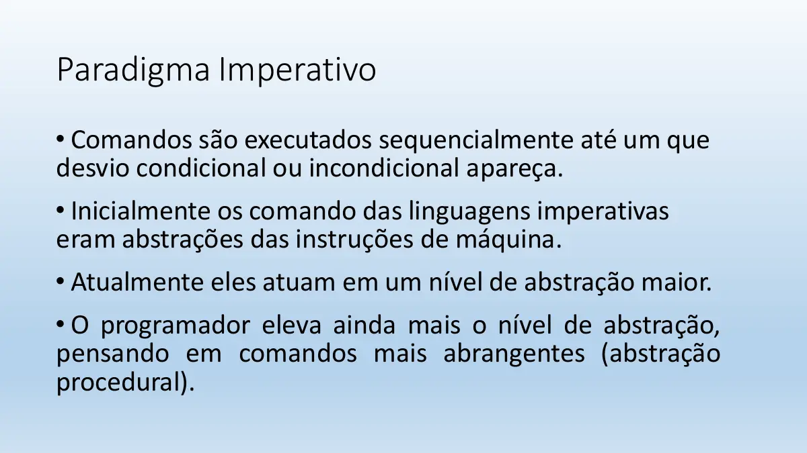

<details>
<summary>Texto da página</summary>

```text
Paradigma Imperativo
• Comandos são executados sequencialmente até um que
desvio condicional ou incondicional apareça.
• Inicialmente os comando das linguagens imperativas
eram abstrações das instruções de máquina.
• Atualmente eles atuam em um nível de abstração maior.
• O programador eleva ainda mais o nível de abstração,
pensando em comandos mais abrangentes (abstração
procedural).
```

</details>

<sub>[↑ voltar ao índice](#aula-09---paradigma-imperativo-i--slides-originais)</sub>

---

### Página 14

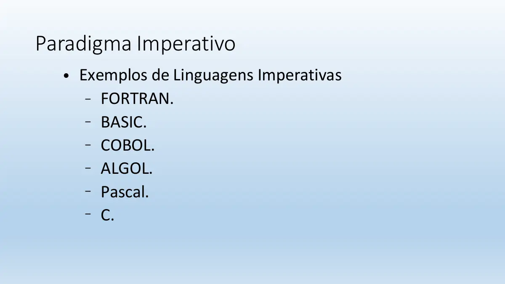

<details>
<summary>Texto da página</summary>

```text
Paradigma Imperativo
  ●   Exemplos de Linguagens Imperativas
       – FORTRAN.
       – BASIC.
       – COBOL.
       – ALGOL.
       – Pascal.
       – C.
```

</details>

<sub>[↑ voltar ao índice](#aula-09---paradigma-imperativo-i--slides-originais)</sub>

---

### Página 15

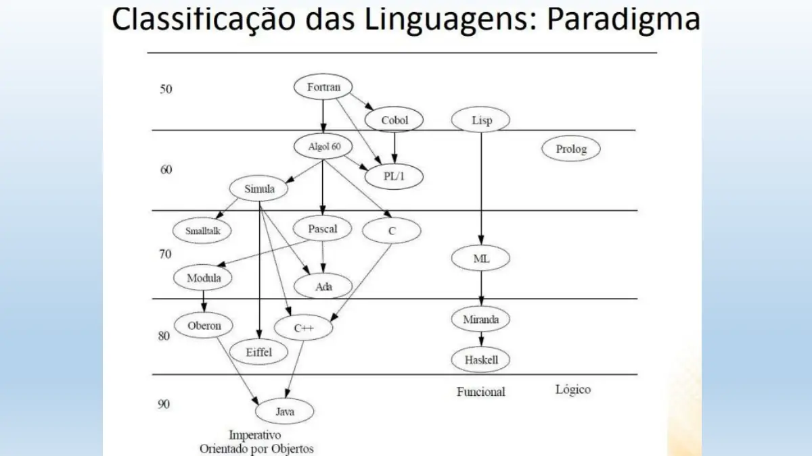

*Página sem texto extraível (só imagem).*

<sub>[↑ voltar ao índice](#aula-09---paradigma-imperativo-i--slides-originais)</sub>

---

### Página 16

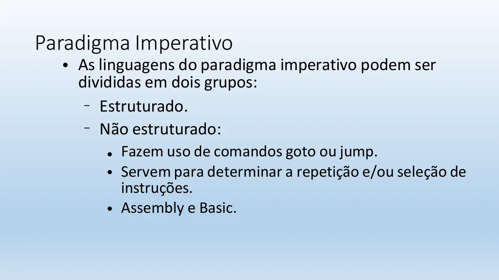

<details>
<summary>Texto da página</summary>

```text
Paradigma Imperativo
  ●   As linguagens do paradigma imperativo podem ser
      divididas em dois grupos:
       – Estruturado.
       – Não estruturado:
         ● Fazem uso de comandos goto ou jump.
         ● Servem para determinar a repetição e/ou seleção de

           instruções.
         ● Assembly e Basic.
```

</details>

<sub>[↑ voltar ao índice](#aula-09---paradigma-imperativo-i--slides-originais)</sub>

---

### Página 17

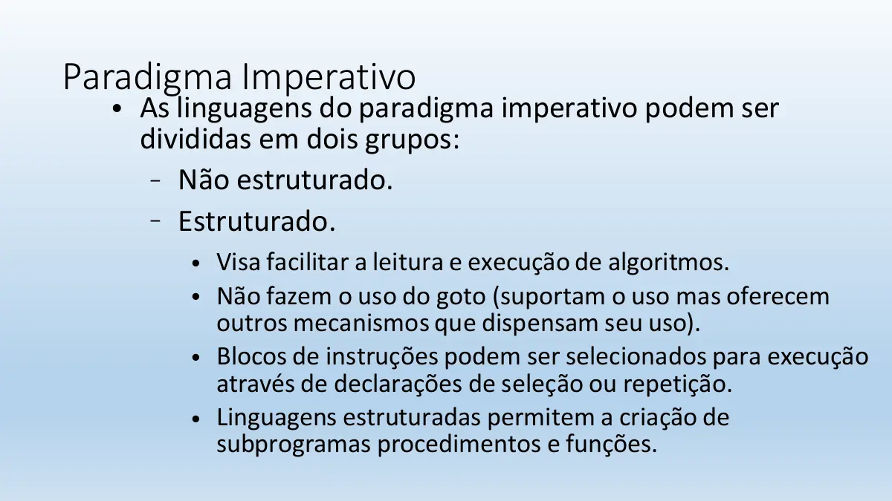

<details>
<summary>Texto da página</summary>

```text
Paradigma Imperativo
  ●   As linguagens do paradigma imperativo podem ser
      divididas em dois grupos:
       – Não estruturado.
       – Estruturado.
         ● Visa facilitar a leitura e execução de algoritmos.
         ● Não fazem o uso do goto (suportam o uso mas oferecem

           outros mecanismos que dispensam seu uso).
         ● Blocos de instruções podem ser selecionados para execução

           através de declarações de seleção ou repetição.
         ● Linguagens estruturadas permitem a criação de

           subprogramas procedimentos e funções.
```

</details>

<sub>[↑ voltar ao índice](#aula-09---paradigma-imperativo-i--slides-originais)</sub>

---

### Página 18

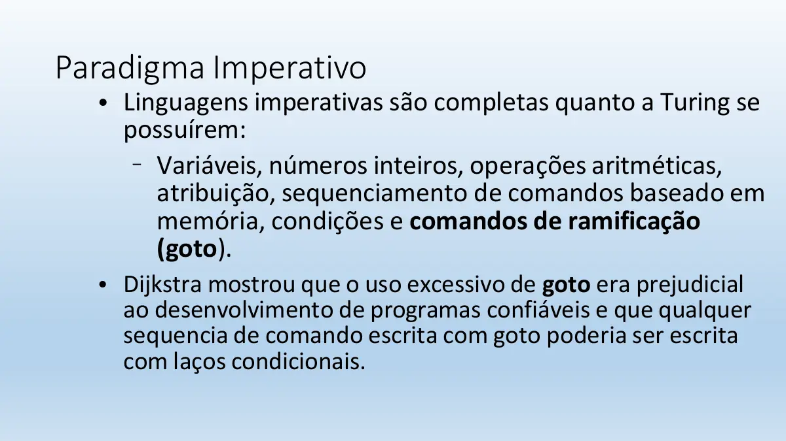

<details>
<summary>Texto da página</summary>

```text
Paradigma Imperativo
  ●   Linguagens imperativas são completas quanto a Turing se
      possuírem:
       – Variáveis, números inteiros, operações aritméticas,
         atribuição, sequenciamento de comandos baseado em
         memória, condições e comandos de ramificação
         (goto).
  ●   Dijkstra mostrou que o uso excessivo de goto era prejudicial
      ao desenvolvimento de programas confiáveis e que qualquer
      sequencia de comando escrita com goto poderia ser escrita
      com laços condicionais.
```

</details>

<sub>[↑ voltar ao índice](#aula-09---paradigma-imperativo-i--slides-originais)</sub>

---

### Página 19

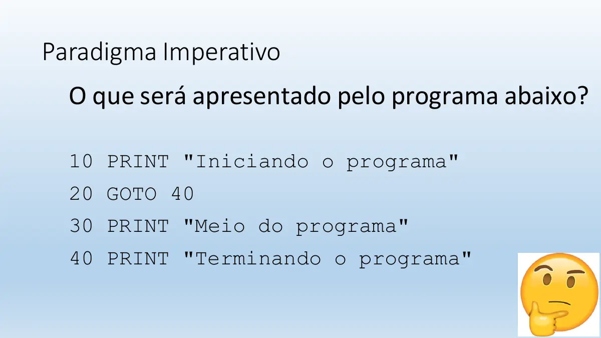

<details>
<summary>Texto da página</summary>

```text
Paradigma Imperativo
  O que será apresentado pelo programa abaixo?

  10 PRINT "Iniciando o programa"
  20 GOTO 40
  30 PRINT "Meio do programa"
  40 PRINT "Terminando o programa"
```

</details>

<sub>[↑ voltar ao índice](#aula-09---paradigma-imperativo-i--slides-originais)</sub>

---

### Página 20

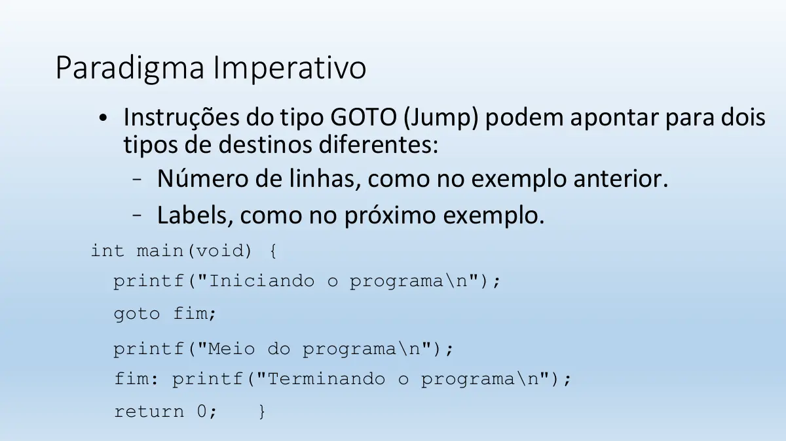

<details>
<summary>Texto da página</summary>

```text
Paradigma Imperativo
  ●   Instruções do tipo GOTO (Jump) podem apontar para dois
      tipos de destinos diferentes:
       – Número de linhas, como no exemplo anterior.
       – Labels, como no próximo exemplo.
  int main(void) {
      printf("Iniciando o programa\n");
      goto fim;
      printf("Meio do programa\n");
      fim: printf("Terminando o programa\n");
      return 0;   }
```

</details>

<sub>[↑ voltar ao índice](#aula-09---paradigma-imperativo-i--slides-originais)</sub>

---

### Página 21

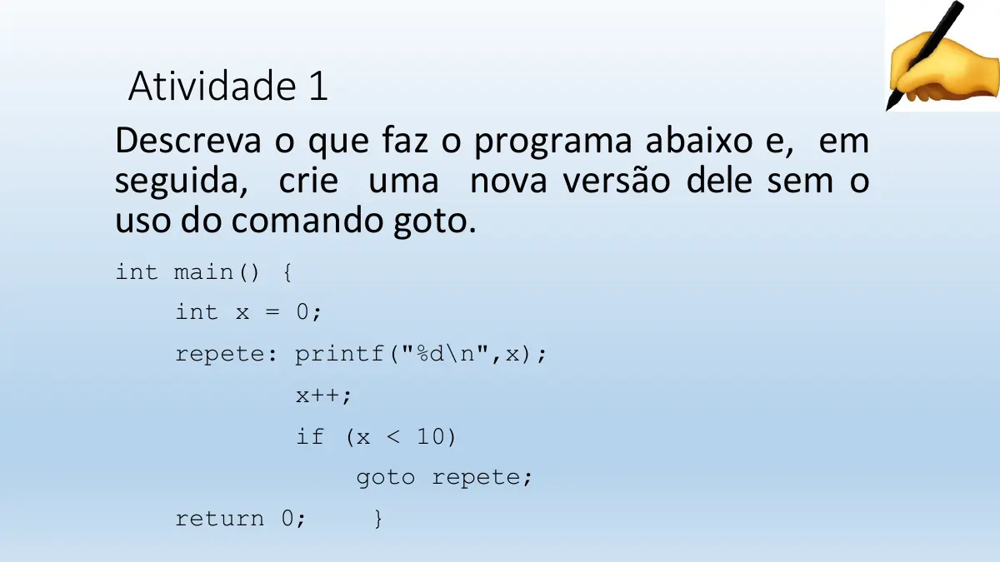

<details>
<summary>Texto da página</summary>

```text
Atividade 1
Descreva o que faz o programa abaixo e, em
seguida, crie uma nova versão dele sem o
uso do comando goto.
int main() {
    int x = 0;
    repete: printf("%d\n",x);
               x++;
               if (x < 10)
                      goto repete;
    return 0;          }
```

</details>

<sub>[↑ voltar ao índice](#aula-09---paradigma-imperativo-i--slides-originais)</sub>

---

### Página 22

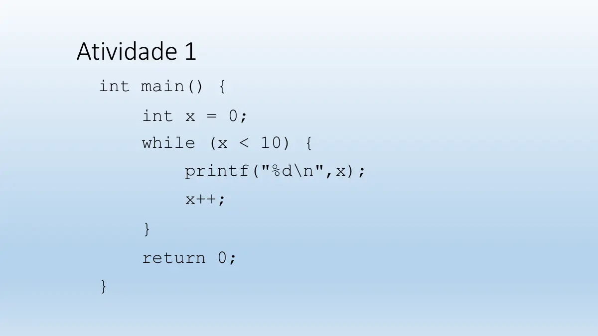

<details>
<summary>Texto da página</summary>

```text
Atividade 1
 int main() {
     int x = 0;
     while (x < 10) {
         printf("%d\n",x);
         x++;
     }
     return 0;
 }
```

</details>

<sub>[↑ voltar ao índice](#aula-09---paradigma-imperativo-i--slides-originais)</sub>

---

### Página 23

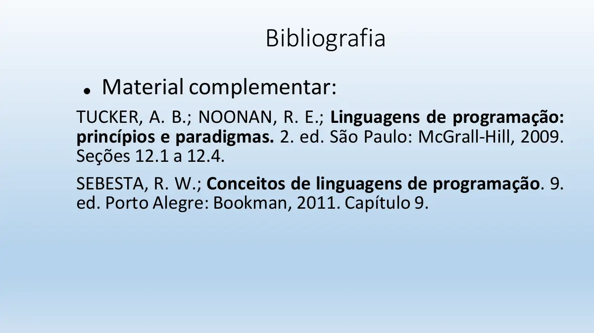

<details>
<summary>Texto da página</summary>

```text
                       Bibliografia
●   Material complementar:
TUCKER, A. B.; NOONAN, R. E.; Linguagens de programação:
princípios e paradigmas. 2. ed. São Paulo: McGrall-Hill, 2009.
Seções 12.1 a 12.4.
SEBESTA, R. W.; Conceitos de linguagens de programação. 9.
ed. Porto Alegre: Bookman, 2011. Capítulo 9.
```

</details>

<sub>[↑ voltar ao índice](#aula-09---paradigma-imperativo-i--slides-originais)</sub>

---

### Página 24

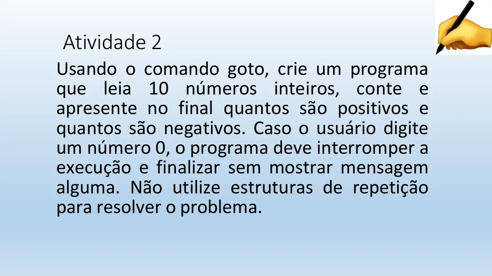

<details>
<summary>Texto da página</summary>

```text
Atividade 2
Usando o comando goto, crie um programa
que leia 10 números inteiros, conte e
apresente no final quantos são positivos e
quantos são negativos. Caso o usuário digite
um número 0, o programa deve interromper a
execução e finalizar sem mostrar mensagem
alguma. Não utilize estruturas de repetição
para resolver o problema.
```

</details>

<sub>[↑ voltar ao índice](#aula-09---paradigma-imperativo-i--slides-originais)</sub>


<!-- nav:rodape -->

---

**Aula 09:** [Visão geral](../README.md) · **Slides** · [Resumo](../02%20-%20Resumo%20Teórico/resumo-aula-09.md) · [Artigo](../02%20-%20Resumo%20Teórico/resumo-artigo-dijkstra-1968.md) · [Exercícios](../03%20-%20Exercícios/exercicios-aula-09.md) · [Resoluções](../04%20-%20Resoluções/resolucoes-aula-09.md) · [Complementos](../05%20-%20Materiais%20Complementares/materiais-complementares.md)

← [Aula 08 · Slides](../../Aula%2008%20-%20Ponteiros/01%20-%20Slides%20Originais/README.md) · [Aula 10 · Slides](../../Aula%2010%20-%20Paradigma%20Imperativo%20II/01%20-%20Slides%20Originais/README.md) →

**Links para esta página (14):** [Acompanhamento de estudo](../../../00%20-%20Planejamento%20e%20Organização/acompanhamento.md) · [Aula 09 · Artigo de Dijkstra](artigo-dijkstra-1968.md) · [Aula 09 · Artigo de Dijkstra (resumo)](../02%20-%20Resumo%20Teórico/resumo-artigo-dijkstra-1968.md) · [Aula 09 · Resumo](../02%20-%20Resumo%20Teórico/resumo-aula-09.md) · [Aula 09 · Exercícios](../03%20-%20Exercícios/exercicios-aula-09.md) · [Aula 09 · Resoluções](../04%20-%20Resoluções/resolucoes-aula-09.md) · [Aula 09 · Complementos](../05%20-%20Materiais%20Complementares/materiais-complementares.md) · [Lista 01 · Resolução](../../../02%20-%20Listas%20de%20Exercícios/Lista%2001%20-%20Revisão%20I/02%20-%20Resolução/resolucao-lista-01.md) · [Lista 02 · Resolução](../../../02%20-%20Listas%20de%20Exercícios/Lista%2002%20-%20Revisão%20II/02%20-%20Resolução/resolucao-lista-02.md) · [Simulado 01 · Resolução comentada](../../../04%20-%20Provas%20e%20Avaliações/Simulados/resolucao-simulado-01.md) · [Simulado 02 · Resolução comentada](../../../04%20-%20Provas%20e%20Avaliações/Simulados/resolucao-simulado-02.md) · [Erratas e inconsistências do material](../../../06%20-%20Revisões%20e%20Sínteses/erratas-e-inconsistencias.md) · [Quadros comparativos](../../../06%20-%20Revisões%20e%20Sínteses/quadros-comparativos.md) · [Questões integradoras · Resolução comentada](../../../06%20-%20Revisões%20e%20Sínteses/resolucao-questoes-integradoras.md)

<!-- /nav:rodape -->
