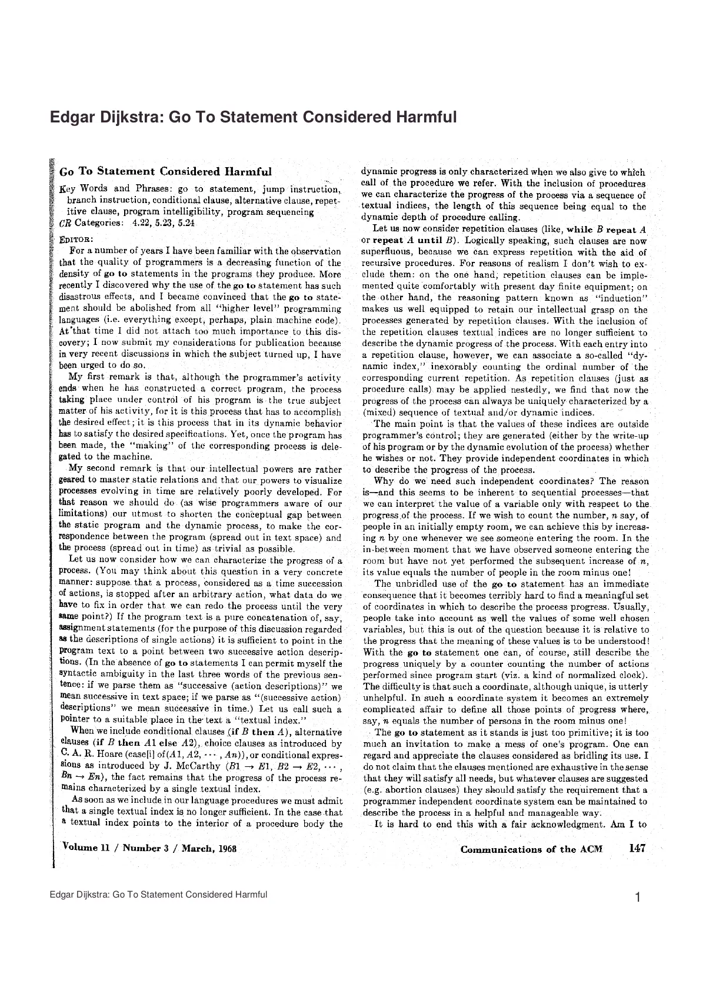
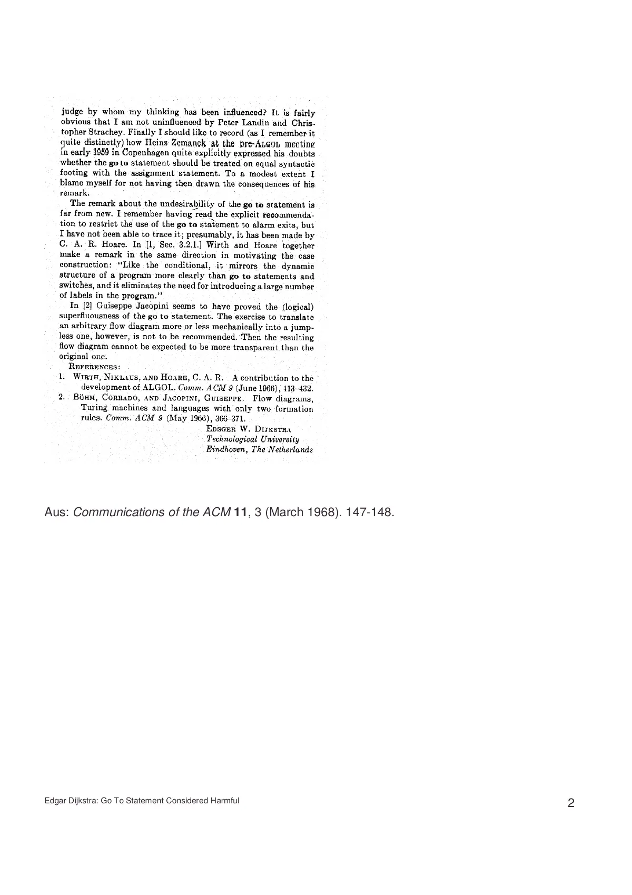

<!-- nav:topo -->
[Início](../../../README.md) › [01 - Aulas](../../README.md) › [Aula 09](../README.md) › [01 - Slides Originais](README.md) · [Mapa](../../../MAPA.md)
<!-- /nav:topo -->

<!-- gerado por ferramentas/geradores/gerar_galerias.py: não edite à mão -->

# Aula 09 - Paradigma Imperativo I · Artigo de Dijkstra (1968)

> **[Material original]** Artigo de Dijkstra (1968) do professor, página por página, para ler aqui mesmo no GitHub. O arquivo original é o PDF [`Aula09a_ArtigoDijkstra68.pdf`](Aula09a_ArtigoDijkstra68.pdf) (2 páginas): use-o para baixar ou imprimir. As imagens e o texto de cada página foram extraídos do PDF, sem alteração do conteúdo.

Nesta pasta também: [Slides originais](README.md).

**Ir para a página:** [1](#página-1) · [2](#página-2)

O texto de cada página fica em **Texto da página**, logo abaixo da imagem: é por ele que a busca encontra o conteúdo dos slides.

---

### Página 1



<details>
<summary>Texto da página</summary>

```text
Edgar Dijkstra: Go To Statement Considered Harmful

Edgar Dijkstra: Go To Statement Considered Harmful   1
```

</details>

<sub>[↑ voltar ao índice](#aula-09---paradigma-imperativo-i--artigo-de-dijkstra-1968)</sub>

---

### Página 2



<details>
<summary>Texto da página</summary>

```text
Aus: Communications of the ACM 11, 3 (March 1968). 147-148.

Edgar Dijkstra: Go To Statement Considered Harmful            2
```

</details>

<sub>[↑ voltar ao índice](#aula-09---paradigma-imperativo-i--artigo-de-dijkstra-1968)</sub>


<!-- nav:rodape -->

---

**Aula 09:** [Visão geral](../README.md) · [Slides](README.md) · [Resumo](../02%20-%20Resumo%20Teórico/resumo-aula-09.md) · [Artigo](../02%20-%20Resumo%20Teórico/resumo-artigo-dijkstra-1968.md) · [Exercícios](../03%20-%20Exercícios/exercicios-aula-09.md) · [Resoluções](../04%20-%20Resoluções/resolucoes-aula-09.md) · [Complementos](../05%20-%20Materiais%20Complementares/materiais-complementares.md)

**Links para esta página (1):** [Aula 09 · Slides](README.md)

<!-- /nav:rodape -->
