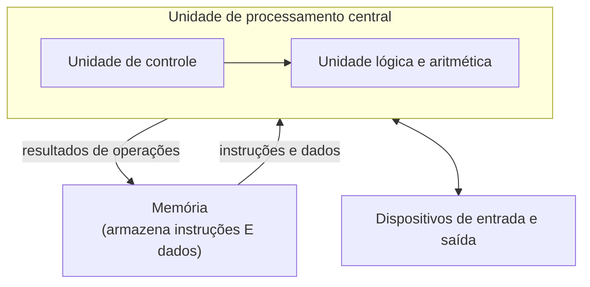

<!-- nav:topo -->
[Início](../../../README.md) › [01 - Aulas](../../README.md) › [Aula 09](../README.md) › [02 - Resumo Teórico](README.md) · [Mapa](../../../MAPA.md)
<!-- /nav:topo -->

# Aula 09 — Paradigma Imperativo I · Resumo teórico

> **Fonte:** [`Aula09_ParadigmaImperativo1.pdf`](../01%20-%20Slides%20Originais/Aula09_ParadigmaImperativo1.pdf) (24 páginas). Apoio indicado: Tucker & Noonan, seções 12.1 a 12.4; Sebesta (9ª ed.), cap. 9 ([p.23](../01%20-%20Slides%20Originais/README.md#página-23)).
> **Leitura obrigatória da aula:** artigo de Dijkstra (1968), [`Aula09a_ArtigoDijkstra68.pdf`](../01%20-%20Slides%20Originais/Aula09a_ArtigoDijkstra68.pdf), resumido em [**resumo-artigo-dijkstra-1968.md**](resumo-artigo-dijkstra-1968.md).
> **Legenda:** ver [Convenções](../../../README.md#convenções-de-marcação). `p.N` = página do PDF.

> **[Atenção] — numeração.** O arquivo se chama `Aula09`, mas o título interno do slide é "**Aula 10** – Paradigma Imperativo – Parte 1". O mesmo deslocamento de +1 se repete até a Aula 15 ("Aula 16"). Este repositório segue sempre o **nome do arquivo**.

---

## 1. Objetivos (p.2)

**[Material original]** Compreender os elementos que caracterizam o paradigma imperativo; diferenciar programação estruturada e não estruturada; conhecer as principais linguagens imperativas; elaborar programas simples usando o comando `goto`.

## 2. Origem: os primeiros computadores (p.3–6)

**[Material original]** "Os primeiros computadores armazenavam os dados na memória e o programa fora dela, geralmente em um painel de fios" (foto de operadoras do ENIAC). As [p.4–6](../01%20-%20Slides%20Originais/README.md#página-4) repetem as figuras de gerações da [Aula 02](../../Aula%2002%20-%20Evolução%20das%20Linguagens%20e%20Paradigmas/02%20-%20Resumo%20Teórico/resumo-aula-02.md#8-evolução-das-linguagens-p1822).

<!-- figura: aula09 página 3 -->
<p align="center"><a href="../01%20-%20Slides%20Originais/README.md#página-3"></a><br><sub>Slide original, página 3: foto do ENIAC. Clique para abrir na galeria.</sub></p>

**[Explicação elaborada]** No ENIAC, "programar" era religar cabos. A grande virada foi o **programa armazenado**: guardar as instruções na mesma memória dos dados, o que permitiu trocar de programa sem mexer no hardware. É a arquitetura de von Neumann.

## 3. Paradigma imperativo e von Neumann (p.7)

**[Material original]**

- Surgiu na **década de 1940**.
- Seus elementos fundamentais estão **diretamente relacionados com a arquitetura dos computadores**: programas e dados ficam na memória, e a alteração é feita pelo processador por meio de **atribuições**.
- **Uma instrução é buscada e executada por vez.**

Figura 1.1 de Sebesta — a arquitetura de von Neumann:



<!-- figura: aula09 página 7 -->
<p align="center"><a href="../01%20-%20Slides%20Originais/README.md#página-7"></a><br><sub>Slide original, página 7: arquitetura de von Neumann (Sebesta, Figura 1.1). Clique para abrir na galeria.</sub></p>

**[Explicação elaborada] — por que o imperativo "espelha" a máquina:**

| Elemento da arquitetura | Construção da linguagem imperativa |
| --- | --- |
| Células de memória | **Variáveis** (nome para uma posição de memória) |
| Gravar resultado na memória | **Atribuição** (`x = expressão`) |
| Busca-execução sequencial | **Sequência** de comandos |
| Desvio do contador de programa (*jump*) | **`goto`**, seleção e repetição |
| ULA | **Expressões** aritméticas e lógicas |

**[Complemento]** O canal único entre CPU e memória, por onde passam instruções e dados, palavra por palavra, ficou conhecido como **gargalo de von Neumann**. A expressão é de John Backus, na palestra do Prêmio Turing de 1977, em que ele defendeu o estilo funcional. Os paradigmas funcional e lógico partem de **outras bases** — funções matemáticas e cálculo de predicados (Aula14 [p.6](../../Aula%2014%20-%20Paradigma%20Funcional/01%20-%20Slides%20Originais/README.md#página-6)) —, e não do hardware; o funcional surgiu nos anos 1960, por necessidades da Inteligência Artificial ([Aula 14](../../Aula%2014%20-%20Paradigma%20Funcional/02%20-%20Resumo%20Teórico/resumo-aula-14.md), [p.7](../../Aula%2014%20-%20Paradigma%20Funcional/01%20-%20Slides%20Originais/README.md#página-7)).

## 4. O que torna uma linguagem imperativa (p.8–10)

**[Material original]** "Uma linguagem de programação é imperativa se for **completa quanto a Turing** e possuir algumas características que surgiram com a evolução das linguagens."

**Completa quanto a Turing ([p.9](../01%20-%20Slides%20Originais/README.md#página-9)):** possui um conjunto mínimo de recursos capaz de expressar **todos os algoritmos** que possam ser concebidos. Linguagens imperativas são Turing-completas se possuírem:

1. variáveis;
2. números inteiros;
3. operações aritméticas;
4. atribuição;
5. sequenciamento de comandos baseado em memória;
6. condições;
7. comandos de ramificação (`goto`).

**Características que surgiram com a evolução ([p.10](../01%20-%20Slides%20Originais/README.md#página-10)):**

- expressões e atribuição;
- estruturas de controle (sequencial, seleção e repetição);
- entrada/saída;
- manipulação de exceções e erros;
- abstração procedural;
- suporte de biblioteca para estruturas de dados.

**[Explicação elaborada]** A Turing-completude é o "piso": com variáveis inteiras, aritmética, atribuição, `if` e `goto` já é possível escrever qualquer algoritmo, por mais desconfortável que seja. As características evolutivas tornam isso **prático e legível**. **[Complemento]** O nome vem da Máquina de Turing (Alan Turing, 1936), modelo matemático do que é computável. Uma linguagem é Turing-completa se consegue simular essa máquina.

## 5. Variáveis, expressões e atribuição (p.11–13)

**[Material original]**

- **Variáveis** associam nomes a posições de memória e identificam o tipo do valor armazenado.
- **Expressões** recuperam valores da memória pelos nomes e calculam um resultado, que também é guardado na memória por um **comando de atribuição**.
- Formato padrão: `destino = expressão;` — exemplo do slide: `int x = x + 20;`.
- **Operadores de atribuição:** estilo Fortran `=` (C, C++, Java, JavaScript…) e estilo Algol68 `:=` (Pascal, Ada, Eiffel).
- **Operadores:** `+ - * / % div mod`; `> < >= <= == (ou =) != (ou <>)`; `and or not` (ou `&& || !`).
- Comandos são executados **sequencialmente** até aparecer um desvio condicional ou incondicional.
- No início, os comandos eram abstrações das instruções de máquina; hoje atuam em nível mais alto, e o programador eleva ainda mais a abstração pensando em comandos abrangentes (**abstração procedural**).

> **[Atenção]** O exemplo `int x = x + 20;` usa `x` antes de ele ter valor: em C, uma variável local não inicializada tem valor indeterminado. O slide quer mostrar só a **forma** `destino = expressão`. Um exemplo correto seria `int x = 10; x = x + 20;`.

**[Explicação elaborada]** Por que `=` e `:=`? Em C e derivadas, `=` atribui e `==` compara — fonte do erro clássico `if (x = 0)`, que compila porque a atribuição é uma expressão. Em Fortran, `=` também atribui, mas a comparação é `.EQ.` (ou `==` a partir do Fortran 90). Em Algol, Pascal e Ada, `:=` atribui e `=` compara, aproximando-se da notação matemática.

## 6. Linguagens imperativas (p.14–15)

**[Material original]** Exemplos: FORTRAN, BASIC, COBOL, ALGOL, Pascal, C. A figura "Classificação das Linguagens: Paradigma" ([p.15](../01%20-%20Slides%20Originais/README.md#página-15)) organiza por década, dos anos 1950 aos 1990:

<!-- figura: aula09 página 15 -->
<p align="center"><a href="../01%20-%20Slides%20Originais/README.md#página-15"></a><br><sub>Slide original, página 15: classificação das linguagens por paradigma e década. Clique para abrir na galeria.</sub></p>

- **Imperativo / OO:** Fortran → Algol 60 → Simula, Pascal, C → Smalltalk, Modula, Ada → Oberon, Eiffel, C++ → Java (com Cobol e PL/I nos anos 1950/60).
- **Funcional:** Lisp → ML → Miranda → Haskell.
- **Lógico:** Prolog. **[Atenção]** A figura posiciona o Prolog na faixa dos anos 1960; a Aula 15 ([p.13](../../Aula%2015%20-%20Paradigma%20Lógico/01%20-%20Slides%20Originais/README.md#página-13)) situa o início do seu desenvolvimento na década de 1970 (1972).

## 7. Não estruturado × estruturado (p.16–18)

**[Material original]** As linguagens imperativas podem ser divididas em dois grupos:

| | Não estruturado | Estruturado |
| --- | --- | --- |
| Controle de fluxo | `goto` ou `jump` para determinar repetição e/ou seleção | Blocos selecionados por comandos de **seleção** ou **repetição** |
| Uso de `goto` | É o mecanismo principal | Não usa (suporta, mas oferece mecanismos que dispensam seu uso) |
| Objetivo | — | Facilitar a leitura e a execução de algoritmos |
| Subprogramas | — | Permite procedimentos e funções |
| Exemplos | Assembly, BASIC ([p.16](../01%20-%20Slides%20Originais/README.md#página-16)) | *(não citados no slide; ex.: Pascal, C, Ada)* |

**Dijkstra ([p.18](../01%20-%20Slides%20Originais/README.md#página-18)):** "mostrou que o uso excessivo de `goto` era prejudicial ao desenvolvimento de programas confiáveis e que qualquer sequência de comandos escrita com `goto` poderia ser escrita com laços condicionais."

> **[Atenção] — nuance em relação ao artigo.** No próprio artigo ([resumo](resumo-artigo-dijkstra-1968.md)), Dijkstra:
> 1. defende **abolir** o `goto` das linguagens de alto nível, e não apenas evitar o "uso excessivo";
> 2. atribui a prova de que o `goto` é logicamente supérfluo a **Böhm e Jacopini (1966)**;
> 3. **não recomenda** converter mecanicamente programas com `goto` em programas sem saltos, porque o resultado não fica mais claro.
>
> Em prova, a frase do slide é aceitável como resumo, mas a versão do artigo é mais precisa.

## 8. Programas com `goto` (p.19–22)

**[Material original]** O `goto` pode apontar para **números de linha** ou **labels** (rótulos).

**BASIC, com número de linha ([p.19](../01%20-%20Slides%20Originais/README.md#página-19)):**

```basic
10 PRINT "Iniciando o programa"
20 GOTO 40
30 PRINT "Meio do programa"
40 PRINT "Terminando o programa"
```

Saída: "Iniciando o programa" e "Terminando o programa". A linha 30 **nunca executa**.

**C, com label ([p.20](../01%20-%20Slides%20Originais/README.md#página-20)):**

<!-- teste: saida-contem="Iniciando o programa\nTerminando o programa" -->
```c
#include <stdio.h>
int main(void) {
    printf("Iniciando o programa\n");
    goto fim;
    printf("Meio do programa\n");      /* código inalcançável */
fim: printf("Terminando o programa\n");
    return 0;
}
```

**Atividade 1 ([p.21–22](../01%20-%20Slides%20Originais/README.md#página-21)):** descrever o programa e reescrevê-lo sem `goto`.

<!-- teste: saida-contem="0\n1\n2\n3\n4\n5\n6\n7\n8\n9" -->
```c
#include <stdio.h>
int main() {
    int x = 0;
repete: printf("%d\n", x);
    x++;
    if (x < 10)
        goto repete;
    return 0;
}
```

O programa imprime de 0 a 9. É um **laço pós-testado**: o corpo executa antes do teste. A resposta do professor ([p.22](../01%20-%20Slides%20Originais/README.md#página-22)) usa `while`:

<!-- teste: saida-contem="0\n1\n2\n3\n4\n5\n6\n7\n8\n9" -->
```c
#include <stdio.h>   /* o slide omite os #include */
int main() {
    int x = 0;
    while (x < 10) {
        printf("%d\n", x);
        x++;
    }
    return 0;
}
```

**[Explicação elaborada]** A versão **mais fiel** ao `goto` é o `do { ... } while (x < 10);`, porque também testa **depois** de executar. O `while` testa **antes**. As duas dão o mesmo resultado aqui porque `x` começa em 0 e a condição é verdadeira na primeira vez. Com `x = 10` no início, a versão com `goto` imprimiria "10" e a com `while` não imprimiria nada.

**Atividade 2 ([p.24](../01%20-%20Slides%20Originais/README.md#página-24)):** usando `goto` e **sem estruturas de repetição**, ler 10 inteiros e contar positivos e negativos; se o usuário digitar 0, encerrar sem mensagem. Solução testada em [resolucoes-aula-09.md](../04%20-%20Resoluções/resolucoes-aula-09.md#e8--atividade-2-original-p24).

> **[Atenção]** O slide de bibliografia ([p.23](../01%20-%20Slides%20Originais/README.md#página-23)) aparece **antes** da Atividade 2 ([p.24](../01%20-%20Slides%20Originais/README.md#página-24)).

## 9. Conexões e pontos para a prova

- Von Neumann é a "raiz" do imperativo e o contraponto do [funcional](../../Aula%2014%20-%20Paradigma%20Funcional/02%20-%20Resumo%20Teórico/resumo-aula-14.md) e do [lógico](../../Aula%2015%20-%20Paradigma%20Lógico/02%20-%20Resumo%20Teórico/resumo-aula-15.md).
- A programação estruturada leva à **abstração procedural** ([Aula 10](../../Aula%2010%20-%20Paradigma%20Imperativo%20II/02%20-%20Resumo%20Teórico/resumo-aula-10.md)) e aos **subprogramas** ([Aula 11](../../Aula%2011%20-%20Paradigma%20Imperativo%20III/02%20-%20Resumo%20Teórico/resumo-aula-11.md)).
- Cobrado na [Lista 01, Q2](../../../02%20-%20Listas%20de%20Exercícios/Lista%2001%20-%20Revisão%20I/02%20-%20Resolução/resolucao-lista-01.md#q2) (von Neumann) e na [Lista 02, Q7](../../../02%20-%20Listas%20de%20Exercícios/Lista%2002%20-%20Revisão%20II/02%20-%20Resolução/resolucao-lista-02.md#q7) (Turing e Dijkstra).
- **Decorar:** a lista de requisitos de Turing-completude; estruturado × não estruturado; converter `goto` ↔ laço.

---

**Anterior:** [Aula 08](../../Aula%2008%20-%20Ponteiros/02%20-%20Resumo%20Teórico/resumo-aula-08.md) · **Próxima:** [Aula 10 — Paradigma Imperativo II](../../Aula%2010%20-%20Paradigma%20Imperativo%20II/02%20-%20Resumo%20Teórico/resumo-aula-10.md)


<!-- nav:rodape -->

---

**Aula 09:** [Visão geral](../README.md) · [Slides](../01%20-%20Slides%20Originais/README.md) · **Resumo** · [Artigo](resumo-artigo-dijkstra-1968.md) · [Exercícios](../03%20-%20Exercícios/exercicios-aula-09.md) · [Resoluções](../04%20-%20Resoluções/resolucoes-aula-09.md) · [Complementos](../05%20-%20Materiais%20Complementares/materiais-complementares.md)

← [Aula 08 · Resumo](../../Aula%2008%20-%20Ponteiros/02%20-%20Resumo%20Teórico/resumo-aula-08.md) · [Aula 10 · Resumo](../../Aula%2010%20-%20Paradigma%20Imperativo%20II/02%20-%20Resumo%20Teórico/resumo-aula-10.md) →

**Links para esta página (13):** [Aula 02 · Resumo](../../Aula%2002%20-%20Evolução%20das%20Linguagens%20e%20Paradigmas/02%20-%20Resumo%20Teórico/resumo-aula-02.md) · [Aula 08 · Resumo](../../Aula%2008%20-%20Ponteiros/02%20-%20Resumo%20Teórico/resumo-aula-08.md) · [Aula 09 · Artigo de Dijkstra (resumo)](resumo-artigo-dijkstra-1968.md) · [Aula 09 · visão geral](../README.md) · [Aula 10 · Resumo](../../Aula%2010%20-%20Paradigma%20Imperativo%20II/02%20-%20Resumo%20Teórico/resumo-aula-10.md) · [Aula 14 · Resumo](../../Aula%2014%20-%20Paradigma%20Funcional/02%20-%20Resumo%20Teórico/resumo-aula-14.md) · [Lista 01](../../../02%20-%20Listas%20de%20Exercícios/Lista%2001%20-%20Revisão%20I/README.md) · [Lista 02](../../../02%20-%20Listas%20de%20Exercícios/Lista%2002%20-%20Revisão%20II/README.md) · [03 — Trabalhos e Projetos](../../../03%20-%20Trabalhos%20e%20Projetos/README.md) · [Revisão da Unidade 2 — Paradigma imperativo (Aulas 09–11)](../../../06%20-%20Revisões%20e%20Sínteses/Revisões%20por%20Unidade/unidade-2-imperativo.md) · [Resumo geral da disciplina](../../../06%20-%20Revisões%20e%20Sínteses/resumo-geral-da-disciplina.md) · [Glossário](../../../07%20-%20Glossário/glossario.md) · [Paradigmas de Linguagens de Programação — UNICSUL](../../../README.md)

<!-- /nav:rodape -->
