<!-- nav:topo -->
[Início](../../../README.md) › [01 - Aulas](../../README.md) › [Aula 10](../README.md) › **01 - Slides Originais** · [Mapa](../../../MAPA.md)
<!-- /nav:topo -->

<!-- gerado por ferramentas/geradores/gerar_galerias.py: não edite à mão -->

# Aula 10 - Paradigma Imperativo II · Slides originais

> **[Material original]** Slides originais do professor, página por página, para ler aqui mesmo no GitHub. O arquivo original é o PDF [`Aula10_ParadigmaImperativo2.pdf`](Aula10_ParadigmaImperativo2.pdf) (20 páginas): use-o para baixar ou imprimir. As imagens e o texto de cada página foram extraídos do PDF, sem alteração do conteúdo.

**Ir para a página:** [1](#página-1) · [2](#página-2) · [3](#página-3) · [4](#página-4) · [5](#página-5) · [6](#página-6) · [7](#página-7) · [8](#página-8) · [9](#página-9) · [10](#página-10) · [11](#página-11) · [12](#página-12) · [13](#página-13) · [14](#página-14) · [15](#página-15) · [16](#página-16) · [17](#página-17) · [18](#página-18) · [19](#página-19) · [20](#página-20)

O texto de cada página fica em **Texto da página**, logo abaixo da imagem: é por ele que a busca encontra o conteúdo dos slides.

---

### Página 1

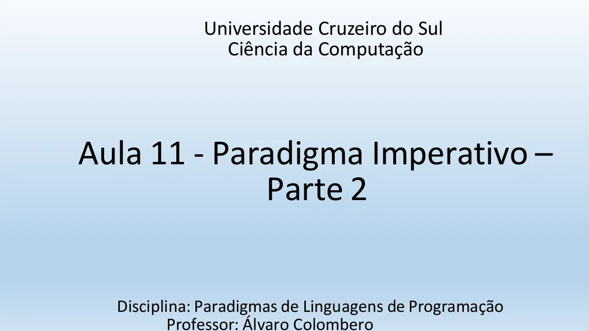

<details>
<summary>Texto da página</summary>

```text
             Universidade Cruzeiro do Sul
               Ciência da Computação

Aula 11 - Paradigma Imperativo –
             Parte 2

  Disciplina: Paradigmas de Linguagens de Programação
          Professor: Álvaro Colombero
```

</details>

<sub>[↑ voltar ao índice](#aula-10---paradigma-imperativo-ii--slides-originais)</sub>

---

### Página 2

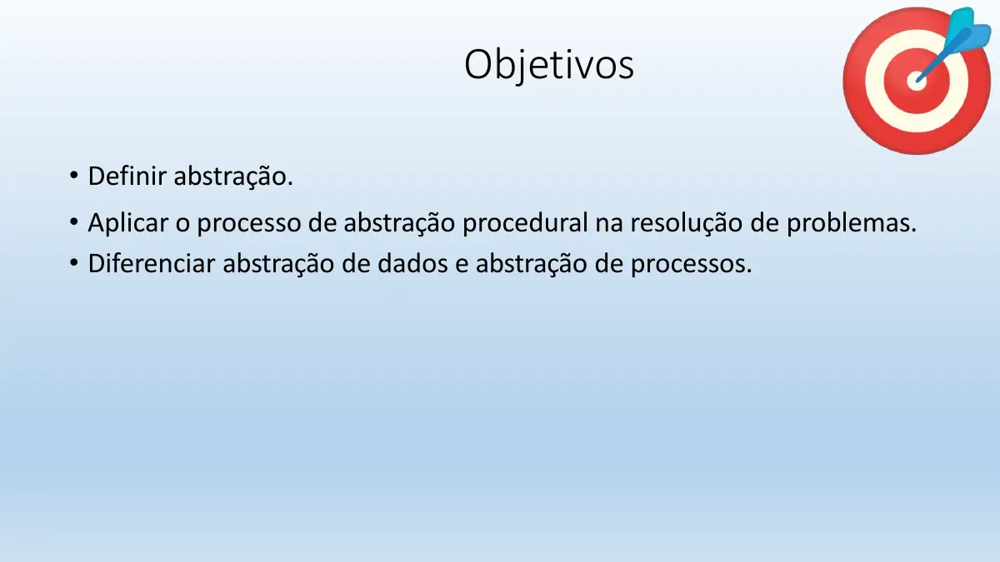

<details>
<summary>Texto da página</summary>

```text
                                 Objetivos

• Definir abstração.
• Aplicar o processo de abstração procedural na resolução de problemas.
• Diferenciar abstração de dados e abstração de processos.
```

</details>

<sub>[↑ voltar ao índice](#aula-10---paradigma-imperativo-ii--slides-originais)</sub>

---

### Página 3

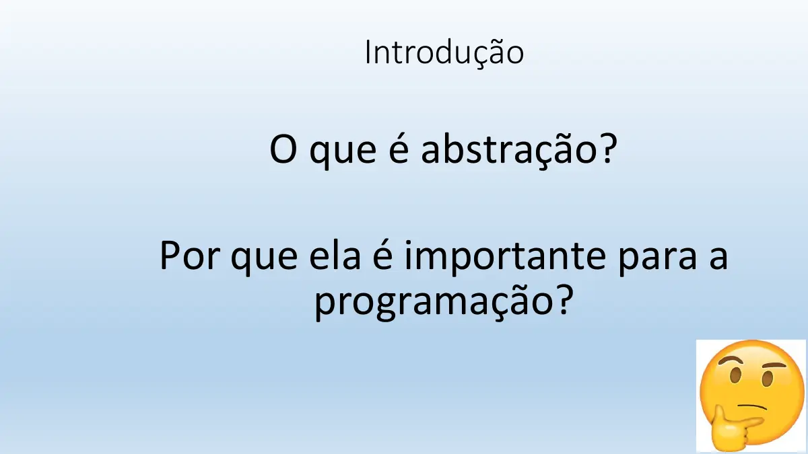

<details>
<summary>Texto da página</summary>

```text
           Introdução

     O que é abstração?

Por que ela é importante para a
        programação?
```

</details>

<sub>[↑ voltar ao índice](#aula-10---paradigma-imperativo-ii--slides-originais)</sub>

---

### Página 4

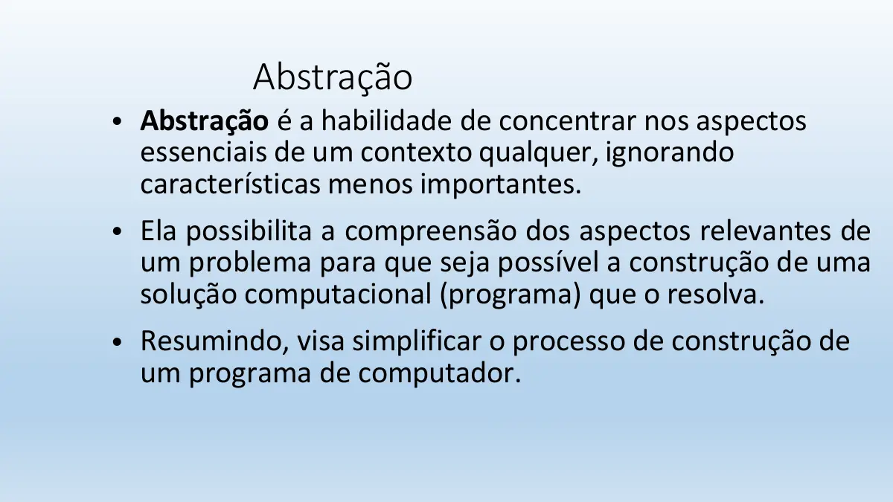

<details>
<summary>Texto da página</summary>

```text
            Abstração
●   Abstração é a habilidade de concentrar nos aspectos
    essenciais de um contexto qualquer, ignorando
    características menos importantes.
●   Ela possibilita a compreensão dos aspectos relevantes de
    um problema para que seja possível a construção de uma
    solução computacional (programa) que o resolva.
●   Resumindo, visa simplificar o processo de construção de
    um programa de computador.
```

</details>

<sub>[↑ voltar ao índice](#aula-10---paradigma-imperativo-ii--slides-originais)</sub>

---

### Página 5

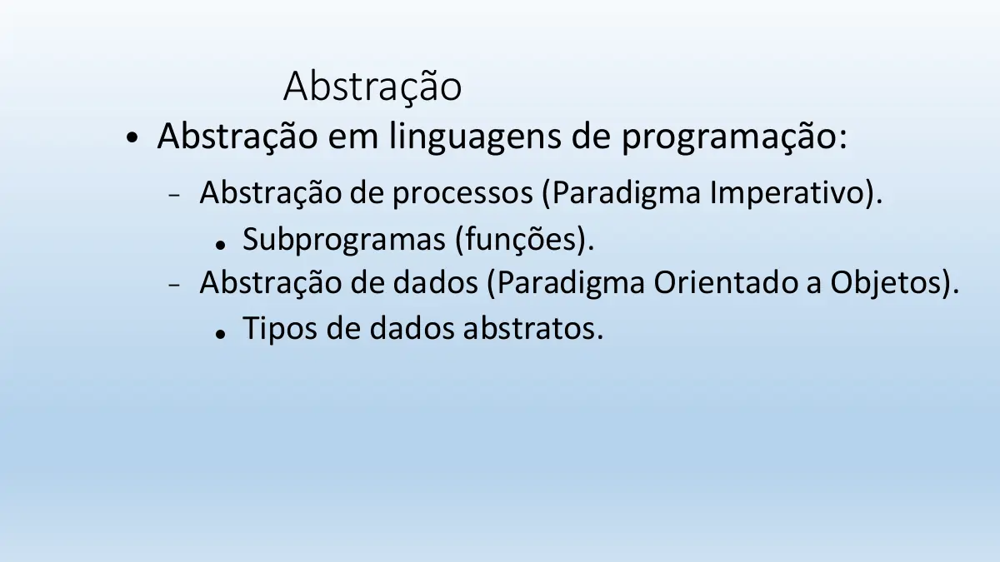

<details>
<summary>Texto da página</summary>

```text
           Abstração
●   Abstração em linguagens de programação:
    – Abstração de processos (Paradigma Imperativo).
       ● Subprogramas (funções).

    – Abstração de dados (Paradigma Orientado a Objetos).
       ● Tipos de dados abstratos.
```

</details>

<sub>[↑ voltar ao índice](#aula-10---paradigma-imperativo-ii--slides-originais)</sub>

---

### Página 6

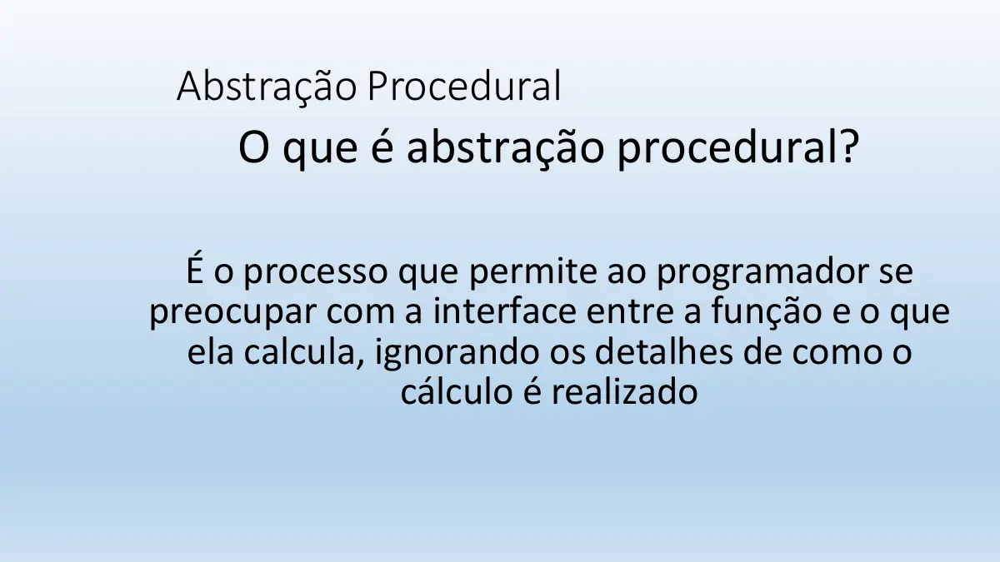

<details>
<summary>Texto da página</summary>

```text
 Abstração Procedural
     O que é abstração procedural?

  É o processo que permite ao programador se
preocupar com a interface entre a função e o que
  ela calcula, ignorando os detalhes de como o
                 cálculo é realizado
```

</details>

<sub>[↑ voltar ao índice](#aula-10---paradigma-imperativo-ii--slides-originais)</sub>

---

### Página 7

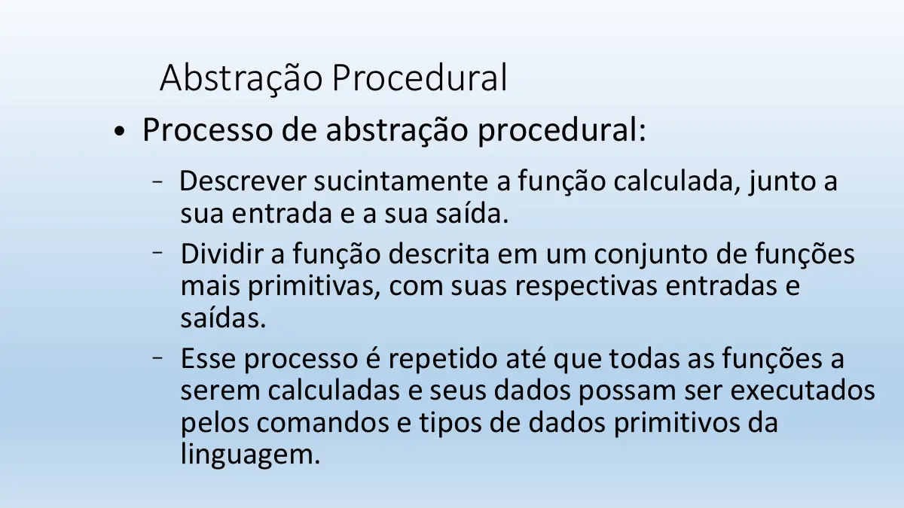

<details>
<summary>Texto da página</summary>

```text
     Abstração Procedural
●   Processo de abstração procedural:
    – Descrever sucintamente a função calculada, junto a
      sua entrada e a sua saída.
    – Dividir a função descrita em um conjunto de funções
      mais primitivas, com suas respectivas entradas e
      saídas.
    – Esse processo é repetido até que todas as funções a
      serem calculadas e seus dados possam ser executados
      pelos comandos e tipos de dados primitivos da
      linguagem.
```

</details>

<sub>[↑ voltar ao índice](#aula-10---paradigma-imperativo-ii--slides-originais)</sub>

---

### Página 8

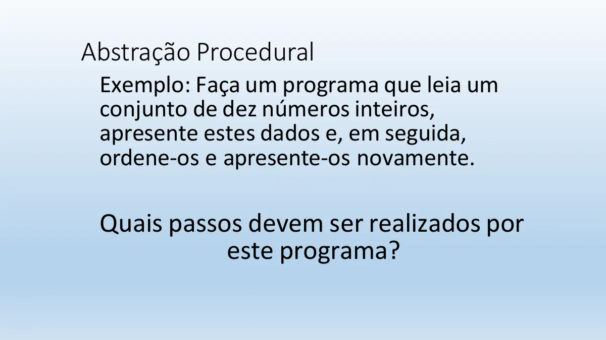

<details>
<summary>Texto da página</summary>

```text
Abstração Procedural
 Exemplo: Faça um programa que leia um
 conjunto de dez números inteiros,
 apresente estes dados e, em seguida,
 ordene-os e apresente-os novamente.

 Quais passos devem ser realizados por
            este programa?
```

</details>

<sub>[↑ voltar ao índice](#aula-10---paradigma-imperativo-ii--slides-originais)</sub>

---

### Página 9

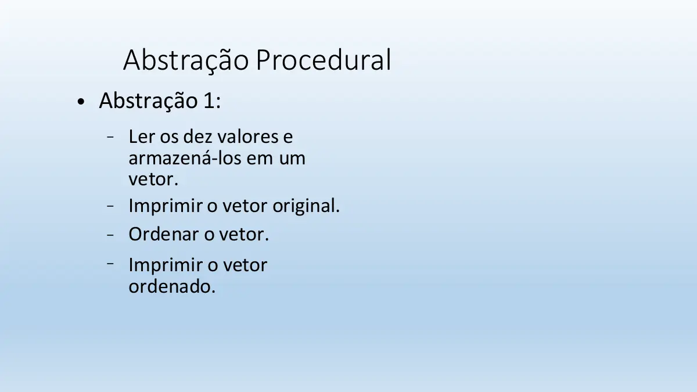

<details>
<summary>Texto da página</summary>

```text
        Abstração Procedural
●   Abstração 1:
    – Ler os dez valores e
      armazená-los em um
      vetor.
    – Imprimir o vetor original.
    – Ordenar o vetor.
    – Imprimir o vetor
      ordenado.
```

</details>

<sub>[↑ voltar ao índice](#aula-10---paradigma-imperativo-ii--slides-originais)</sub>

---

### Página 10

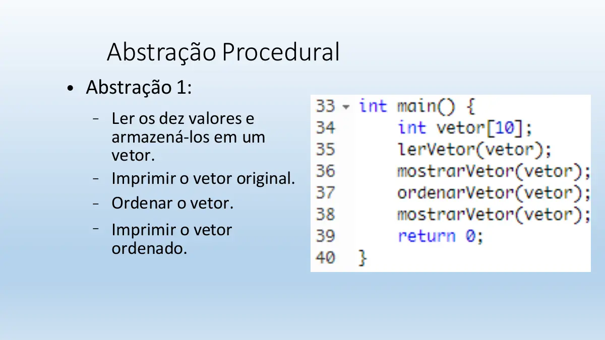

<details>
<summary>Texto da página</summary>

```text
        Abstração Procedural
●   Abstração 1:
    – Ler os dez valores e
      armazená-los em um
      vetor.
    – Imprimir o vetor original.
    – Ordenar o vetor.
    – Imprimir o vetor
      ordenado.
```

</details>

<sub>[↑ voltar ao índice](#aula-10---paradigma-imperativo-ii--slides-originais)</sub>

---

### Página 11

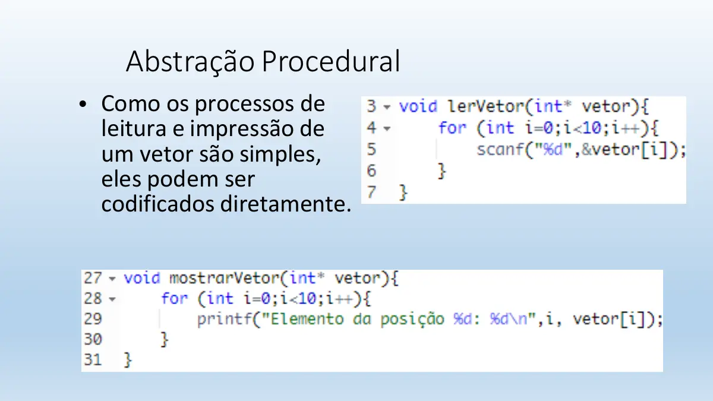

<details>
<summary>Texto da página</summary>

```text
      Abstração Procedural
●   Como os processos de
    leitura e impressão de
    um vetor são simples,
    eles podem ser
    codificados diretamente.
```

</details>

<sub>[↑ voltar ao índice](#aula-10---paradigma-imperativo-ii--slides-originais)</sub>

---

### Página 12

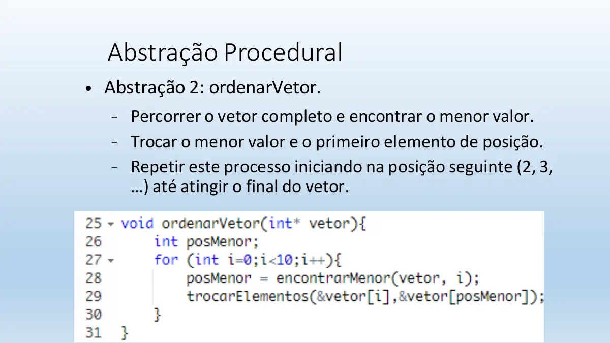

<details>
<summary>Texto da página</summary>

```text
    Abstração Procedural
●   Abstração 2: ordenarVetor.
    – Percorrer o vetor completo e encontrar o menor valor.
    – Trocar o menor valor e o primeiro elemento de posição.
    – Repetir este processo iniciando na posição seguinte (2, 3,
      …) até atingir o final do vetor.
```

</details>

<sub>[↑ voltar ao índice](#aula-10---paradigma-imperativo-ii--slides-originais)</sub>

---

### Página 13

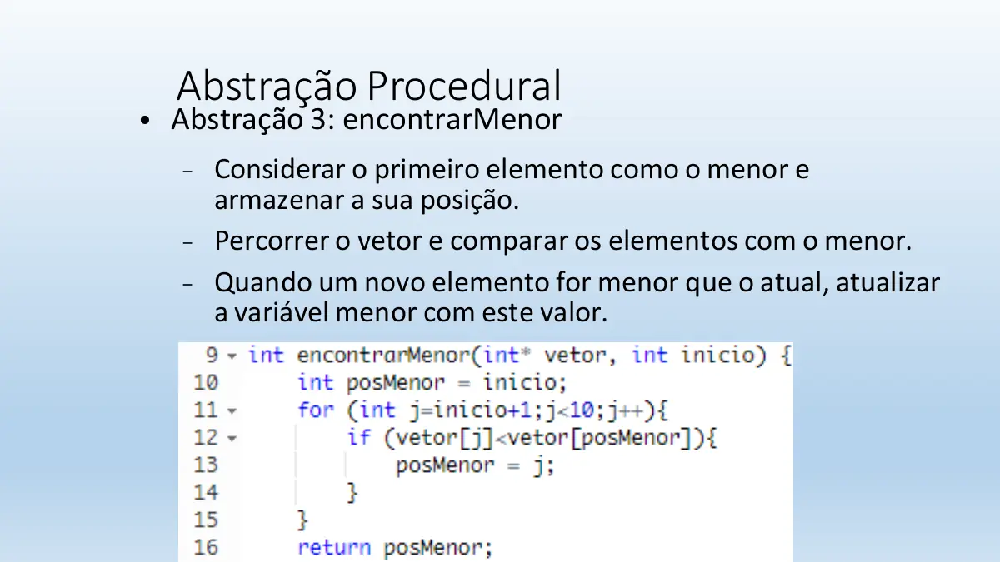

<details>
<summary>Texto da página</summary>

```text
    Abstração Procedural
●   Abstração 3: encontrarMenor
    – Considerar o primeiro elemento como o menor e
      armazenar a sua posição.
    – Percorrer o vetor e comparar os elementos com o menor.
    – Quando um novo elemento for menor que o atual, atualizar
      a variável menor com este valor.
```

</details>

<sub>[↑ voltar ao índice](#aula-10---paradigma-imperativo-ii--slides-originais)</sub>

---

### Página 14

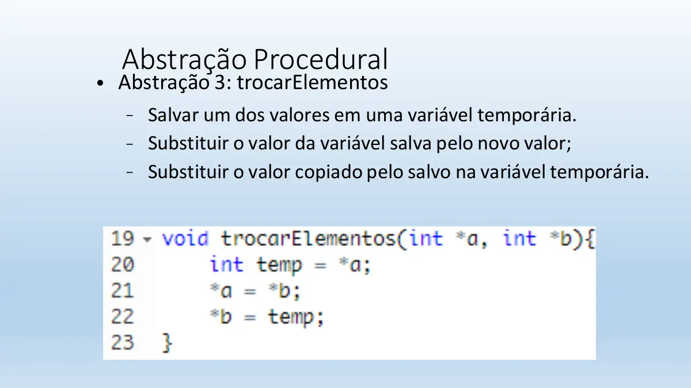

<details>
<summary>Texto da página</summary>

```text
    Abstração Procedural
●   Abstração 3: trocarElementos
    – Salvar um dos valores em uma variável temporária.
    – Substituir o valor da variável salva pelo novo valor;
    – Substituir o valor copiado pelo salvo na variável temporária.
```

</details>

<sub>[↑ voltar ao índice](#aula-10---paradigma-imperativo-ii--slides-originais)</sub>

---

### Página 15

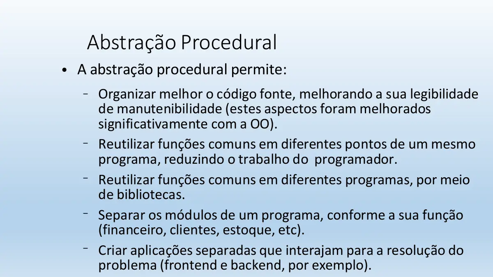

<details>
<summary>Texto da página</summary>

```text
     Abstração Procedural
●   A abstração procedural permite:
    – Organizar melhor o código fonte, melhorando a sua legibilidade
      de manutenibilidade (estes aspectos foram melhorados
      significativamente com a OO).
    – Reutilizar funções comuns em diferentes pontos de um mesmo
      programa, reduzindo o trabalho do programador.
    – Reutilizar funções comuns em diferentes programas, por meio
      de bibliotecas.
    – Separar os módulos de um programa, conforme a sua função
      (financeiro, clientes, estoque, etc).
    – Criar aplicações separadas que interajam para a resolução do
      problema (frontend e backend, por exemplo).
```

</details>

<sub>[↑ voltar ao índice](#aula-10---paradigma-imperativo-ii--slides-originais)</sub>

---

### Página 16

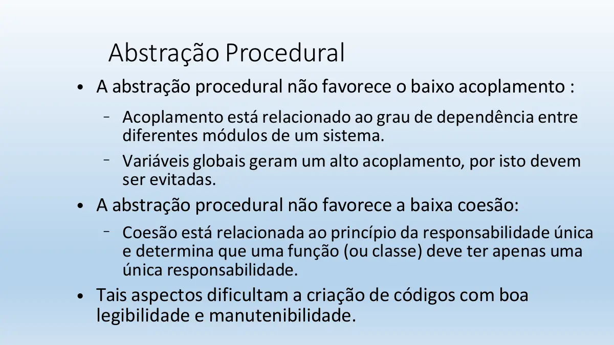

<details>
<summary>Texto da página</summary>

```text
     Abstração Procedural
●   A abstração procedural não favorece o baixo acoplamento :
    – Acoplamento está relacionado ao grau de dependência entre
      diferentes módulos de um sistema.
    – Variáveis globais geram um alto acoplamento, por isto devem
      ser evitadas.
●   A abstração procedural não favorece a baixa coesão:
    –   Coesão está relacionada ao princípio da responsabilidade única
        e determina que uma função (ou classe) deve ter apenas uma
        única responsabilidade.
●   Tais aspectos dificultam a criação de códigos com boa
    legibilidade e manutenibilidade.
```

</details>

<sub>[↑ voltar ao índice](#aula-10---paradigma-imperativo-ii--slides-originais)</sub>

---

### Página 17

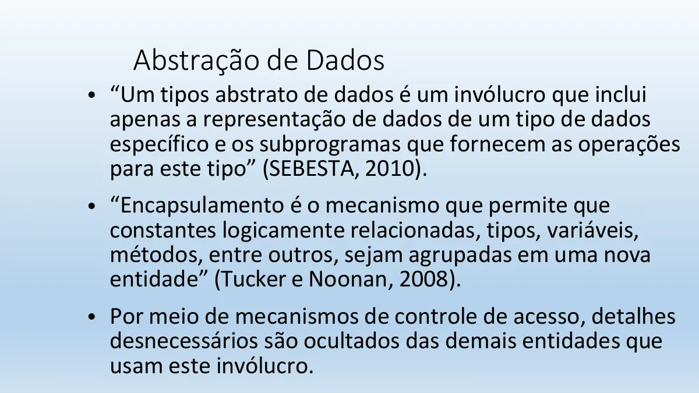

<details>
<summary>Texto da página</summary>

```text
      Abstração de Dados
●   “Um tipos abstrato de dados é um invólucro que inclui
    apenas a representação de dados de um tipo de dados
    específico e os subprogramas que fornecem as operações
    para este tipo” (SEBESTA, 2010).
●   “Encapsulamento é o mecanismo que permite que
    constantes logicamente relacionadas, tipos, variáveis,
    métodos, entre outros, sejam agrupadas em uma nova
    entidade” (Tucker e Noonan, 2008).
●   Por meio de mecanismos de controle de acesso, detalhes
    desnecessários são ocultados das demais entidades que
    usam este invólucro.
```

</details>

<sub>[↑ voltar ao índice](#aula-10---paradigma-imperativo-ii--slides-originais)</sub>

---

### Página 18

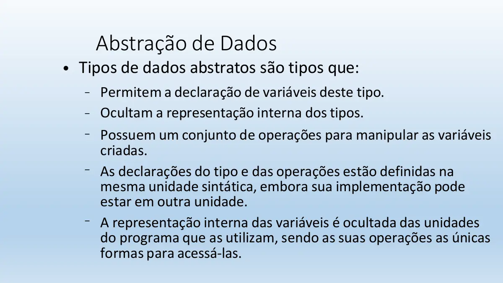

<details>
<summary>Texto da página</summary>

```text
        Abstração de Dados
●   Tipos de dados abstratos são tipos que:
    – Permitem a declaração de variáveis deste tipo.
    – Ocultam a representação interna dos tipos.
    – Possuem um conjunto de operações para manipular as variáveis
      criadas.
    – As declarações do tipo e das operações estão definidas na
      mesma unidade sintática, embora sua implementação pode
      estar em outra unidade.
    – A representação interna das variáveis é ocultada das unidades
      do programa que as utilizam, sendo as suas operações as únicas
      formas para acessá-las.
```

</details>

<sub>[↑ voltar ao índice](#aula-10---paradigma-imperativo-ii--slides-originais)</sub>

---

### Página 19

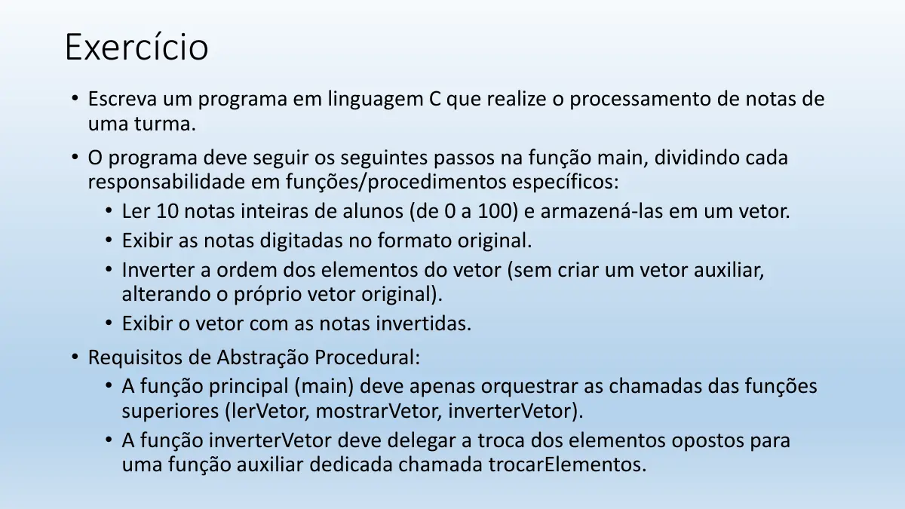

<details>
<summary>Texto da página</summary>

```text
Exercício
• Escreva um programa em linguagem C que realize o processamento de notas de
  uma turma.
• O programa deve seguir os seguintes passos na função main, dividindo cada
  responsabilidade em funções/procedimentos específicos:
    • Ler 10 notas inteiras de alunos (de 0 a 100) e armazená-las em um vetor.
    • Exibir as notas digitadas no formato original.
    • Inverter a ordem dos elementos do vetor (sem criar um vetor auxiliar,
      alterando o próprio vetor original).
    • Exibir o vetor com as notas invertidas.
• Requisitos de Abstração Procedural:
    • A função principal (main) deve apenas orquestrar as chamadas das funções
      superiores (lerVetor, mostrarVetor, inverterVetor).
    • A função inverterVetor deve delegar a troca dos elementos opostos para
      uma função auxiliar dedicada chamada trocarElementos.
```

</details>

<sub>[↑ voltar ao índice](#aula-10---paradigma-imperativo-ii--slides-originais)</sub>

---

### Página 20

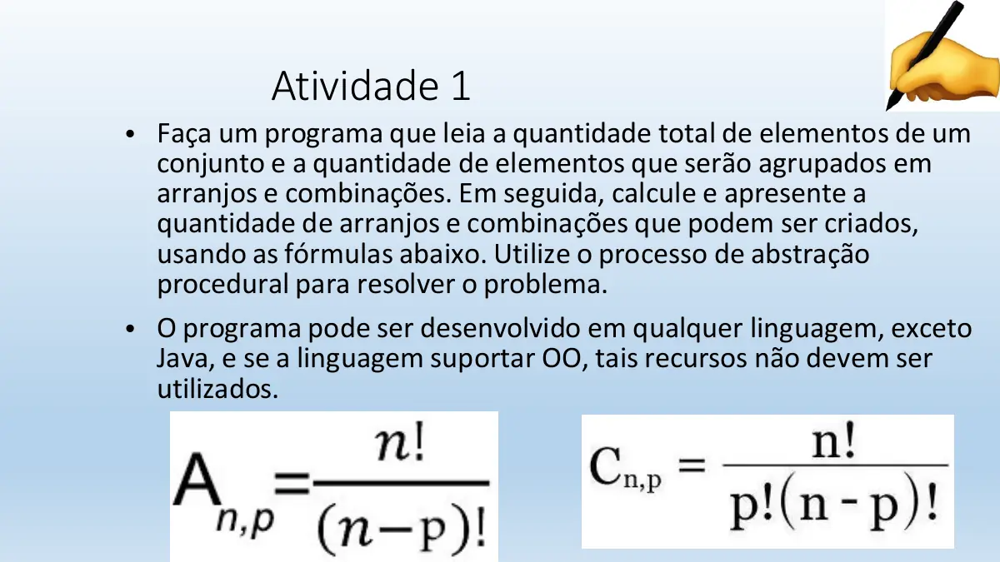

<details>
<summary>Texto da página</summary>

```text
            Atividade 1
●   Faça um programa que leia a quantidade total de elementos de um
    conjunto e a quantidade de elementos que serão agrupados em
    arranjos e combinações. Em seguida, calcule e apresente a
    quantidade de arranjos e combinações que podem ser criados,
    usando as fórmulas abaixo. Utilize o processo de abstração
    procedural para resolver o problema.
●   O programa pode ser desenvolvido em qualquer linguagem, exceto
    Java, e se a linguagem suportar OO, tais recursos não devem ser
    utilizados.
```

</details>

<sub>[↑ voltar ao índice](#aula-10---paradigma-imperativo-ii--slides-originais)</sub>


<!-- nav:rodape -->

---

**Aula 10:** [Visão geral](../README.md) · **Slides** · [Resumo](../02%20-%20Resumo%20Teórico/resumo-aula-10.md) · [Exercícios](../03%20-%20Exercícios/exercicios-aula-10.md) · [Resoluções](../04%20-%20Resoluções/resolucoes-aula-10.md) · [Complementos](../05%20-%20Materiais%20Complementares/materiais-complementares.md)

← [Aula 09 · Slides](../../Aula%2009%20-%20Paradigma%20Imperativo%20I/01%20-%20Slides%20Originais/README.md) · [Aula 11 · Slides](../../Aula%2011%20-%20Paradigma%20Imperativo%20III/01%20-%20Slides%20Originais/README.md) →

**Links para esta página (11):** [Acompanhamento de estudo](../../../00%20-%20Planejamento%20e%20Organização/acompanhamento.md) · [Aula 10 · Resumo](../02%20-%20Resumo%20Teórico/resumo-aula-10.md) · [Aula 10 · Exercícios](../03%20-%20Exercícios/exercicios-aula-10.md) · [Aula 10 · Resoluções](../04%20-%20Resoluções/resolucoes-aula-10.md) · [Aula 10 · Complementos](../05%20-%20Materiais%20Complementares/materiais-complementares.md) · [Aula 13 · Resoluções](../../Aula%2013%20-%20Paradigma%20Orientado%20a%20Objetos%20II/04%20-%20Resoluções/resolucoes-aula-13.md) · [Lista 02 · Resolução](../../../02%20-%20Listas%20de%20Exercícios/Lista%2002%20-%20Revisão%20II/02%20-%20Resolução/resolucao-lista-02.md) · [Simulado 01 · Resolução comentada](../../../04%20-%20Provas%20e%20Avaliações/Simulados/resolucao-simulado-01.md) · [Simulado 02 · Resolução comentada](../../../04%20-%20Provas%20e%20Avaliações/Simulados/resolucao-simulado-02.md) · [Erratas e inconsistências do material](../../../06%20-%20Revisões%20e%20Sínteses/erratas-e-inconsistencias.md) · [Questões integradoras · Resolução comentada](../../../06%20-%20Revisões%20e%20Sínteses/resolucao-questoes-integradoras.md)

<!-- /nav:rodape -->
