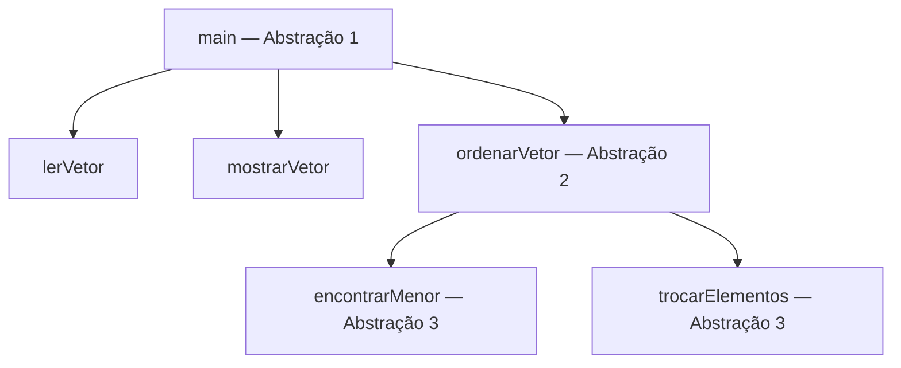

# Aula 10 — Paradigma Imperativo II (Abstração) · Resumo teórico

> **Fonte:** [`Aula10_ParadigmaImperativo2.pdf`](../01%20-%20Slides%20Originais/Aula10_ParadigmaImperativo2.pdf) (20 páginas). Título interno: "Aula 11 – Paradigma Imperativo – Parte 2". A aula não tem slide de bibliografia.
> **Legenda:** ver [Convenções](../../../README.md#convenções-de-marcação). `p.N` = página do PDF. Os programas marcados foram compilados e executados com gcc.

---

## 1. Objetivos (p.2)

**[Material original]** Definir abstração; aplicar o processo de abstração procedural na resolução de problemas; diferenciar abstração de dados e abstração de processos.

## 2. Abstração (p.3–5)

**[Material original]**

- "Abstração é a habilidade de **concentrar nos aspectos essenciais** de um contexto qualquer, **ignorando características menos importantes**."
- Possibilita compreender os aspectos relevantes de um problema para construir uma solução computacional que o resolva.
- Resumindo: visa **simplificar o processo de construção** de um programa.

**Abstração em linguagens de programação (p.5):**

| Tipo | Mecanismo | Paradigma |
| --- | --- | --- |
| Abstração de **processos** | Subprogramas (funções) | Imperativo |
| Abstração de **dados** | Tipos de dados abstratos | Orientado a objetos |

**[Explicação elaborada]** Um mapa de metrô é uma abstração: mostra estações e conexões e ignora distâncias reais e ruas. Em programação, `sqrt(x)` é uma abstração: você usa a raiz quadrada sem saber o algoritmo interno. Já vimos abstração antes: a variável abstrai células de memória (Aula 04) e cada "computador virtual" abstrai a camada de baixo (Aula 03).

## 3. Abstração procedural (p.6–7)

**[Material original]** "É o processo que permite ao programador se preocupar com a **interface** entre a função e **o que ela calcula**, ignorando os detalhes de **como** o cálculo é realizado."

**Processo de abstração procedural (p.7):**

1. Descrever sucintamente a função calculada, com sua entrada e sua saída.
2. Dividir a função descrita em um conjunto de funções mais primitivas, com suas respectivas entradas e saídas.
3. Repetir até que todas as funções e seus dados possam ser executados pelos **comandos e tipos primitivos** da linguagem.

**[Explicação elaborada]** É o **refinamento sucessivo** (*top-down*): começa-se pelo problema inteiro e desce-se em níveis cada vez mais concretos. Cada função é uma "caixa-preta" com entrada e saída definidas — quem a usa só precisa da interface.

## 4. Exemplo guiado: ordenar dez números (p.8–14)

**[Material original]** "Faça um programa que leia um conjunto de dez números inteiros, apresente estes dados e, em seguida, ordene-os e apresente-os novamente. Quais passos devem ser realizados?"



| Nível | Função | O que faz (slide) | Código no slide |
| --- | --- | --- | --- |
| Abstração 1 (p.9–11) | `main` | Ler os dez valores num vetor; imprimir o original; ordenar; imprimir o ordenado. Ler e imprimir são simples e codificados diretamente. | `int vetor[10]; lerVetor(vetor); mostrarVetor(vetor); ordenarVetor(vetor); mostrarVetor(vetor);` |
| Abstração 2 (p.12) | `ordenarVetor` | Percorrer o vetor e encontrar o menor; trocar o menor com o primeiro; repetir a partir da posição seguinte até o fim. | `for (i=0;i<10;i++){ posMenor = encontrarMenor(vetor, i); trocarElementos(&vetor[i], &vetor[posMenor]); }` |
| Abstração 3 (p.13) | `encontrarMenor` | Considerar o primeiro elemento como o menor e guardar sua posição; percorrer e comparar; quando um elemento for menor, atualizar. | `posMenor = inicio; for (j=inicio+1;j<10;j++) if (vetor[j]<vetor[posMenor]) posMenor = j; return posMenor;` |
| Abstração 3 (p.14) | `trocarElementos` | Salvar um valor em uma temporária; substituir pelo outro; copiar a temporária de volta. | `int temp = *a; *a = *b; *b = temp;` |

> **[Atenção]**
> - O texto da p.13 diz "atualizar a variável **menor** com este **valor**", mas o código guarda a **posição** (`posMenor = j`). O código é o correto: a posição é necessária para fazer a troca depois.
> - `encontrarMenor` e `trocarElementos` aparecem ambos como "Abstração 3" (mesmo nível de refinamento, abaixo de `ordenarVetor`).
> - O código de `trocarElementos` (p.14) recebe dois ponteiros, `void trocarElementos(int *a, int *b)`, e é compatível com a chamada `trocarElementos(&vetor[i], &vetor[posMenor])`.

**Programa completo (versão montada a partir dos trechos do slide):**

<!-- teste: entrada="9 3 7 1 8 2 10 5 4 6" saida-contem="9 3 7 1 8 2 10 5 4 6|1 2 3 4 5 6 7 8 9 10" -->
```c
#include <stdio.h>
#define TAM 10

/* ---- Abstração 3 ---- */
int encontrarMenor(int *vetor, int inicio) {          /* devolve a POSIÇÃO do menor a partir de inicio */
    int posMenor = inicio;
    for (int j = inicio + 1; j < TAM; j++) {
        if (vetor[j] < vetor[posMenor]) {
            posMenor = j;
        }
    }
    return posMenor;
}

void trocarElementos(int *a, int *b) {                 /* código do slide (p.14) */
    int temp = *a;     /* 1. salva um dos valores numa temporária   */
    *a = *b;           /* 2. substitui pelo outro valor              */
    *b = temp;         /* 3. copia o valor salvo                     */
}

/* ---- Abstração 2 ---- */
void ordenarVetor(int *vetor) {                        /* selection sort */
    int posMenor;
    for (int i = 0; i < TAM; i++) {
        posMenor = encontrarMenor(vetor, i);
        trocarElementos(&vetor[i], &vetor[posMenor]);
    }
}

/* ---- Leitura e impressão: simples, codificadas diretamente ---- */
void lerVetor(int *vetor) {
    for (int i = 0; i < TAM; i++) scanf("%d", &vetor[i]);
}

void mostrarVetor(int *vetor) {
    /* simplificado: o slide (p.11) imprime "Elemento da posição %d: %d\n" */
    for (int i = 0; i < TAM; i++) printf("%d ", vetor[i]);
    printf("\n");
}

/* ---- Abstração 1 ---- */
int main() {
    int vetor[TAM];
    lerVetor(vetor);
    mostrarVetor(vetor);
    ordenarVetor(vetor);
    mostrarVetor(vetor);
    return 0;
}
```

**[Explicação elaborada]**

- Lendo só o `main`, entende-se o programa inteiro **sem saber como se ordena** — é a abstração procedural em ação.
- `trocarElementos` recebe **ponteiros** (`&vetor[i]`) porque precisa alterar o vetor do chamador: passagem por referência simulada em C ([Aula 08](../../Aula%2008%20-%20Ponteiros/02%20-%20Resumo%20Teórico/resumo-aula-08.md)).
- `vetor` é passado como `int *` sem `&` porque o nome de um vetor em C já é o endereço do primeiro elemento.

## 5. O que a abstração procedural permite (p.15)

**[Material original]**

- **Organizar** melhor o código-fonte, melhorando legibilidade e manutenibilidade — aspectos "melhorados significativamente com a OO".
- **Reutilizar** funções comuns em diferentes pontos do mesmo programa, reduzindo o trabalho do programador.
- **Reutilizar** funções comuns em programas diferentes, por meio de **bibliotecas**.
- **Separar os módulos** de um programa conforme sua função (financeiro, clientes, estoque…).
- Criar **aplicações separadas** que interajam para resolver o problema (frontend e backend, por exemplo).

## 6. Limitações: acoplamento e coesão (p.16)

**[Material original]**

- A abstração procedural **não favorece o baixo acoplamento**:
  - **Acoplamento** é o grau de dependência entre diferentes módulos de um sistema.
  - **Variáveis globais** geram alto acoplamento e por isso devem ser evitadas.
- A abstração procedural não favorece a "baixa coesão":
  - **Coesão** está relacionada ao **princípio da responsabilidade única**: uma função (ou classe) deve ter apenas uma responsabilidade.
- Esses aspectos dificultam a criação de código com boa legibilidade e manutenibilidade.

> **[Atenção]** O slide diz "não favorece a **baixa** coesão". Pela própria definição dada (responsabilidade única), o desejável é **alta** coesão. A leitura coerente é: a abstração procedural **não favorece a alta coesão**. A meta de projeto é **baixo acoplamento + alta coesão**.

**[Explicação elaborada] — exemplo de acoplamento por variável global:**

```c
int total;                       /* global */
void soma(int x)   { total += x; }
void zera(void)    { total = 0; }
void relatorio(void) { printf("%d", total); }
```

As três funções dependem de `total`: mudar o nome ou o tipo de `total` obriga a mexer nas três, e qualquer função do programa pode alterá-la sem aviso. Isso é **alto acoplamento**. A OO resolve encapsulando `total` dentro de uma classe com acesso controlado ([Aula 12](../../Aula%2012%20-%20Paradigma%20Orientado%20a%20Objetos%20I/02%20-%20Resumo%20Teórico/resumo-aula-12.md)).

## 7. Abstração de dados e TDA (p.17–18)

**[Material original]**

- **Tipo abstrato de dados (Sebesta):** "um invólucro que inclui apenas a representação de dados de um tipo de dados específico e os subprogramas que fornecem as operações para este tipo".
- **Encapsulamento (Tucker e Noonan):** "mecanismo que permite que constantes logicamente relacionadas, tipos, variáveis, métodos, entre outros, sejam agrupados em uma nova entidade".
- Por meio de **mecanismos de controle de acesso**, detalhes desnecessários são **ocultados** das entidades que usam esse invólucro.

**Um TDA (p.18):**

1. permite declarar variáveis daquele tipo;
2. **oculta a representação interna**;
3. tem um conjunto de **operações** para manipular as variáveis criadas;
4. declara tipo e operações na **mesma unidade sintática** (a implementação pode estar em outra);
5. só é acessado por meio de suas operações — a representação fica oculta das unidades que o usam.

**[Explicação elaborada]** Abstração de processos responde "**o que esta função faz?**"; abstração de dados responde "**o que este tipo é e que operações oferece?**". O `FILE *` de C é um TDA: você usa `fopen`, `fprintf` e `fclose` sem conhecer os campos internos da estrutura. Esse conceito é a base da OO.

## 8. Exercício e atividade (p.19–20)

**[Material original] — Exercício (p.19):** em C, processar as notas de uma turma: ler 10 notas inteiras (0 a 100) num vetor; exibir; **inverter o próprio vetor** (sem vetor auxiliar); exibir de novo.

- O `main` deve apenas **orquestrar** `lerVetor`, `mostrarVetor` e `inverterVetor`.
- `inverterVetor` deve **delegar** a troca dos elementos opostos a uma função auxiliar `trocarElementos`.

**[Material original] — Atividade 1 (p.20):** ler o total de elementos de um conjunto e a quantidade agrupada; calcular arranjos e combinações por abstração procedural, em qualquer linguagem **exceto Java** e **sem recursos de OO**.

```latex
A_{n,p} = \frac{n!}{(n-p)!} \qquad\qquad C_{n,p} = \frac{n!}{p!\,(n-p)!}
```

Soluções testadas em [resolucoes-aula-10.md](../04%20-%20Resoluções/resolucoes-aula-10.md).

## 9. Conexões e pontos para a prova

- A abstração procedural depende de **subprogramas e parâmetros** ([Aula 11](../../Aula%2011%20-%20Paradigma%20Imperativo%20III/02%20-%20Resumo%20Teórico/resumo-aula-11.md)).
- O TDA é a base da OO ([Aula 12](../../Aula%2012%20-%20Paradigma%20Orientado%20a%20Objetos%20I/02%20-%20Resumo%20Teórico/resumo-aula-12.md), que repete as definições de Sebesta e de Tucker & Noonan).
- Cobrado na [Lista 02, Q8](../../../02%20-%20Listas%20de%20Exercícios/Lista%2002%20-%20Revisão%20II/02%20-%20Resolução/resolucao-lista-02.md#q8).
- **Decorar:** os 3 passos da abstração procedural; processos × dados; acoplamento baixo e coesão alta.

---

**Anterior:** [Aula 09](../../Aula%2009%20-%20Paradigma%20Imperativo%20I/02%20-%20Resumo%20Teórico/resumo-aula-09.md) · **Próxima:** [Aula 11 — Paradigma Imperativo III](../../Aula%2011%20-%20Paradigma%20Imperativo%20III/02%20-%20Resumo%20Teórico/resumo-aula-11.md)
