<!-- nav:topo -->
[Início](../../../README.md) › [01 - Aulas](../../README.md) › [Aula 11](../README.md) › **01 - Slides Originais** · [Mapa](../../../MAPA.md)
<!-- /nav:topo -->

<!-- gerado por ferramentas/geradores/gerar_galerias.py: não edite à mão -->

# Aula 11 - Paradigma Imperativo III · Slides originais

> **[Material original]** Slides originais do professor, página por página, para ler aqui mesmo no GitHub. O arquivo original é o PDF [`Aula11_ParadigmaImperativo3.pdf`](Aula11_ParadigmaImperativo3.pdf) (22 páginas): use-o para baixar ou imprimir. As imagens e o texto de cada página foram extraídos do PDF, sem alteração do conteúdo.

**Ir para a página:** [1](#página-1) · [2](#página-2) · [3](#página-3) · [4](#página-4) · [5](#página-5) · [6](#página-6) · [7](#página-7) · [8](#página-8) · [9](#página-9) · [10](#página-10) · [11](#página-11) · [12](#página-12) · [13](#página-13) · [14](#página-14) · [15](#página-15) · [16](#página-16) · [17](#página-17) · [18](#página-18) · [19](#página-19) · [20](#página-20) · [21](#página-21) · [22](#página-22)

O texto de cada página fica em **Texto da página**, logo abaixo da imagem: é por ele que a busca encontra o conteúdo dos slides.

---

### Página 1

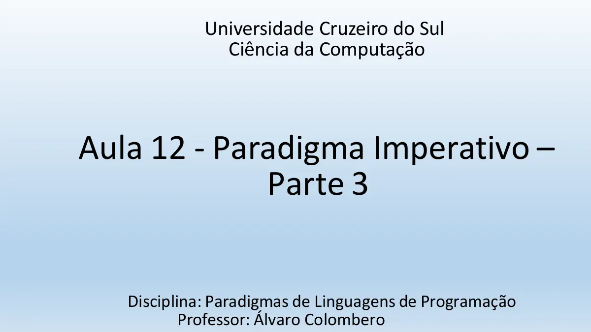

<details>
<summary>Texto da página</summary>

```text
             Universidade Cruzeiro do Sul
               Ciência da Computação

Aula 12 - Paradigma Imperativo –
             Parte 3

   Disciplina: Paradigmas de Linguagens de Programação
           Professor: Álvaro Colombero
```

</details>

<sub>[↑ voltar ao índice](#aula-11---paradigma-imperativo-iii--slides-originais)</sub>

---

### Página 2

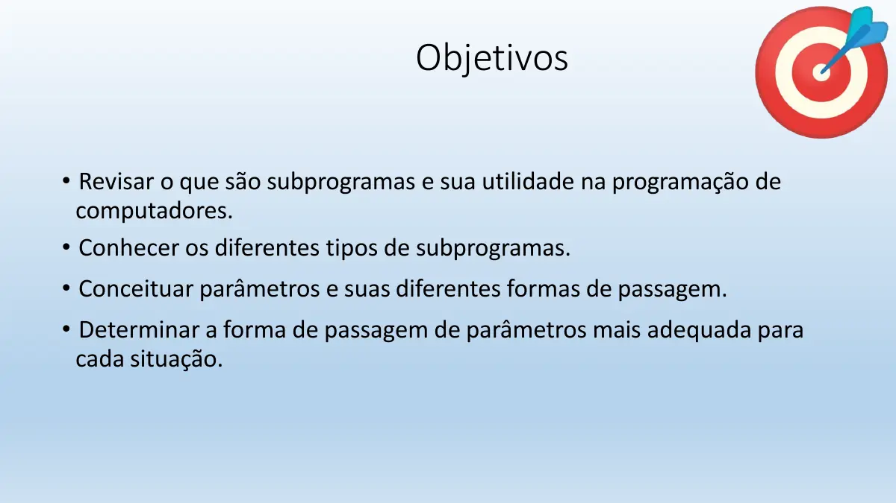

<details>
<summary>Texto da página</summary>

```text
                                Objetivos

• Revisar o que são subprogramas e sua utilidade na programação de
  computadores.
• Conhecer os diferentes tipos de subprogramas.
• Conceituar parâmetros e suas diferentes formas de passagem.
• Determinar a forma de passagem de parâmetros mais adequada para
  cada situação.
```

</details>

<sub>[↑ voltar ao índice](#aula-11---paradigma-imperativo-iii--slides-originais)</sub>

---

### Página 3

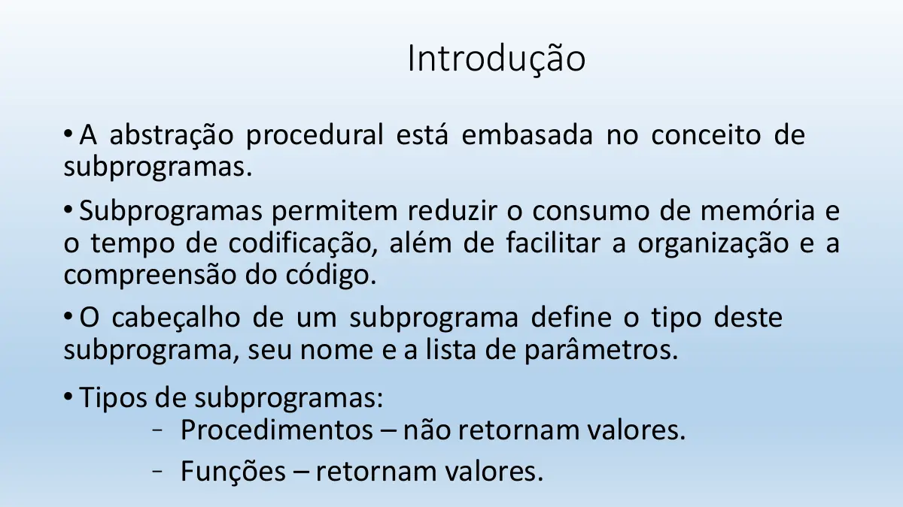

<details>
<summary>Texto da página</summary>

```text
                          Introdução
• A abstração procedural está embasada no conceito de
subprogramas.
• Subprogramas permitem reduzir o consumo de memória e
o tempo de codificação, além de facilitar a organização e a
compreensão do código.
• O cabeçalho de um subprograma define o tipo deste
subprograma, seu nome e a lista de parâmetros.
• Tipos de subprogramas:
       – Procedimentos – não retornam valores.
       – Funções – retornam valores.
```

</details>

<sub>[↑ voltar ao índice](#aula-11---paradigma-imperativo-iii--slides-originais)</sub>

---

### Página 4

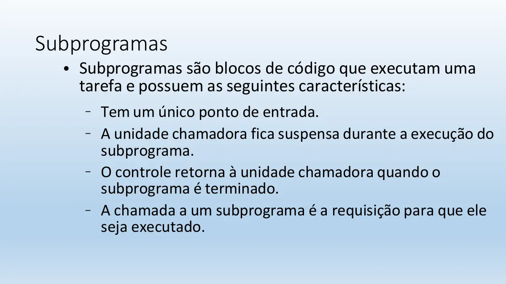

<details>
<summary>Texto da página</summary>

```text
Subprogramas
  ●   Subprogramas são blocos de código que executam uma
      tarefa e possuem as seguintes características:
      – Tem um único ponto de entrada.
      – A unidade chamadora fica suspensa durante a execução do
        subprograma.
      – O controle retorna à unidade chamadora quando o
        subprograma é terminado.
      – A chamada a um subprograma é a requisição para que ele
        seja executado.
```

</details>

<sub>[↑ voltar ao índice](#aula-11---paradigma-imperativo-iii--slides-originais)</sub>

---

### Página 5

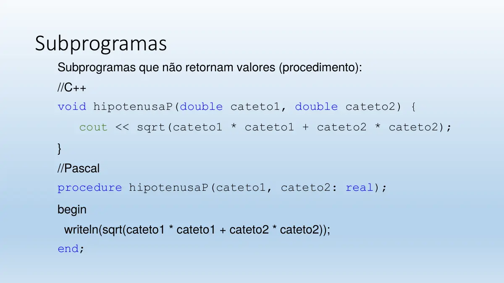

<details>
<summary>Texto da página</summary>

```text
Subprogramas
  Subprogramas que não retornam valores (procedimento):
  //C++
  void hipotenusaP(double cateto1, double cateto2) {
        cout << sqrt(cateto1 * cateto1 + cateto2 * cateto2);
  }
  //Pascal
  procedure hipotenusaP(cateto1, cateto2: real);
  begin
      writeln(sqrt(cateto1 * cateto1 + cateto2 * cateto2));
  end;
```

</details>

<sub>[↑ voltar ao índice](#aula-11---paradigma-imperativo-iii--slides-originais)</sub>

---

### Página 6

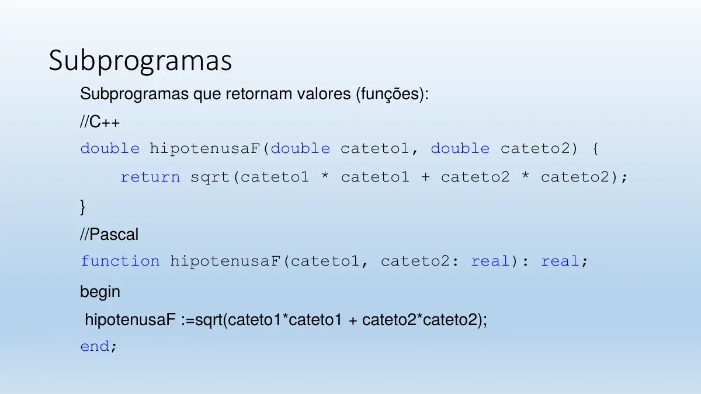

<details>
<summary>Texto da página</summary>

```text
Subprogramas
  Subprogramas que retornam valores (funções):
  //C++
  double hipotenusaF(double cateto1, double cateto2) {
         return sqrt(cateto1 * cateto1 + cateto2 * cateto2);
  }
  //Pascal
  function hipotenusaF(cateto1, cateto2: real): real;
  begin
  hipotenusaF :=sqrt(cateto1*cateto1 + cateto2*cateto2);
  end;
```

</details>

<sub>[↑ voltar ao índice](#aula-11---paradigma-imperativo-iii--slides-originais)</sub>

---

### Página 7

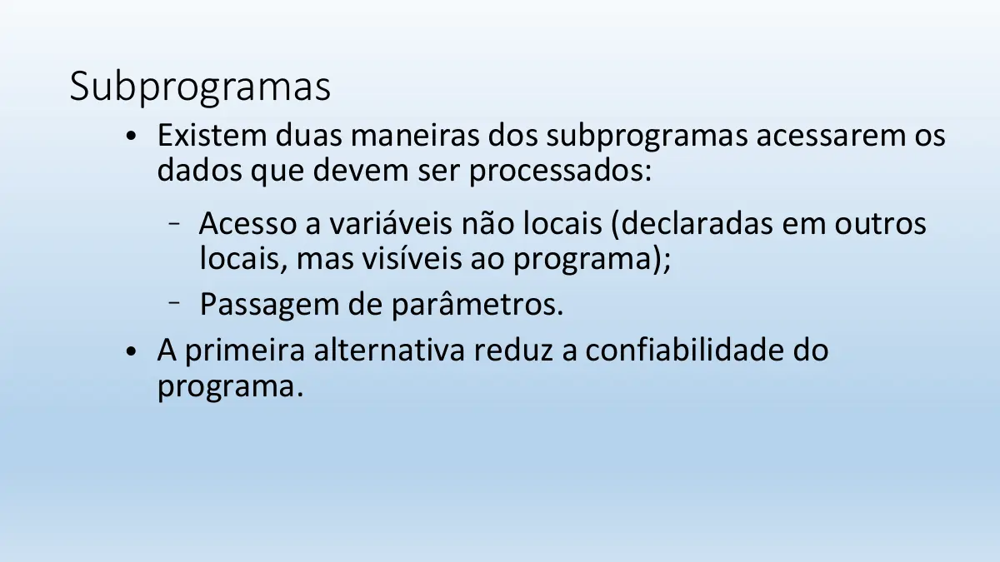

<details>
<summary>Texto da página</summary>

```text
Subprogramas
  ●   Existem duas maneiras dos subprogramas acessarem os
      dados que devem ser processados:
      – Acesso a variáveis não locais (declaradas em outros
       locais, mas visíveis ao programa);
     – Passagem de parâmetros.
  ● A primeira alternativa reduz a confiabilidade do

    programa.
```

</details>

<sub>[↑ voltar ao índice](#aula-11---paradigma-imperativo-iii--slides-originais)</sub>

---

### Página 8

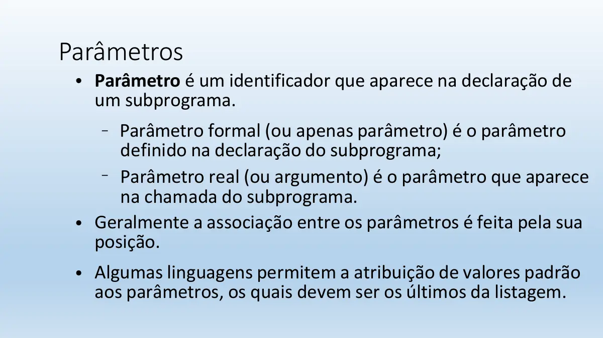

<details>
<summary>Texto da página</summary>

```text
Parâmetros
 ●   Parâmetro é um identificador que aparece na declaração de
     um subprograma.
     –Parâmetro formal (ou apenas parâmetro) é o parâmetro
      definido na declaração do subprograma;
    – Parâmetro real (ou argumento) é o parâmetro que aparece
      na chamada do subprograma.
 ● Geralmente a associação entre os parâmetros é feita pela sua

   posição.
 ●   Algumas linguagens permitem a atribuição de valores padrão
     aos parâmetros, os quais devem ser os últimos da listagem.
```

</details>

<sub>[↑ voltar ao índice](#aula-11---paradigma-imperativo-iii--slides-originais)</sub>

---

### Página 9

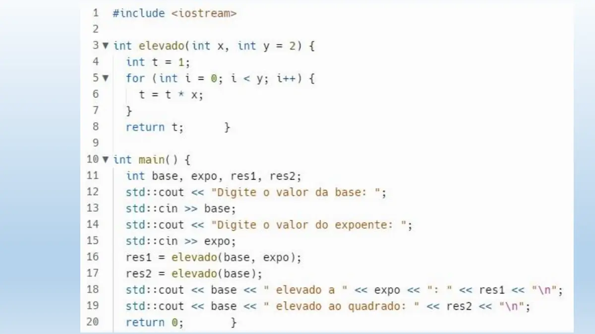

*Página sem texto extraível (só imagem).*

<sub>[↑ voltar ao índice](#aula-11---paradigma-imperativo-iii--slides-originais)</sub>

---

### Página 10

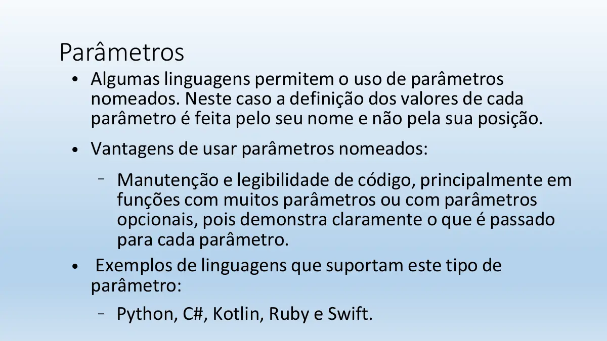

<details>
<summary>Texto da página</summary>

```text
Parâmetros
●   Algumas linguagens permitem o uso de parâmetros
    nomeados. Neste caso a definição dos valores de cada
    parâmetro é feita pelo seu nome e não pela sua posição.
●   Vantagens de usar parâmetros nomeados:
    –Manutenção e legibilidade de código, principalmente em
     funções com muitos parâmetros ou com parâmetros
     opcionais, pois demonstra claramente o que é passado
     para cada parâmetro.
● Exemplos de linguagens que suportam este tipo de
  parâmetro:
   – Python, C#, Kotlin, Ruby e Swift.
```

</details>

<sub>[↑ voltar ao índice](#aula-11---paradigma-imperativo-iii--slides-originais)</sub>

---

### Página 11

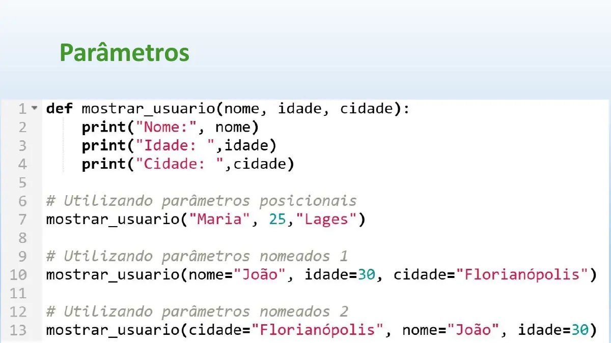

<details>
<summary>Texto da página</summary>

```text
Parâmetros
```

</details>

<sub>[↑ voltar ao índice](#aula-11---paradigma-imperativo-iii--slides-originais)</sub>

---

### Página 12

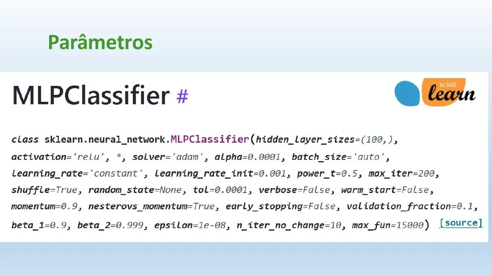

<details>
<summary>Texto da página</summary>

```text
Parâmetros
```

</details>

<sub>[↑ voltar ao índice](#aula-11---paradigma-imperativo-iii--slides-originais)</sub>

---

### Página 13

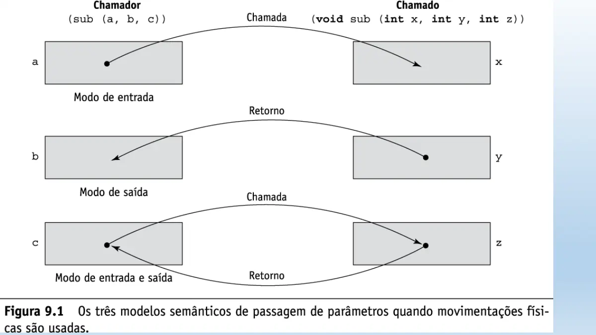

*Página sem texto extraível (só imagem).*

<sub>[↑ voltar ao índice](#aula-11---paradigma-imperativo-iii--slides-originais)</sub>

---

### Página 14

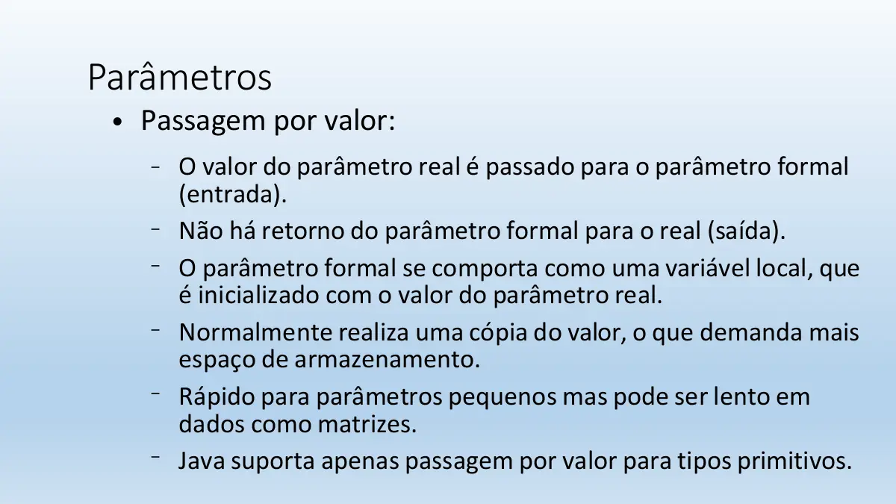

<details>
<summary>Texto da página</summary>

```text
Parâmetros
 ●   Passagem por valor:
     – O valor do parâmetro real é passado para o parâmetro formal
       (entrada).
     – Não há retorno do parâmetro formal para o real (saída).
     – O parâmetro formal se comporta como uma variável local, que
       é inicializado com o valor do parâmetro real.
     – Normalmente realiza uma cópia do valor, o que demanda mais
       espaço de armazenamento.
     – Rápido para parâmetros pequenos mas pode ser lento em
       dados como matrizes.
     – Java suporta apenas passagem por valor para tipos primitivos.
```

</details>

<sub>[↑ voltar ao índice](#aula-11---paradigma-imperativo-iii--slides-originais)</sub>

---

### Página 15

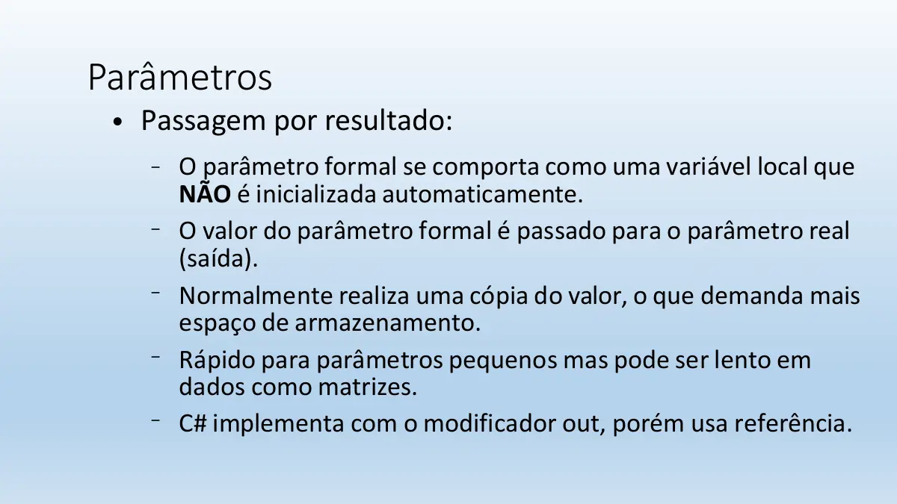

<details>
<summary>Texto da página</summary>

```text
Parâmetros
 ●   Passagem por resultado:
     – O parâmetro formal se comporta como uma variável local que
       NÃO é inicializada automaticamente.
     – O valor do parâmetro formal é passado para o parâmetro real
       (saída).
     – Normalmente realiza uma cópia do valor, o que demanda mais
       espaço de armazenamento.
     – Rápido para parâmetros pequenos mas pode ser lento em
       dados como matrizes.
     – C# implementa com o modificador out, porém usa referência.
```

</details>

<sub>[↑ voltar ao índice](#aula-11---paradigma-imperativo-iii--slides-originais)</sub>

---

### Página 16

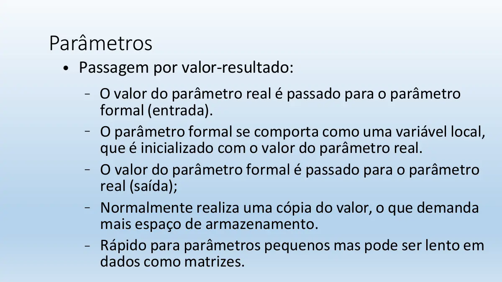

<details>
<summary>Texto da página</summary>

```text
Parâmetros
 ●   Passagem por valor-resultado:
     – O valor do parâmetro real é passado para o parâmetro
       formal (entrada).
     – O parâmetro formal se comporta como uma variável local,
       que é inicializado com o valor do parâmetro real.
     – O valor do parâmetro formal é passado para o parâmetro
       real (saída);
     – Normalmente realiza uma cópia do valor, o que demanda
       mais espaço de armazenamento.
     – Rápido para parâmetros pequenos mas pode ser lento em
       dados como matrizes.
```

</details>

<sub>[↑ voltar ao índice](#aula-11---paradigma-imperativo-iii--slides-originais)</sub>

---

### Página 17

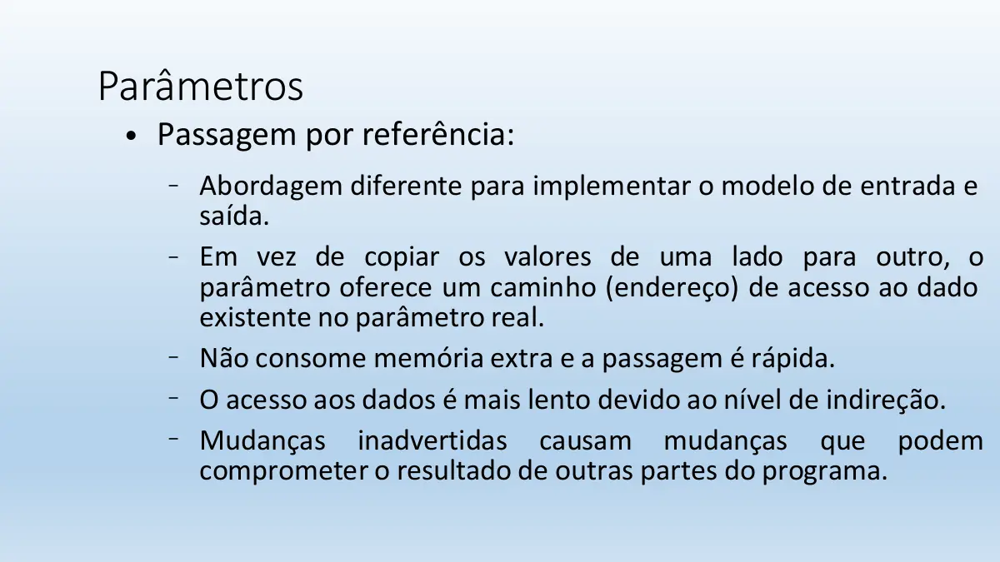

<details>
<summary>Texto da página</summary>

```text
Parâmetros
 ●   Passagem por referência:
     – Abordagem diferente para implementar o modelo de entrada e
       saída.
     – Em vez de copiar os valores de uma lado para outro, o
       parâmetro oferece um caminho (endereço) de acesso ao dado
       existente no parâmetro real.
     – Não consome memória extra e a passagem é rápida.
     – O acesso aos dados é mais lento devido ao nível de indireção.
     – Mudanças inadvertidas causam mudanças que podem
       comprometer o resultado de outras partes do programa.
```

</details>

<sub>[↑ voltar ao índice](#aula-11---paradigma-imperativo-iii--slides-originais)</sub>

---

### Página 18

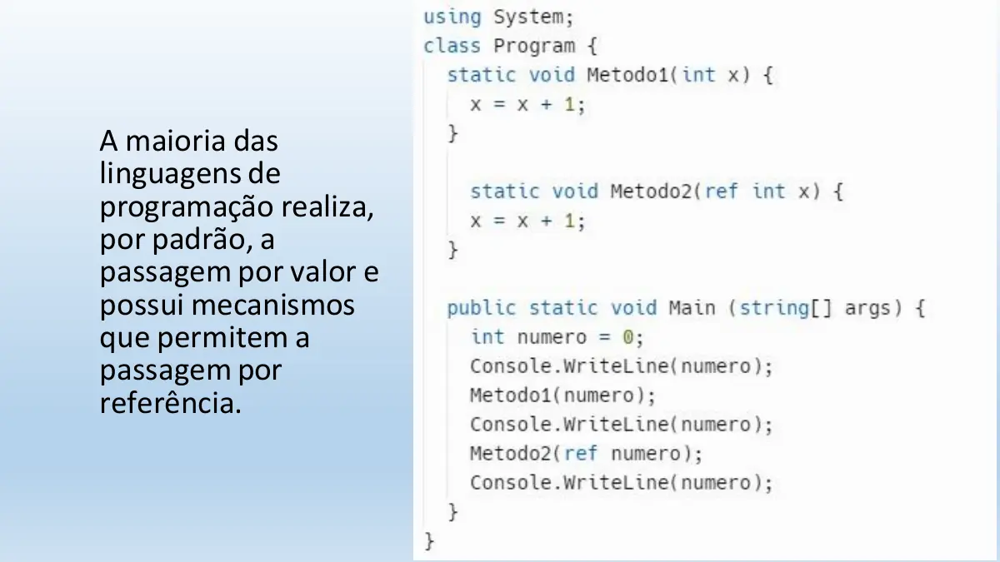

<details>
<summary>Texto da página</summary>

```text
A maioria das
linguagens de
programação realiza,
por padrão, a
passagem por valor e
possui mecanismos
que permitem a
passagem por
referência.
```

</details>

<sub>[↑ voltar ao índice](#aula-11---paradigma-imperativo-iii--slides-originais)</sub>

---

### Página 19

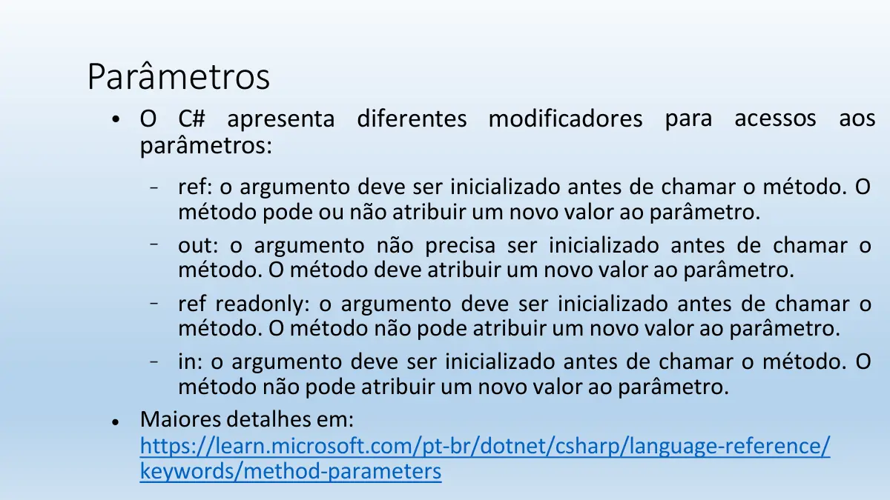

<details>
<summary>Texto da página</summary>

```text
Parâmetros
 ●   O C# apresenta diferentes modificadores para acessos aos
     parâmetros:
     –   ref: o argumento deve ser inicializado antes de chamar o método. O
         método pode ou não atribuir um novo valor ao parâmetro.
      – out: o argumento não precisa ser inicializado antes de chamar o
         método. O método deve atribuir um novo valor ao parâmetro.
      – ref readonly: o argumento deve ser inicializado antes de chamar o
         método. O método não pode atribuir um novo valor ao parâmetro.
      – in: o argumento deve ser inicializado antes de chamar o método. O
         método não pode atribuir um novo valor ao parâmetro.
 ●   Maiores detalhes em:
     https://learn.microsoft.com/pt-br/dotnet/csharp/language-reference/
     keywords/method-parameters
```

</details>

<sub>[↑ voltar ao índice](#aula-11---paradigma-imperativo-iii--slides-originais)</sub>

---

### Página 20

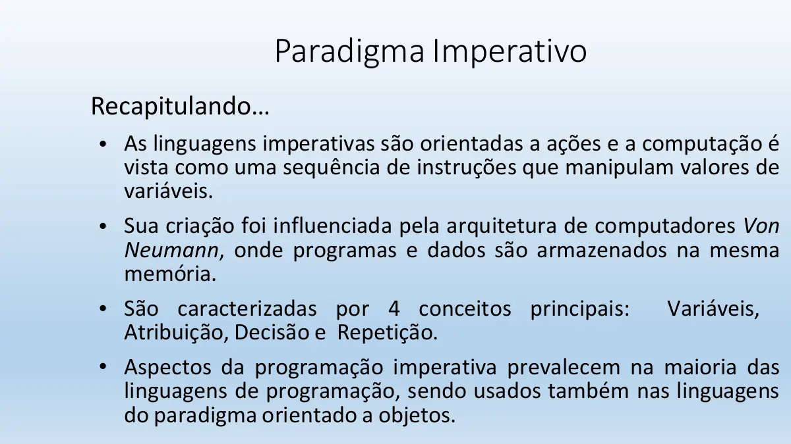

<details>
<summary>Texto da página</summary>

```text
                  Paradigma Imperativo
Recapitulando…
●   As linguagens imperativas são orientadas a ações e a computação é
    vista como uma sequência de instruções que manipulam valores de
    variáveis.
●   Sua criação foi influenciada pela arquitetura de computadores Von
    Neumann, onde programas e dados são armazenados na mesma
    memória.
●   São caracterizadas por 4 conceitos principais:         Variáveis,
    Atribuição, Decisão e Repetição.
●   Aspectos da programação imperativa prevalecem na maioria das
    linguagens de programação, sendo usados também nas linguagens
    do paradigma orientado a objetos.
```

</details>

<sub>[↑ voltar ao índice](#aula-11---paradigma-imperativo-iii--slides-originais)</sub>

---

### Página 21

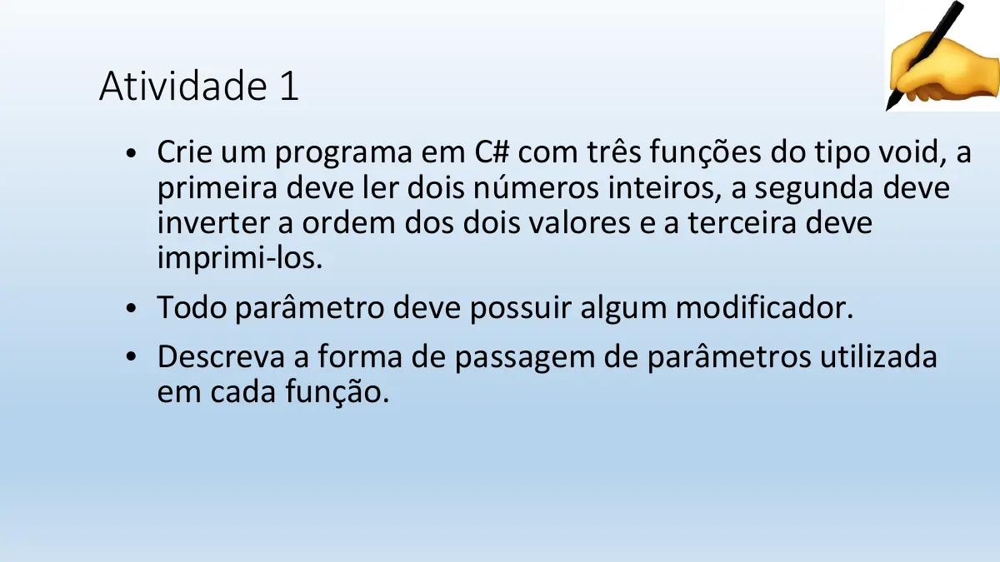

<details>
<summary>Texto da página</summary>

```text
Atividade 1
 ● Crie um programa em C# com três funções do tipo void, a
   primeira deve ler dois números inteiros, a segunda deve
   inverter a ordem dos dois valores e a terceira deve
   imprimi-los.
 ● Todo parâmetro deve possuir algum modificador.

 ● Descreva a forma de passagem de parâmetros utilizada

   em cada função.
```

</details>

<sub>[↑ voltar ao índice](#aula-11---paradigma-imperativo-iii--slides-originais)</sub>

---

### Página 22

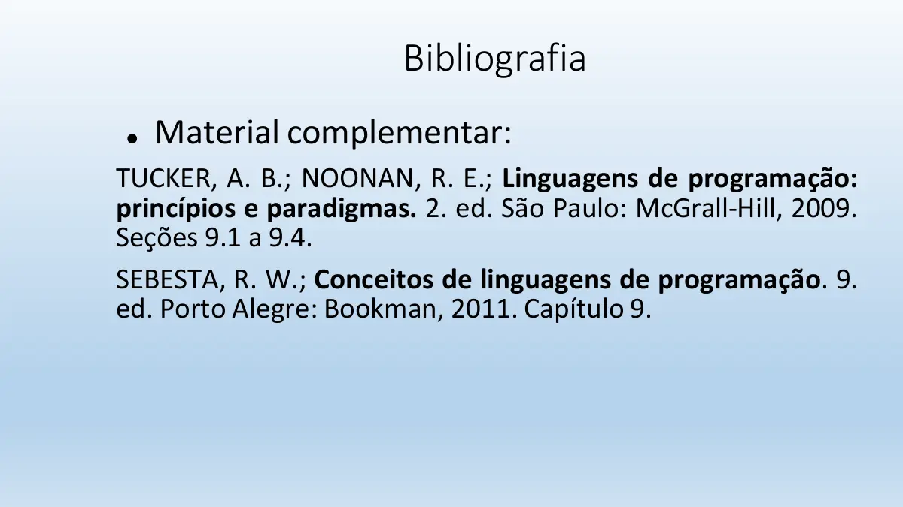

<details>
<summary>Texto da página</summary>

```text
                       Bibliografia
●   Material complementar:
TUCKER, A. B.; NOONAN, R. E.; Linguagens de programação:
princípios e paradigmas. 2. ed. São Paulo: McGrall-Hill, 2009.
Seções 9.1 a 9.4.
SEBESTA, R. W.; Conceitos de linguagens de programação. 9.
ed. Porto Alegre: Bookman, 2011. Capítulo 9.
```

</details>

<sub>[↑ voltar ao índice](#aula-11---paradigma-imperativo-iii--slides-originais)</sub>


<!-- nav:rodape -->

---

**Aula 11:** [Visão geral](../README.md) · **Slides** · [Resumo](../02%20-%20Resumo%20Teórico/resumo-aula-11.md) · [Exercícios](../03%20-%20Exercícios/exercicios-aula-11.md) · [Resoluções](../04%20-%20Resoluções/resolucoes-aula-11.md) · [Complementos](../05%20-%20Materiais%20Complementares/materiais-complementares.md)

← [Aula 10 · Slides](../../Aula%2010%20-%20Paradigma%20Imperativo%20II/01%20-%20Slides%20Originais/README.md) · [Aula 12 · Slides](../../Aula%2012%20-%20Paradigma%20Orientado%20a%20Objetos%20I/01%20-%20Slides%20Originais/README.md) →

**Links para esta página (12):** [Acompanhamento de estudo](../../../00%20-%20Planejamento%20e%20Organização/acompanhamento.md) · [Aula 09 · Artigo de Dijkstra (resumo)](../../Aula%2009%20-%20Paradigma%20Imperativo%20I/02%20-%20Resumo%20Teórico/resumo-artigo-dijkstra-1968.md) · [Aula 11 · Resumo](../02%20-%20Resumo%20Teórico/resumo-aula-11.md) · [Aula 11 · Exercícios](../03%20-%20Exercícios/exercicios-aula-11.md) · [Aula 11 · Resoluções](../04%20-%20Resoluções/resolucoes-aula-11.md) · [Aula 11 · Complementos](../05%20-%20Materiais%20Complementares/materiais-complementares.md) · [Lista 01 · Resolução](../../../02%20-%20Listas%20de%20Exercícios/Lista%2001%20-%20Revisão%20I/02%20-%20Resolução/resolucao-lista-01.md) · [Lista 02 · Resolução](../../../02%20-%20Listas%20de%20Exercícios/Lista%2002%20-%20Revisão%20II/02%20-%20Resolução/resolucao-lista-02.md) · [Simulado 01 · Resolução comentada](../../../04%20-%20Provas%20e%20Avaliações/Simulados/resolucao-simulado-01.md) · [Erratas e inconsistências do material](../../../06%20-%20Revisões%20e%20Sínteses/erratas-e-inconsistencias.md) · [Quadros comparativos](../../../06%20-%20Revisões%20e%20Sínteses/quadros-comparativos.md) · [Questões integradoras · Resolução comentada](../../../06%20-%20Revisões%20e%20Sínteses/resolucao-questoes-integradoras.md)

<!-- /nav:rodape -->
