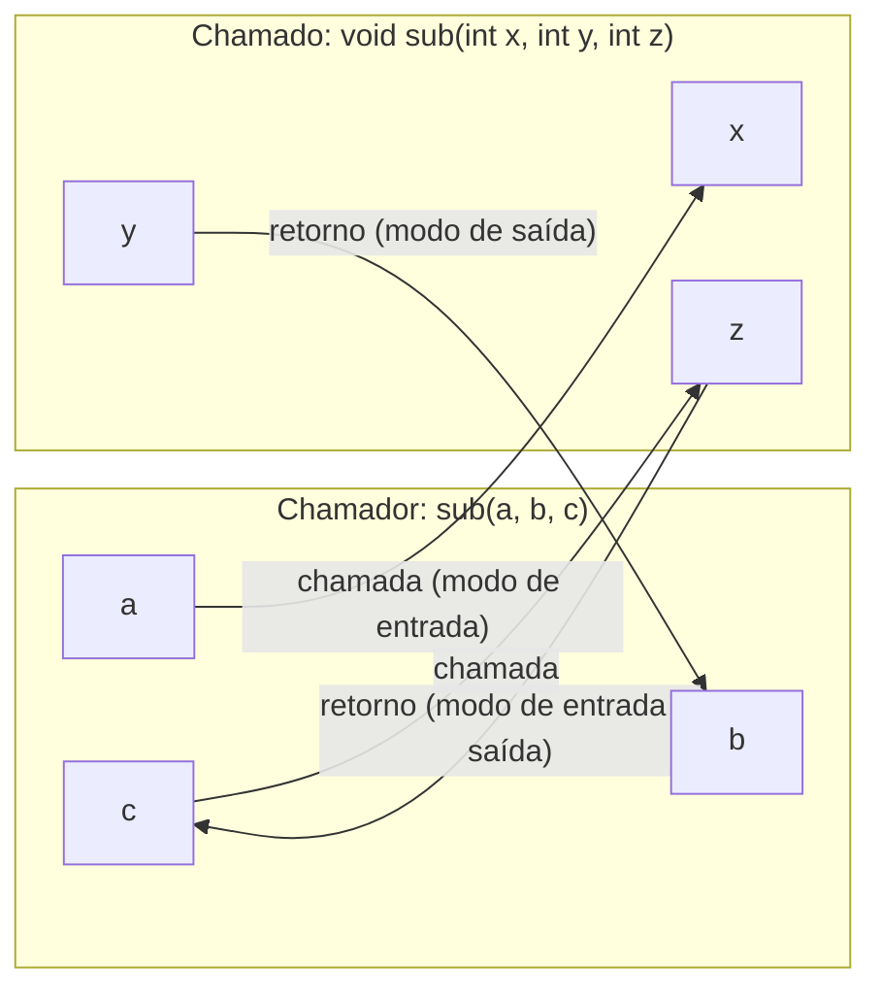

# Aula 11 — Paradigma Imperativo III (Subprogramas e Parâmetros) · Resumo teórico

> **Fonte:** [`Aula11_ParadigmaImperativo3.pdf`](../01%20-%20Slides%20Originais/Aula11_ParadigmaImperativo3.pdf) (22 páginas). Título interno: "Aula 12 – Paradigma Imperativo – Parte 3". Apoio indicado: Tucker & Noonan, seções 9.1 a 9.4; Sebesta (9ª ed.), cap. 9 (p.22).
> **Legenda:** ver [Convenções](../../../README.md#convenções-de-marcação). `p.N` = página do PDF. Os exemplos C++ e Python foram executados; os de C# e Pascal foram analisados sem execução.

---

## 1. Objetivos (p.2)

**[Material original]** Revisar o que são subprogramas e sua utilidade; conhecer os tipos de subprogramas; conceituar parâmetros e suas formas de passagem; determinar a forma de passagem mais adequada a cada situação.

## 2. Subprogramas (p.3–6)

**[Material original]**

- A **abstração procedural** está embasada no conceito de subprogramas.
- Subprogramas **reduzem o consumo de memória e o tempo de codificação**, além de facilitar a organização e a compreensão do código.
- O **cabeçalho** define o tipo do subprograma, seu nome e a lista de parâmetros.
- **Tipos:** **procedimentos**, que não retornam valores, e **funções**, que retornam valores.

**Características (p.4):**

1. Têm um **único ponto de entrada**.
2. A unidade chamadora fica **suspensa** durante a execução do subprograma.
3. O controle **retorna** à unidade chamadora quando o subprograma termina.
4. A **chamada** é a requisição para que o subprograma seja executado.

**Exemplo — hipotenusa (p.5–6):**

| | Procedimento (não retorna) | Função (retorna) |
| --- | --- | --- |
| C++ | `void hipotenusaP(double cateto1, double cateto2) { cout << sqrt(cateto1*cateto1 + cateto2*cateto2); }` | `double hipotenusaF(double cateto1, double cateto2) { return sqrt(cateto1*cateto1 + cateto2*cateto2); }` |
| Pascal | `procedure hipotenusaP(cateto1, cateto2: real); begin writeln(sqrt(...)); end;` | `function hipotenusaF(cateto1, cateto2: real): real; begin hipotenusaF := sqrt(...); end;` |

**[Explicação elaborada]**

- Em Pascal, o valor de retorno de uma `function` é definido **atribuindo ao nome da função** (`hipotenusaF := ...`).
- O procedimento **imprime** o resultado (efeito colateral de E/S) e não devolve nada. A função **devolve** o valor, e o chamador decide o que fazer: imprimir, somar, guardar. A função é mais **reutilizável**: dá para escrever `hipotenusaF(3,4) + 1`, mas não `hipotenusaP(3,4) + 1`.

## 3. Como o subprograma acessa os dados (p.7)

**[Material original]** Duas maneiras: **acesso a variáveis não locais** (declaradas em outro lugar, mas visíveis) ou **passagem de parâmetros**. "A primeira alternativa **reduz a confiabilidade** do programa."

**[Explicação elaborada]** Acessar não locais é usar variáveis globais — o alto acoplamento da [Aula 10](../../Aula%2010%20-%20Paradigma%20Imperativo%20II/02%20-%20Resumo%20Teórico/resumo-aula-10.md#6-limitações-acoplamento-e-coesão-p16). Com parâmetros, tudo de que a função precisa aparece no cabeçalho.

## 4. Parâmetros (p.8–12)

**[Material original]**

- **Parâmetro** é um identificador que aparece na declaração de um subprograma.
  - **Formal** (ou só "parâmetro"): definido na **declaração**.
  - **Real** (ou **argumento**): aparece na **chamada**.
- Em geral, a associação entre eles é feita pela **posição**.
- Algumas linguagens permitem **valores padrão**, que devem ser os **últimos** da lista.

**Valor padrão em C++ (p.9):**

<!-- teste: entrada="2 5" saida-contem="2 elevado a 5: 32|2 elevado ao quadrado: 4" -->
```cpp
#include <iostream>

int elevado(int x, int y = 2) {        // y tem valor padrão 2
    int t = 1;
    for (int i = 0; i < y; i++) {
        t = t * x;
    }
    return t;
}

int main() {
    int base, expo, res1, res2;
    std::cout << "Digite o valor da base: ";
    std::cin >> base;
    std::cout << "Digite o valor do expoente: ";
    std::cin >> expo;
    res1 = elevado(base, expo);        // usa o expoente informado
    res2 = elevado(base);              // omite y: usa o padrão 2
    std::cout << base << " elevado a " << expo << ": " << res1 << "\n";
    std::cout << base << " elevado ao quadrado: " << res2 << "\n";
    return 0;
}
```

**[Explicação elaborada]** Os padrões ficam no fim porque a associação é posicional. Em `f(int a = 1, int b)`, a chamada `f(5)` seria ambígua: o 5 é `a` ou `b`?

**Parâmetros nomeados (p.10–12):** em algumas linguagens, o valor de cada parâmetro é definido pelo **nome**, não pela posição.

- **Vantagens:** manutenção e legibilidade, principalmente em funções com **muitos parâmetros** ou com **parâmetros opcionais**, porque fica claro o que é passado para cada um.
- **Exemplos de linguagens:** Python, C#, Kotlin, Ruby e Swift.

<!-- teste: saida-contem="Nome: Maria|Cidade:  Lages|Nome: João|Cidade:  Florianópolis" -->
```python
def mostrar_usuario(nome, idade, cidade):
    print("Nome:", nome)
    print("Idade: ", idade)
    print("Cidade: ", cidade)

# Utilizando parâmetros posicionais
mostrar_usuario("Maria", 25, "Lages")

# Utilizando parâmetros nomeados 1
mostrar_usuario(nome="João", idade=30, cidade="Florianópolis")

# Utilizando parâmetros nomeados 2 (ordem livre)
mostrar_usuario(cidade="Florianópolis", nome="João", idade=30)
```

**Motivação real (p.12):** **[Explicação elaborada]** a assinatura de `sklearn.neural_network.MLPClassifier` tem mais de 20 parâmetros, todos com valor padrão (`hidden_layer_sizes=(100,)`, `activation='relu'`, `solver='adam'`, `alpha=0.0001`, `max_iter=200`…). Com parâmetros nomeados, escreve-se `MLPClassifier(max_iter=500, solver='sgd')` e mudam-se só os necessários, sem contar posições. Na assinatura do slide, o `*` depois de `activation` torna todos os parâmetros seguintes **somente nomeados** (*keyword-only*): passá-los por posição dá `TypeError`.

## 5. Modelos de passagem de parâmetros: semânticos e de implementação (p.13–18)

**[Material original]** Figura 9.1 de Sebesta — os três modelos semânticos, quando há movimentação física:



**[Material original] — os modelos de implementação:**

| Modelo | Direção | O formal se comporta como… | Custo e riscos |
| --- | --- | --- | --- |
| **Por valor** (p.14) | Entrada | Variável local **inicializada** com o valor do real; não há retorno do formal para o real | Cópia: mais espaço; rápido para dados pequenos, lento para matrizes. "**Java suporta apenas passagem por valor para tipos primitivos.**" |
| **Por resultado** (p.15) | Saída | Variável local **não inicializada**; no fim, seu valor é copiado para o real | Cópia; rápido para dados pequenos, lento para matrizes. "C# implementa com o modificador `out`, porém usa referência." |
| **Por valor-resultado** (p.16) | Entrada e saída | Local inicializada com o real; no fim, copiada de volta para o real | Duas cópias; rápido para dados pequenos, lento para matrizes |
| **Por referência** (p.17) | Entrada e saída | Caminho (endereço) até o dado do real | **Não consome memória extra** e a passagem é rápida; o **acesso** é mais lento (indireção); mudanças **inadvertidas** podem comprometer outras partes do programa |

> **[Atenção]** A frase da p.14 pode sugerir que Java passa objetos por referência. Formalmente, **Java sempre passa por valor**: para objetos e vetores, o valor copiado é a referência. Por isso o método consegue alterar o conteúdo do objeto, mas reatribuir o parâmetro não afeta a variável do chamador ([Aula 08](../../Aula%2008%20-%20Ponteiros/02%20-%20Resumo%20Teórico/resumo-aula-08.md#exemplo-2--java-vetor-e-inteiro-como-parâmetros-p10)).

**[Material original] (p.18):** "A maioria das linguagens realiza, por padrão, a **passagem por valor** e possui mecanismos que permitem a passagem por referência" — com uma versão reduzida do exemplo C# `Metodo1(int x)` × `Metodo2(ref int x)` da [Aula 08](../../Aula%2008%20-%20Ponteiros/02%20-%20Resumo%20Teórico/resumo-aula-08.md#exemplo-1--c-ref-p9), sem `Console.WriteLine` dentro dos métodos (saída: `0`, `0`, `1`).

**[Explicação elaborada] — valor-resultado × referência.** Os dois são de "entrada e saída", mas diferem quando há *aliasing*. Considere:

```text
procedimento p(x, y):   x = x + 1;  y = y * 10
chamada: p(a, a)   com a = 2
```

| Modelo | Execução | Valor final de `a` |
| --- | --- | --- |
| Referência | `x` e `y` **são** `a`: a = 3, depois a = 30 | **30** |
| Valor-resultado | x = 2 e y = 2 (cópias); x = 3, y = 20; no fim, copia x → a (3) e y → a (20) | **20** (ou 3, conforme a ordem das cópias de volta) |

O mesmo código dá resultados diferentes. É por isso que Sebesta trata os modelos de implementação separadamente dos modelos semânticos.

## 6. Modificadores de parâmetros do C# (p.19)

**[Material original]**

| Modificador | Argumento precisa estar inicializado antes da chamada? | O método pode atribuir novo valor? |
| --- | --- | --- |
| `ref` | Sim | Pode (opcional) |
| `out` | Não | **Deve** atribuir |
| `ref readonly` | Sim | Não pode |
| `in` | Sim | Não pode |

Detalhes: <https://learn.microsoft.com/pt-br/dotnet/csharp/language-reference/keywords/method-parameters>.

**[Explicação elaborada] — quando usar cada um:**

- **sem modificador** (por valor): o método só lê um valor pequeno (`int`, `double`).
- **`out`**: o método **produz** um resultado extra além do `return` — por exemplo, `int.TryParse(texto, out int numero)`, que devolve `bool` (deu certo?) e entrega o número por `out`. É o modelo **por resultado**.
- **`ref`**: o método precisa **ler e alterar** a variável do chamador, como uma função de troca. É o modelo **entrada e saída**.
- **`in` / `ref readonly`**: passar uma **estrutura grande** sem copiá-la, garantindo que não será alterada. É referência por desempenho, com segurança de leitura.

## 7. Recapitulação do paradigma imperativo (p.20)

**[Material original]**

- As linguagens imperativas são **orientadas a ações**, e a computação é vista como uma **sequência de instruções que manipulam valores de variáveis**.
- Sua criação foi influenciada pela arquitetura de **von Neumann**, em que programas e dados ficam na mesma memória.
- São caracterizadas por **4 conceitos principais: variáveis, atribuição, decisão e repetição**.
- Aspectos da programação imperativa **prevalecem na maioria das linguagens**, inclusive nas orientadas a objetos.

## 8. Atividade (p.21)

**[Material original]** Criar em C# três funções `void`: a primeira lê dois inteiros, a segunda inverte a ordem dos dois valores e a terceira os imprime. **Todo parâmetro deve ter algum modificador**, e é preciso descrever a forma de passagem usada em cada função. Solução em [resolucoes-aula-11.md](../04%20-%20Resoluções/resolucoes-aula-11.md#e8--atividade-1-original-p21).

## 9. Conexões e pontos para a prova

- Os subprogramas são o mecanismo da **abstração procedural** ([Aula 10](../../Aula%2010%20-%20Paradigma%20Imperativo%20II/02%20-%20Resumo%20Teórico/resumo-aula-10.md)); por valor × por referência começou na [Aula 08](../../Aula%2008%20-%20Ponteiros/02%20-%20Resumo%20Teórico/resumo-aula-08.md).
- Cobrado na [Lista 02, Q9](../../../02%20-%20Listas%20de%20Exercícios/Lista%2002%20-%20Revisão%20II/02%20-%20Resolução/resolucao-lista-02.md#q9) (os quatro modelos).
- **Decorar:** a tabela dos quatro modelos (direção, cópia/endereço, custo); a tabela dos modificadores C#; os 4 conceitos do imperativo.

---

**Anterior:** [Aula 10](../../Aula%2010%20-%20Paradigma%20Imperativo%20II/02%20-%20Resumo%20Teórico/resumo-aula-10.md) · **Próxima:** [Aula 12 — Paradigma Orientado a Objetos I](../../Aula%2012%20-%20Paradigma%20Orientado%20a%20Objetos%20I/02%20-%20Resumo%20Teórico/resumo-aula-12.md)
