<!-- nav:topo -->
[Início](../../../README.md) › [01 - Aulas](../../README.md) › [Aula 12](../README.md) › **01 - Slides Originais** · [Mapa](../../../MAPA.md)
<!-- /nav:topo -->

<!-- gerado por ferramentas/geradores/gerar_galerias.py: não edite à mão -->

# Aula 12 - Paradigma Orientado a Objetos I · Slides originais

> **[Material original]** Slides originais do professor, página por página, para ler aqui mesmo no GitHub. O arquivo original é o PDF [`Aula12_ParadigmaOrientadoObjetos1.pdf`](Aula12_ParadigmaOrientadoObjetos1.pdf) (31 páginas): use-o para baixar ou imprimir. As imagens e o texto de cada página foram extraídos do PDF, sem alteração do conteúdo.

**Ir para a página:** [1](#página-1) · [2](#página-2) · [3](#página-3) · [4](#página-4) · [5](#página-5) · [6](#página-6) · [7](#página-7) · [8](#página-8) · [9](#página-9) · [10](#página-10) · [11](#página-11) · [12](#página-12) · [13](#página-13) · [14](#página-14) · [15](#página-15) · [16](#página-16) · [17](#página-17) · [18](#página-18) · [19](#página-19) · [20](#página-20) · [21](#página-21) · [22](#página-22) · [23](#página-23) · [24](#página-24) · [25](#página-25) · [26](#página-26) · [27](#página-27) · [28](#página-28) · [29](#página-29) · [30](#página-30) · [31](#página-31)

O texto de cada página fica em **Texto da página**, logo abaixo da imagem: é por ele que a busca encontra o conteúdo dos slides.

---

### Página 1

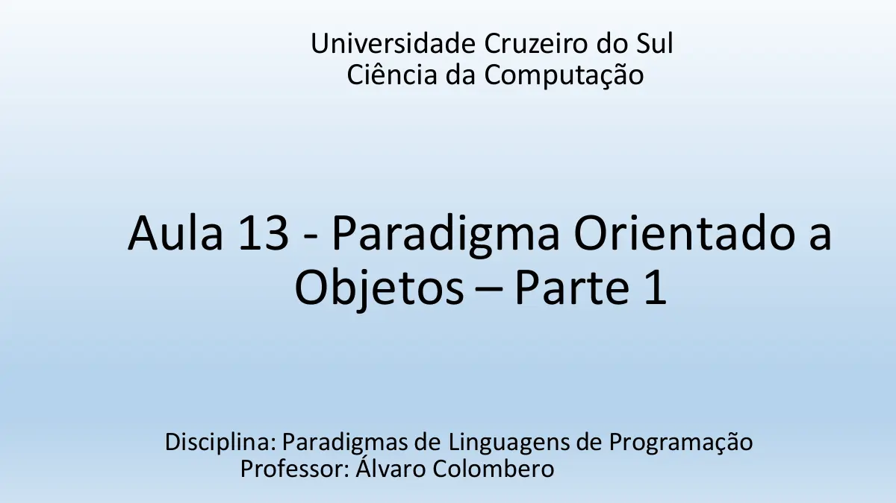

<details>
<summary>Texto da página</summary>

```text
             Universidade Cruzeiro do Sul
               Ciência da Computação

Aula 13 - Paradigma Orientado a
       Objetos – Parte 1

 Disciplina: Paradigmas de Linguagens de Programação
         Professor: Álvaro Colombero
```

</details>

<sub>[↑ voltar ao índice](#aula-12---paradigma-orientado-a-objetos-i--slides-originais)</sub>

---

### Página 2

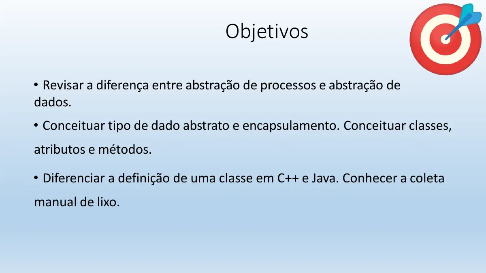

<details>
<summary>Texto da página</summary>

```text
                                 Objetivos

• Revisar a diferença entre abstração de processos e abstração de
dados.
• Conceituar tipo de dado abstrato e encapsulamento. Conceituar classes,
atributos e métodos.

• Diferenciar a definição de uma classe em C++ e Java. Conhecer a coleta
manual de lixo.
```

</details>

<sub>[↑ voltar ao índice](#aula-12---paradigma-orientado-a-objetos-i--slides-originais)</sub>

---

### Página 3

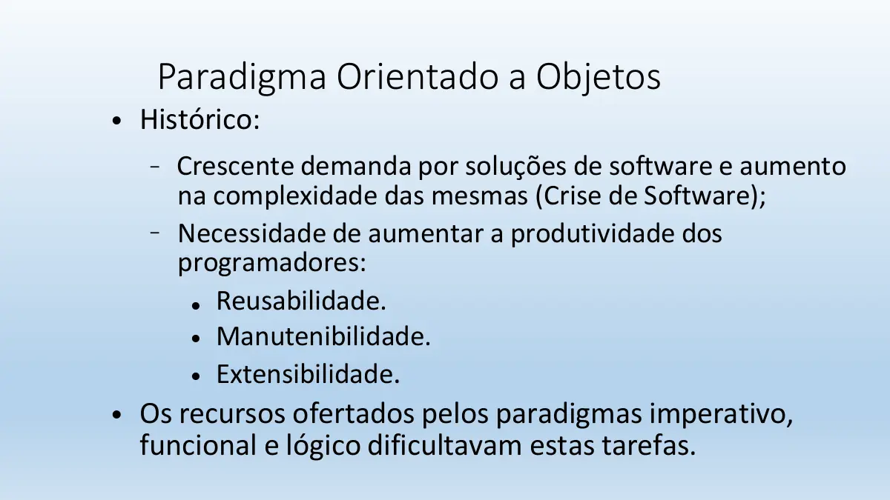

<details>
<summary>Texto da página</summary>

```text
     Paradigma Orientado a Objetos
●   Histórico:
    – Crescente demanda por soluções de software e aumento
      na complexidade das mesmas (Crise de Software);
    – Necessidade de aumentar a produtividade dos
      programadores:
       ● Reusabilidade.

       ● Manutenibilidade.

       ● Extensibilidade.

●   Os recursos ofertados pelos paradigmas imperativo,
    funcional e lógico dificultavam estas tarefas.
```

</details>

<sub>[↑ voltar ao índice](#aula-12---paradigma-orientado-a-objetos-i--slides-originais)</sub>

---

### Página 4

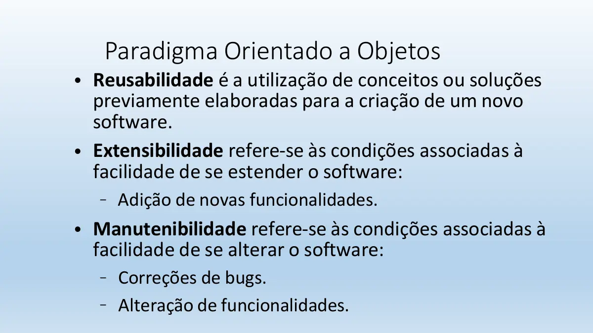

<details>
<summary>Texto da página</summary>

```text
     Paradigma Orientado a Objetos
● Reusabilidade é a utilização de conceitos ou soluções
  previamente elaboradas para a criação de um novo
  software.
● Extensibilidade refere-se às condições associadas à

  facilidade de se estender o software:
    –   Adição de novas funcionalidades.
●   Manutenibilidade refere-se às condições associadas à
    facilidade de se alterar o software:
    – Correções de bugs.
    – Alteração de funcionalidades.
```

</details>

<sub>[↑ voltar ao índice](#aula-12---paradigma-orientado-a-objetos-i--slides-originais)</sub>

---

### Página 5

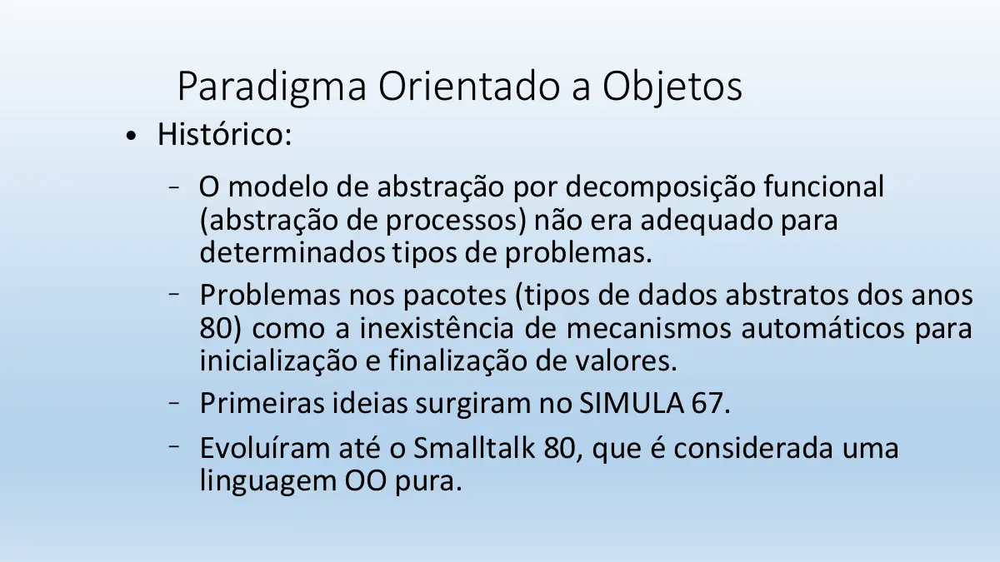

<details>
<summary>Texto da página</summary>

```text
     Paradigma Orientado a Objetos
●   Histórico:
    – O modelo de abstração por decomposição funcional
      (abstração de processos) não era adequado para
      determinados tipos de problemas.
    – Problemas nos pacotes (tipos de dados abstratos dos anos
      80) como a inexistência de mecanismos automáticos para
      inicialização e finalização de valores.
    – Primeiras ideias surgiram no SIMULA 67.
    – Evoluíram até o Smalltalk 80, que é considerada uma
      linguagem OO pura.
```

</details>

<sub>[↑ voltar ao índice](#aula-12---paradigma-orientado-a-objetos-i--slides-originais)</sub>

---

### Página 6

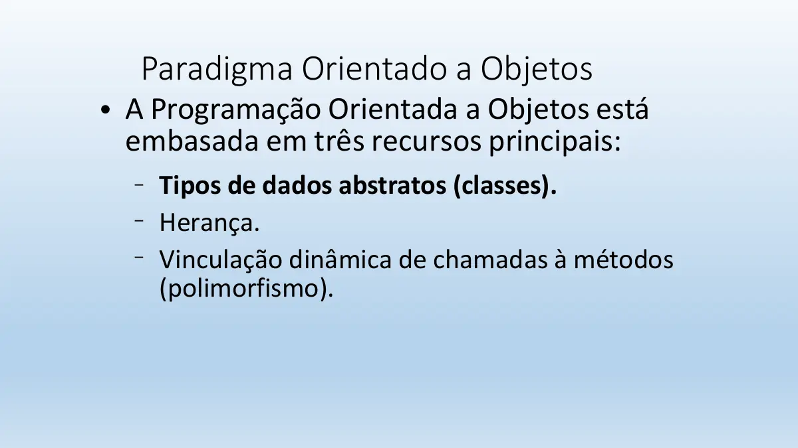

<details>
<summary>Texto da página</summary>

```text
     Paradigma Orientado a Objetos
●   A Programação Orientada a Objetos está
    embasada em três recursos principais:
    – Tipos de dados abstratos (classes).
    – Herança.
    – Vinculação dinâmica de chamadas à métodos
      (polimorfismo).
```

</details>

<sub>[↑ voltar ao índice](#aula-12---paradigma-orientado-a-objetos-i--slides-originais)</sub>

---

### Página 7

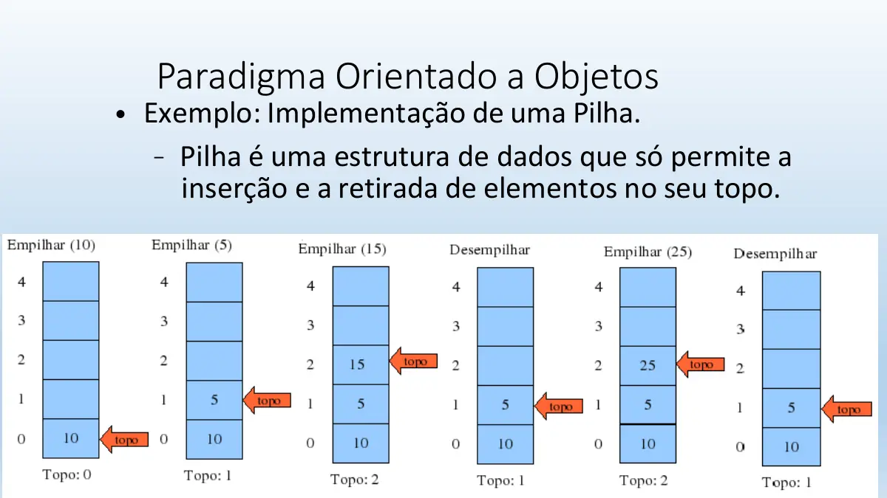

<details>
<summary>Texto da página</summary>

```text
    Paradigma Orientado a Objetos
●   Exemplo: Implementação de uma Pilha.
     – Pilha é uma estrutura de dados que só permite a
       inserção e a retirada de elementos no seu topo.
```

</details>

<sub>[↑ voltar ao índice](#aula-12---paradigma-orientado-a-objetos-i--slides-originais)</sub>

---

### Página 8

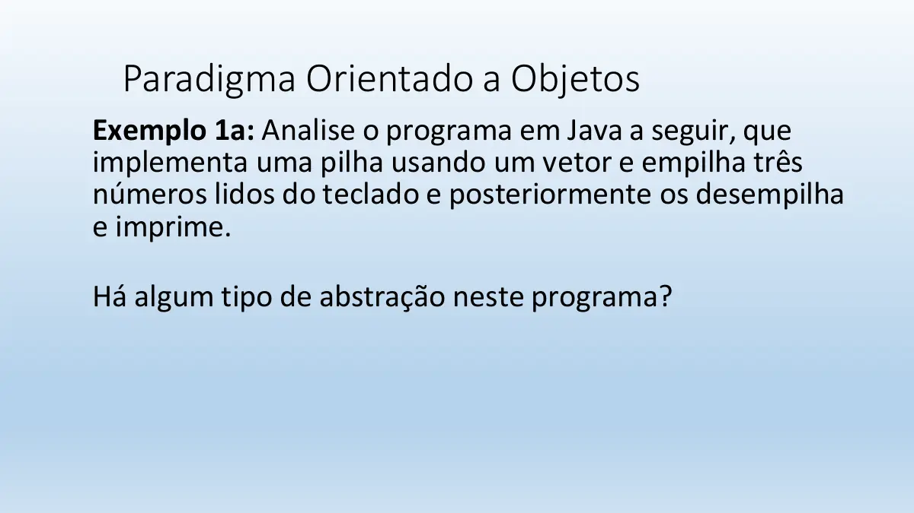

<details>
<summary>Texto da página</summary>

```text
  Paradigma Orientado a Objetos
Exemplo 1a: Analise o programa em Java a seguir, que
implementa uma pilha usando um vetor e empilha três
números lidos do teclado e posteriormente os desempilha
e imprime.

Há algum tipo de abstração neste programa?
```

</details>

<sub>[↑ voltar ao índice](#aula-12---paradigma-orientado-a-objetos-i--slides-originais)</sub>

---

### Página 9

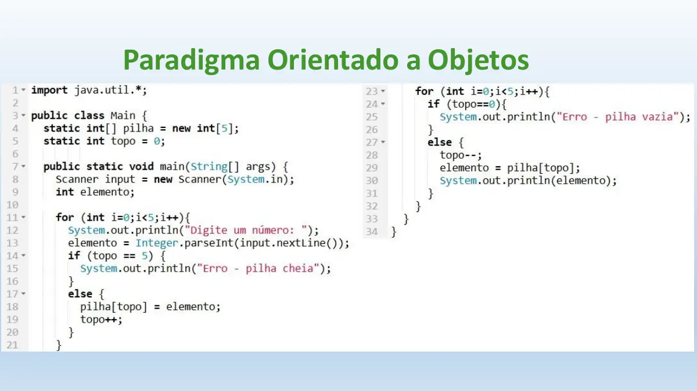

<details>
<summary>Texto da página</summary>

```text
Paradigma Orientado a Objetos
```

</details>

<sub>[↑ voltar ao índice](#aula-12---paradigma-orientado-a-objetos-i--slides-originais)</sub>

---

### Página 10

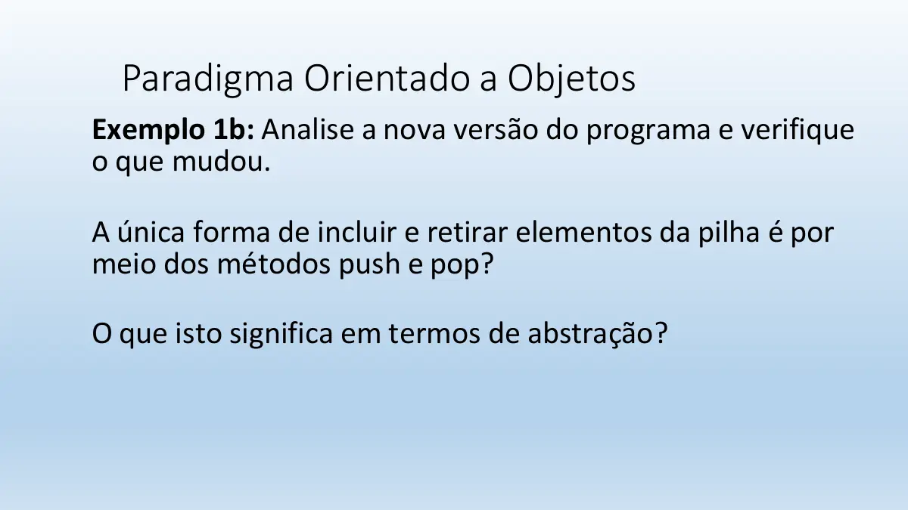

<details>
<summary>Texto da página</summary>

```text
  Paradigma Orientado a Objetos
Exemplo 1b: Analise a nova versão do programa e verifique
o que mudou.

A única forma de incluir e retirar elementos da pilha é por
meio dos métodos push e pop?

O que isto significa em termos de abstração?
```

</details>

<sub>[↑ voltar ao índice](#aula-12---paradigma-orientado-a-objetos-i--slides-originais)</sub>

---

### Página 11

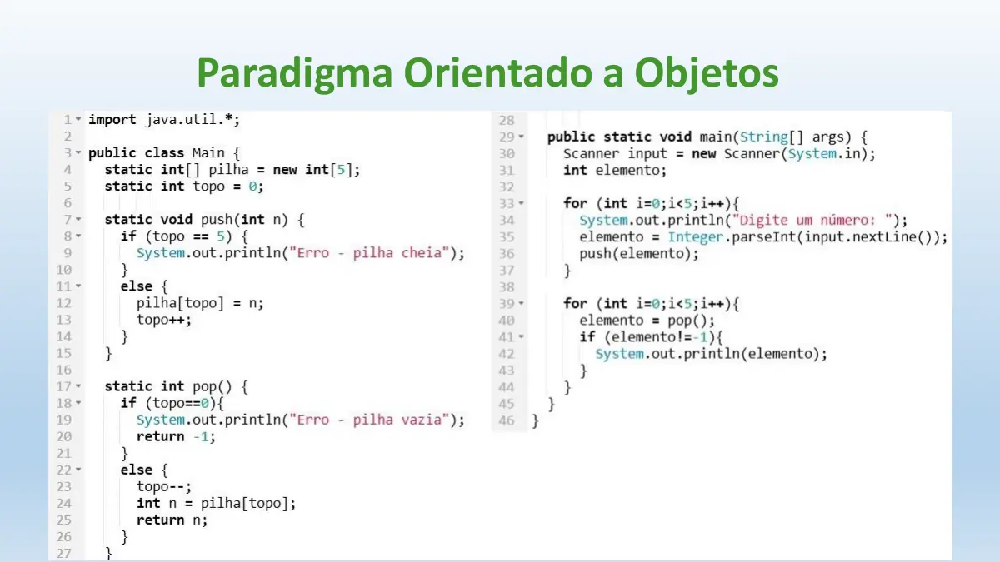

<details>
<summary>Texto da página</summary>

```text
Paradigma Orientado a Objetos
```

</details>

<sub>[↑ voltar ao índice](#aula-12---paradigma-orientado-a-objetos-i--slides-originais)</sub>

---

### Página 12

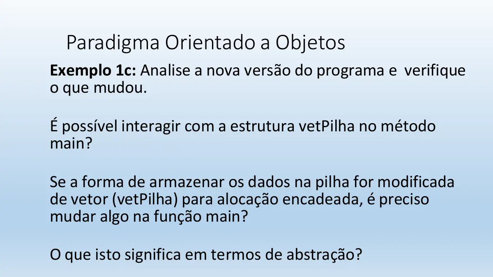

<details>
<summary>Texto da página</summary>

```text
  Paradigma Orientado a Objetos
Exemplo 1c: Analise a nova versão do programa e verifique
o que mudou.

É possível interagir com a estrutura vetPilha no método
main?

Se a forma de armazenar os dados na pilha for modificada
de vetor (vetPilha) para alocação encadeada, é preciso
mudar algo na função main?

O que isto significa em termos de abstração?
```

</details>

<sub>[↑ voltar ao índice](#aula-12---paradigma-orientado-a-objetos-i--slides-originais)</sub>

---

### Página 13

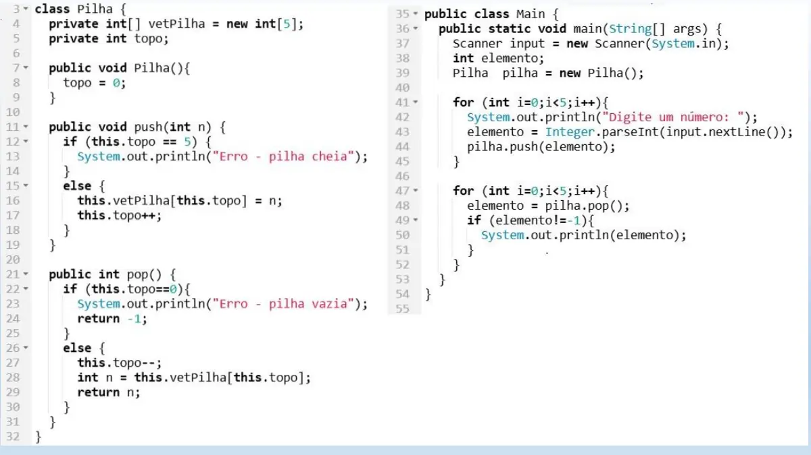

<details>
<summary>Texto da página</summary>

```text
Paradigma Orientado a Objetos
```

</details>

<sub>[↑ voltar ao índice](#aula-12---paradigma-orientado-a-objetos-i--slides-originais)</sub>

---

### Página 14

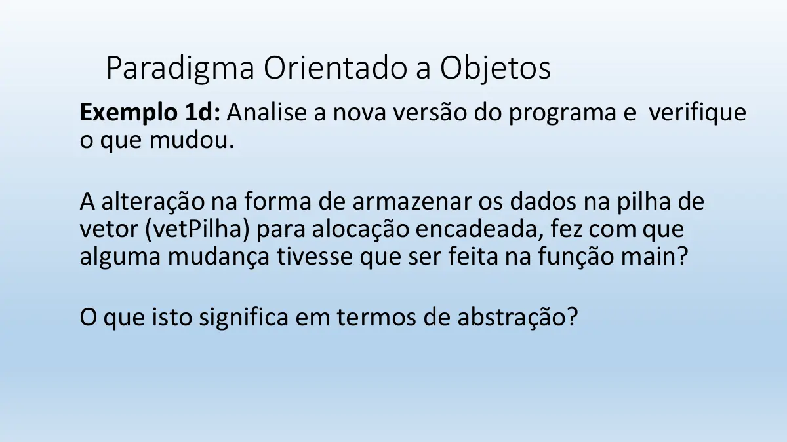

<details>
<summary>Texto da página</summary>

```text
  Paradigma Orientado a Objetos
Exemplo 1d: Analise a nova versão do programa e verifique
o que mudou.

A alteração na forma de armazenar os dados na pilha de
vetor (vetPilha) para alocação encadeada, fez com que
alguma mudança tivesse que ser feita na função main?

O que isto significa em termos de abstração?
```

</details>

<sub>[↑ voltar ao índice](#aula-12---paradigma-orientado-a-objetos-i--slides-originais)</sub>

---

### Página 15

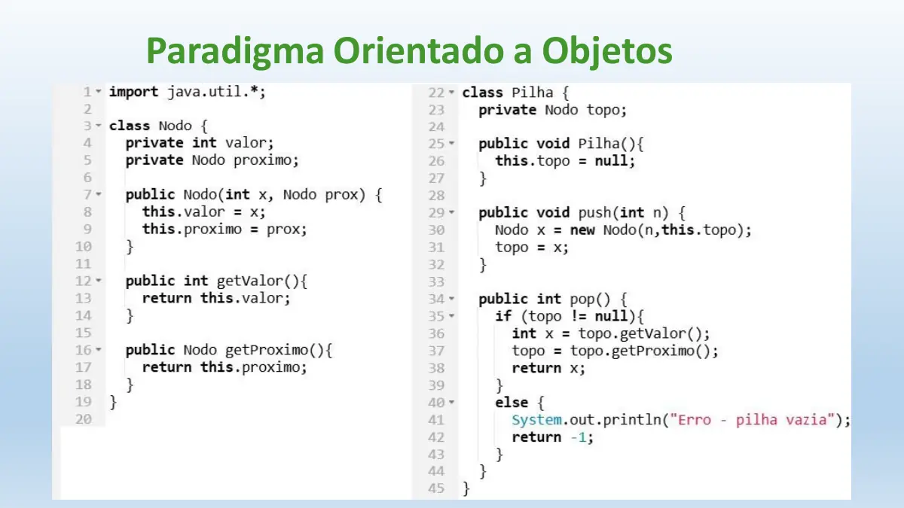

<details>
<summary>Texto da página</summary>

```text
Paradigma Orientado a Objetos
```

</details>

<sub>[↑ voltar ao índice](#aula-12---paradigma-orientado-a-objetos-i--slides-originais)</sub>

---

### Página 16

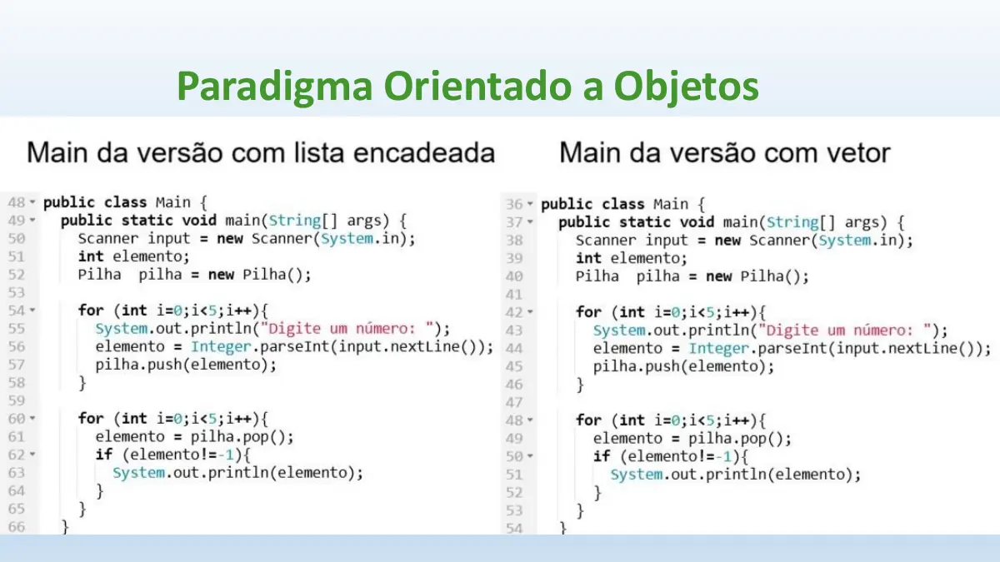

<details>
<summary>Texto da página</summary>

```text
Paradigma Orientado a Objetos
```

</details>

<sub>[↑ voltar ao índice](#aula-12---paradigma-orientado-a-objetos-i--slides-originais)</sub>

---

### Página 17

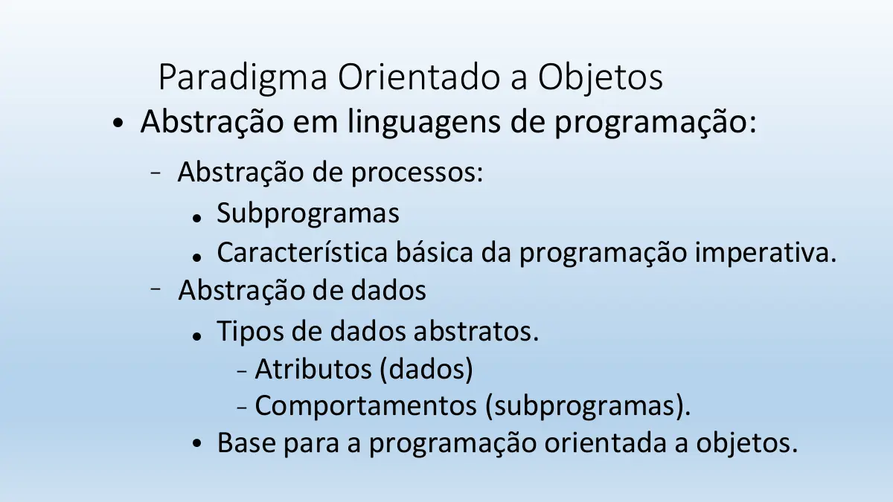

<details>
<summary>Texto da página</summary>

```text
     Paradigma Orientado a Objetos
●   Abstração em linguagens de programação:
    – Abstração de processos:
       ● Subprogramas
       ● Característica básica da programação imperativa.

    – Abstração de dados
       ● Tipos de dados abstratos.

           – Atributos (dados)
           – Comportamentos (subprogramas).
       ● Base para a programação orientada a objetos.
```

</details>

<sub>[↑ voltar ao índice](#aula-12---paradigma-orientado-a-objetos-i--slides-originais)</sub>

---

### Página 18

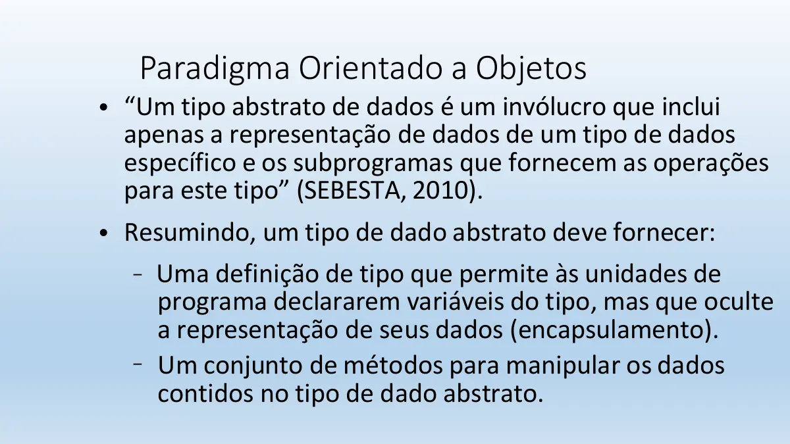

<details>
<summary>Texto da página</summary>

```text
     Paradigma Orientado a Objetos
●   “Um tipo abstrato de dados é um invólucro que inclui
    apenas a representação de dados de um tipo de dados
    específico e os subprogramas que fornecem as operações
    para este tipo” (SEBESTA, 2010).
●   Resumindo, um tipo de dado abstrato deve fornecer:
    – Uma definição de tipo que permite às unidades de
      programa declararem variáveis do tipo, mas que oculte
      a representação de seus dados (encapsulamento).
    – Um conjunto de métodos para manipular os dados
      contidos no tipo de dado abstrato.
```

</details>

<sub>[↑ voltar ao índice](#aula-12---paradigma-orientado-a-objetos-i--slides-originais)</sub>

---

### Página 19

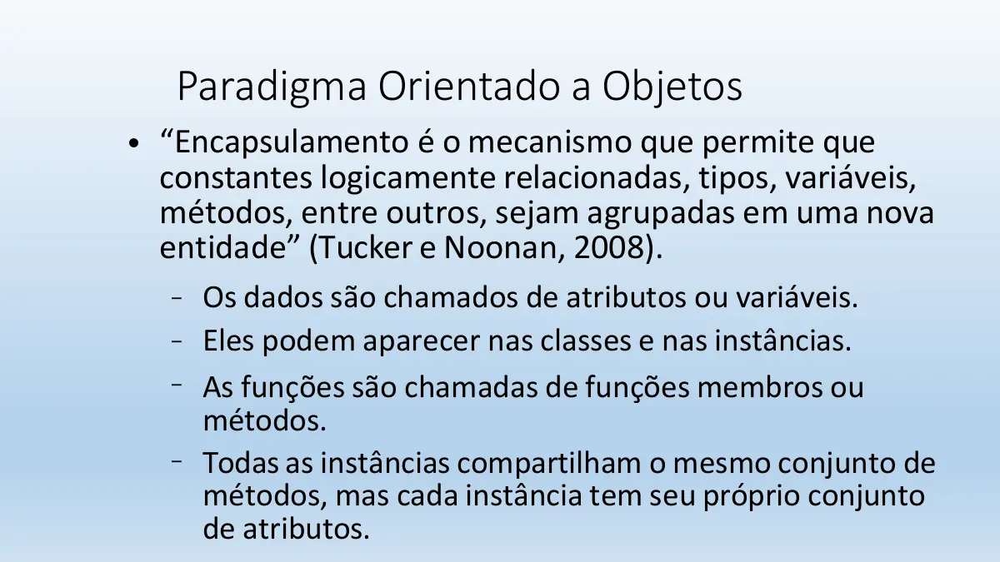

<details>
<summary>Texto da página</summary>

```text
     Paradigma Orientado a Objetos
●   “Encapsulamento é o mecanismo que permite que
    constantes logicamente relacionadas, tipos, variáveis,
    métodos, entre outros, sejam agrupadas em uma nova
    entidade” (Tucker e Noonan, 2008).
    – Os dados são chamados de atributos ou variáveis.
    – Eles podem aparecer nas classes e nas instâncias.
    – As funções são chamadas de funções membros ou
      métodos.
    – Todas as instâncias compartilham o mesmo conjunto de
      métodos, mas cada instância tem seu próprio conjunto
      de atributos.
```

</details>

<sub>[↑ voltar ao índice](#aula-12---paradigma-orientado-a-objetos-i--slides-originais)</sub>

---

### Página 20

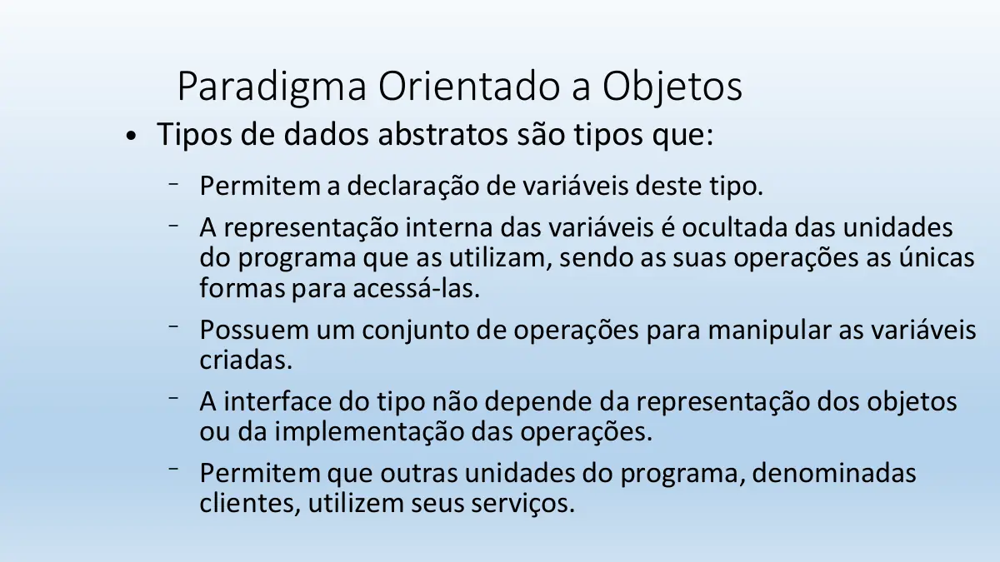

<details>
<summary>Texto da página</summary>

```text
     Paradigma Orientado a Objetos
●   Tipos de dados abstratos são tipos que:
    – Permitem a declaração de variáveis deste tipo.
    – A representação interna das variáveis é ocultada das unidades
      do programa que as utilizam, sendo as suas operações as únicas
      formas para acessá-las.
    – Possuem um conjunto de operações para manipular as variáveis
      criadas.
    – A interface do tipo não depende da representação dos objetos
      ou da implementação das operações.
    – Permitem que outras unidades do programa, denominadas
      clientes, utilizem seus serviços.
```

</details>

<sub>[↑ voltar ao índice](#aula-12---paradigma-orientado-a-objetos-i--slides-originais)</sub>

---

### Página 21

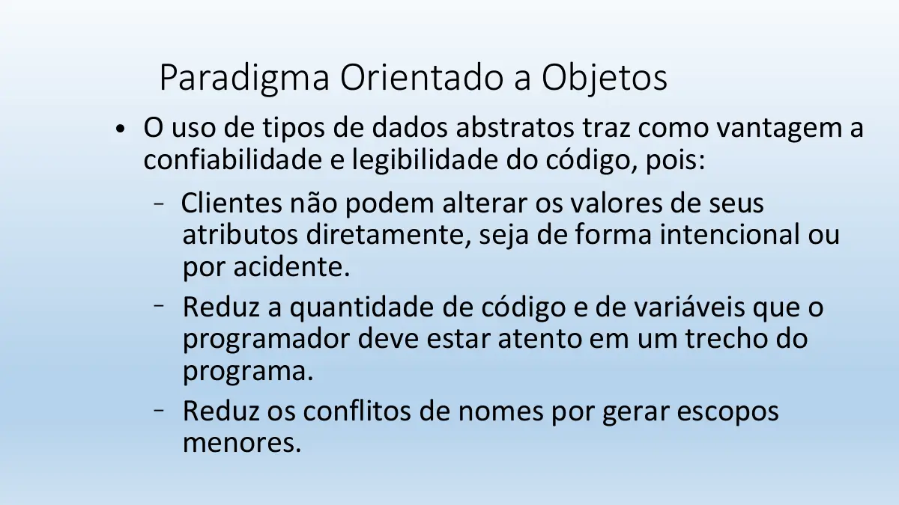

<details>
<summary>Texto da página</summary>

```text
     Paradigma Orientado a Objetos
●   O uso de tipos de dados abstratos traz como vantagem a
    confiabilidade e legibilidade do código, pois:
     – Clientes não podem alterar os valores de seus
       atributos diretamente, seja de forma intencional ou
       por acidente.
     – Reduz a quantidade de código e de variáveis que o
       programador deve estar atento em um trecho do
       programa.
     – Reduz os conflitos de nomes por gerar escopos
       menores.
```

</details>

<sub>[↑ voltar ao índice](#aula-12---paradigma-orientado-a-objetos-i--slides-originais)</sub>

---

### Página 22

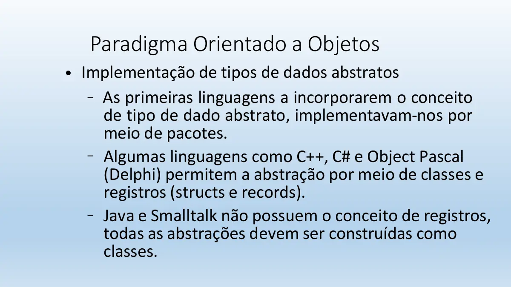

<details>
<summary>Texto da página</summary>

```text
     Paradigma Orientado a Objetos
●   Implementação de tipos de dados abstratos
     – As primeiras linguagens a incorporarem o conceito
       de tipo de dado abstrato, implementavam-nos por
       meio de pacotes.
     – Algumas linguagens como C++, C# e Object Pascal
       (Delphi) permitem a abstração por meio de classes e
       registros (structs e records).
     – Java e Smalltalk não possuem o conceito de registros,
       todas as abstrações devem ser construídas como
       classes.
```

</details>

<sub>[↑ voltar ao índice](#aula-12---paradigma-orientado-a-objetos-i--slides-originais)</sub>

---

### Página 23

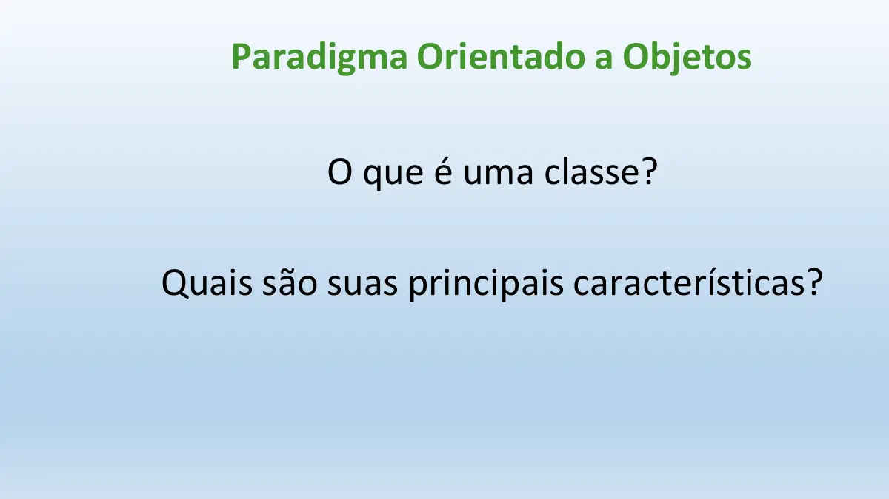

<details>
<summary>Texto da página</summary>

```text
    Paradigma Orientado a Objetos

          O que é uma classe?

Quais são suas principais características?
```

</details>

<sub>[↑ voltar ao índice](#aula-12---paradigma-orientado-a-objetos-i--slides-originais)</sub>

---

### Página 24

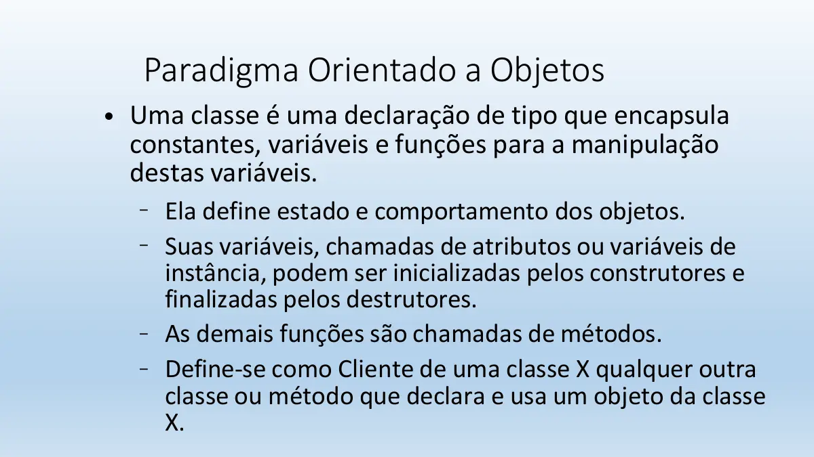

<details>
<summary>Texto da página</summary>

```text
     Paradigma Orientado a Objetos
●   Uma classe é uma declaração de tipo que encapsula
    constantes, variáveis e funções para a manipulação
    destas variáveis.
    – Ela define estado e comportamento dos objetos.
    – Suas variáveis, chamadas de atributos ou variáveis de
      instância, podem ser inicializadas pelos construtores e
      finalizadas pelos destrutores.
    – As demais funções são chamadas de métodos.
    – Define-se como Cliente de uma classe X qualquer outra
      classe ou método que declara e usa um objeto da classe
      X.
```

</details>

<sub>[↑ voltar ao índice](#aula-12---paradigma-orientado-a-objetos-i--slides-originais)</sub>

---

### Página 25

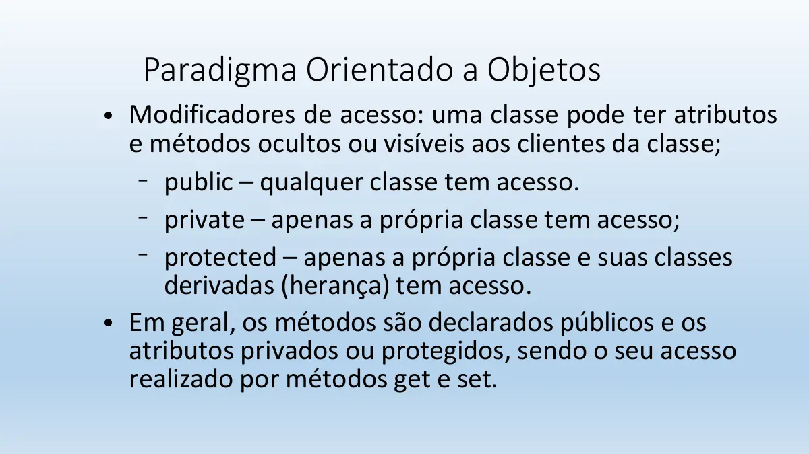

<details>
<summary>Texto da página</summary>

```text
    Paradigma Orientado a Objetos
● Modificadores de acesso: uma classe pode ter atributos
  e métodos ocultos ou visíveis aos clientes da classe;
   – public – qualquer classe tem acesso.
   – private – apenas a própria classe tem acesso;
   – protected – apenas a própria classe e suas classes
     derivadas (herança) tem acesso.
● Em geral, os métodos são declarados públicos e os

  atributos privados ou protegidos, sendo o seu acesso
  realizado por métodos get e set.
```

</details>

<sub>[↑ voltar ao índice](#aula-12---paradigma-orientado-a-objetos-i--slides-originais)</sub>

---

### Página 26

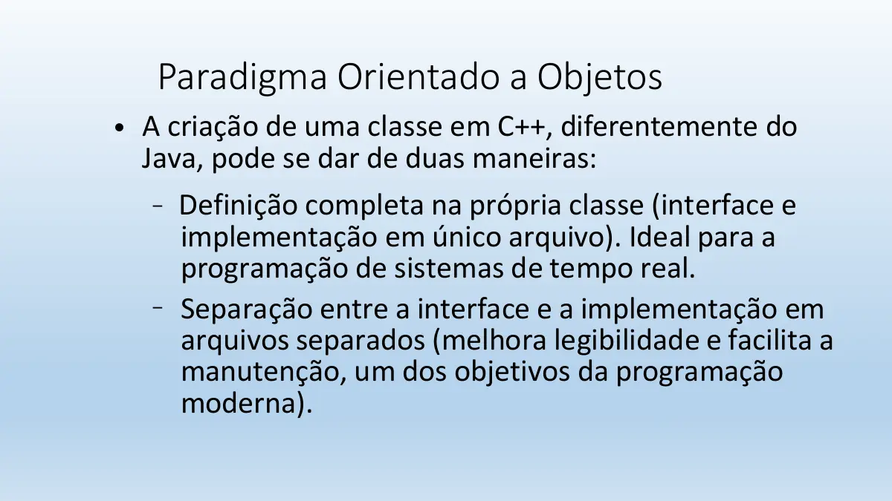

<details>
<summary>Texto da página</summary>

```text
     Paradigma Orientado a Objetos
●   A criação de uma classe em C++, diferentemente do
    Java, pode se dar de duas maneiras:
    – Definição completa na própria classe (interface e
      implementação em único arquivo). Ideal para a
      programação de sistemas de tempo real.
    – Separação entre a interface e a implementação em
      arquivos separados (melhora legibilidade e facilita a
      manutenção, um dos objetivos da programação
      moderna).
```

</details>

<sub>[↑ voltar ao índice](#aula-12---paradigma-orientado-a-objetos-i--slides-originais)</sub>

---

### Página 27

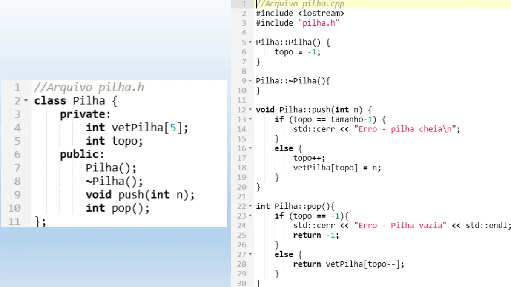

*Página sem texto extraível (só imagem).*

<sub>[↑ voltar ao índice](#aula-12---paradigma-orientado-a-objetos-i--slides-originais)</sub>

---

### Página 28

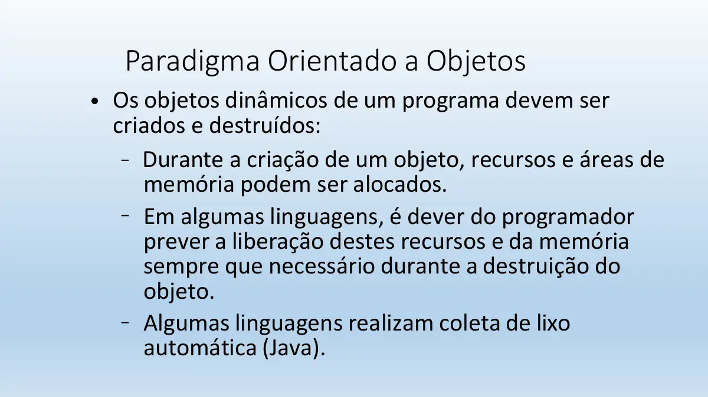

<details>
<summary>Texto da página</summary>

```text
     Paradigma Orientado a Objetos
●   Os objetos dinâmicos de um programa devem ser
    criados e destruídos:
     – Durante a criação de um objeto, recursos e áreas de
       memória podem ser alocados.
     – Em algumas linguagens, é dever do programador
       prever a liberação destes recursos e da memória
       sempre que necessário durante a destruição do
       objeto.
     – Algumas linguagens realizam coleta de lixo
       automática (Java).
```

</details>

<sub>[↑ voltar ao índice](#aula-12---paradigma-orientado-a-objetos-i--slides-originais)</sub>

---

### Página 29

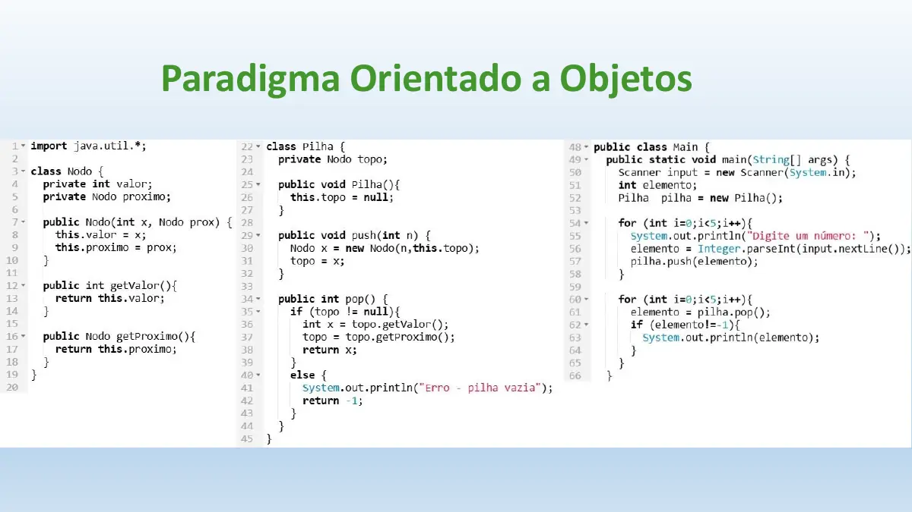

<details>
<summary>Texto da página</summary>

```text
Paradigma Orientado a Objetos
```

</details>

<sub>[↑ voltar ao índice](#aula-12---paradigma-orientado-a-objetos-i--slides-originais)</sub>

---

### Página 30

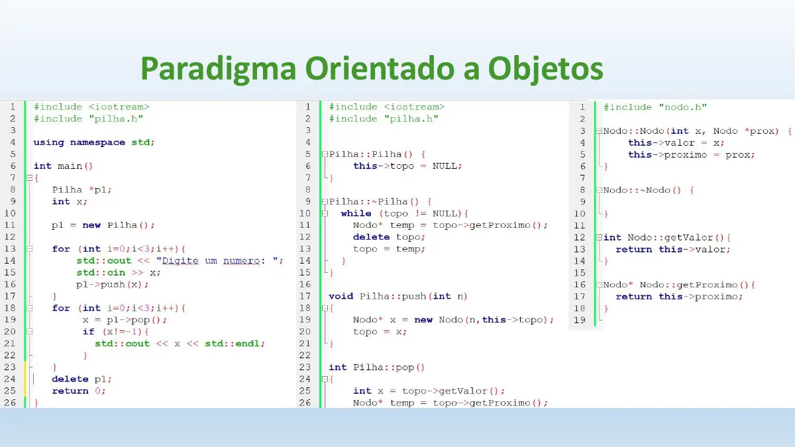

<details>
<summary>Texto da página</summary>

```text
Paradigma Orientado a Objetos
```

</details>

<sub>[↑ voltar ao índice](#aula-12---paradigma-orientado-a-objetos-i--slides-originais)</sub>

---

### Página 31

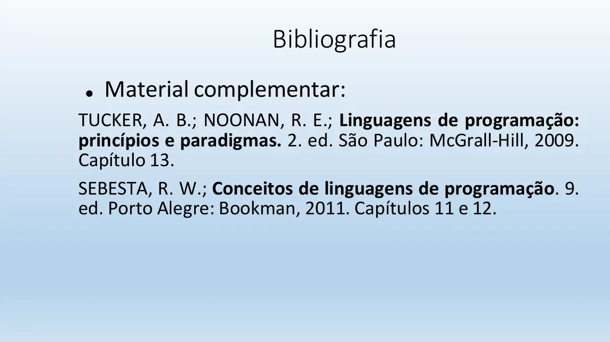

<details>
<summary>Texto da página</summary>

```text
                       Bibliografia
●   Material complementar:
TUCKER, A. B.; NOONAN, R. E.; Linguagens de programação:
princípios e paradigmas. 2. ed. São Paulo: McGrall-Hill, 2009.
Capítulo 13.
SEBESTA, R. W.; Conceitos de linguagens de programação. 9.
ed. Porto Alegre: Bookman, 2011. Capítulos 11 e 12.
```

</details>

<sub>[↑ voltar ao índice](#aula-12---paradigma-orientado-a-objetos-i--slides-originais)</sub>


<!-- nav:rodape -->

---

**Aula 12:** [Visão geral](../README.md) · **Slides** · [Resumo](../02%20-%20Resumo%20Teórico/resumo-aula-12.md) · [Exercícios](../03%20-%20Exercícios/exercicios-aula-12.md) · [Resoluções](../04%20-%20Resoluções/resolucoes-aula-12.md) · [Complementos](../05%20-%20Materiais%20Complementares/materiais-complementares.md)

← [Aula 11 · Slides](../../Aula%2011%20-%20Paradigma%20Imperativo%20III/01%20-%20Slides%20Originais/README.md) · [Aula 13 · Slides](../../Aula%2013%20-%20Paradigma%20Orientado%20a%20Objetos%20II/01%20-%20Slides%20Originais/README.md) →

**Links para esta página (15):** [Aula 07 · Resumo](../../Aula%2007%20-%20Tipos%20Compostos/02%20-%20Resumo%20Teórico/resumo-aula-07.md) · [Aula 07 · Resoluções](../../Aula%2007%20-%20Tipos%20Compostos/04%20-%20Resoluções/resolucoes-aula-07.md) · [Aula 12 · Resumo](../02%20-%20Resumo%20Teórico/resumo-aula-12.md) · [Aula 12 · Exercícios](../03%20-%20Exercícios/exercicios-aula-12.md) · [Aula 12 · Resoluções](../04%20-%20Resoluções/resolucoes-aula-12.md) · [Aula 12 · Complementos](../05%20-%20Materiais%20Complementares/materiais-complementares.md) · [Aula 13 · Resumo](../../Aula%2013%20-%20Paradigma%20Orientado%20a%20Objetos%20II/02%20-%20Resumo%20Teórico/resumo-aula-13.md) · [Aula 13 · Complementos](../../Aula%2013%20-%20Paradigma%20Orientado%20a%20Objetos%20II/05%20-%20Materiais%20Complementares/materiais-complementares.md) · [Lista 02 · Resolução](../../../02%20-%20Listas%20de%20Exercícios/Lista%2002%20-%20Revisão%20II/02%20-%20Resolução/resolucao-lista-02.md) · [Simulado 03 · Resolução comentada](../../../04%20-%20Provas%20e%20Avaliações/Simulados/resolucao-simulado-03.md) · [Erratas e inconsistências do material](../../../06%20-%20Revisões%20e%20Sínteses/erratas-e-inconsistencias.md) · [Quadros comparativos](../../../06%20-%20Revisões%20e%20Sínteses/quadros-comparativos.md) · [Questões integradoras · Resolução comentada](../../../06%20-%20Revisões%20e%20Sínteses/resolucao-questoes-integradoras.md) · [P2 — Estruturas encadeadas em C++: pilha e fila](../../../09%20-%20Projetos%20Práticos/P2%20-%20Estruturas%20Encadeadas%20em%20C++/README.md) · [Exemplo de anotação: pilha encadeada × pilha em vetor](../../../10%20-%20Caderno%20de%20Anotações/exemplo-de-anotacao.md)

<!-- /nav:rodape -->
