<!-- nav:topo -->
[Início](../../../README.md) › [01 - Aulas](../../README.md) › [Aula 13](../README.md) › **01 - Slides Originais** · [Mapa](../../../MAPA.md)
<!-- /nav:topo -->

<!-- gerado por ferramentas/geradores/gerar_galerias.py: não edite à mão -->

# Aula 13 - Paradigma Orientado a Objetos II · Slides originais

> **[Material original]** Slides originais do professor, página por página, para ler aqui mesmo no GitHub. O arquivo original é o PDF [`Aula13_ParadigmaOrientadoObjetos2.pdf`](Aula13_ParadigmaOrientadoObjetos2.pdf) (17 páginas): use-o para baixar ou imprimir. As imagens e o texto de cada página foram extraídos do PDF, sem alteração do conteúdo.

**Ir para a página:** [1](#página-1) · [2](#página-2) · [3](#página-3) · [4](#página-4) · [5](#página-5) · [6](#página-6) · [7](#página-7) · [8](#página-8) · [9](#página-9) · [10](#página-10) · [11](#página-11) · [12](#página-12) · [13](#página-13) · [14](#página-14) · [15](#página-15) · [16](#página-16) · [17](#página-17)

O texto de cada página fica em **Texto da página**, logo abaixo da imagem: é por ele que a busca encontra o conteúdo dos slides.

---

### Página 1

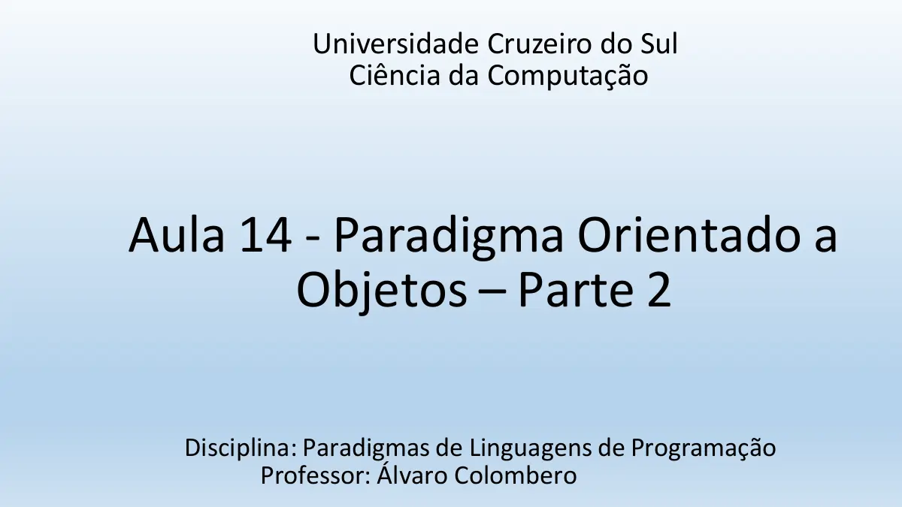

<details>
<summary>Texto da página</summary>

```text
             Universidade Cruzeiro do Sul
               Ciência da Computação

Aula 14 - Paradigma Orientado a
       Objetos – Parte 2

  Disciplina: Paradigmas de Linguagens de Programação
          Professor: Álvaro Colombero
```

</details>

<sub>[↑ voltar ao índice](#aula-13---paradigma-orientado-a-objetos-ii--slides-originais)</sub>

---

### Página 2

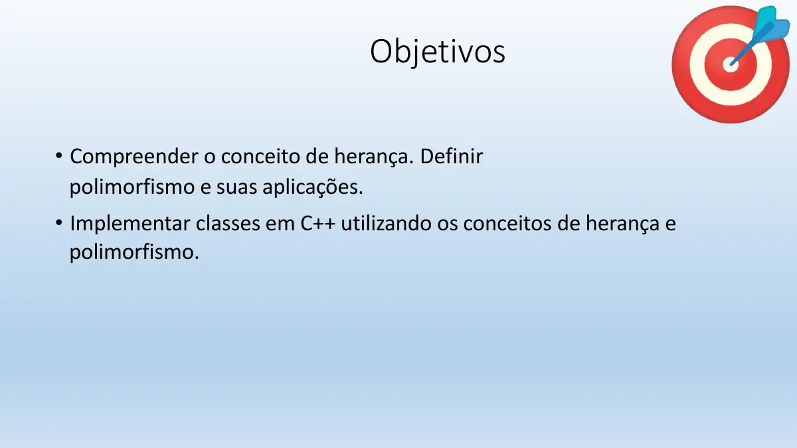

<details>
<summary>Texto da página</summary>

```text
                                Objetivos

• Compreender o conceito de herança. Definir
  polimorfismo e suas aplicações.
• Implementar classes em C++ utilizando os conceitos de herança e
  polimorfismo.
```

</details>

<sub>[↑ voltar ao índice](#aula-13---paradigma-orientado-a-objetos-ii--slides-originais)</sub>

---

### Página 3

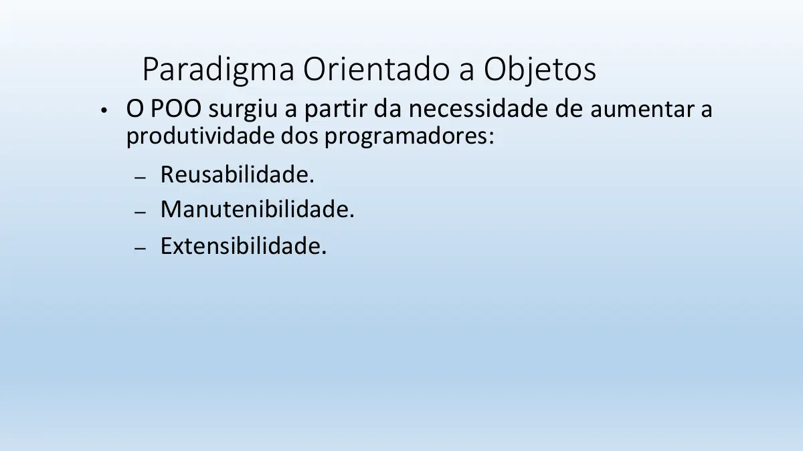

<details>
<summary>Texto da página</summary>

```text
     Paradigma Orientado a Objetos
●   O POO surgiu a partir da necessidade de aumentar a
    produtividade dos programadores:
     – Reusabilidade.
     – Manutenibilidade.
     – Extensibilidade.
```

</details>

<sub>[↑ voltar ao índice](#aula-13---paradigma-orientado-a-objetos-ii--slides-originais)</sub>

---

### Página 4

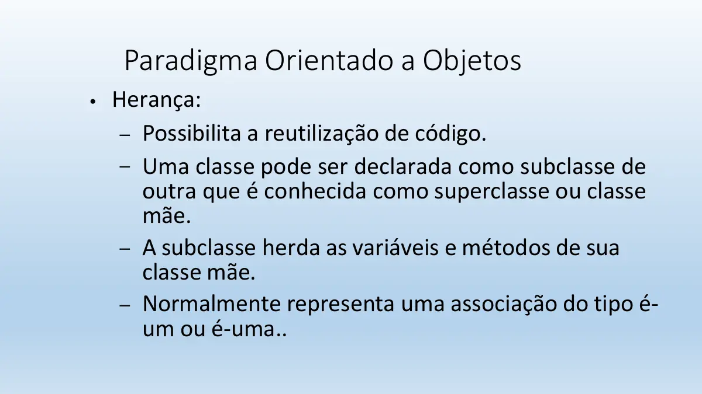

<details>
<summary>Texto da página</summary>

```text
     Paradigma Orientado a Objetos
●   Herança:
    – Possibilita a reutilização de código.
    – Uma classe pode ser declarada como subclasse de
      outra que é conhecida como superclasse ou classe
      mãe.
    – A subclasse herda as variáveis e métodos de sua
      classe mãe.
    – Normalmente representa uma associação do tipo é-
      um ou é-uma..
```

</details>

<sub>[↑ voltar ao índice](#aula-13---paradigma-orientado-a-objetos-ii--slides-originais)</sub>

---

### Página 5

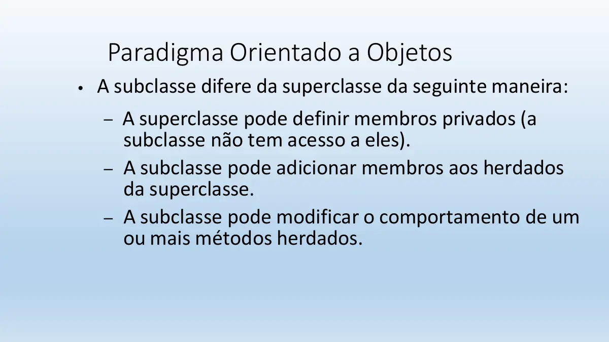

<details>
<summary>Texto da página</summary>

```text
     Paradigma Orientado a Objetos
●   A subclasse difere da superclasse da seguinte maneira:
    – A superclasse pode definir membros privados (a
      subclasse não tem acesso a eles).
    – A subclasse pode adicionar membros aos herdados
      da superclasse.
    – A subclasse pode modificar o comportamento de um
      ou mais métodos herdados.
```

</details>

<sub>[↑ voltar ao índice](#aula-13---paradigma-orientado-a-objetos-ii--slides-originais)</sub>

---

### Página 6

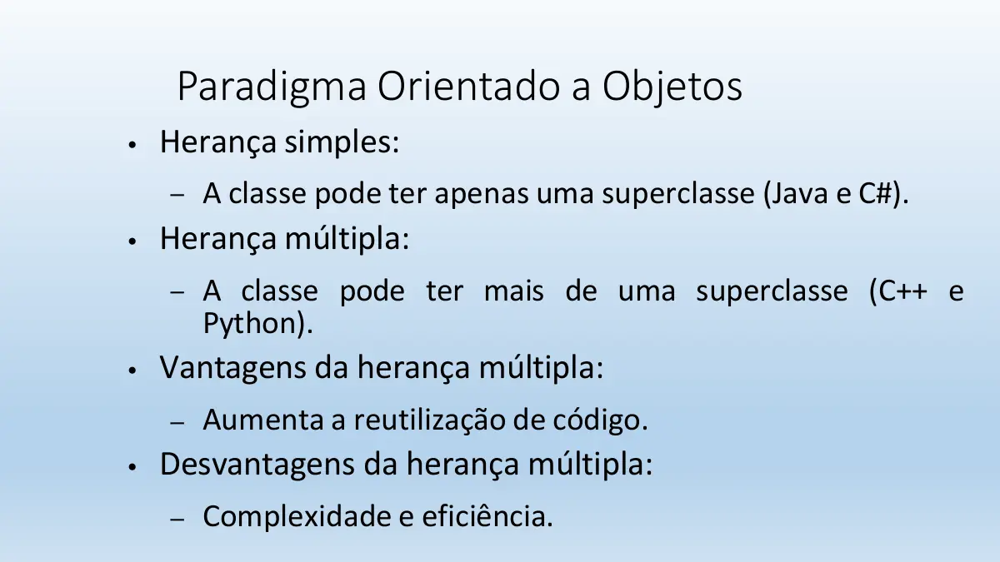

<details>
<summary>Texto da página</summary>

```text
     Paradigma Orientado a Objetos
●   Herança simples:
    –   A classe pode ter apenas uma superclasse (Java e C#).
●   Herança múltipla:
    –   A classe pode ter mais de uma superclasse (C++ e
        Python).
●   Vantagens da herança múltipla:
    –   Aumenta a reutilização de código.
●   Desvantagens da herança múltipla:
    –   Complexidade e eficiência.
```

</details>

<sub>[↑ voltar ao índice](#aula-13---paradigma-orientado-a-objetos-ii--slides-originais)</sub>

---

### Página 7

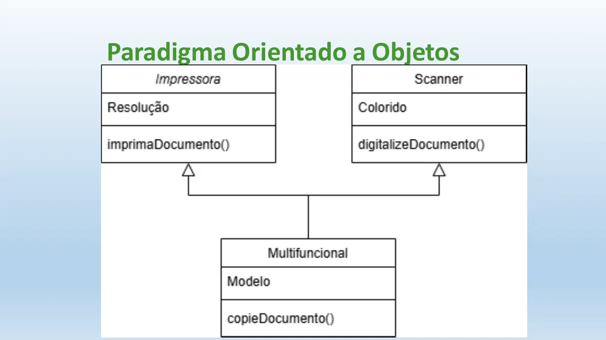

<details>
<summary>Texto da página</summary>

```text
Paradigma Orientado a Objetos
```

</details>

<sub>[↑ voltar ao índice](#aula-13---paradigma-orientado-a-objetos-ii--slides-originais)</sub>

---

### Página 8

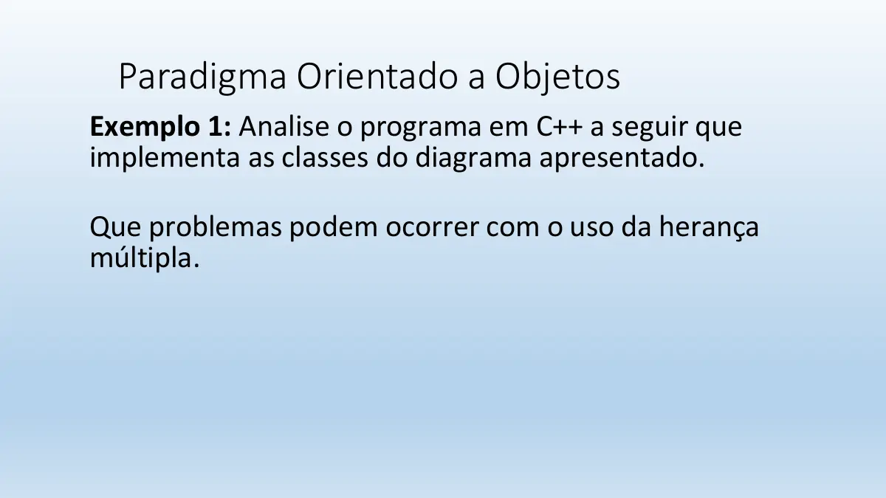

<details>
<summary>Texto da página</summary>

```text
  Paradigma Orientado a Objetos
Exemplo 1: Analise o programa em C++ a seguir que
implementa as classes do diagrama apresentado.

Que problemas podem ocorrer com o uso da herança
múltipla.
```

</details>

<sub>[↑ voltar ao índice](#aula-13---paradigma-orientado-a-objetos-ii--slides-originais)</sub>

---

### Página 9

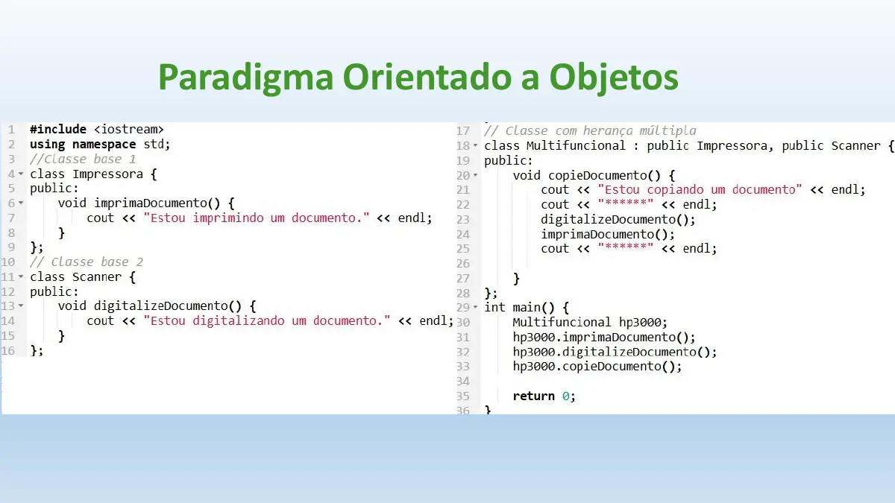

<details>
<summary>Texto da página</summary>

```text
Paradigma Orientado a Objetos
```

</details>

<sub>[↑ voltar ao índice](#aula-13---paradigma-orientado-a-objetos-ii--slides-originais)</sub>

---

### Página 10

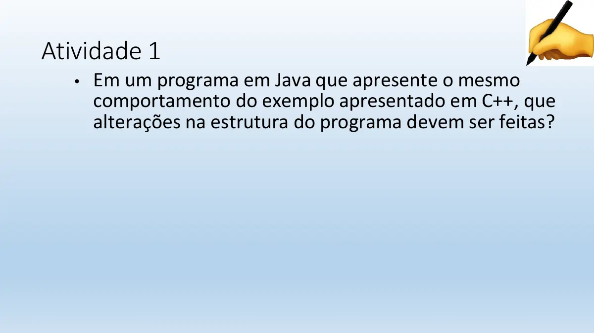

<details>
<summary>Texto da página</summary>

```text
Atividade 1
  ●   Em um programa em Java que apresente o mesmo
      comportamento do exemplo apresentado em C++, que
      alterações na estrutura do programa devem ser feitas?
```

</details>

<sub>[↑ voltar ao índice](#aula-13---paradigma-orientado-a-objetos-ii--slides-originais)</sub>

---

### Página 11

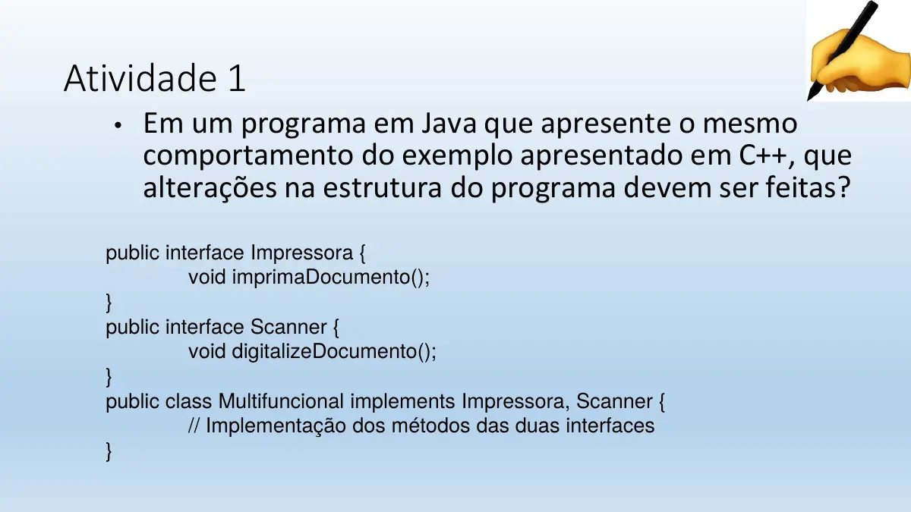

<details>
<summary>Texto da página</summary>

```text
Atividade 1
  ●   Em um programa em Java que apresente o mesmo
      comportamento do exemplo apresentado em C++, que
      alterações na estrutura do programa devem ser feitas?
  public interface Impressora {
            void imprimaDocumento();
  }
  public interface Scanner {
            void digitalizeDocumento();
  }
  public class Multifuncional implements Impressora, Scanner {
            // Implementação dos métodos das duas interfaces
  }
```

</details>

<sub>[↑ voltar ao índice](#aula-13---paradigma-orientado-a-objetos-ii--slides-originais)</sub>

---

### Página 12

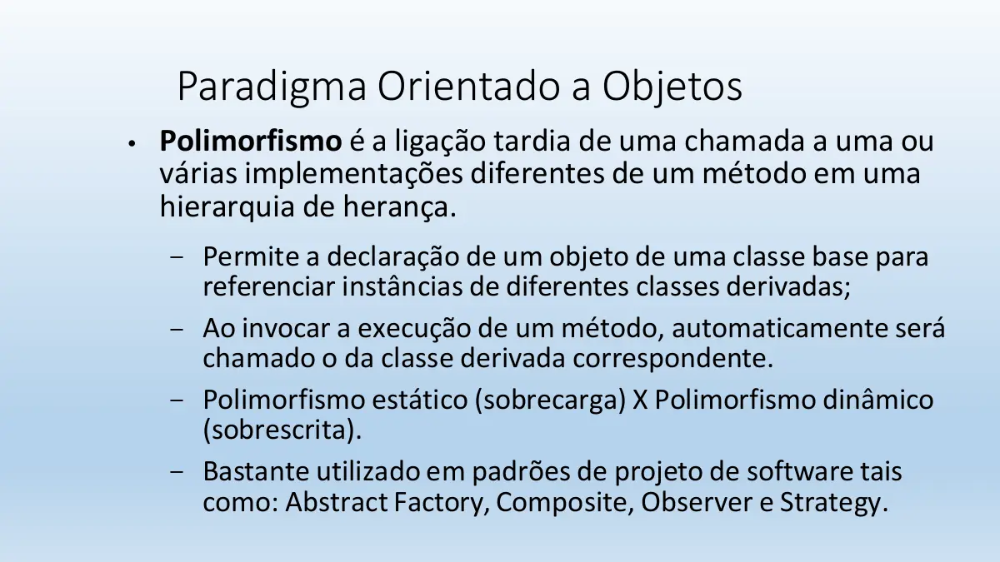

<details>
<summary>Texto da página</summary>

```text
     Paradigma Orientado a Objetos
●   Polimorfismo é a ligação tardia de uma chamada a uma ou
    várias implementações diferentes de um método em uma
    hierarquia de herança.
    – Permite a declaração de um objeto de uma classe base para
      referenciar instâncias de diferentes classes derivadas;
    – Ao invocar a execução de um método, automaticamente será
      chamado o da classe derivada correspondente.
    – Polimorfismo estático (sobrecarga) X Polimorfismo dinâmico
      (sobrescrita).
    – Bastante utilizado em padrões de projeto de software tais
      como: Abstract Factory, Composite, Observer e Strategy.
```

</details>

<sub>[↑ voltar ao índice](#aula-13---paradigma-orientado-a-objetos-ii--slides-originais)</sub>

---

### Página 13

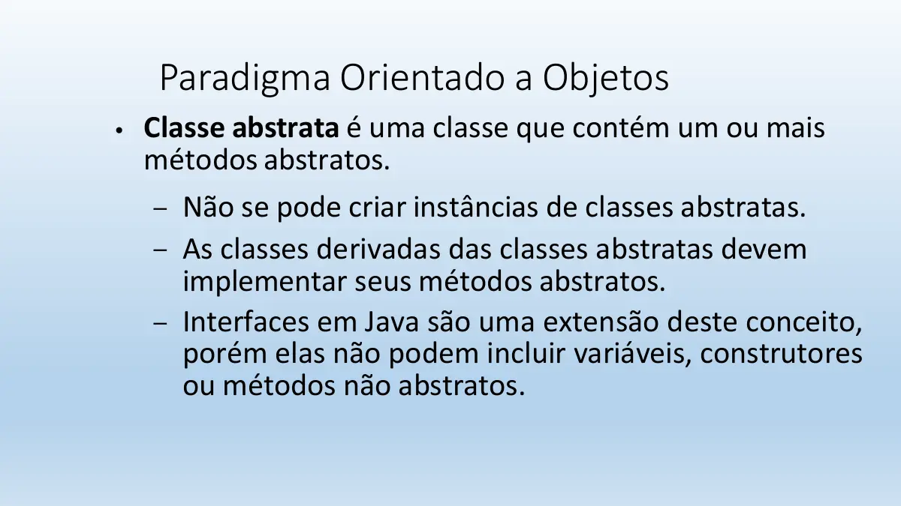

<details>
<summary>Texto da página</summary>

```text
     Paradigma Orientado a Objetos
●   Classe abstrata é uma classe que contém um ou mais
    métodos abstratos.
     – Não se pode criar instâncias de classes abstratas.
     – As classes derivadas das classes abstratas devem
       implementar seus métodos abstratos.
     – Interfaces em Java são uma extensão deste conceito,
       porém elas não podem incluir variáveis, construtores
       ou métodos não abstratos.
```

</details>

<sub>[↑ voltar ao índice](#aula-13---paradigma-orientado-a-objetos-ii--slides-originais)</sub>

---

### Página 14

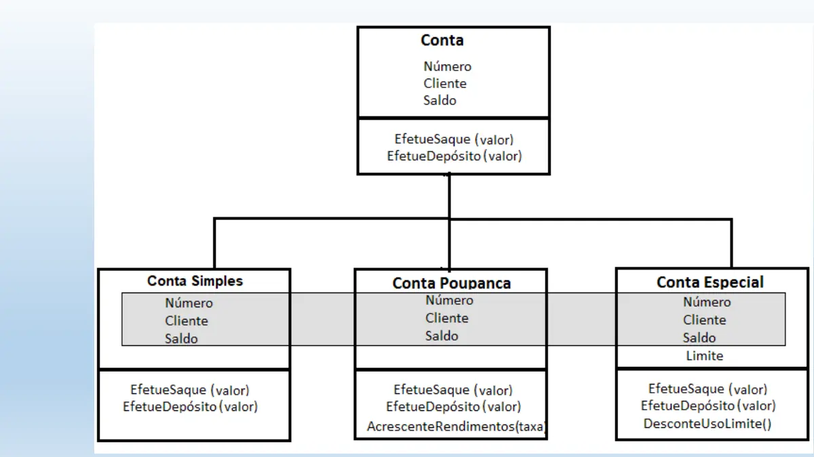

<details>
<summary>Texto da página</summary>

```text
Paradigma Orientado a Objetos
```

</details>

<sub>[↑ voltar ao índice](#aula-13---paradigma-orientado-a-objetos-ii--slides-originais)</sub>

---

### Página 15

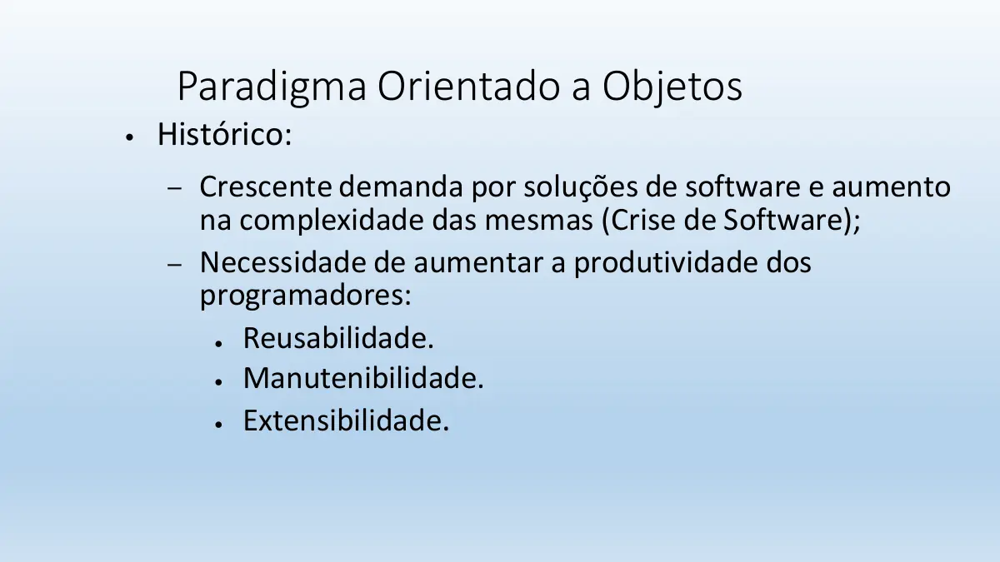

<details>
<summary>Texto da página</summary>

```text
     Paradigma Orientado a Objetos
●   Histórico:
    – Crescente demanda por soluções de software e aumento
      na complexidade das mesmas (Crise de Software);
    – Necessidade de aumentar a produtividade dos
      programadores:
       ● Reusabilidade.

       ● Manutenibilidade.

       ● Extensibilidade.
```

</details>

<sub>[↑ voltar ao índice](#aula-13---paradigma-orientado-a-objetos-ii--slides-originais)</sub>

---

### Página 16

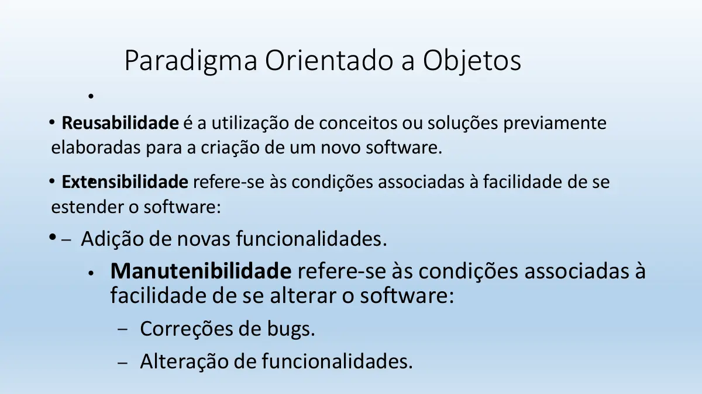

<details>
<summary>Texto da página</summary>

```text
         Paradigma Orientado a Objetos
    ●

• Reusabilidade é a utilização de conceitos ou soluções previamente
elaboradas para a criação de um novo software.
• Extensibilidade
     ●            refere-se às condições associadas à facilidade de se
estender o software:
• – Adição de novas funcionalidades.
     ● Manutenibilidade refere-se às condições associadas à

       facilidade de se alterar o software:
        – Correções de bugs.
        – Alteração de funcionalidades.
```

</details>

<sub>[↑ voltar ao índice](#aula-13---paradigma-orientado-a-objetos-ii--slides-originais)</sub>

---

### Página 17

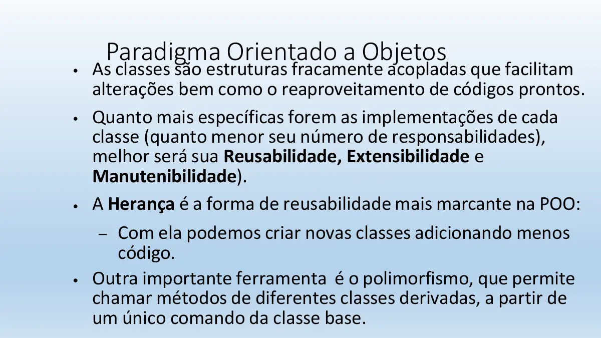

<details>
<summary>Texto da página</summary>

```text
     Paradigma Orientado a Objetos
●   As classes são estruturas fracamente acopladas que facilitam
    alterações bem como o reaproveitamento de códigos prontos.
●   Quanto mais específicas forem as implementações de cada
    classe (quanto menor seu número de responsabilidades),
    melhor será sua Reusabilidade, Extensibilidade e
    Manutenibilidade).
●   A Herança é a forma de reusabilidade mais marcante na POO:
     – Com ela podemos criar novas classes adicionando menos
        código.
●   Outra importante ferramenta é o polimorfismo, que permite
    chamar métodos de diferentes classes derivadas, a partir de
    um único comando da classe base.
```

</details>

<sub>[↑ voltar ao índice](#aula-13---paradigma-orientado-a-objetos-ii--slides-originais)</sub>


<!-- nav:rodape -->

---

**Aula 13:** [Visão geral](../README.md) · **Slides** · [Resumo](../02%20-%20Resumo%20Teórico/resumo-aula-13.md) · [Exercícios](../03%20-%20Exercícios/exercicios-aula-13.md) · [Resoluções](../04%20-%20Resoluções/resolucoes-aula-13.md) · [Complementos](../05%20-%20Materiais%20Complementares/materiais-complementares.md)

← [Aula 12 · Slides](../../Aula%2012%20-%20Paradigma%20Orientado%20a%20Objetos%20I/01%20-%20Slides%20Originais/README.md) · [Aula 14 · Slides](../../Aula%2014%20-%20Paradigma%20Funcional/01%20-%20Slides%20Originais/README.md) →

**Links para esta página (11):** [Acompanhamento de estudo](../../../00%20-%20Planejamento%20e%20Organização/acompanhamento.md) · [Aula 13 · Resumo](../02%20-%20Resumo%20Teórico/resumo-aula-13.md) · [Aula 13 · Exercícios](../03%20-%20Exercícios/exercicios-aula-13.md) · [Aula 13 · Resoluções](../04%20-%20Resoluções/resolucoes-aula-13.md) · [Aula 13 · Complementos](../05%20-%20Materiais%20Complementares/materiais-complementares.md) · [Lista 02 · Resolução](../../../02%20-%20Listas%20de%20Exercícios/Lista%2002%20-%20Revisão%20II/02%20-%20Resolução/resolucao-lista-02.md) · [Simulado 03 · Resolução comentada](../../../04%20-%20Provas%20e%20Avaliações/Simulados/resolucao-simulado-03.md) · [Erratas e inconsistências do material](../../../06%20-%20Revisões%20e%20Sínteses/erratas-e-inconsistencias.md) · [Quadros comparativos](../../../06%20-%20Revisões%20e%20Sínteses/quadros-comparativos.md) · [Questões integradoras · Resolução comentada](../../../06%20-%20Revisões%20e%20Sínteses/resolucao-questoes-integradoras.md) · [P3 — Acervo da biblioteca em Java](../../../09%20-%20Projetos%20Práticos/P3%20-%20Acervo%20da%20Biblioteca%20em%20Java/README.md)

<!-- /nav:rodape -->
