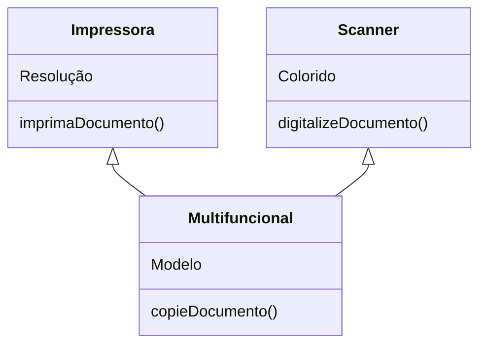

# Aula 13 — Paradigma Orientado a Objetos II · Resumo teórico

> **Fonte:** [`Aula13_ParadigmaOrientadoObjetos2.pdf`](../01%20-%20Slides%20Originais/Aula13_ParadigmaOrientadoObjetos2.pdf) (17 páginas). Título interno: "Aula 14 – Paradigma Orientado a Objetos – Parte 2". A aula não tem slide de bibliografia; as referências da Aula 12 (Sebesta, cap. 12; Tucker & Noonan, cap. 13) cobrem o tema.
> **Legenda:** ver [Convenções](../../../README.md#convenções-de-marcação). `p.N` = página do PDF. Os códigos C++ e Java foram compilados e executados.

---

## 1. Objetivos (p.2)

**[Material original]** Compreender o conceito de herança; definir polimorfismo e suas aplicações; implementar classes em C++ usando herança e polimorfismo.

## 2. Herança (p.3–6)

**[Material original]**

- A POO surgiu da necessidade de aumentar a produtividade: **reusabilidade, manutenibilidade e extensibilidade** (p.3).
- **Herança** possibilita a **reutilização de código**.
- Uma classe pode ser declarada **subclasse** de outra, a **superclasse** ou **classe mãe**.
- A subclasse **herda as variáveis e os métodos** da mãe.
- Normalmente representa uma associação do tipo **"é-um"** ou **"é-uma"**.

**Como a subclasse difere da superclasse (p.5):**

1. A superclasse pode definir **membros privados**, aos quais a subclasse **não tem acesso**.
2. A subclasse pode **adicionar membros** aos herdados.
3. A subclasse pode **modificar o comportamento** de um ou mais métodos herdados.

**Simples × múltipla (p.6):**

| | Herança simples | Herança múltipla |
| --- | --- | --- |
| Definição | A classe tem **uma** superclasse | A classe tem **mais de uma** superclasse |
| Linguagens (slide) | Java, C# | C++, Python |
| Vantagem | — | **Aumenta a reutilização** de código |
| Desvantagem | — | **Complexidade e eficiência** |

**[Explicação elaborada] — o teste do "é-um":** "Conta Poupança **é uma** Conta" faz sentido, então herança é adequada. "Carro **é um** Motor" não faz: um carro **tem** um motor, o que é composição (um atributo do tipo `Motor`), não herança. Na pilha encadeada da Aula 12, `Pilha` **tem** um `Nodo topo` — composição.

## 3. Exemplo: impressora multifuncional (p.7–9)

**[Material original]** Diagrama UML (p.7): `Impressora` (atributo Resolução; método `imprimaDocumento()`) e `Scanner` (atributo Colorido; método `digitalizeDocumento()`) são superclasses de `Multifuncional` (atributo Modelo; método `copieDocumento()`).



**Implementação em C++ (p.9):**

<!-- teste: saida-contem="Estou imprimindo um documento.\nEstou digitalizando um documento.\nEstou copiando um documento\n******\nEstou digitalizando um documento.\nEstou imprimindo um documento.\n******" -->
```cpp
#include <iostream>
using namespace std;

// Classe base 1
class Impressora {
public:
    void imprimaDocumento() {
        cout << "Estou imprimindo um documento." << endl;
    }
};

// Classe base 2
class Scanner {
public:
    void digitalizeDocumento() {
        cout << "Estou digitalizando um documento." << endl;
    }
};

// Classe com herança múltipla
class Multifuncional : public Impressora, public Scanner {
public:
    void copieDocumento() {
        cout << "Estou copiando um documento" << endl;
        cout << "******" << endl;
        digitalizeDocumento();      // herdado de Scanner
        imprimaDocumento();         // herdado de Impressora
        cout << "******" << endl;
    }
};

int main() {
    Multifuncional hp3000;
    hp3000.imprimaDocumento();
    hp3000.digitalizeDocumento();
    hp3000.copieDocumento();
    return 0;
}
```

**[Explicação elaborada]** `Multifuncional` não escreveu `imprimaDocumento` nem `digitalizeDocumento`: herdou os dois e os **reutilizou** para compor `copieDocumento` — o máximo de reuso com o mínimo de código.

**Pergunta do professor (p.8): "Que problemas podem ocorrer com o uso da herança múltipla?"** O slide só cita "complexidade e eficiência". **[Complemento]** Os problemas clássicos:

1. **Conflito de nomes:** se `Impressora` e `Scanner` tivessem, por exemplo, um método `ligar()`, `hp3000.ligar()` seria **ambíguo**. O compilador C++ recusa a chamada, e é preciso escrever `hp3000.Impressora::ligar()`.
2. **Problema do diamante:** se `Impressora` e `Scanner` herdassem de uma mesma classe `Equipamento`, `Multifuncional` teria **duas cópias** dos atributos de `Equipamento`. C++ resolve com herança `virtual`.
3. Hierarquias mais difíceis de entender e manter.

> **[Atenção]** Os atributos do diagrama (Resolução, Colorido, Modelo) **não aparecem** no código C++.

## 4. Atividade: o mesmo em Java (p.10–11)

**[Material original]** "Em um programa em Java que apresente o mesmo comportamento do exemplo em C++, que alterações na estrutura do programa devem ser feitas?" Resposta do professor (p.11):

```java
public interface Impressora {
    void imprimaDocumento();
}
public interface Scanner {
    void digitalizeDocumento();
}
public class Multifuncional implements Impressora, Scanner {
    // Implementação dos métodos das duas interfaces
}
```

**[Explicação elaborada]** Java não tem herança múltipla de **classes**, mas uma classe pode **implementar várias interfaces**. A alteração estrutural é transformar as duas superclasses em interfaces. O custo é que `Multifuncional` herda só o **contrato** (os nomes dos métodos) e precisa **escrever as implementações** — perde-se parte do reuso. Programa completo e testado em [resolucoes-aula-13.md](../04%20-%20Resoluções/resolucoes-aula-13.md#e8--atividade-1-original-p1011).

> **[Complemento]** Desde o Java 8, interfaces podem ter métodos `default`, com corpo, o que recupera parte do reuso. Cuidado também com o nome `Scanner`, que colide com `java.util.Scanner` se esse pacote for importado.

## 5. Polimorfismo (p.12)

**[Material original]**

- "Polimorfismo é a **ligação tardia** de uma chamada a uma ou várias implementações diferentes de um método em uma hierarquia de herança."
- Permite declarar um objeto de uma **classe base** para referenciar instâncias de **diferentes classes derivadas**.
- Ao invocar um método, **automaticamente é chamado o da classe derivada** correspondente.
- **Polimorfismo estático (sobrecarga) × polimorfismo dinâmico (sobrescrita).**
- Muito usado em **padrões de projeto**: Abstract Factory, Composite, Observer e Strategy.

**[Explicação elaborada]**

| | Sobrecarga (*overloading*) — estático | Sobrescrita (*overriding*) — dinâmico |
| --- | --- | --- |
| O que é | Mesmo nome, **parâmetros diferentes**, na mesma classe | Mesma assinatura, **redefinida na subclasse** |
| Quem decide qual versão roda | O **compilador**, pelos tipos dos argumentos | A **execução**, pelo tipo **real** do objeto |
| Exemplo | `soma(int, int)` e `soma(double, double)`; o `+` da Aula 06 | `Conta.efetueSaque` redefinido em `ContaEspecial` |
| Precisa de herança? | Não | Sim |

"Ligação tardia" (*late binding*) significa decidir **em tempo de execução** qual código executar.

## 6. Classe abstrata e interface (p.13)

**[Material original]**

- **Classe abstrata** é uma classe que contém um ou mais **métodos abstratos** (sem implementação).
- **Não se pode criar instâncias** de classes abstratas.
- As classes derivadas **devem implementar** os métodos abstratos.
- **Interfaces em Java** são uma extensão desse conceito, mas **não podem incluir variáveis, construtores ou métodos não abstratos**.

> **[Atenção]** Essa é a definição **clássica** (até o Java 7). Desde o Java 8, interfaces podem ter métodos `default` e `static`, com corpo, e desde o Java 9, métodos `private`. Interfaces sempre puderam ter **constantes** (`public static final`). Continua valendo que interfaces não têm variáveis de instância nem construtores.

| | Classe abstrata | Interface (Java) |
| --- | --- | --- |
| Instanciável? | Não | Não |
| Atributos de instância | Sim | Não (só constantes) |
| Construtores | Sim | Não |
| Métodos concretos | Sim | Só `default`/`static` (Java 8+) |
| Quantas uma classe pode ter | Herda de **uma** | Implementa **várias** |

## 7. Hierarquia de contas (p.14)

**[Material original]** Diagrama:

- **`Conta`** (Número, Cliente, Saldo; `EfetueSaque(valor)`, `EfetueDepósito(valor)`) é a base.
- **`Conta Simples`** herda tudo e não acrescenta nada.
- **`Conta Poupança`** acrescenta `AcrescenteRendimentos(taxa)`.
- **`Conta Especial`** acrescenta o atributo `Limite` e o método `DesconteUsoLimite()`.
- A faixa cinza destaca os atributos **herdados** (Número, Cliente, Saldo) em cada subclasse.

**[Explicação elaborada] — herança e polimorfismo juntos (código testado):**

<!-- teste: saida-contem="Simples: saque negado|Especial: saque de 150.0 realizado|Saldos: 100.0 | -50.0 | 102.0" -->
```java
import java.util.List;

abstract class Conta {
    protected int numero;
    protected String cliente;
    protected double saldo;

    Conta(int numero, String cliente, double saldo) {
        this.numero = numero; this.cliente = cliente; this.saldo = saldo;
    }

    void efetueDeposito(double valor) { saldo += valor; }

    boolean efetueSaque(double valor) {           // regra padrão: não pode ficar negativo
        if (valor > saldo) return false;
        saldo -= valor;
        return true;
    }

    abstract String tipo();                       // cada subclasse DEVE implementar
}

class ContaSimples extends Conta {
    ContaSimples(int n, String c, double s) { super(n, c, s); }
    String tipo() { return "Simples"; }
}

class ContaPoupanca extends Conta {
    ContaPoupanca(int n, String c, double s) { super(n, c, s); }
    void acrescenteRendimentos(double taxa) { saldo += saldo * taxa; }   // membro ADICIONADO
    String tipo() { return "Poupanca"; }
}

class ContaEspecial extends Conta {
    private double limite;                                              // atributo ADICIONADO
    ContaEspecial(int n, String c, double s, double limite) { super(n, c, s); this.limite = limite; }

    @Override
    boolean efetueSaque(double valor) {           // comportamento MODIFICADO (sobrescrita)
        if (valor > saldo + limite) return false;
        saldo -= valor;
        return true;
    }
    String tipo() { return "Especial"; }
}

public class Main {
    public static void main(String[] args) {
        ContaPoupanca poup = new ContaPoupanca(3, "Caio", 100);
        List<Conta> contas = List.of(new ContaSimples(1, "Ana", 100),
                                     new ContaEspecial(2, "Bia", 100, 200),
                                     poup);
        for (Conta c : contas) {                  // referência do tipo BASE
            if (c instanceof ContaPoupanca) continue;
            boolean ok = c.efetueSaque(150);       // LIGAÇÃO TARDIA: qual efetueSaque roda?
            System.out.println(c.tipo() + ": " + (ok ? "saque de 150.0 realizado" : "saque negado"));
        }
        poup.acrescenteRendimentos(0.02);
        System.out.println("Saldos: " + contas.get(0).saldo + " | " + contas.get(1).saldo + " | " + poup.saldo);
    }
}
```

- `c.efetueSaque(150)` é **um único comando** escrito para o tipo `Conta`. Para a `ContaSimples`, roda a versão da base (negado: 150 > 100). Para a `ContaEspecial`, roda a versão **sobrescrita** (aceito: 150 ≤ 100 + 200). Essa é a "ligação tardia" da p.12.
- `ContaPoupanca` **adiciona** um método; `ContaEspecial` **adiciona** um atributo e **modifica** um método — as diferenças da p.5.
- `Conta` é **abstrata** (não faz sentido uma conta "genérica") e obriga cada subclasse a implementar `tipo()`.

## 8. Fechamento (p.15–17)

**[Material original]** Repete a motivação (Crise de Software; reusabilidade, extensibilidade, manutenibilidade) e conclui:

- As classes são **estruturas fracamente acopladas**, que facilitam alterações e o reaproveitamento de código.
- Quanto **mais específicas** as implementações de cada classe (**quanto menos responsabilidades**), melhor sua reusabilidade, extensibilidade e manutenibilidade.
- A **herança** é a forma de reusabilidade **mais marcante** na POO: com ela, criam-se novas classes **adicionando menos código**.
- O **polimorfismo** permite chamar métodos de diferentes classes derivadas a partir de **um único comando da classe base**.

**[Explicação elaborada]** "Menos responsabilidades" é a **alta coesão**, e "fracamente acopladas", o **baixo acoplamento** — exatamente o que a abstração procedural não favorecia ([Aula 10, p.16](../../Aula%2010%20-%20Paradigma%20Imperativo%20II/02%20-%20Resumo%20Teórico/resumo-aula-10.md#6-limitações-acoplamento-e-coesão-p16)).

## 9. Conexões e pontos para a prova

- Os três recursos da POO (Aula 12, p.6): TDA (Aula 12), **herança** e **polimorfismo** (esta aula).
- A sobrecarga de operadores da [Aula 06](../../Aula%2006%20-%20Sistema%20de%20Tipos/02%20-%20Resumo%20Teórico/resumo-aula-06.md#8-sobrecarga-de-operadores-p25) é polimorfismo **estático**.
- Cobrado na [Lista 02, Q11](../../../02%20-%20Listas%20de%20Exercícios/Lista%2002%20-%20Revisão%20II/02%20-%20Resolução/resolucao-lista-02.md#q11).
- **Decorar:** as 3 diferenças entre subclasse e superclasse; simples × múltipla (linguagens, vantagem, desvantagem); a solução Java por interfaces; sobrecarga × sobrescrita; classe abstrata × interface.

---

**Anterior:** [Aula 12](../../Aula%2012%20-%20Paradigma%20Orientado%20a%20Objetos%20I/02%20-%20Resumo%20Teórico/resumo-aula-12.md) · **Próxima:** [Aula 14 — Paradigma Funcional](../../Aula%2014%20-%20Paradigma%20Funcional/02%20-%20Resumo%20Teórico/resumo-aula-14.md)
