<!-- nav:topo -->
[Início](../../../README.md) › [01 - Aulas](../../README.md) › [Aula 14](../README.md) › **01 - Slides Originais** · [Mapa](../../../MAPA.md)
<!-- /nav:topo -->

<!-- gerado por ferramentas/geradores/gerar_galerias.py: não edite à mão -->

# Aula 14 - Paradigma Funcional · Slides originais

> **[Material original]** Slides originais do professor, página por página, para ler aqui mesmo no GitHub. O arquivo original é o PDF [`Aula14_ParadigmaFuncional.pdf`](Aula14_ParadigmaFuncional.pdf) (24 páginas): use-o para baixar ou imprimir. As imagens e o texto de cada página foram extraídos do PDF, sem alteração do conteúdo.

**Ir para a página:** [1](#página-1) · [2](#página-2) · [3](#página-3) · [4](#página-4) · [5](#página-5) · [6](#página-6) · [7](#página-7) · [8](#página-8) · [9](#página-9) · [10](#página-10) · [11](#página-11) · [12](#página-12) · [13](#página-13) · [14](#página-14) · [15](#página-15) · [16](#página-16) · [17](#página-17) · [18](#página-18) · [19](#página-19) · [20](#página-20) · [21](#página-21) · [22](#página-22) · [23](#página-23) · [24](#página-24)

O texto de cada página fica em **Texto da página**, logo abaixo da imagem: é por ele que a busca encontra o conteúdo dos slides.

---

### Página 1

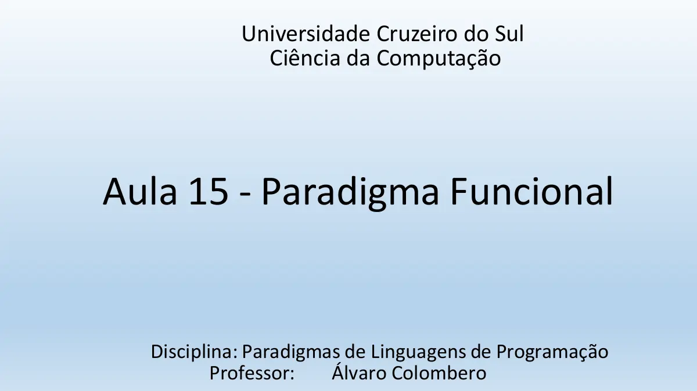

<details>
<summary>Texto da página</summary>

```text
            Universidade Cruzeiro do Sul
              Ciência da Computação

Aula 15 - Paradigma Funcional

  Disciplina: Paradigmas de Linguagens de Programação
          Professor:   Álvaro Colombero
```

</details>

<sub>[↑ voltar ao índice](#aula-14---paradigma-funcional--slides-originais)</sub>

---

### Página 2

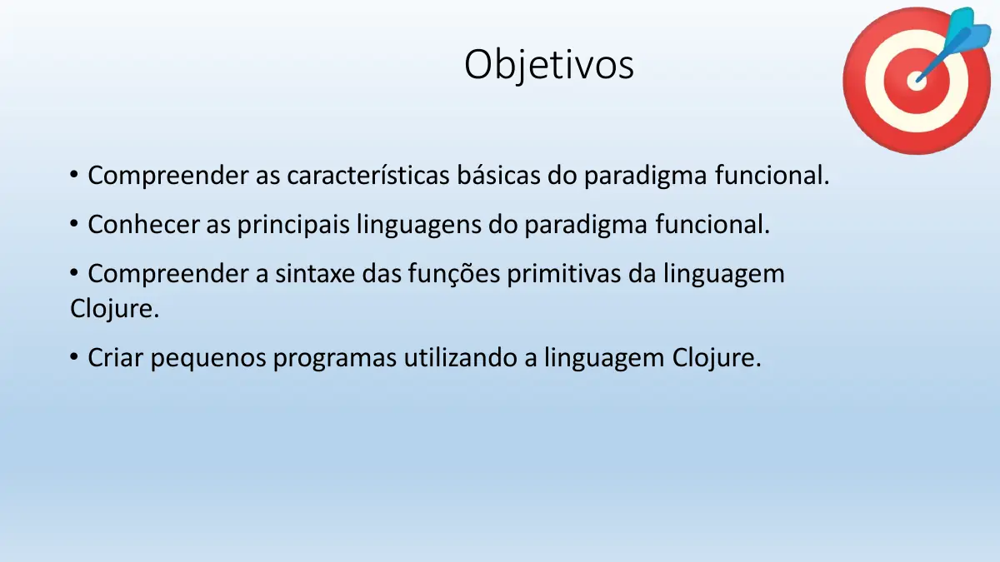

<details>
<summary>Texto da página</summary>

```text
                                 Objetivos

• Compreender as características básicas do paradigma funcional.
• Conhecer as principais linguagens do paradigma funcional.
• Compreender a sintaxe das funções primitivas da linguagem
Clojure.
• Criar pequenos programas utilizando a linguagem Clojure.
```

</details>

<sub>[↑ voltar ao índice](#aula-14---paradigma-funcional--slides-originais)</sub>

---

### Página 3

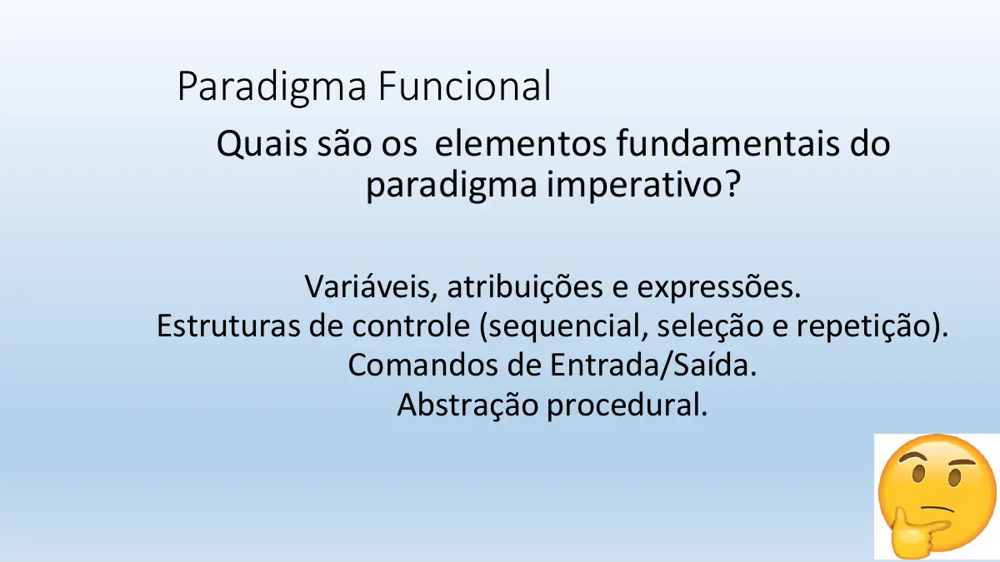

<details>
<summary>Texto da página</summary>

```text
 Paradigma Funcional
    Quais são os elementos fundamentais do
             paradigma imperativo?

          Variáveis, atribuições e expressões.
Estruturas de controle (sequencial, seleção e repetição).
             Comandos de Entrada/Saída.
                 Abstração procedural.
```

</details>

<sub>[↑ voltar ao índice](#aula-14---paradigma-funcional--slides-originais)</sub>

---

### Página 4

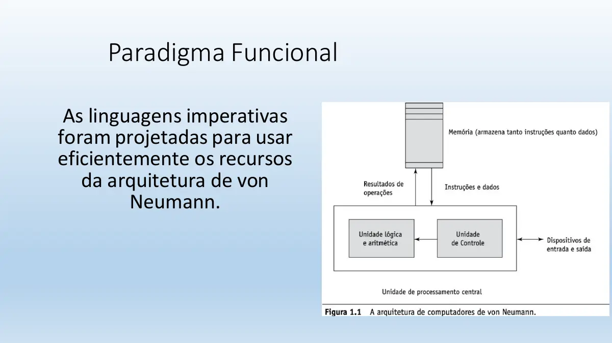

<details>
<summary>Texto da página</summary>

```text
     Paradigma Funcional

 As linguagens imperativas
foram projetadas para usar
eficientemente os recursos
   da arquitetura de von
         Neumann.
```

</details>

<sub>[↑ voltar ao índice](#aula-14---paradigma-funcional--slides-originais)</sub>

---

### Página 5

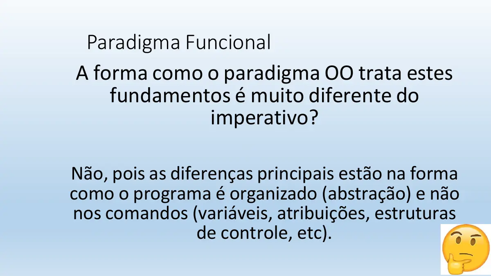

<details>
<summary>Texto da página</summary>

```text
 Paradigma Funcional
A forma como o paradigma OO trata estes
    fundamentos é muito diferente do
             imperativo?

Não, pois as diferenças principais estão na forma
como o programa é organizado (abstração) e não
nos comandos (variáveis, atribuições, estruturas
                 de controle, etc).
```

</details>

<sub>[↑ voltar ao índice](#aula-14---paradigma-funcional--slides-originais)</sub>

---

### Página 6

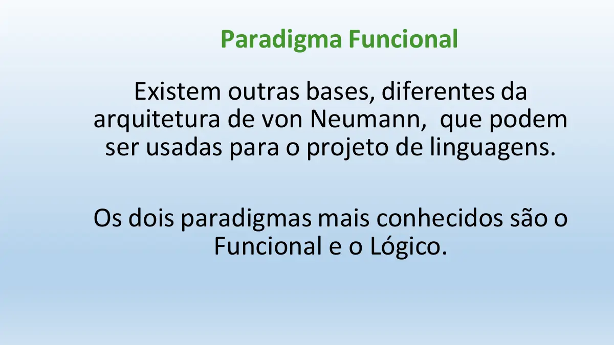

<details>
<summary>Texto da página</summary>

```text
          Paradigma Funcional
   Existem outras bases, diferentes da
arquitetura de von Neumann, que podem
 ser usadas para o projeto de linguagens.

Os dois paradigmas mais conhecidos são o
           Funcional e o Lógico.
```

</details>

<sub>[↑ voltar ao índice](#aula-14---paradigma-funcional--slides-originais)</sub>

---

### Página 7

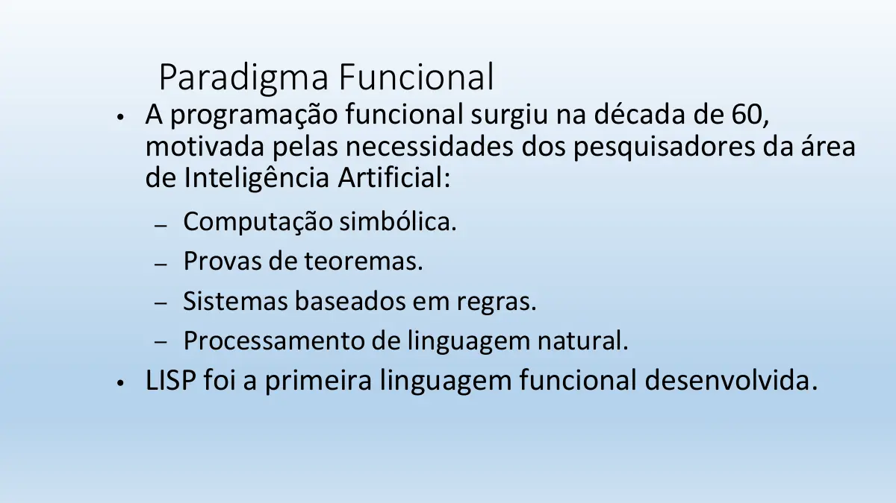

<details>
<summary>Texto da página</summary>

```text
     Paradigma Funcional
●   A programação funcional surgiu na década de 60,
    motivada pelas necessidades dos pesquisadores da área
    de Inteligência Artificial:
    – Computação simbólica.
    – Provas de teoremas.
    – Sistemas baseados em regras.
    – Processamento de linguagem natural.
●   LISP foi a primeira linguagem funcional desenvolvida.
```

</details>

<sub>[↑ voltar ao índice](#aula-14---paradigma-funcional--slides-originais)</sub>

---

### Página 8

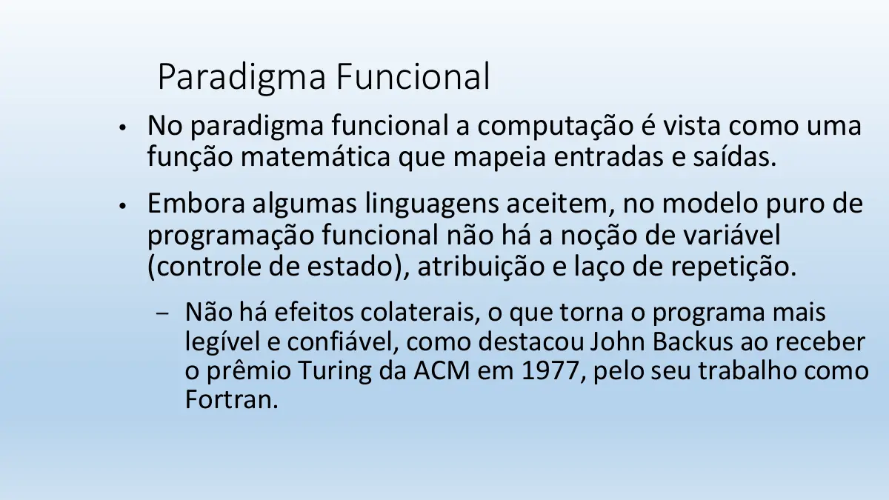

<details>
<summary>Texto da página</summary>

```text
    Paradigma Funcional
●   No paradigma funcional a computação é vista como uma
    função matemática que mapeia entradas e saídas.
●   Embora algumas linguagens aceitem, no modelo puro de
    programação funcional não há a noção de variável
    (controle de estado), atribuição e laço de repetição.
    –   Não há efeitos colaterais, o que torna o programa mais
        legível e confiável, como destacou John Backus ao receber
        o prêmio Turing da ACM em 1977, pelo seu trabalho como
        Fortran.
```

</details>

<sub>[↑ voltar ao índice](#aula-14---paradigma-funcional--slides-originais)</sub>

---

### Página 9

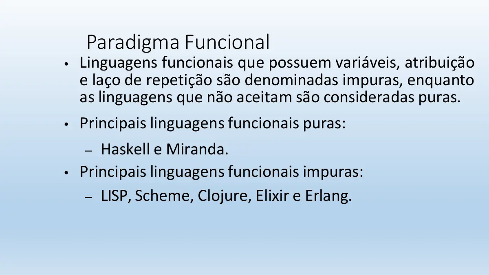

<details>
<summary>Texto da página</summary>

```text
    Paradigma Funcional
●   Linguagens funcionais que possuem variáveis, atribuição
    e laço de repetição são denominadas impuras, enquanto
    as linguagens que não aceitam são consideradas puras.
●   Principais linguagens funcionais puras:
    – Haskell e Miranda.
●   Principais linguagens funcionais impuras:
     – LISP, Scheme, Clojure, Elixir e Erlang.
```

</details>

<sub>[↑ voltar ao índice](#aula-14---paradigma-funcional--slides-originais)</sub>

---

### Página 10

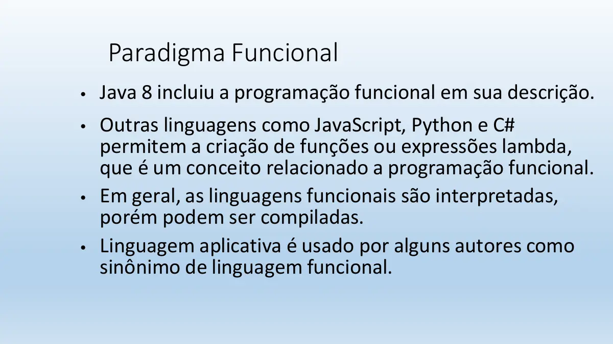

<details>
<summary>Texto da página</summary>

```text
    Paradigma Funcional
●   Java 8 incluiu a programação funcional em sua descrição.
● Outras linguagens como JavaScript, Python e C#
  permitem a criação de funções ou expressões lambda,
  que é um conceito relacionado a programação funcional.
● Em geral, as linguagens funcionais são interpretadas,

  porém podem ser compiladas.
● Linguagem aplicativa é usado por alguns autores como

  sinônimo de linguagem funcional.
```

</details>

<sub>[↑ voltar ao índice](#aula-14---paradigma-funcional--slides-originais)</sub>

---

### Página 11

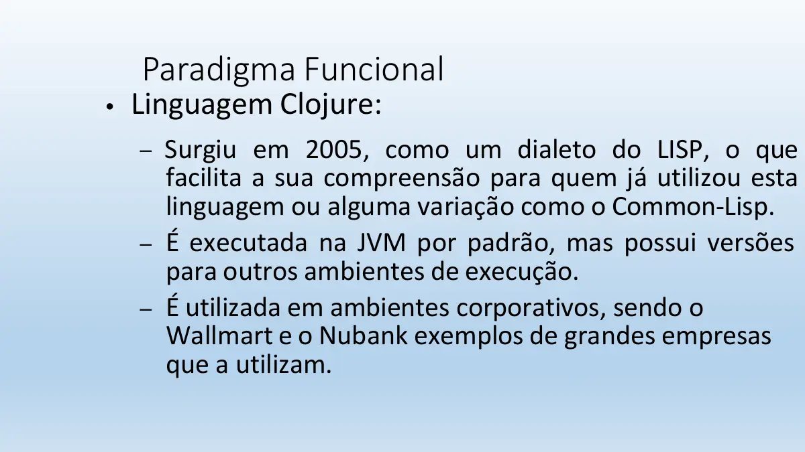

<details>
<summary>Texto da página</summary>

```text
    Paradigma Funcional
●   Linguagem Clojure:
    – Surgiu   em 2005, como um dialeto do LISP, o que
      facilita a sua compreensão para quem já utilizou esta
      linguagem ou alguma variação como o Common-Lisp.
    – É executada na JVM por padrão, mas possui versões
      para outros ambientes de execução.
    – É utilizada em ambientes corporativos, sendo o
      Wallmart e o Nubank exemplos de grandes empresas
      que a utilizam.
```

</details>

<sub>[↑ voltar ao índice](#aula-14---paradigma-funcional--slides-originais)</sub>

---

### Página 12

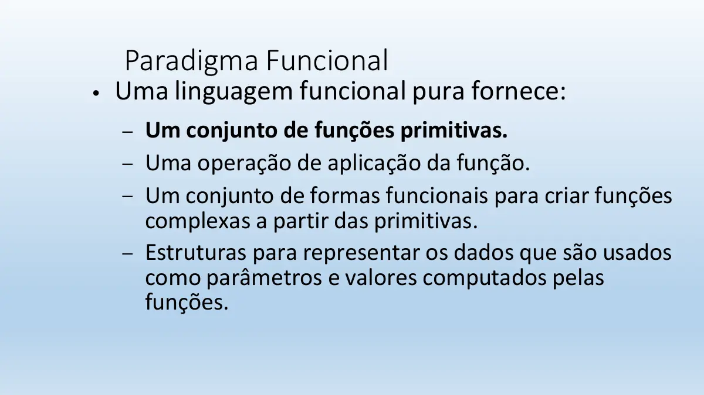

<details>
<summary>Texto da página</summary>

```text
    Paradigma Funcional
●   Uma linguagem funcional pura fornece:
    – Um conjunto de funções primitivas.
    – Uma operação de aplicação da função.
    – Um conjunto de formas funcionais para criar funções
      complexas a partir das primitivas.
    – Estruturas para representar os dados que são usados
      como parâmetros e valores computados pelas
      funções.
```

</details>

<sub>[↑ voltar ao índice](#aula-14---paradigma-funcional--slides-originais)</sub>

---

### Página 13

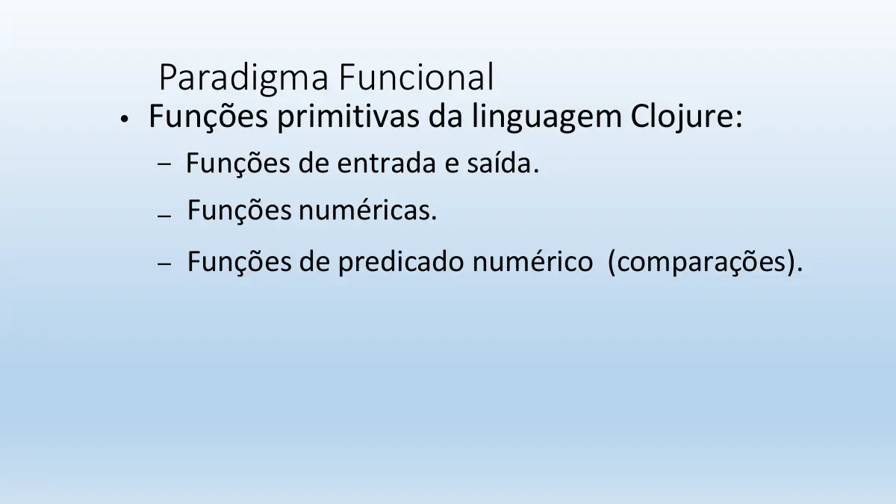

<details>
<summary>Texto da página</summary>

```text
    Paradigma Funcional
●   Funções primitivas da linguagem Clojure:
    – Funções de entrada e saída.

    – Funções numéricas.

    – Funções de predicado numérico (comparações).
```

</details>

<sub>[↑ voltar ao índice](#aula-14---paradigma-funcional--slides-originais)</sub>

---

### Página 14

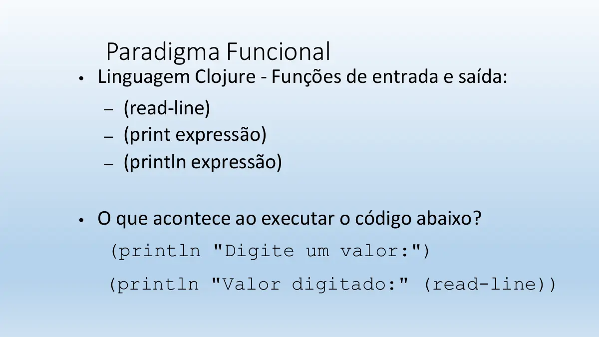

<details>
<summary>Texto da página</summary>

```text
    Paradigma Funcional
●   Linguagem Clojure - Funções de entrada e saída:
    – (read-line)
    – (print expressão)
    – (println expressão)

●   O que acontece ao executar o código abaixo?
     (println "Digite um valor:")
    (println "Valor digitado:" (read-line))
```

</details>

<sub>[↑ voltar ao índice](#aula-14---paradigma-funcional--slides-originais)</sub>

---

### Página 15

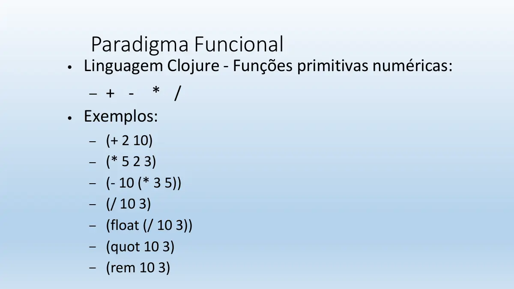

<details>
<summary>Texto da página</summary>

```text
    Paradigma Funcional
●   Linguagem Clojure - Funções primitivas numéricas:
    – +- * /
● Exemplos:

    – (+ 2 10)
    – (* 5 2 3)
    – (- 10 (* 3 5))
    – (/ 10 3)
    – (float (/ 10 3))
    – (quot 10 3)
    – (rem 10 3)
```

</details>

<sub>[↑ voltar ao índice](#aula-14---paradigma-funcional--slides-originais)</sub>

---

### Página 16

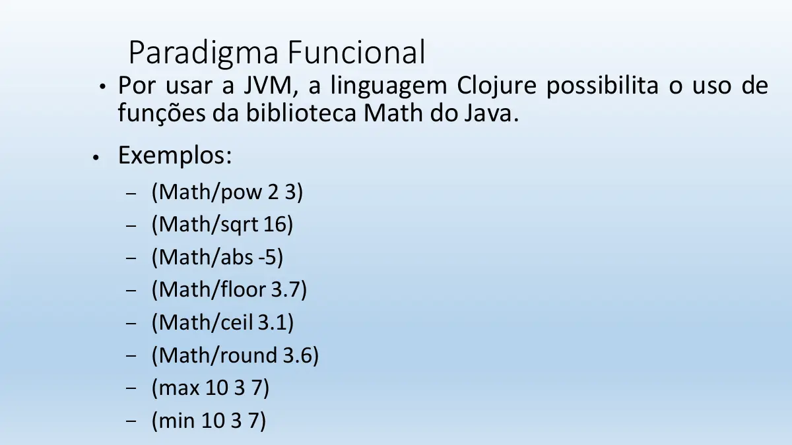

<details>
<summary>Texto da página</summary>

```text
    Paradigma Funcional
●   Por usar a JVM, a linguagem Clojure possibilita o uso de
    funções da biblioteca Math do Java.
●   Exemplos:
    – (Math/pow 2 3)
    – (Math/sqrt 16)
    – (Math/abs -5)
    – (Math/floor 3.7)
    – (Math/ceil 3.1)
    – (Math/round 3.6)
    – (max 10 3 7)
    – (min 10 3 7)
```

</details>

<sub>[↑ voltar ao índice](#aula-14---paradigma-funcional--slides-originais)</sub>

---

### Página 17

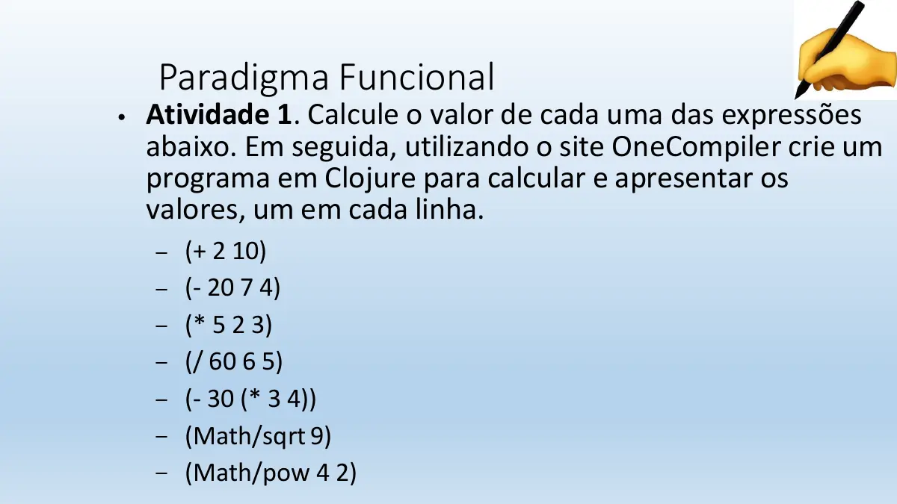

<details>
<summary>Texto da página</summary>

```text
    Paradigma Funcional
●   Atividade 1. Calcule o valor de cada uma das expressões
    abaixo. Em seguida, utilizando o site OneCompiler crie um
    programa em Clojure para calcular e apresentar os
    valores, um em cada linha.
    – (+ 2 10)
    – (- 20 7 4)
    – (* 5 2 3)
    – (/ 60 6 5)
    – (- 30 (* 3 4))
    – (Math/sqrt 9)
    – (Math/pow 4 2)
```

</details>

<sub>[↑ voltar ao índice](#aula-14---paradigma-funcional--slides-originais)</sub>

---

### Página 18

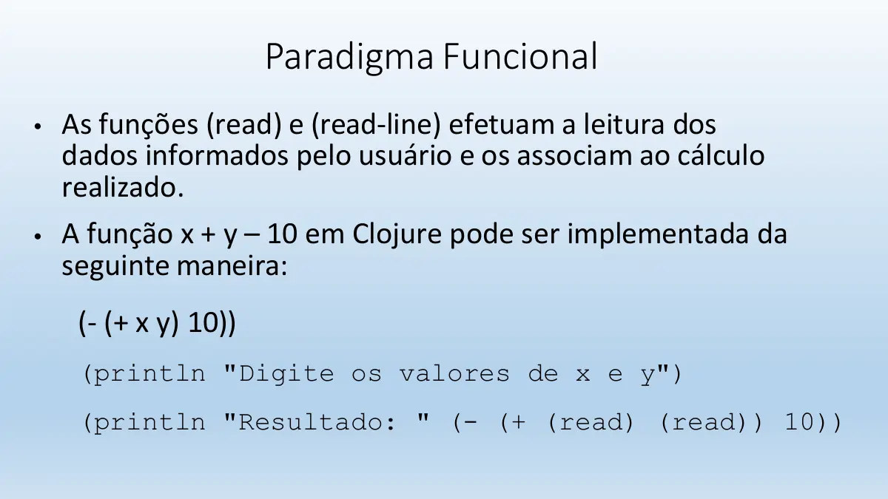

<details>
<summary>Texto da página</summary>

```text
                       Paradigma Funcional
●   As funções (read) e (read-line) efetuam a leitura dos
    dados informados pelo usuário e os associam ao cálculo
    realizado.
●   A função x + y – 10 em Clojure pode ser implementada da
    seguinte maneira:
     (- (+ x y) 10))
     (println "Digite os valores de x e y")
     (println "Resultado: " (- (+ (read) (read)) 10))
```

</details>

<sub>[↑ voltar ao índice](#aula-14---paradigma-funcional--slides-originais)</sub>

---

### Página 19

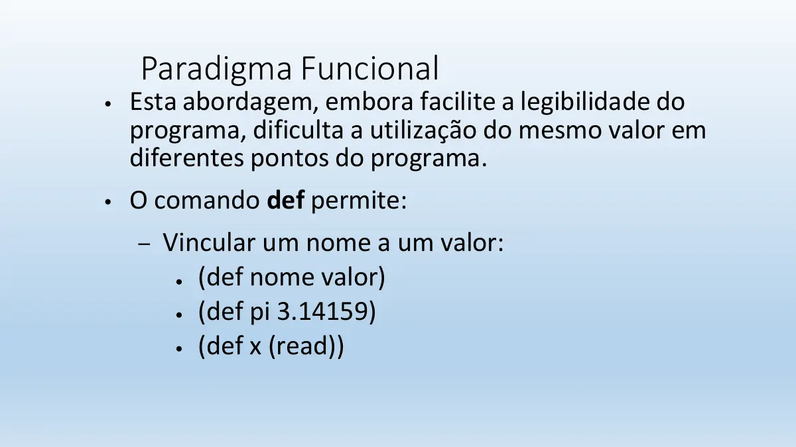

<details>
<summary>Texto da página</summary>

```text
    Paradigma Funcional
●   Esta abordagem, embora facilite a legibilidade do
    programa, dificulta a utilização do mesmo valor em
    diferentes pontos do programa.
●   O comando def permite:
    – Vincular um nome a um valor:
       ● (def nome valor)
       ● (def pi 3.14159)

       ● (def x (read))
```

</details>

<sub>[↑ voltar ao índice](#aula-14---paradigma-funcional--slides-originais)</sub>

---

### Página 20

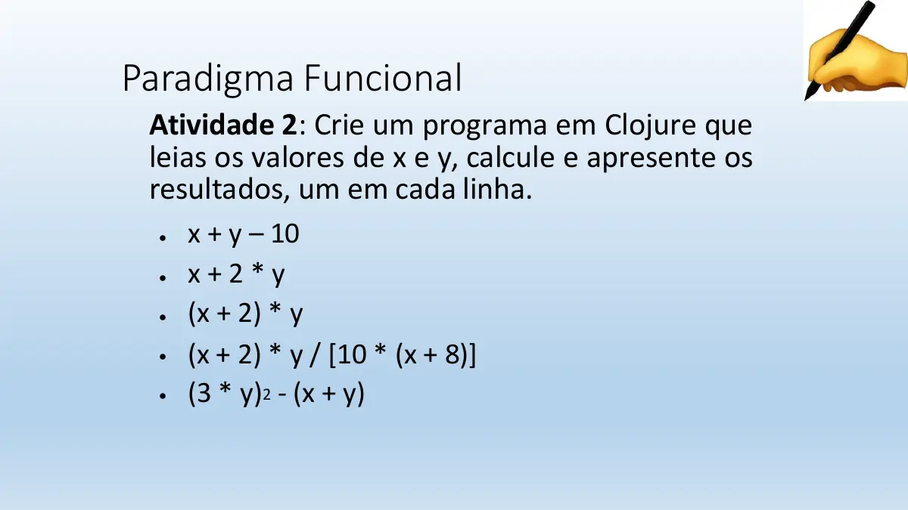

<details>
<summary>Texto da página</summary>

```text
Paradigma Funcional
 Atividade 2: Crie um programa em Clojure que
 leias os valores de x e y, calcule e apresente os
 resultados, um em cada linha.
  ●   x + y – 10
  ●   x+2*y
  ●   (x + 2) * y
  ●   (x + 2) * y / [10 * (x + 8)]
  ●   (3 * y)2 - (x + y)
```

</details>

<sub>[↑ voltar ao índice](#aula-14---paradigma-funcional--slides-originais)</sub>

---

### Página 21

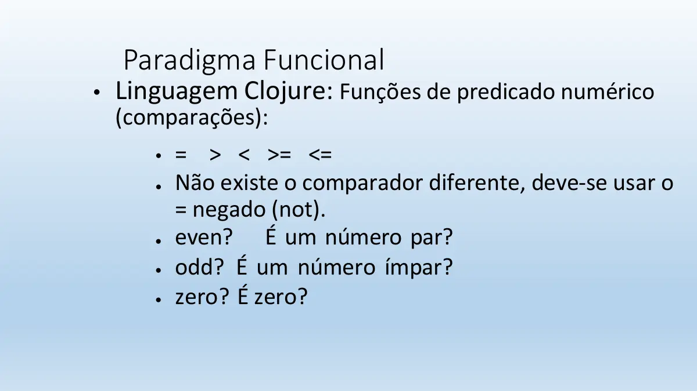

<details>
<summary>Texto da página</summary>

```text
    Paradigma Funcional
●   Linguagem Clojure: Funções de predicado numérico
    (comparações):
       ● = > < >= <=
       ● Não existe o comparador diferente, deve-se usar o

         = negado (not).
       ● even?    É um número par?
       ● odd? É um número ímpar?

       ● zero? É zero?
```

</details>

<sub>[↑ voltar ao índice](#aula-14---paradigma-funcional--slides-originais)</sub>

---

### Página 22

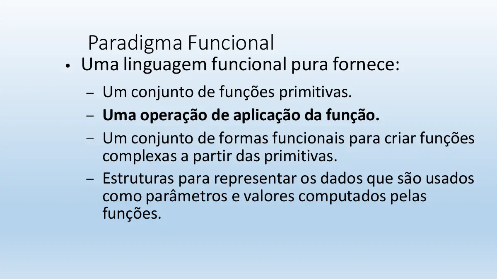

<details>
<summary>Texto da página</summary>

```text
    Paradigma Funcional
●   Uma linguagem funcional pura fornece:
    – Um conjunto de funções primitivas.
    – Uma operação de aplicação da função.
    – Um conjunto de formas funcionais para criar funções
      complexas a partir das primitivas.
    – Estruturas para representar os dados que são usados
      como parâmetros e valores computados pelas
      funções.
```

</details>

<sub>[↑ voltar ao índice](#aula-14---paradigma-funcional--slides-originais)</sub>

---

### Página 23

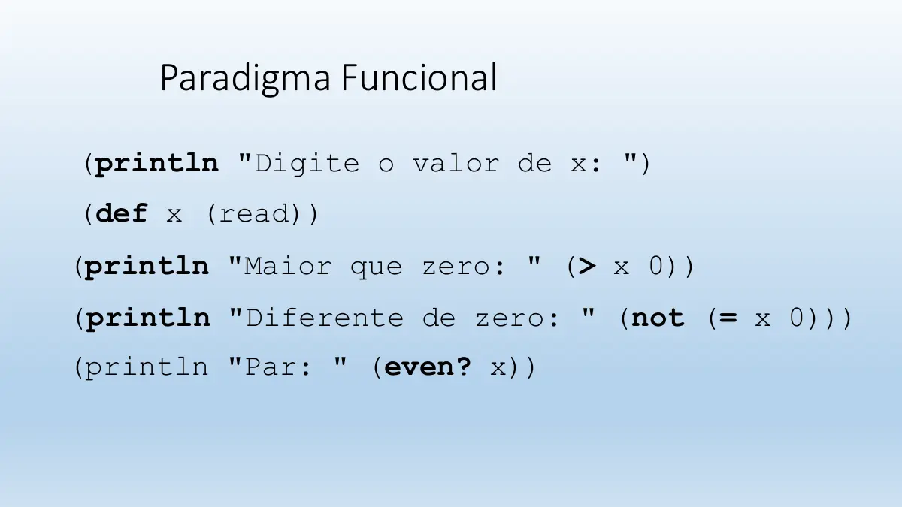

<details>
<summary>Texto da página</summary>

```text
     Paradigma Funcional
(println "Digite o valor de x: ")
(def x (read))
(println "Maior que zero: " (> x 0))
(println "Diferente de zero: " (not (= x 0)))
(println "Par: " (even? x))
```

</details>

<sub>[↑ voltar ao índice](#aula-14---paradigma-funcional--slides-originais)</sub>

---

### Página 24

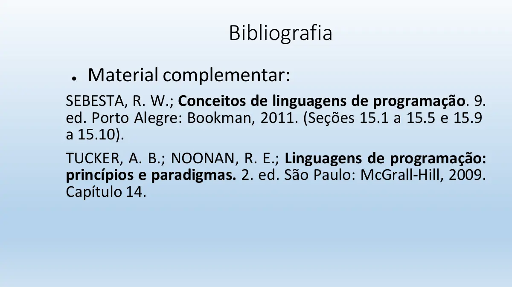

<details>
<summary>Texto da página</summary>

```text
                       Bibliografia
●   Material complementar:
SEBESTA, R. W.; Conceitos de linguagens de programação. 9.
ed. Porto Alegre: Bookman, 2011. (Seções 15.1 a 15.5 e 15.9
a 15.10).
TUCKER, A. B.; NOONAN, R. E.; Linguagens de programação:
princípios e paradigmas. 2. ed. São Paulo: McGrall-Hill, 2009.
Capítulo 14.
```

</details>

<sub>[↑ voltar ao índice](#aula-14---paradigma-funcional--slides-originais)</sub>


<!-- nav:rodape -->

---

**Aula 14:** [Visão geral](../README.md) · **Slides** · [Resumo](../02%20-%20Resumo%20Teórico/resumo-aula-14.md) · [Exercícios](../03%20-%20Exercícios/exercicios-aula-14.md) · [Resoluções](../04%20-%20Resoluções/resolucoes-aula-14.md) · [Complementos](../05%20-%20Materiais%20Complementares/materiais-complementares.md)

← [Aula 13 · Slides](../../Aula%2013%20-%20Paradigma%20Orientado%20a%20Objetos%20II/01%20-%20Slides%20Originais/README.md) · [Aula 15 · Slides](../../Aula%2015%20-%20Paradigma%20Lógico/01%20-%20Slides%20Originais/README.md) →

**Links para esta página (17):** [Acompanhamento de estudo](../../../00%20-%20Planejamento%20e%20Organização/acompanhamento.md) · [Ementa, conteúdo e avaliação](../../../00%20-%20Planejamento%20e%20Organização/ementa.md) · [Aula 01 · Resumo](../../Aula%2001%20-%20Apresentação%20da%20Disciplina/02%20-%20Resumo%20Teórico/resumo-aula-01.md) · [Aula 02 · Resumo](../../Aula%2002%20-%20Evolução%20das%20Linguagens%20e%20Paradigmas/02%20-%20Resumo%20Teórico/resumo-aula-02.md) · [Aula 02 · Exercícios](../../Aula%2002%20-%20Evolução%20das%20Linguagens%20e%20Paradigmas/03%20-%20Exercícios/exercicios-aula-02.md) · [Aula 02 · Resoluções](../../Aula%2002%20-%20Evolução%20das%20Linguagens%20e%20Paradigmas/04%20-%20Resoluções/resolucoes-aula-02.md) · [Aula 09 · Resumo](../../Aula%2009%20-%20Paradigma%20Imperativo%20I/02%20-%20Resumo%20Teórico/resumo-aula-09.md) · [Aula 14 · Resumo](../02%20-%20Resumo%20Teórico/resumo-aula-14.md) · [Aula 14 · Exercícios](../03%20-%20Exercícios/exercicios-aula-14.md) · [Aula 14 · Resoluções](../04%20-%20Resoluções/resolucoes-aula-14.md) · [Aula 14 · Complementos](../05%20-%20Materiais%20Complementares/materiais-complementares.md) · [Lista 01 · Resolução](../../../02%20-%20Listas%20de%20Exercícios/Lista%2001%20-%20Revisão%20I/02%20-%20Resolução/resolucao-lista-01.md) · [Simulado 01 · Resolução comentada](../../../04%20-%20Provas%20e%20Avaliações/Simulados/resolucao-simulado-01.md) · [Simulado 03 · Resolução comentada](../../../04%20-%20Provas%20e%20Avaliações/Simulados/resolucao-simulado-03.md) · [Erratas e inconsistências do material](../../../06%20-%20Revisões%20e%20Sínteses/erratas-e-inconsistencias.md) · [Quadros comparativos](../../../06%20-%20Revisões%20e%20Sínteses/quadros-comparativos.md) · [P4 — Estatísticas de texto em Clojure](../../../09%20-%20Projetos%20Práticos/P4%20-%20Estatísticas%20de%20Texto%20em%20Clojure/README.md)

<!-- /nav:rodape -->
