<!-- nav:topo -->
[Início](../../../README.md) › [01 - Aulas](../../README.md) › [Aula 15](../README.md) › **01 - Slides Originais** · [Mapa](../../../MAPA.md)
<!-- /nav:topo -->

<!-- gerado por ferramentas/geradores/gerar_galerias.py: não edite à mão -->

# Aula 15 - Paradigma Lógico · Slides originais

> **[Material original]** Slides originais do professor, página por página, para ler aqui mesmo no GitHub. O arquivo original é o PDF [`Aula15_Paradigma Lógico.pdf`](Aula15_Paradigma%20L%C3%B3gico.pdf) (25 páginas): use-o para baixar ou imprimir. As imagens e o texto de cada página foram extraídos do PDF, sem alteração do conteúdo.

**Ir para a página:** [1](#página-1) · [2](#página-2) · [3](#página-3) · [4](#página-4) · [5](#página-5) · [6](#página-6) · [7](#página-7) · [8](#página-8) · [9](#página-9) · [10](#página-10) · [11](#página-11) · [12](#página-12) · [13](#página-13) · [14](#página-14) · [15](#página-15) · [16](#página-16) · [17](#página-17) · [18](#página-18) · [19](#página-19) · [20](#página-20) · [21](#página-21) · [22](#página-22) · [23](#página-23) · [24](#página-24) · [25](#página-25)

O texto de cada página fica em **Texto da página**, logo abaixo da imagem: é por ele que a busca encontra o conteúdo dos slides.

---

### Página 1

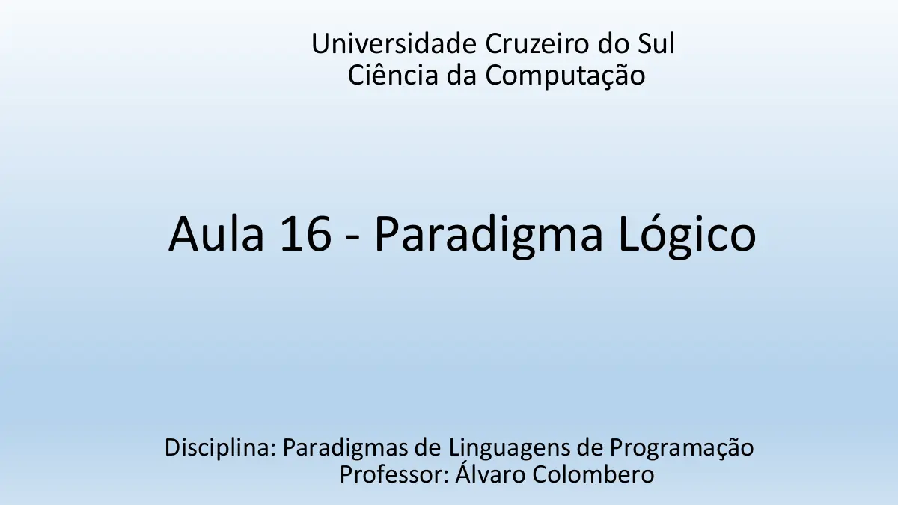

<details>
<summary>Texto da página</summary>

```text
            Universidade Cruzeiro do Sul
              Ciência da Computação

Aula 16 - Paradigma Lógico

Disciplina: Paradigmas de Linguagens de Programação
                 Professor: Álvaro Colombero
```

</details>

<sub>[↑ voltar ao índice](#aula-15---paradigma-lógico--slides-originais)</sub>

---

### Página 2

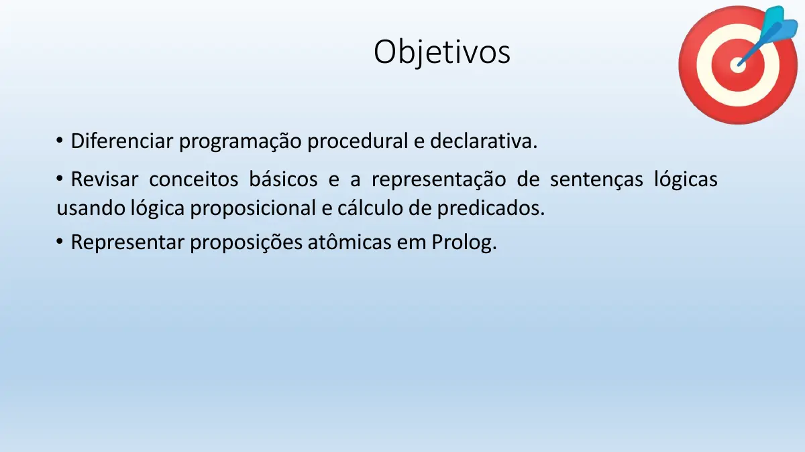

<details>
<summary>Texto da página</summary>

```text
                                 Objetivos

• Diferenciar programação procedural e declarativa.
• Revisar conceitos básicos e a representação de sentenças lógicas
usando lógica proposicional e cálculo de predicados.
• Representar proposições atômicas em Prolog.
```

</details>

<sub>[↑ voltar ao índice](#aula-15---paradigma-lógico--slides-originais)</sub>

---

### Página 3

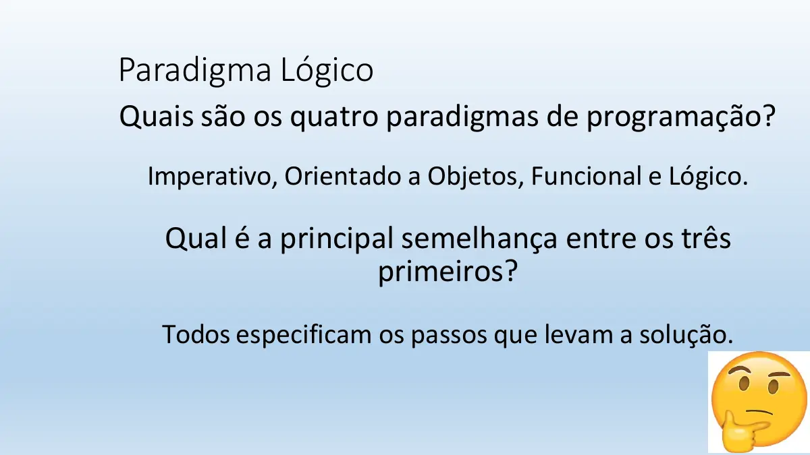

<details>
<summary>Texto da página</summary>

```text
Paradigma Lógico
Quais são os quatro paradigmas de programação?
 Imperativo, Orientado a Objetos, Funcional e Lógico.

   Qual é a principal semelhança entre os três
                   primeiros?
  Todos especificam os passos que levam a solução.
```

</details>

<sub>[↑ voltar ao índice](#aula-15---paradigma-lógico--slides-originais)</sub>

---

### Página 4

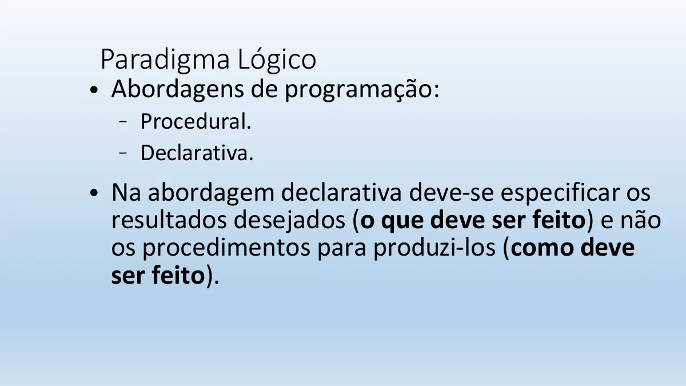

<details>
<summary>Texto da página</summary>

```text
    Paradigma Lógico
●   Abordagens de programação:
     – Procedural.
     – Declarativa.

●   Na abordagem declarativa deve-se especificar os
    resultados desejados (o que deve ser feito) e não
    os procedimentos para produzi-los (como deve
    ser feito).
```

</details>

<sub>[↑ voltar ao índice](#aula-15---paradigma-lógico--slides-originais)</sub>

---

### Página 5

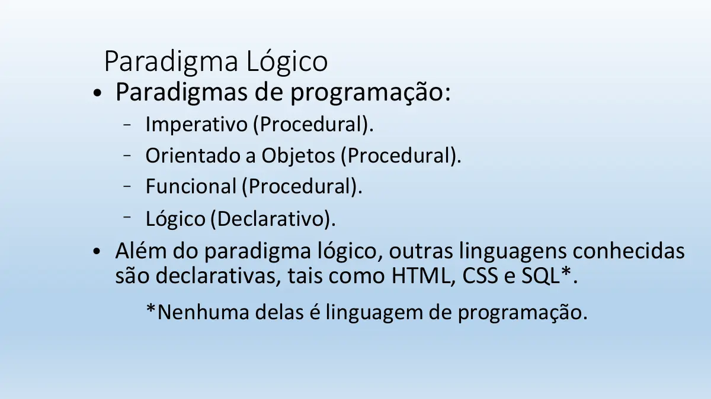

<details>
<summary>Texto da página</summary>

```text
    Paradigma Lógico
●   Paradigmas de programação:
     – Imperativo (Procedural).
     – Orientado a Objetos (Procedural).
     – Funcional (Procedural).
     – Lógico (Declarativo).
●   Além do paradigma lógico, outras linguagens conhecidas
    são declarativas, tais como HTML, CSS e SQL*.
         *Nenhuma delas é linguagem de programação.
```

</details>

<sub>[↑ voltar ao índice](#aula-15---paradigma-lógico--slides-originais)</sub>

---

### Página 6

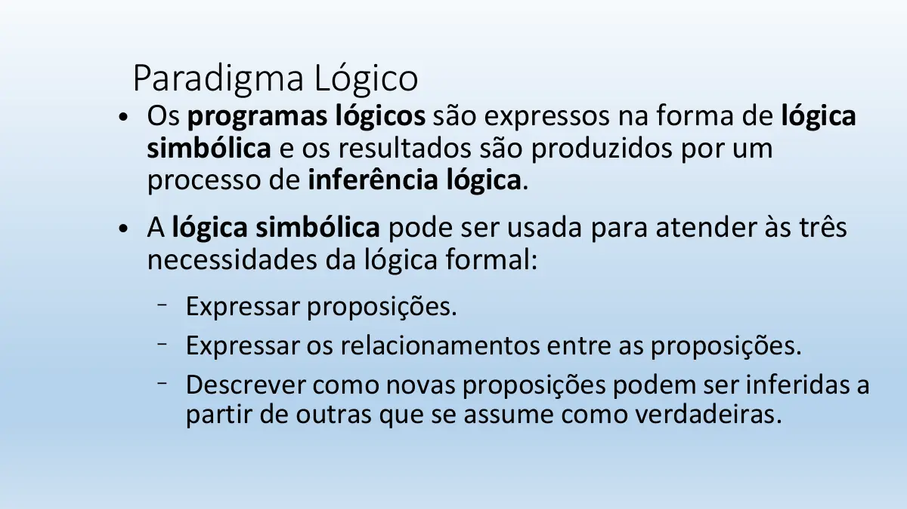

<details>
<summary>Texto da página</summary>

```text
    Paradigma Lógico
●   Os programas lógicos são expressos na forma de lógica
    simbólica e os resultados são produzidos por um
    processo de inferência lógica.
●   A lógica simbólica pode ser usada para atender às três
    necessidades da lógica formal:
     – Expressar proposições.
     – Expressar os relacionamentos entre as proposições.
     – Descrever como novas proposições podem ser inferidas a
       partir de outras que se assume como verdadeiras.
```

</details>

<sub>[↑ voltar ao índice](#aula-15---paradigma-lógico--slides-originais)</sub>

---

### Página 7

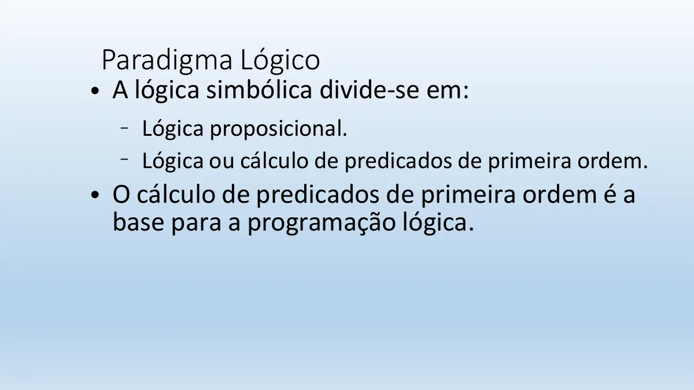

<details>
<summary>Texto da página</summary>

```text
    Paradigma Lógico
●   A lógica simbólica divide-se em:
     – Lógica proposicional.
     – Lógica ou cálculo de predicados de primeira ordem.
●   O cálculo de predicados de primeira ordem é a
    base para a programação lógica.
```

</details>

<sub>[↑ voltar ao índice](#aula-15---paradigma-lógico--slides-originais)</sub>

---

### Página 8

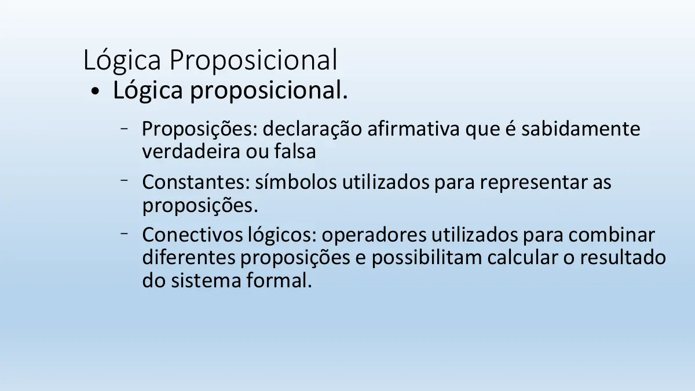

<details>
<summary>Texto da página</summary>

```text
Lógica Proposicional
●   Lógica proposicional.
    – Proposições: declaração afirmativa que é sabidamente
      verdadeira ou falsa
    – Constantes: símbolos utilizados para representar as
      proposições.
    – Conectivos lógicos: operadores utilizados para combinar
      diferentes proposições e possibilitam calcular o resultado
      do sistema formal.
```

</details>

<sub>[↑ voltar ao índice](#aula-15---paradigma-lógico--slides-originais)</sub>

---

### Página 9

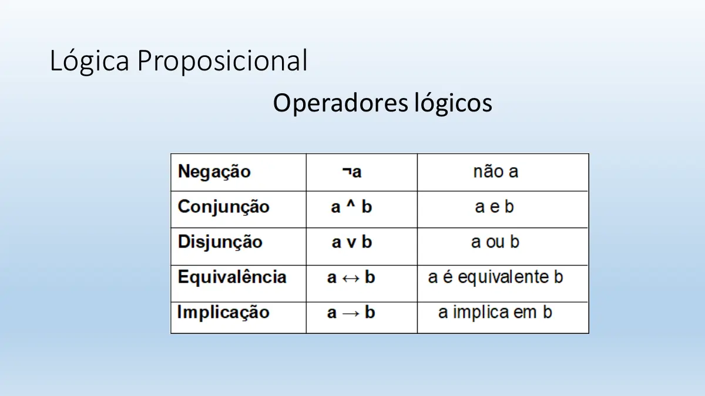

<details>
<summary>Texto da página</summary>

```text
Lógica Proposicional
                 Operadores lógicos
```

</details>

<sub>[↑ voltar ao índice](#aula-15---paradigma-lógico--slides-originais)</sub>

---

### Página 10

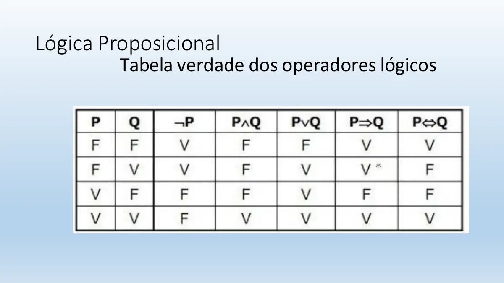

<details>
<summary>Texto da página</summary>

```text
Lógica Proposicional
         Tabela verdade dos operadores lógicos
```

</details>

<sub>[↑ voltar ao índice](#aula-15---paradigma-lógico--slides-originais)</sub>

---

### Página 11

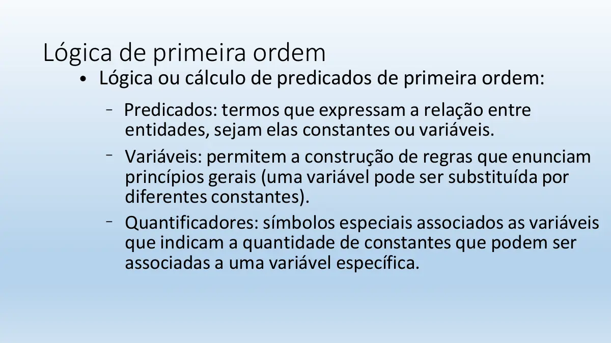

<details>
<summary>Texto da página</summary>

```text
Lógica de primeira ordem
   ●   Lógica ou cálculo de predicados de primeira ordem:
       – Predicados: termos que expressam a relação entre
         entidades, sejam elas constantes ou variáveis.
       – Variáveis: permitem a construção de regras que enunciam
         princípios gerais (uma variável pode ser substituída por
         diferentes constantes).
       – Quantificadores: símbolos especiais associados as variáveis
         que indicam a quantidade de constantes que podem ser
         associadas a uma variável específica.
```

</details>

<sub>[↑ voltar ao índice](#aula-15---paradigma-lógico--slides-originais)</sub>

---

### Página 12

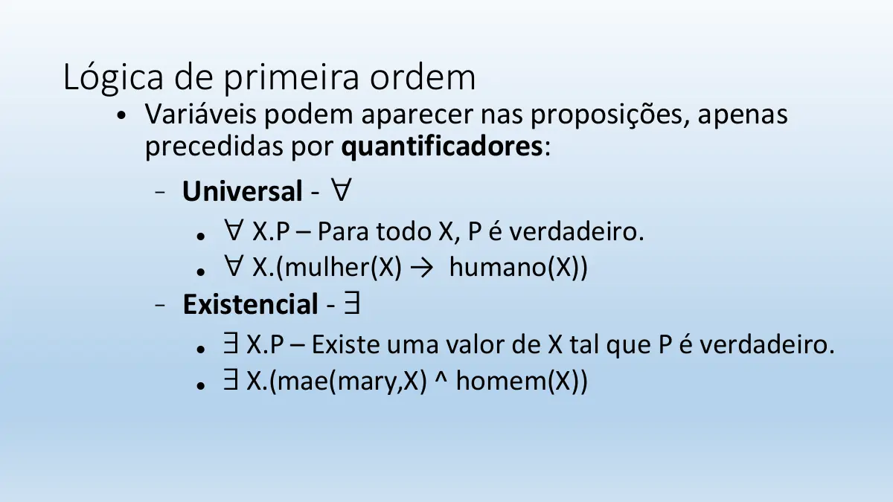

<details>
<summary>Texto da página</summary>

```text
Lógica de primeira ordem
   ●   Variáveis podem aparecer nas proposições, apenas
       precedidas por quantificadores:
        – Universal - ∀
            ● ∀ X.P – Para todo X, P é verdadeiro.
            ● ∀ X.(mulher(X) → humano(X))

       –   Existencial - ∃
            ● ∃ X.P – Existe uma valor de X tal que P é verdadeiro.
            ● ∃ X.(mae(mary,X) ^ homem(X))
```

</details>

<sub>[↑ voltar ao índice](#aula-15---paradigma-lógico--slides-originais)</sub>

---

### Página 13

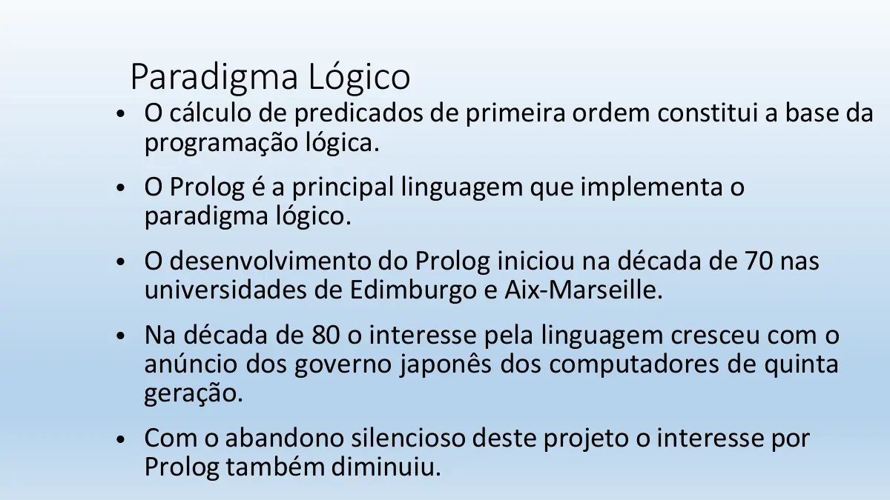

<details>
<summary>Texto da página</summary>

```text
    Paradigma Lógico
●   O cálculo de predicados de primeira ordem constitui a base da
    programação lógica.
●   O Prolog é a principal linguagem que implementa o
    paradigma lógico.
●   O desenvolvimento do Prolog iniciou na década de 70 nas
    universidades de Edimburgo e Aix-Marseille.
●   Na década de 80 o interesse pela linguagem cresceu com o
    anúncio dos governo japonês dos computadores de quinta
    geração.
●   Com o abandono silencioso deste projeto o interesse por
    Prolog também diminuiu.
```

</details>

<sub>[↑ voltar ao índice](#aula-15---paradigma-lógico--slides-originais)</sub>

---

### Página 14

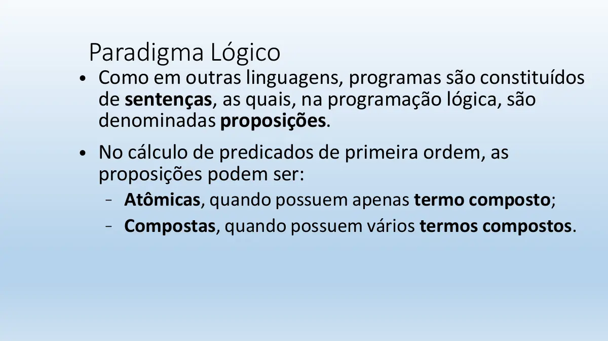

<details>
<summary>Texto da página</summary>

```text
    Paradigma Lógico
●   Como em outras linguagens, programas são constituídos
    de sentenças, as quais, na programação lógica, são
    denominadas proposições.
●   No cálculo de predicados de primeira ordem, as
    proposições podem ser:
     – Atômicas, quando possuem apenas termo composto;
     – Compostas, quando possuem vários termos compostos.
```

</details>

<sub>[↑ voltar ao índice](#aula-15---paradigma-lógico--slides-originais)</sub>

---

### Página 15

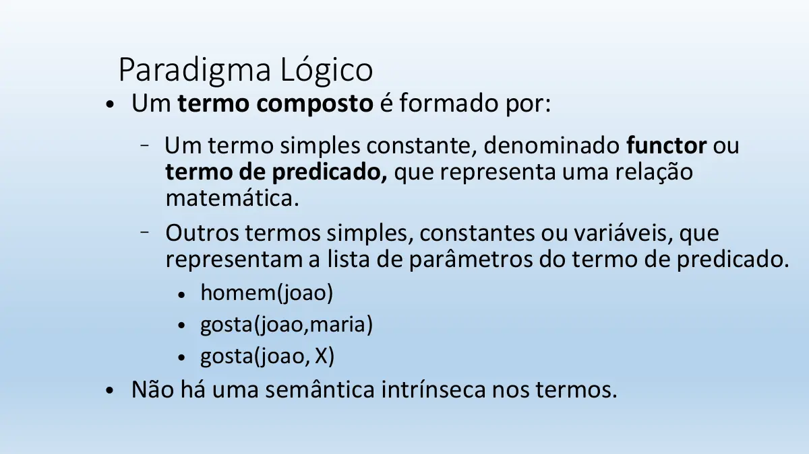

<details>
<summary>Texto da página</summary>

```text
    Paradigma Lógico
●   Um termo composto é formado por:
     – Um termo simples constante, denominado functor ou
       termo de predicado, que representa uma relação
       matemática.
     – Outros termos simples, constantes ou variáveis, que
       representam a lista de parâmetros do termo de predicado.
         ● homem(joao)
         ● gosta(joao,maria)

         ● gosta(joao, X)

●   Não há uma semântica intrínseca nos termos.
```

</details>

<sub>[↑ voltar ao índice](#aula-15---paradigma-lógico--slides-originais)</sub>

---

### Página 16

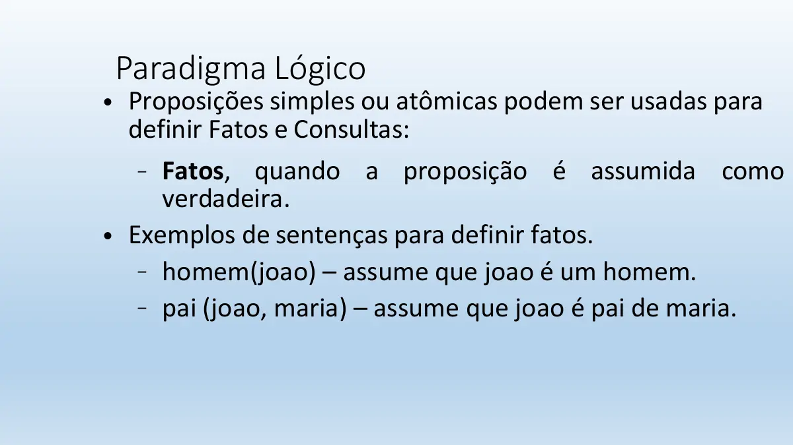

<details>
<summary>Texto da página</summary>

```text
    Paradigma Lógico
●   Proposições simples ou atômicas podem ser usadas para
    definir Fatos e Consultas:
     –
     Fatos, quando a proposição é assumida como
     verdadeira.
● Exemplos de sentenças para definir fatos.

   – homem(joao) – assume que joao é um homem.
   – pai (joao, maria) – assume que joao é pai de maria.
```

</details>

<sub>[↑ voltar ao índice](#aula-15---paradigma-lógico--slides-originais)</sub>

---

### Página 17

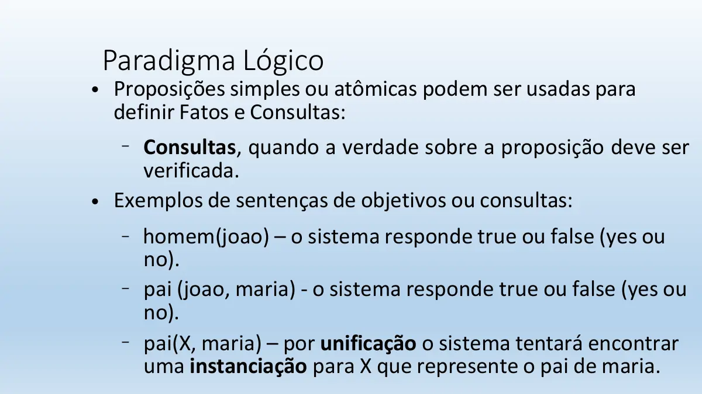

<details>
<summary>Texto da página</summary>

```text
    Paradigma Lógico
●   Proposições simples ou atômicas podem ser usadas para
    definir Fatos e Consultas:
     –
     Consultas, quando a verdade sobre a proposição deve ser
     verificada.
● Exemplos de sentenças de objetivos ou consultas:

     – homem(joao) – o sistema responde true ou false (yes ou
       no).
     – pai (joao, maria) - o sistema responde true ou false (yes ou
       no).
     – pai(X, maria) – por unificação o sistema tentará encontrar
       uma instanciação para X que represente o pai de maria.
```

</details>

<sub>[↑ voltar ao índice](#aula-15---paradigma-lógico--slides-originais)</sub>

---

### Página 18

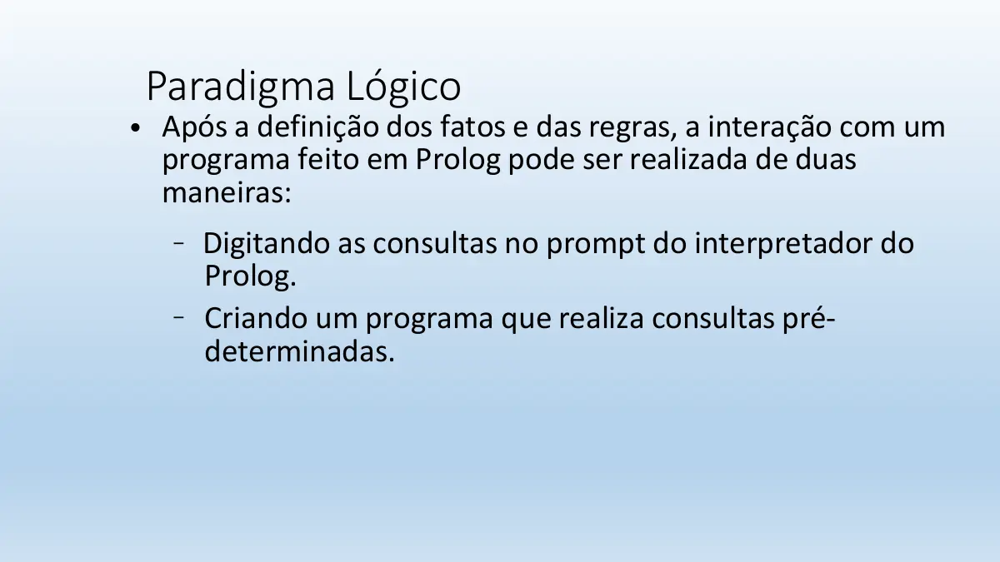

<details>
<summary>Texto da página</summary>

```text
    Paradigma Lógico
●   Após a definição dos fatos e das regras, a interação com um
    programa feito em Prolog pode ser realizada de duas
    maneiras:
     – Digitando as consultas no prompt do interpretador do
       Prolog.
     – Criando um programa que realiza consultas pré-
       determinadas.
```

</details>

<sub>[↑ voltar ao índice](#aula-15---paradigma-lógico--slides-originais)</sub>

---

### Página 19

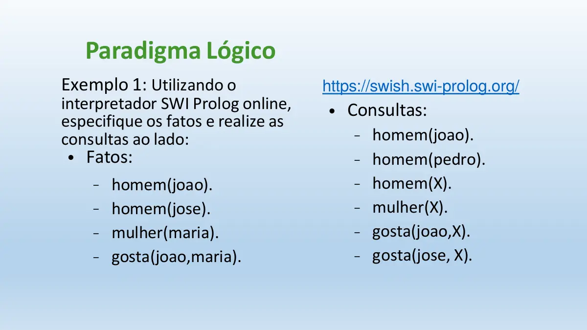

<details>
<summary>Texto da página</summary>

```text
    Paradigma Lógico
Exemplo 1: Utilizando o             https://swish.swi-prolog.org/
interpretador SWI Prolog online,    ●   Consultas:
especifique os fatos e realize as
consultas ao lado:                      – homem(joao).
●   Fatos:                              – homem(pedro).
    – homem(joao).                      – homem(X).
    – homem(jose).                      – mulher(X).
    – mulher(maria).                    – gosta(joao,X).
    – gosta(joao,maria).                – gosta(jose, X).
```

</details>

<sub>[↑ voltar ao índice](#aula-15---paradigma-lógico--slides-originais)</sub>

---

### Página 20

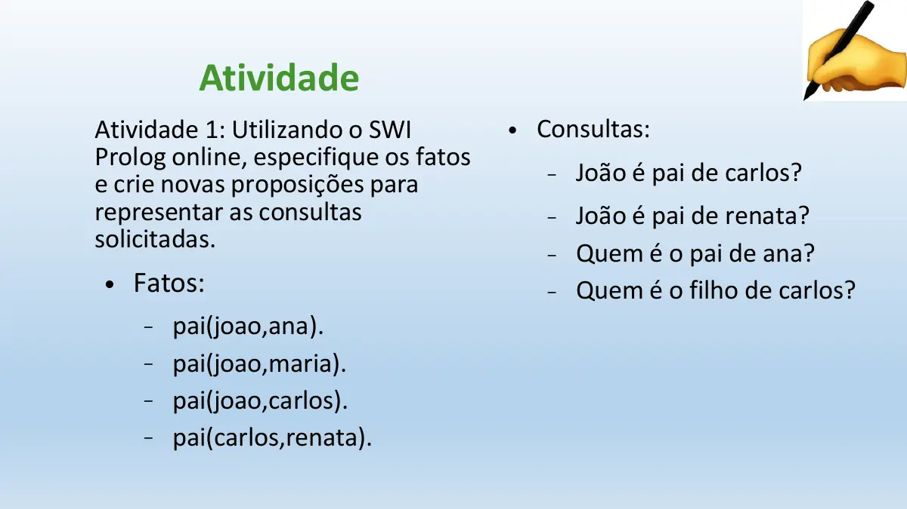

<details>
<summary>Texto da página</summary>

```text
         Atividade
Atividade 1: Utilizando o SWI         ●   Consultas:
Prolog online, especifique os fatos
                                          –   João é pai de carlos?
e crie novas proposições para
representar as consultas                  – João é pai de renata?
solicitadas.
                                          – Quem é o pai de ana?
●   Fatos:                                – Quem é o filho de carlos?
    – pai(joao,ana).
    – pai(joao,maria).
    – pai(joao,carlos).
    – pai(carlos,renata).
```

</details>

<sub>[↑ voltar ao índice](#aula-15---paradigma-lógico--slides-originais)</sub>

---

### Página 21

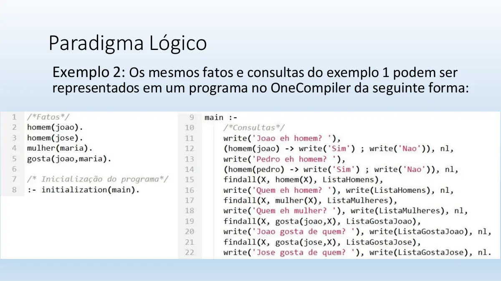

<details>
<summary>Texto da página</summary>

```text
Paradigma Lógico
Exemplo 2: Os mesmos fatos e consultas do exemplo 1 podem ser
representados em um programa no OneCompiler da seguinte forma:
```

</details>

<sub>[↑ voltar ao índice](#aula-15---paradigma-lógico--slides-originais)</sub>

---

### Página 22

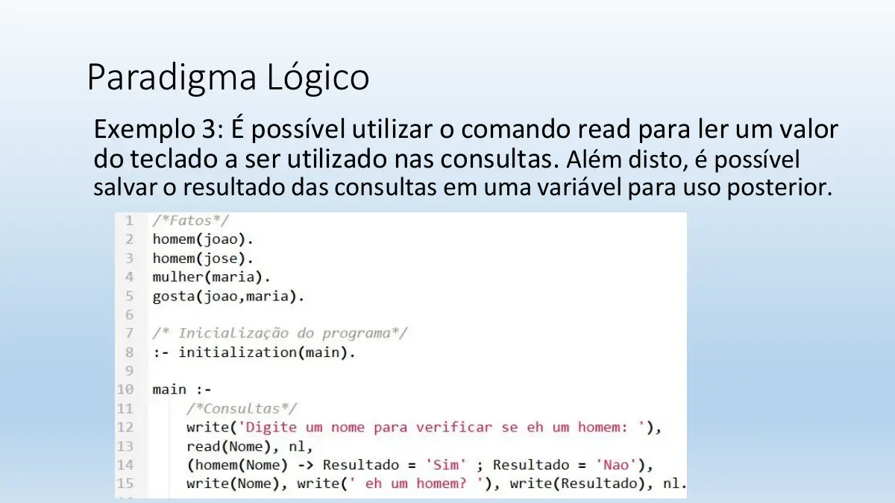

<details>
<summary>Texto da página</summary>

```text
Paradigma Lógico
Exemplo 3: É possível utilizar o comando read para ler um valor
do teclado a ser utilizado nas consultas. Além disto, é possível
salvar o resultado das consultas em uma variável para uso posterior.
```

</details>

<sub>[↑ voltar ao índice](#aula-15---paradigma-lógico--slides-originais)</sub>

---

### Página 23

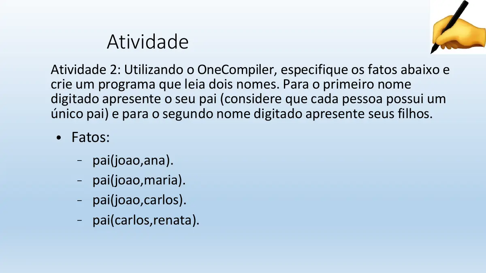

<details>
<summary>Texto da página</summary>

```text
         Atividade
Atividade 2: Utilizando o OneCompiler, especifique os fatos abaixo e
crie um programa que leia dois nomes. Para o primeiro nome
digitado apresente o seu pai (considere que cada pessoa possui um
único pai) e para o segundo nome digitado apresente seus filhos.
●   Fatos:
    – pai(joao,ana).
    – pai(joao,maria).
    – pai(joao,carlos).
    – pai(carlos,renata).
```

</details>

<sub>[↑ voltar ao índice](#aula-15---paradigma-lógico--slides-originais)</sub>

---

### Página 24

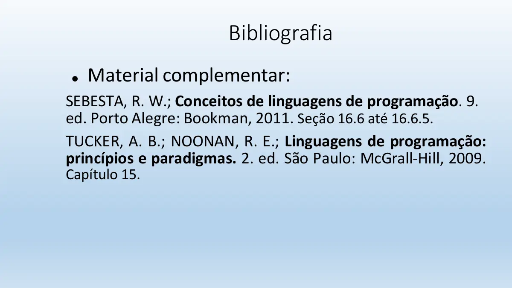

<details>
<summary>Texto da página</summary>

```text
                       Bibliografia
●   Material complementar:
SEBESTA, R. W.; Conceitos de linguagens de programação. 9.
ed. Porto Alegre: Bookman, 2011. Seção 16.6 até 16.6.5.
TUCKER, A. B.; NOONAN, R. E.; Linguagens de programação:
princípios e paradigmas. 2. ed. São Paulo: McGrall-Hill, 2009.
Capítulo 15.
```

</details>

<sub>[↑ voltar ao índice](#aula-15---paradigma-lógico--slides-originais)</sub>

---

### Página 25

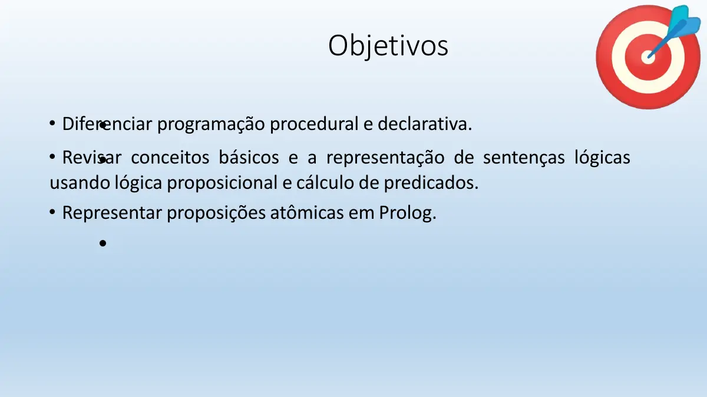

<details>
<summary>Texto da página</summary>

```text
                                 Objetivos

• Diferenciar
       ●      programação procedural e declarativa.
• Revisar
      ●   conceitos básicos e a representação de sentenças lógicas
usando lógica proposicional e cálculo de predicados.
• Representar proposições atômicas em Prolog.
     ●
```

</details>

<sub>[↑ voltar ao índice](#aula-15---paradigma-lógico--slides-originais)</sub>


<!-- nav:rodape -->

---

**Aula 15:** [Visão geral](../README.md) · **Slides** · [Resumo](../02%20-%20Resumo%20Teórico/resumo-aula-15.md) · [Exercícios](../03%20-%20Exercícios/exercicios-aula-15.md) · [Resoluções](../04%20-%20Resoluções/resolucoes-aula-15.md) · [Complementos](../05%20-%20Materiais%20Complementares/materiais-complementares.md)

← [Aula 14 · Slides](../../Aula%2014%20-%20Paradigma%20Funcional/01%20-%20Slides%20Originais/README.md)

**Links para esta página (18):** [Acompanhamento de estudo](../../../00%20-%20Planejamento%20e%20Organização/acompanhamento.md) · [Ementa, conteúdo e avaliação](../../../00%20-%20Planejamento%20e%20Organização/ementa.md) · [Aula 01 · Resumo](../../Aula%2001%20-%20Apresentação%20da%20Disciplina/02%20-%20Resumo%20Teórico/resumo-aula-01.md) · [Aula 09 · Resumo](../../Aula%2009%20-%20Paradigma%20Imperativo%20I/02%20-%20Resumo%20Teórico/resumo-aula-09.md) · [Aula 14 · Resumo](../../Aula%2014%20-%20Paradigma%20Funcional/02%20-%20Resumo%20Teórico/resumo-aula-14.md) · [Aula 15 · Resumo](../02%20-%20Resumo%20Teórico/resumo-aula-15.md) · [Aula 15 · Exercícios](../03%20-%20Exercícios/exercicios-aula-15.md) · [Aula 15 · Resoluções](../04%20-%20Resoluções/resolucoes-aula-15.md) · [Aula 15 · Complementos](../05%20-%20Materiais%20Complementares/materiais-complementares.md) · [Lista 01 · Resolução](../../../02%20-%20Listas%20de%20Exercícios/Lista%2001%20-%20Revisão%20I/02%20-%20Resolução/resolucao-lista-01.md) · [Lista 02 · Resolução](../../../02%20-%20Listas%20de%20Exercícios/Lista%2002%20-%20Revisão%20II/02%20-%20Resolução/resolucao-lista-02.md) · [Simulado 03 · Resolução comentada](../../../04%20-%20Provas%20e%20Avaliações/Simulados/resolucao-simulado-03.md) · [Revisão da Unidade 4 — Paradigmas funcional e lógico (Aulas…](../../../06%20-%20Revisões%20e%20Sínteses/Revisões%20por%20Unidade/unidade-4-funcional-e-logico.md) · [Erratas e inconsistências do material](../../../06%20-%20Revisões%20e%20Sínteses/erratas-e-inconsistencias.md) · [Mapas conceituais](../../../06%20-%20Revisões%20e%20Sínteses/mapas-conceituais.md) · [Quadros comparativos](../../../06%20-%20Revisões%20e%20Sínteses/quadros-comparativos.md) · [Glossário](../../../07%20-%20Glossário/glossario.md) · [P6 — Situação acadêmica em quatro paradigmas](../../../09%20-%20Projetos%20Práticos/P6%20-%20Situação%20Acadêmica%20em%20Quatro%20Paradigmas/README.md)

<!-- /nav:rodape -->
