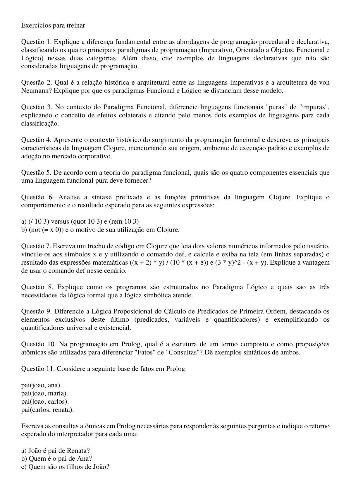

<!-- nav:topo -->
[Início](../../../README.md) › [02 - Listas de Exercícios](../../README.md) › [Lista 01](../README.md) › **01 - Enunciado Original** · [Mapa](../../../MAPA.md)
<!-- /nav:topo -->

<!-- gerado por ferramentas/geradores/gerar_galerias.py: não edite à mão -->

# Lista 01 - Revisão I · Enunciado original

> **[Material original]** Enunciado original do professor, página por página, para ler aqui mesmo no GitHub. O arquivo original é o PDF [`Aula16a_ExRevisao1.pdf`](Aula16a_ExRevisao1.pdf) (2 páginas): use-o para baixar ou imprimir. As imagens e o texto de cada página foram extraídos do PDF, sem alteração do conteúdo.

**Ir para a página:** [1](#página-1) · [2](#página-2)

O texto de cada página fica em **Texto da página**, logo abaixo da imagem: é por ele que a busca encontra o conteúdo dos slides.

---

### Página 1



<details>
<summary>Texto da página</summary>

```text
Exercícios para treinar

Questão 1. Explique a diferença fundamental entre as abordagens de programação procedural e declarativa,
classificando os quatro principais paradigmas de programação (Imperativo, Orientado a Objetos, Funcional e
Lógico) nessas duas categorias. Além disso, cite exemplos de linguagens declarativas que não são
consideradas linguagens de programação.

Questão 2. Qual é a relação histórica e arquitetural entre as linguagens imperativas e a arquitetura de von
Neumann? Explique por que os paradigmas Funcional e Lógico se distanciam desse modelo.

Questão 3. No contexto do Paradigma Funcional, diferencie linguagens funcionais "puras" de "impuras",
explicando o conceito de efeitos colaterais e citando pelo menos dois exemplos de linguagens para cada
classificação.

Questão 4. Apresente o contexto histórico do surgimento da programação funcional e descreva as principais
características da linguagem Clojure, mencionando sua origem, ambiente de execução padrão e exemplos de
adoção no mercado corporativo.

Questão 5. De acordo com a teoria do paradigma funcional, quais são os quatro componentes essenciais que
uma linguagem funcional pura deve fornecer?

Questão 6. Analise a sintaxe prefixada e as funções primitivas da linguagem Clojure. Explique o
comportamento e o resultado esperado para as seguintes expressões:

a) (/ 10 3) versus (quot 10 3) e (rem 10 3)
b) (not (= x 0)) e o motivo de sua utilização em Clojure.

Questão 7. Escreva um trecho de código em Clojure que leia dois valores numéricos informados pelo usuário,
vincule-os aos símbolos x e y utilizando o comando def, e calcule e exiba na tela (em linhas separadas) o
resultado das expressões matemáticas ((x + 2) * y) / (10 * (x + 8)) e (3 * y)^2 - (x + y). Explique a vantagem
de usar o comando def nesse cenário.

Questão 8. Explique como os programas são estruturados no Paradigma Lógico e quais são as três
necessidades da lógica formal que a lógica simbólica atende.

Questão 9. Diferencie a Lógica Proposicional do Cálculo de Predicados de Primeira Ordem, destacando os
elementos exclusivos deste último (predicados, variáveis e quantificadores) e exemplificando os
quantificadores universal e existencial.

Questão 10. Na programação em Prolog, qual é a estrutura de um termo composto e como proposições
atômicas são utilizadas para diferenciar "Fatos" de "Consultas"? Dê exemplos sintáticos de ambos.

Questão 11. Considere a seguinte base de fatos em Prolog:

pai(joao, ana).
pai(joao, maria).
pai(joao, carlos).
pai(carlos, renata).

Escreva as consultas atômicas em Prolog necessárias para responder às seguintes perguntas e indique o retorno
esperado do interpretador para cada uma:

a) João é pai de Renata?
b) Quem é o pai de Ana?
c) Quem são os filhos de João?
```

</details>

<sub>[↑ voltar ao índice](#lista-01---revisão-i--enunciado-original)</sub>

---

### Página 2


*Página sem texto extraível (só imagem).*

<sub>[↑ voltar ao índice](#lista-01---revisão-i--enunciado-original)</sub>


<!-- nav:rodape -->

---

[Lista 02 · Enunciado](../../Lista%2002%20-%20Revisão%20II/01%20-%20Enunciado%20Original/README.md) →

<!-- /nav:rodape -->
