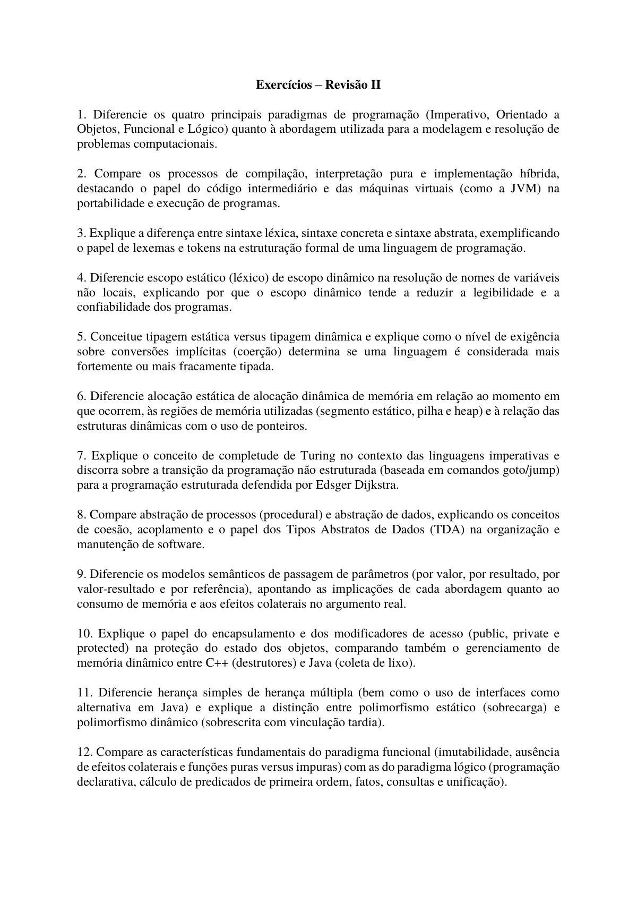

<!-- nav:topo -->
[Início](../../../README.md) › [02 - Listas de Exercícios](../../README.md) › [Lista 02](../README.md) › **01 - Enunciado Original** · [Mapa](../../../MAPA.md)
<!-- /nav:topo -->

<!-- gerado por ferramentas/geradores/gerar_galerias.py: não edite à mão -->

# Lista 02 - Revisão II · Enunciado original

> **[Material original]** Enunciado original do professor, página por página, para ler aqui mesmo no GitHub. O arquivo original é o PDF [`Aula16b_ExRevisao2.pdf`](Aula16b_ExRevisao2.pdf) (1 páginas): use-o para baixar ou imprimir. As imagens e o texto de cada página foram extraídos do PDF, sem alteração do conteúdo.

**Ir para a página:** [1](#página-1)

O texto de cada página fica em **Texto da página**, logo abaixo da imagem: é por ele que a busca encontra o conteúdo dos slides.

---

### Página 1



<details>
<summary>Texto da página</summary>

```text
                                   Exercícios – Revisão II

1. Diferencie os quatro principais paradigmas de programação (Imperativo, Orientado a
Objetos, Funcional e Lógico) quanto à abordagem utilizada para a modelagem e resolução de
problemas computacionais.

2. Compare os processos de compilação, interpretação pura e implementação híbrida,
destacando o papel do código intermediário e das máquinas virtuais (como a JVM) na
portabilidade e execução de programas.

3. Explique a diferença entre sintaxe léxica, sintaxe concreta e sintaxe abstrata, exemplificando
o papel de lexemas e tokens na estruturação formal de uma linguagem de programação.

4. Diferencie escopo estático (léxico) de escopo dinâmico na resolução de nomes de variáveis
não locais, explicando por que o escopo dinâmico tende a reduzir a legibilidade e a
confiabilidade dos programas.

5. Conceitue tipagem estática versus tipagem dinâmica e explique como o nível de exigência
sobre conversões implícitas (coerção) determina se uma linguagem é considerada mais
fortemente ou mais fracamente tipada.

6. Diferencie alocação estática de alocação dinâmica de memória em relação ao momento em
que ocorrem, às regiões de memória utilizadas (segmento estático, pilha e heap) e à relação das
estruturas dinâmicas com o uso de ponteiros.

7. Explique o conceito de completude de Turing no contexto das linguagens imperativas e
discorra sobre a transição da programação não estruturada (baseada em comandos goto/jump)
para a programação estruturada defendida por Edsger Dijkstra.

8. Compare abstração de processos (procedural) e abstração de dados, explicando os conceitos
de coesão, acoplamento e o papel dos Tipos Abstratos de Dados (TDA) na organização e
manutenção de software.

9. Diferencie os modelos semânticos de passagem de parâmetros (por valor, por resultado, por
valor-resultado e por referência), apontando as implicações de cada abordagem quanto ao
consumo de memória e aos efeitos colaterais no argumento real.

10. Explique o papel do encapsulamento e dos modificadores de acesso (public, private e
protected) na proteção do estado dos objetos, comparando também o gerenciamento de
memória dinâmico entre C++ (destrutores) e Java (coleta de lixo).

11. Diferencie herança simples de herança múltipla (bem como o uso de interfaces como
alternativa em Java) e explique a distinção entre polimorfismo estático (sobrecarga) e
polimorfismo dinâmico (sobrescrita com vinculação tardia).

12. Compare as características fundamentais do paradigma funcional (imutabilidade, ausência
de efeitos colaterais e funções puras versus impuras) com as do paradigma lógico (programação
declarativa, cálculo de predicados de primeira ordem, fatos, consultas e unificação).
```

</details>

<sub>[↑ voltar ao índice](#lista-02---revisão-ii--enunciado-original)</sub>


<!-- nav:rodape -->

---

← [Lista 01 · Enunciado](../../Lista%2001%20-%20Revisão%20I/01%20-%20Enunciado%20Original/README.md)

<!-- /nav:rodape -->
