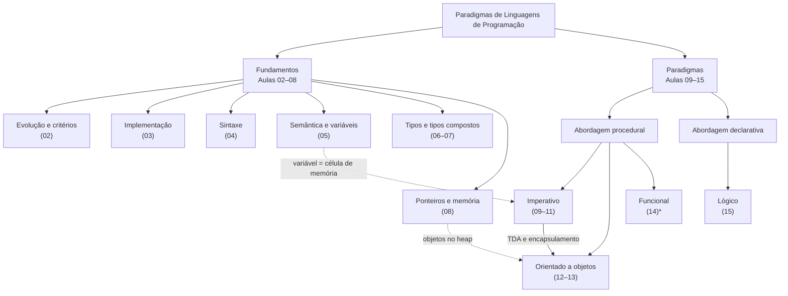
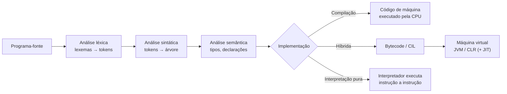
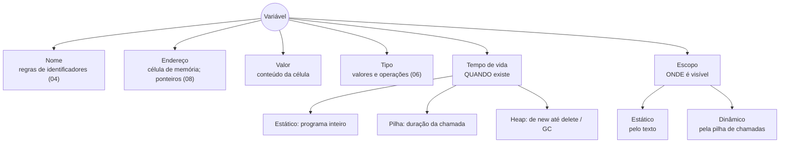
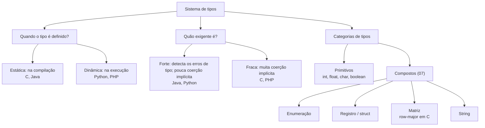
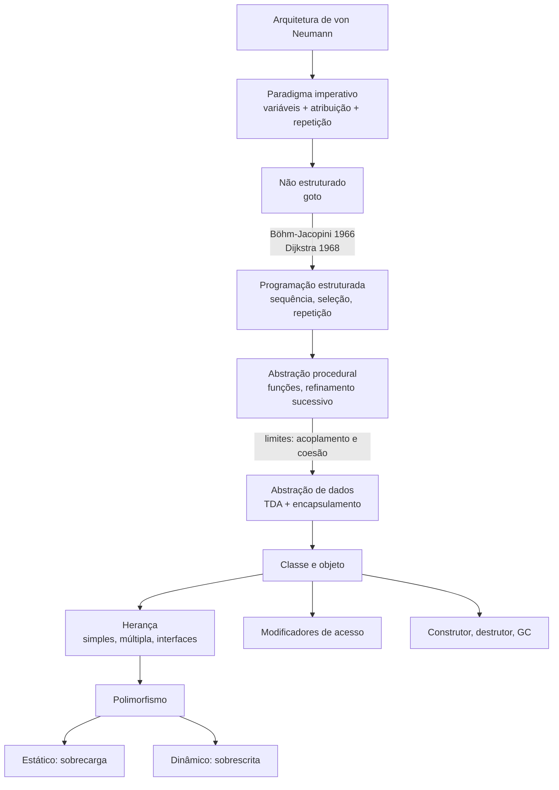
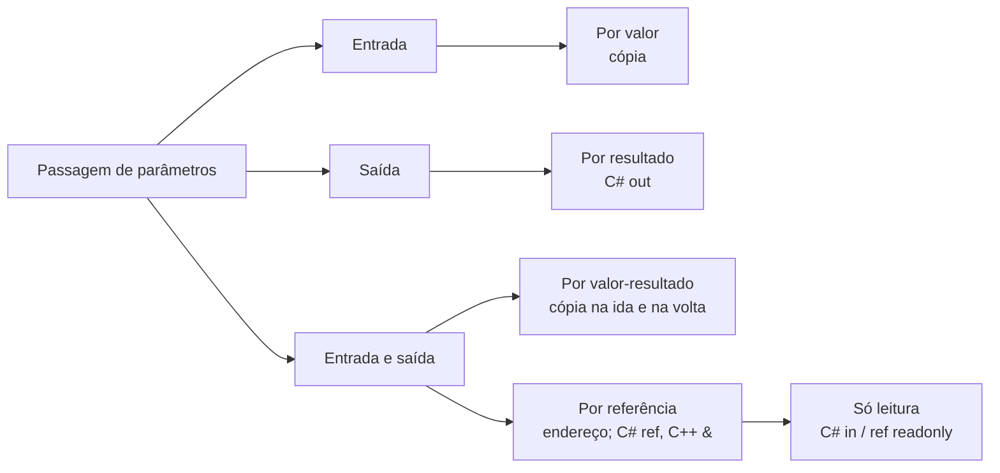
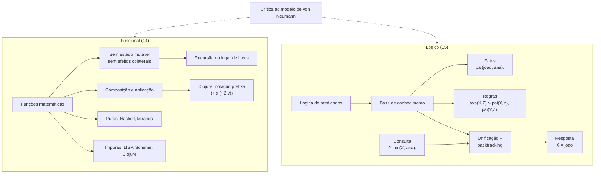

# Mapas conceituais

> **[Explicação elaborada]** Mapas em [Mermaid](https://mermaid.js.org/), renderizados automaticamente pelo GitHub. Cada mapa resume as relações entre os conceitos de uma parte da disciplina; os detalhes estão nos resumos das aulas indicadas. Legenda: [Convenções](../README.md#convenções-de-marcação).

## Sumário

1. [Mapa geral da disciplina](#1-mapa-geral-da-disciplina)
2. [Da linguagem à execução](#2-da-linguagem-à-execução-aulas-0304)
3. [A variável e seus atributos](#3-a-variável-e-seus-atributos-aulas-0508)
4. [Sistemas de tipos](#4-sistemas-de-tipos-aulas-0607)
5. [Do imperativo à orientação a objetos](#5-do-imperativo-à-orientação-a-objetos-aulas-0913)
6. [Passagem de parâmetros](#6-passagem-de-parâmetros-aulas-08-e-11)
7. [Paradigmas funcional e lógico](#7-paradigmas-funcional-e-lógico-aulas-1415)

---

## 1. Mapa geral da disciplina

\* Classificação do professor (Aula15 p.3–5). Boa parte da literatura classifica o funcional como declarativo.

## 2. Da linguagem à execução (Aulas 03–04)

## 3. A variável e seus atributos (Aulas 05–08)

## 4. Sistemas de tipos (Aulas 06–07)

## 5. Do imperativo à orientação a objetos (Aulas 09–13)

## 6. Passagem de parâmetros (Aulas 08 e 11)

## 7. Paradigmas funcional e lógico (Aulas 14–15)

