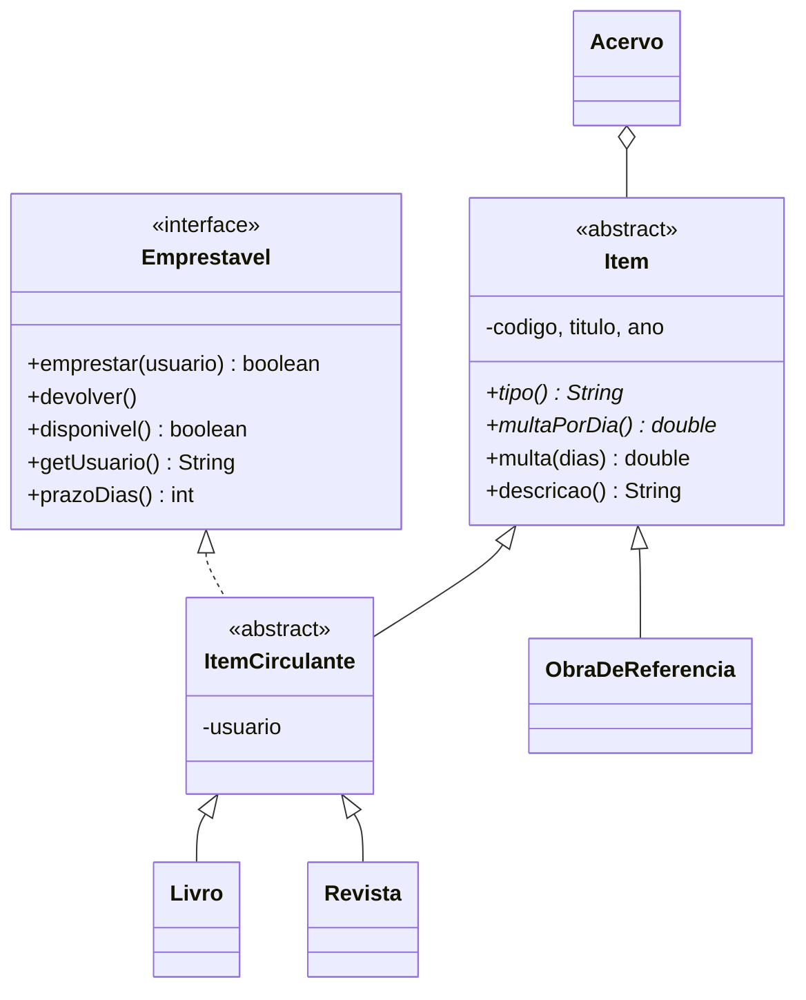

<!-- nav:topo -->
[Início](../../README.md) › [09 - Projetos Práticos](../README.md) › **P3** · [Mapa](../../MAPA.md)
<!-- /nav:topo -->

# P3 — Acervo da biblioteca em Java

> **[Exercício autoral]** Projeto prático elaborado para este repositório. **Não é trabalho do professor** e não vale nota. A pasta `solucao/` é uma **[Resolução elaborada]**, não gabarito oficial.

| | |
| --- | --- |
| **Linguagem** | Java 17 ou mais recente |
| **Aulas** | 12 (classes, encapsulamento, TDA), 13 (herança, classe abstrata, interface, polimorfismo, sobrecarga × sobrescrita) |
| **Duração sugerida** | 3 horas |
| **Testes** | 25 grupos de verificação em `testes/TestesAcervo.java` (sem bibliotecas externas) |

## Objetivo

Modelar o acervo de uma biblioteca com uma pequena hierarquia de classes. O projeto exercita, num só programa, cada conceito de orientação a objetos que as Listas e os simulados pedem para **diferenciar**: classe abstrata × interface, herança × implementação, sobrecarga × sobrescrita, vinculação estática × dinâmica.



## Conceitos da disciplina aplicados

| Conceito | Onde aparece | Resumo |
| --- | --- | --- |
| Encapsulamento, atributos `private`, construtor | `Item`, `ItemCirculante` | [Aula 12](../../01%20-%20Aulas/Aula%2012%20-%20Paradigma%20Orientado%20a%20Objetos%20I/02%20-%20Resumo%20Teórico/resumo-aula-12.md) |
| Classe abstrata e método abstrato | `Item.tipo()`, `Item.multaPorDia()` | [Aula 13](../../01%20-%20Aulas/Aula%2013%20-%20Paradigma%20Orientado%20a%20Objetos%20II/02%20-%20Resumo%20Teórico/resumo-aula-13.md) |
| Interface como contrato (e herança múltipla de tipo) | `Emprestavel` | [Aula 13](../../01%20-%20Aulas/Aula%2013%20-%20Paradigma%20Orientado%20a%20Objetos%20II/02%20-%20Resumo%20Teórico/resumo-aula-13.md) |
| Sobrescrita e `super` | `descricao()` em `Livro` e `Revista` | [Aula 13](../../01%20-%20Aulas/Aula%2013%20-%20Paradigma%20Orientado%20a%20Objetos%20II/02%20-%20Resumo%20Teórico/resumo-aula-13.md) |
| Sobrecarga | `Acervo.buscar(String)` × `Acervo.buscar(int)` | [Aula 13](../../01%20-%20Aulas/Aula%2013%20-%20Paradigma%20Orientado%20a%20Objetos%20II/02%20-%20Resumo%20Teórico/resumo-aula-13.md) |
| Polimorfismo e vinculação dinâmica | `Item.multa()` chama `multaPorDia()` | [Aula 13](../../01%20-%20Aulas/Aula%2013%20-%20Paradigma%20Orientado%20a%20Objetos%20II/02%20-%20Resumo%20Teórico/resumo-aula-13.md) |

## Requisitos

- **R1.** Hierarquia do diagrama: `Item` abstrata; `ItemCirculante` abstrata, filha de `Item`, implementa `Emprestavel`; `Livro` e `Revista` filhas de `ItemCirculante`; `ObraDeReferencia` filha direta de `Item` (não é emprestável).
- **R2.** Todos os atributos de instância são `private`. O construtor de `Item` rejeita código ou título vazios e ano ≤ 0 com `IllegalArgumentException`.
- **R3.** Cada classe concreta define `tipo()`, `multaPorDia()` e, se emprestável, `prazoDias()`:

  | Classe | `tipo()` | Prazo | Multa por dia |
  | --- | --- | :-: | :-: |
  | `Livro` | `Livro` | 14 | 1,00 |
  | `Revista` | `Revista` | 7 | 0,50 |
  | `ObraDeReferencia` | `Referência` | — | 0,00 |

- **R4.** `Item.multa(dias)` é concreta e usa `multaPorDia()`, que é abstrata: **nenhum `if` sobre o tipo**.
- **R5.** `descricao()` devolve `[Tipo] Título (ano)`; `Livro` acrescenta ` — autor` e `Revista`, ` — ed. N`, chamando `super.descricao()`.
- **R6.** Empréstimo: `emprestar` devolve `false` se o item já está emprestado ou se o usuário é vazio; `devolver` libera.
- **R7.** `Acervo.adicionar` rejeita código repetido.
- **R8.** Buscas: por código, por **ano** (sobrecarga de `buscar`) e por trecho do título, sem diferenciar maiúsculas.
- **R9.** `Acervo.emprestar` só empresta itens que são `Emprestavel` (use `instanceof`).
- **R10.** `Acervo.multa` e `Acervo.relatorio` funcionam para qualquer `Item`, inclusive tipos que venham a ser criados depois.

## Como testar

```bash
python3 ferramentas/testar_projetos.py P3                       # compila inicial/*.java com os testes e executa
cd "09 - Projetos Práticos/P3 - Acervo da Biblioteca em Java/inicial"
javac *.java && java Main                                       # a demonstração
```

## Critérios de autoavaliação

| Critério | Peso |
| --- | :-: |
| Todos os testes passam | 40% |
| Nenhum `instanceof Livro`/`instanceof Revista` no `Acervo`: só `Item` e `Emprestavel` | 20% |
| Atributos privados e validação no construtor | 15% |
| Comentários que apontam, no código, onde há sobrecarga, sobrescrita e vinculação dinâmica | 15% |
| A demonstração (`Main`) mostra os três tipos de item | 10% |

## Extensões

1. **Novo tipo** `DVD` (prazo de 3 dias, multa de 2,00): quantas linhas do `Acervo` precisam mudar? (Resposta esperada: nenhuma.)
2. **Usuário como classe**, com limite de empréstimos simultâneos.
3. **Datas reais** com `java.time.LocalDate`: data de devolução prevista e multa calculada a partir dela.
4. **Versão em C++**: reescreva `Item` com função virtual pura e compare com o exemplo de herança múltipla da Aula 13 ([p.7–9](../../01%20-%20Aulas/Aula%2013%20-%20Paradigma%20Orientado%20a%20Objetos%20II/01%20-%20Slides%20Originais/README.md#página-7)).

## Para refletir

- Por que `ObraDeReferencia` não implementa `Emprestavel`, em vez de implementar e devolver sempre `false`? O que isso tem a ver com o contrato de uma interface?
- `buscar("L1")` e `buscar(2011)`: em que momento o Java escolhe qual método chamar? E em `item.multa(3)`, qual `multaPorDia()` é usada?
- Por que `ItemCirculante` é uma classe abstrata, e não uma interface? (Dica: o atributo `usuario`; ver o [Atenção] sobre interfaces no resumo da Aula 13.)


<!-- nav:rodape -->

---

← [P2 — Estruturas encadeadas em C++: pilha e fila](../P2%20-%20Estruturas%20Encadeadas%20em%20C++/README.md) · [P4 — Estatísticas de texto em Clojure](../P4%20-%20Estatísticas%20de%20Texto%20em%20Clojure/README.md) →

**Links para esta página (1):** [09 — Projetos Práticos](../README.md)

<!-- /nav:rodape -->
