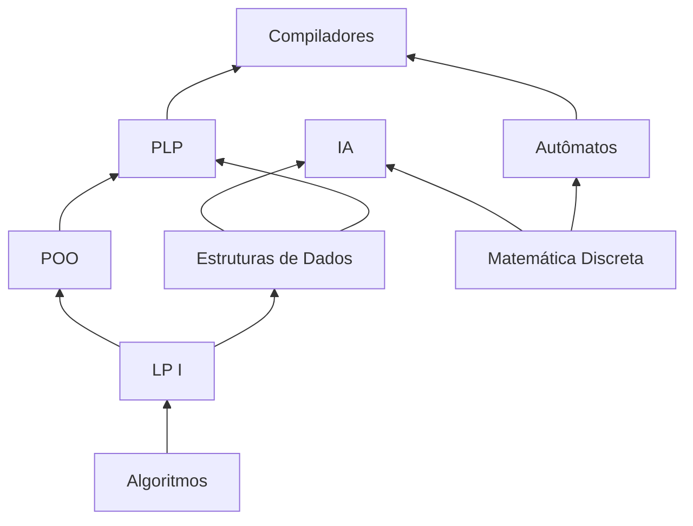

# P5 — Grade curricular em Prolog

> **[Exercício autoral]** Projeto prático elaborado para este repositório. **Não é trabalho do professor** e não vale nota. A pasta `solucao/` é uma **[Resolução elaborada]**, não gabarito oficial. A grade e os alunos são **fictícios**.

| | |
| --- | --- |
| **Linguagem** | Prolog (SWI-Prolog; os testes também rodam no Tau-Prolog) |
| **Aula** | 15 (paradigma lógico) |
| **Duração sugerida** | 2 a 3 horas |
| **Testes** | 38, em `testes/testes.pl` |

## Objetivo

Responder perguntas sobre uma grade curricular — "o que a Ana pode cursar?", "Compiladores depende de Algoritmos?", "quem já se formou?" — escrevendo **regras**, e não algoritmos. Você declara **o que** é verdade, e o mecanismo do Prolog (unificação, busca com retrocesso) encontra as respostas. É a diferença entre "como" e "o quê" que a Aula 15 usa para separar o paradigma lógico dos procedurais.

```prolog
?- disponiveis(ana, L).
L = [ia, poo].

?- cadeia(comp, alg, C).
C = [comp, plp, ed, lp1, alg] ;
C = [comp, plp, poo, lp1, alg].
```



## Conceitos da disciplina aplicados

| Conceito | Onde aparece | Resumo |
| --- | --- | --- |
| Fatos, regras e consultas | `base.pl` × `regras.pl` × testes | [Aula 15](../../01%20-%20Aulas/Aula%2015%20-%20Paradigma%20Lógico/02%20-%20Resumo%20Teórico/resumo-aula-15.md) |
| Conjunção (`,`), variáveis, unificação | todas as regras | [Aula 15](../../01%20-%20Aulas/Aula%2015%20-%20Paradigma%20Lógico/02%20-%20Resumo%20Teórico/resumo-aula-15.md) |
| Recursão (fecho transitivo, listas) | `depende/2`, `cadeia/3`, `soma/2` | [Aula 15](../../01%20-%20Aulas/Aula%2015%20-%20Paradigma%20Lógico/02%20-%20Resumo%20Teórico/resumo-aula-15.md) |
| `findall/3` e `is/2` | `disponiveis/2`, `media/2` | [Aula 15](../../01%20-%20Aulas/Aula%2015%20-%20Paradigma%20Lógico/02%20-%20Resumo%20Teórico/resumo-aula-15.md) |
| Mundo fechado e negação por falha (`\+`) **[Complemento]** | `pode_cursar/2`, `formado/1` | [Resolução da Aula 15](../../01%20-%20Aulas/Aula%2015%20-%20Paradigma%20Lógico/04%20-%20Resoluções/resolucoes-aula-15.md) |
| Declarativo × procedural | comparação com P6 | [Quadros comparativos](../../06%20-%20Revisões%20e%20Sínteses/quadros-comparativos.md) |

## Requisitos

Os fatos (`disciplina/3`, `prerequisito/2`, `aluno/1`, `cursou/3`) estão prontos em `base.pl`. Você escreve, em `regras.pl`:

| | Predicado | Significado |
| --- | --- | --- |
| **R1** | `aprovado(A, D)` | cursou `D` com nota ≥ 6 (basta uma vez) |
| **R2** | `situacao(A, D, S)` | `S` é `aprovado`, `reprovado` ou `pendente`, com **uma** resposta só |
| **R3** | `pode_cursar(A, D)` | ainda não aprovado em `D` e aprovado em **todos** os pré-requisitos |
| **R4** | `disponiveis(A, L)` | lista ordenada do que `A` pode cursar |
| **R5** | `depende(D, P)` | `D` depende de `P`, direta ou indiretamente |
| **R6** | `cadeia(D, P, C)` | `C` é um caminho de pré-requisitos de `D` até `P` |
| **R7** | `liberadas_por(D, L)` | disciplinas que têm `D` como pré-requisito direto |
| **R8** | `soma(L, S)` · `media(A, M)` | soma **recursiva**; média de todas as notas (falha se o aluno não tem notas) |
| **R9** | `reprovacoes(A, N)` | número de vezes que `A` cursou com nota < 6 |
| **R10** | `formado(A)` | aprovado em todas as disciplinas |

## Como testar

```bash
python3 ferramentas/testar_projetos.py P5       # Falhas = [] quando tudo passa
cd "09 - Projetos Práticos/P5 - Grade Curricular em Prolog/inicial"
swipl base.pl regras.pl                         # e então, no prompt:  ?- disponiveis(ana, L).
```

O resultado lista o nome de cada teste que falhou (por exemplo, `r3_ana_pode_poo`); procure-o em `testes/testes.pl` para ver a consulta exata.

## Critérios de autoavaliação

| Critério | Peso |
| --- | :-: |
| Todos os testes passam | 40% |
| Regras declarativas: cada uma lê como uma frase ("A pode cursar D se…") | 20% |
| Recursões com caso base **antes** do caso recursivo e sem laço infinito | 15% |
| Nenhum fato novo em `regras.pl`: as respostas vêm das regras, não de resultados escritos à mão | 15% |
| Comentários que explicam o uso de `\+` e de `findall` | 10% |

## Extensões

1. **Plano de estudos:** `plano(A, Semestres)` que distribui as pendências respeitando os pré-requisitos (uma ordenação topológica).
2. **Ciclos:** acrescente por engano `prerequisito(alg, comp)`. O que acontece com `depende/2`? Como evitar o laço infinito guardando os visitados?
3. **Coeficiente de rendimento:** média ponderada pela carga horária (acrescente a carga a `disciplina/3`).
4. **Versão imperativa:** resolva R3 e R4 em Python ou Java e compare o tamanho e a clareza com a versão em Prolog.

## Para refletir

- Por que `pode_cursar/2` precisa gerar `A` e `D` (com `aluno/1` e `disciplina/3`) **antes** de usar `\+`? O que acontece com `\+ aprovado(A, D)` se `A` estiver livre?
- `\+ aprovado(davi, alg)` é verdadeiro. Isso quer dizer que o Davi foi reprovado? (Mundo fechado.)
- Em `depende/2`, o que muda se a cláusula recursiva vier primeiro? E se a recursão for `depende(D, P) :- depende(D, X), prerequisito(X, P).`?
