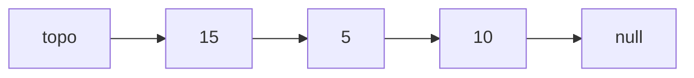

<!-- nav:topo -->
[Início](../README.md) › [10 - Caderno de Anotações](README.md) · [Mapa](../MAPA.md)
<!-- /nav:topo -->

# Exemplo de anotação: pilha encadeada × pilha em vetor

> **Assunto:** TDA e alocação dinâmica · **Aulas:** [Aula 08](../01%20-%20Aulas/Aula%2008%20-%20Ponteiros/02%20-%20Resumo%20Teórico/resumo-aula-08.md) e [Aula 12](../01%20-%20Aulas/Aula%2012%20-%20Paradigma%20Orientado%20a%20Objetos%20I/02%20-%20Resumo%20Teórico/resumo-aula-12.md) · **Data:** 2026-11-21

**[Explicação elaborada]** Nota de demonstração: mostra cada recurso que um caderno no GitHub suporta. Pode ser apagada.

## Ideia principal

A mesma **interface** de pilha (`push`, `pop`, `vazia`) pode ter duas **representações**: um vetor ou uma lista encadeada de nós no heap. Quem usa a pilha não percebe a diferença. É a independência de representação de um TDA (Aula12 [p.17](../01%20-%20Aulas/Aula%2012%20-%20Paradigma%20Orientado%20a%20Objetos%20I/01%20-%20Slides%20Originais/README.md#página-17)).

## Imagem do slide

A figura da Aula12 [p.7](../01%20-%20Aulas/Aula%2012%20-%20Paradigma%20Orientado%20a%20Objetos%20I/01%20-%20Slides%20Originais/README.md#página-7) mostra as operações de empilhar e desempilhar:

<p align="center"><a href="../01%20-%20Aulas/Aula%2012%20-%20Paradigma%20Orientado%20a%20Objetos%20I/01%20-%20Slides%20Originais/README.md#página-7"></a></p>

Para uma foto sua, o caminho seria `imagens/2026-11-21-quadro.jpg` (veja [imagens](imagens/README.md)).

## Comparação

| | Vetor | Lista encadeada |
| --- | --- | --- |
| Memória | um bloco contíguo (`new int[n]`) | um nó por elemento, espalhados pelo heap |
| Crescer | realocar e copiar | só criar outro nó |
| Acesso ao topo | índice `topo` | ponteiro `topo` |

## Diagrama



## Código

```java
class Nodo {
    int valor;
    Nodo proximo;
    Nodo(int valor, Nodo proximo) { this.valor = valor; this.proximo = proximo; }
}
```

> [!TIP]
> O projeto prático [P2](../09%20-%20Projetos%20Práticos/P2%20-%20Estruturas%20Encadeadas%20em%20C++/README.md) implementa as duas versões em C++, com testes.

## Referências

- [Resumo da Aula 08 — alocação dinâmica](../01%20-%20Aulas/Aula%2008%20-%20Ponteiros/02%20-%20Resumo%20Teórico/resumo-aula-08.md)
- [Quadros comparativos](../06%20-%20Revisões%20e%20Sínteses/quadros-comparativos.md)
- [Pilha (Wikipédia)](https://pt.wikipedia.org/wiki/Pilha_%28inform%C3%A1tica%29)


<!-- nav:rodape -->

---

**Links para esta página (1):** [10 - Caderno de Anotações](README.md)

<!-- /nav:rodape -->
